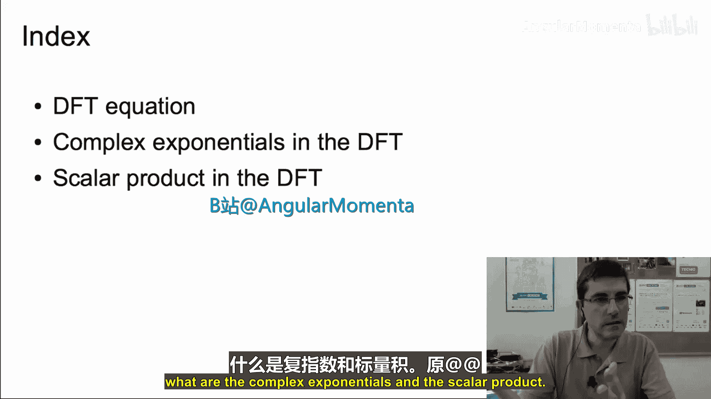
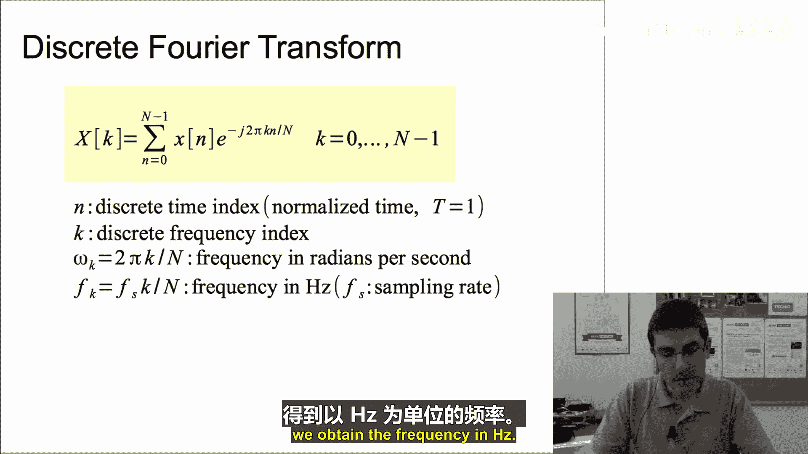
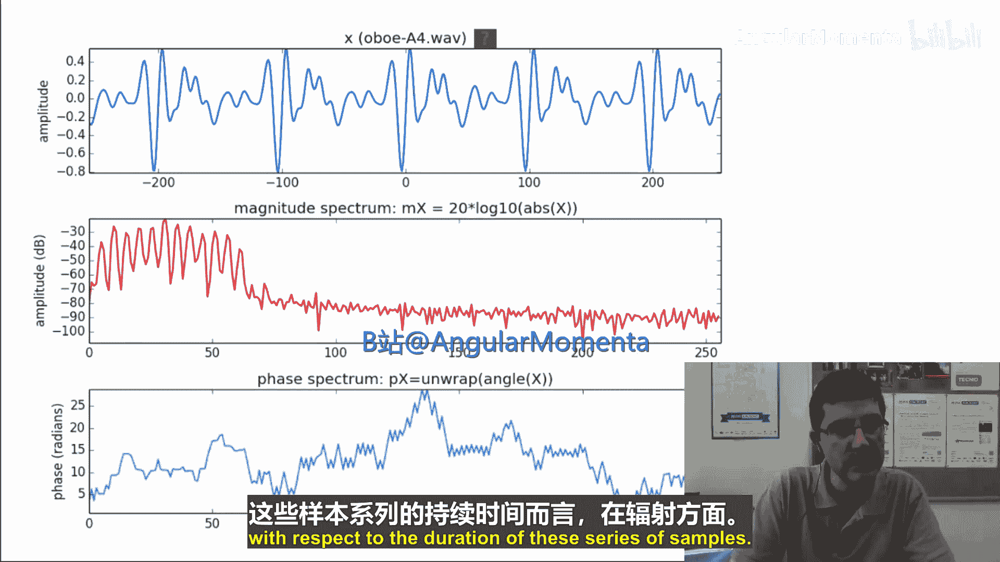
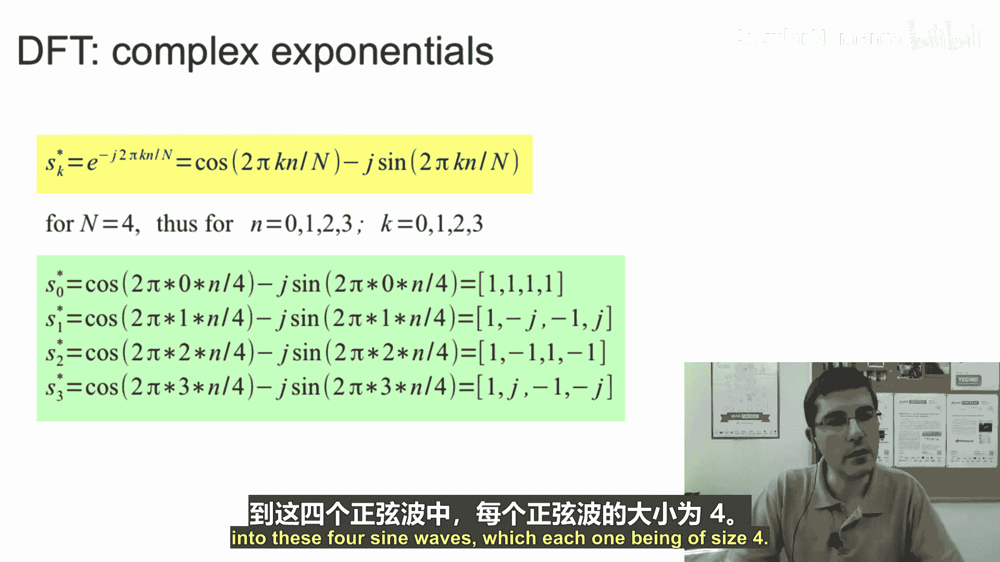
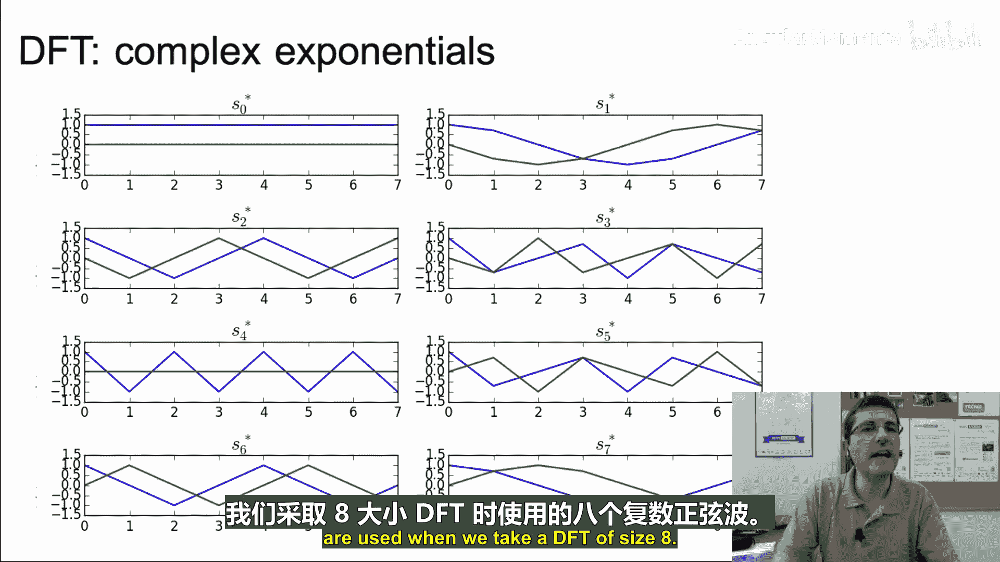
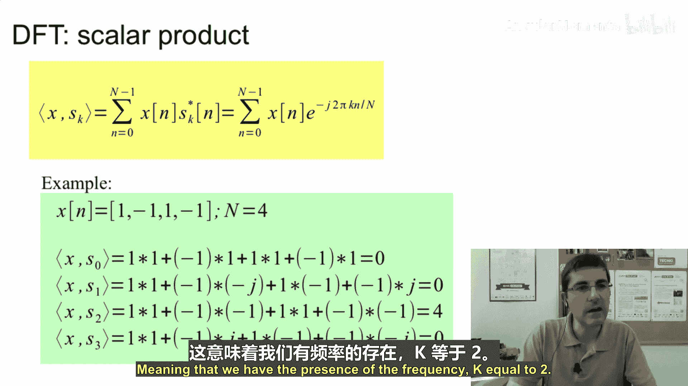
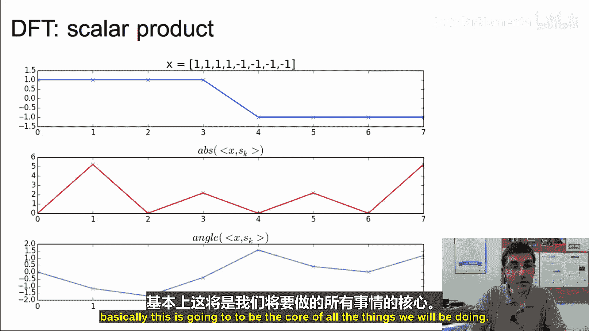
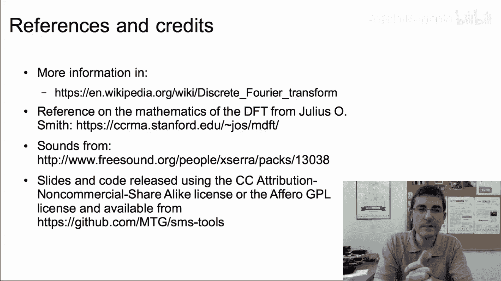
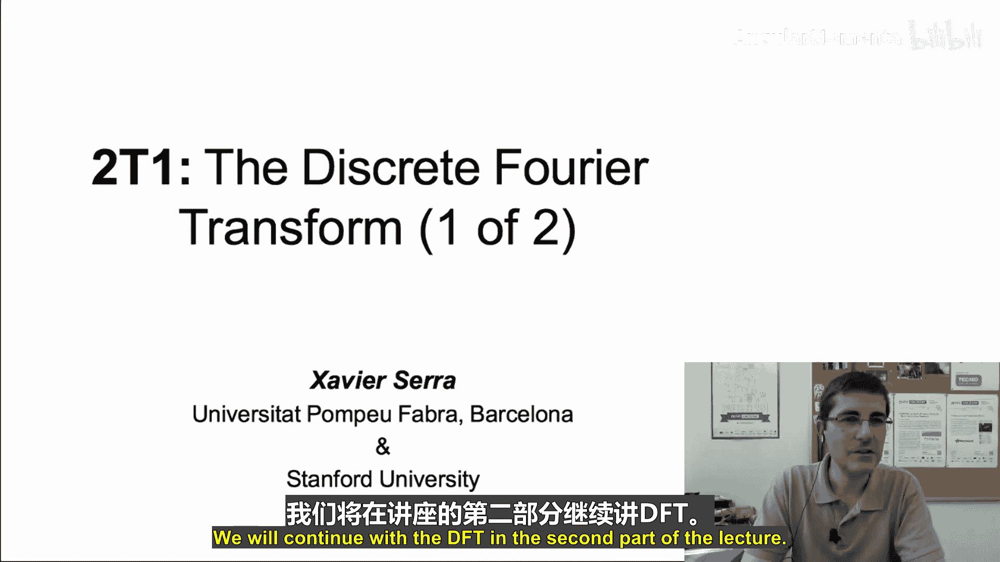

# 【巴塞罗那庞培法布拉大学】音乐应用中的音频信号处理-｜-Audio-Signal-Processing-for-Music-Applications-p12-02_01_01_密度泛函理论-1--BV18Xr6BeEX5_p12-

Welcome again to the course on art single processing for music applications in this lecture。

 I will start with our most fundamental topic the is create for your transform。

If you can follow and understand this topic， you should have no problem in following the whole course。

I divided the topic into two lectures， so this is the first one。

We will start with the discrete Fourier transform equation and then explain the two basic components of the equation。

 what are the complex exponentials and the scalar product。

So this is it。This is the most important equation to be shown in the Hol course， so pay attention。

In the equation， you can see x of n， which is our input signal。Our a series of samples of a sound。

That is multiplied by a complex exponential。That a complex sinusoid。And we multiply sample by sample。

So we have one sample of our sound， and we multipied it by one sample of the complex sinusite。

And then with sum over capital n。Which is the number of samples we compute。And then as a result。

 we obtain capital x of k， which is our spectrum。And the index K refers to the frequency index。So。

 we have capital N。Frequs， the output， which is the result of computing capital and samples of the input。

 so n is our discrete time index， K is our discrete frequency index。

And then if we want to understand these frequencies as radian frequencies。

 we have to multiply k by2 pi and divided by n， which is our exponent in the complex exponential。

 and then if we want to convert these to a frequency in hertz。

 if we have the k index divided by capital n and we multiply by the sampling grade。

 we obtain the frequency in hertz。Okay， so let's see an example。 the our x of n is this top plot。

 which is in this case a series of samples of a novo sound。

And then when we compute the DFT， we obtain this complex function capital x that can be expressed in polar coordinates。

 can be expressed with a magnitude and a phase。 but let's first hear the sound。

Okay so this is the obsound and the spectrum， we can see the magnitude and the phase and in the magnitude we can identify the harmonics of this sound。

 so these peaks that we see basically reflect the harmonics of these obsound。

 which is clearly a very harmonic sound and in the phase spectrum we can see basically the phase how these sinusoids are placed within the sort of the cycle length and with respect in radiance with respect to the duration of these series of samples。

As we said in the DFT equation， the input signal X is multiplied by a series of complex exponentials。

 complex sine waves， the sine waves are the basis functions of the DFT。

 the components that we will identify and measure in the input signal。

So one of these complex sine waves is s of k。In which using earlier identity。

 we can express it as a complex exponential E to the minus J2 pi k and divided by capital n。

 And this is equal to the cosine of the same value， minus J signine of this same frequency。

 So the real and imaginary part of this complex exponential。If we have a DftT of size n equal4。

 we will have n samples in the input signal and therefore in the sine waves and will have four frequencies。

 that's going to be also the output of the DFT therefore we will have four sine waves of length41 will be a frequency0 S sub0。

 which will be basically the frequency equal to0 and it will be all equal1s。

 then S sub 1 will be the frequency1 and that will be one cycle of a complex sine wave S2 will be frequency K equal 2 and S sub 3 will be k equal3。

 So a signal of size n equal4 will be projected into these four sine waves which each。

I'm being of size for。

If the signal has size n equal8， we will need eight sine waves like these ones。

So here we have the eight complex sine waves starting with S sub0 with this DCc component all being a constant S sub1 which will have this one period of a sine and of a cosine and we will keep increasing the number of periods。

 but as you can see that is kind of some symmetry and the frequency doesn't go up to8 periods。

 but it really goes back to the one period， we' will talk about that。

 but these are basically the eight complex sine waves that are used when we take a DftT of size 8。

Okay， so the DFT equation can also be expressed by this equation。

Which emphasizes the idea of skillalar product。In which we are doing the scalar product of x of n。

 our input signal by the N complex exponentials。And if we put an example of we take again。

 size n equal4 and we take a signal of being these four sample1 minus11 minus1。

 and we do the scalar product of this signal by every one of the four sine waves that we had computed in in the previous slides we will compute the DftT result。

 so when we do the scalar product of x by s sub0， the result will be0， that will mean that。

This particular signal has no frequency zero is not present。

And then if we change to S sub 1 and we do the scar product， we get the same result0。

 which again means that this frequency is not present in this X signal。

 but when we change to S sub2 and we do the scalar product， the result is4。

 which means that basically this x signal is this sinusoid。

Is completely present in in this sinusoid and we get the result of4。

 which is the sum of all the samples。 and then by S sub 3 again is equal to0。

 So that means that we have computed the DFT of x of n and we have obtained that is equal to 4 for k equal to 2 and is equal to0 for the rest。

 meaning that we have the presence of the frequency K equal to 2。

Let's do that with a bigger signal， so this is an example of the scalar operation of a simple signal that has all ones。

 it has eight samples， the first four are ones and the last four are minus ones so this would be like a rectangular kind of signal if we compute the DFT or the scalar product between these x signal and the eight complex ss that we had seen in the previous slides。

 the result will be this one will get the magnitude and the phase so it's going to be a complex spectrum and we can display as polar coordinates and here we can see that in this signal that is some frequencies present。

The frequency k equals0 is not present， frequency K equal 1 is very much present。

 but it also present K equals 3 and is also present K equal 5 and again is also present K equals 7 and the phases mean how these sine waves are located in sort of in the time location。

So this is the DFT operation， and basically this is going to be the core of all the things we will be doing。

You can find more information on the DFT in Wikipedia and of course， in the website of Julius Smith。

And from now on on all our lectures， we will use Sam sound。

 so all will come from free sound and they can be obtained from this link and again the standard creative Commons and。

GPL licensing of the code that we'll be using。So we have shown and explained the EF equation。

 I hope you realize that is not such a complex thing， but even if you feel it is complex。

 its use in audio signal processing is huge， so it is worth spending some time with it。

We will continue with the DFT in the second part of this lecture。 So thank you for your attention。

 and I see you next class。

