# 【巴塞罗那庞培法布拉大学】音乐应用中的音频信号处理-｜-Audio-Signal-Processing-for-Music-Applications-p13-02_01_02_dft-2--BV18Xr6BeEX5_p13-

Welcome back to the course on our Re processing for music applications。

We are in the second week of the course， and this is the second part of the lecture on the discrete for transform。

In the first part， we focus on the basic equation of the DFT， so now let's continue。

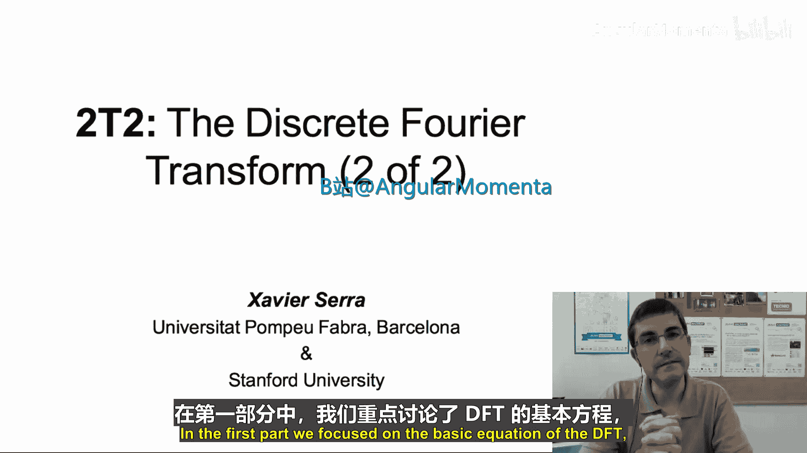

We will briefly review the DFT equation and then we will talk about how the DFT works when our input signal is a complex sinusoid or when it's a real sinusoid。

 and then we will talk about the inverse DftT。

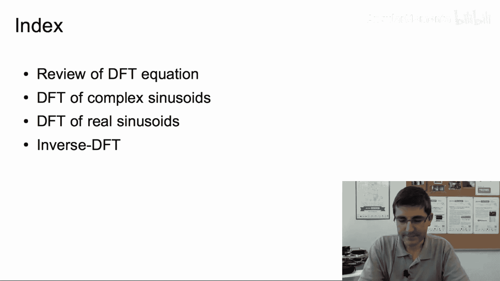

So the DFT can be understood as the projection of a signal into a finite set of complex s waves。Thus。

 it is able to identify how much of each of these sinusoids is present in the signal。

So from the equation， the concept of the inner product expresses this idea that the signal x of n when we project it on the complex sinusoids E to the minus J2 pi kn over capital n。

 we are basically measuring the amount of the sinusoids in the signal。🎼If we show an example。

 this violin sound， so we are taking a fragment of this sound。Okay。

 so we are taking capital n samples of this violin sound and we are projecting it into these complex sinusoids that we are generating and the result is this spectrum。

Express in polar coordinate so we see the magnitude and the phase spectrum in the magnitude we see the amount of each of the sinusoids present in the signal。

 and in the phase we are identifying the location of these sinusoids with respect to time0。

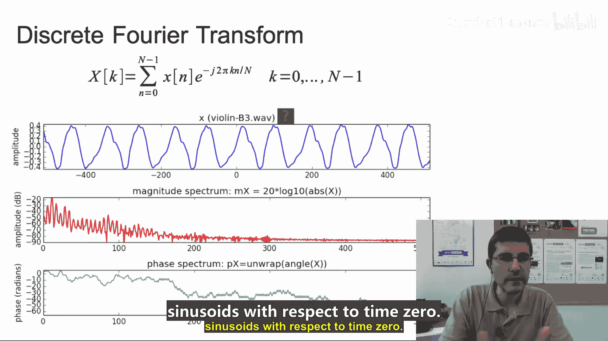

So if we explain how to compute the DFT of one single complex sinusoid。

 we will understand this concept a little bit better。So let's start from an input signal x sub 1。

 which is defined as a complex sinusoid of length capital n。

And has a given frequency expressed by this index k sub 0。

And what we're going to do is we're going to substitute our input signal x in our DFT equation by this complex sinusoid。

So therefore， we have a product of two complex sinusoids， we can sum the exponents。

And we obtain a single complex sinusoid with a more complex exponent and this in fact is the sum of a geometric series and therefore it has a close form that can be expressed by this equation and by basically inspecting this equation we can see that when k is not equal to k sub 0。

 the denominator is not0， and the de numerator is0。Therefore。

 all the output signal x of k is equal to capital n when k is equal to k of 0 and is equal to 0 for the rest。

 so what we are saying is that it has a single value at k equal k of0 and this value is n。

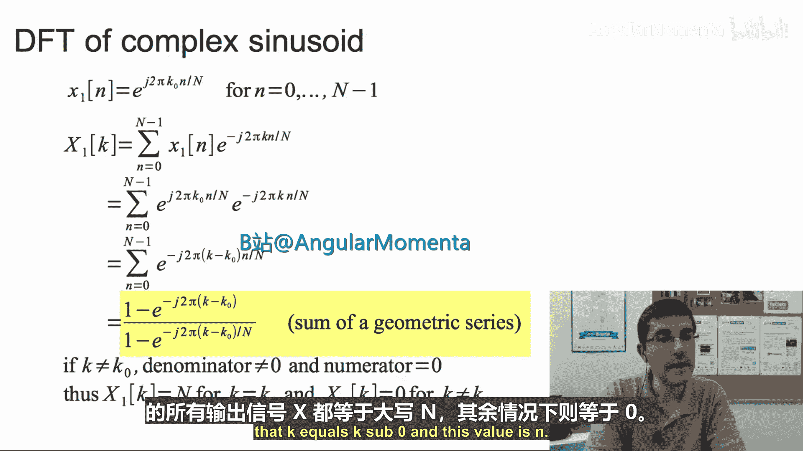

So let's see the plot of this operation。So this is the DFT of a complex sinusoid。

 so on top we see this complex sinusoid that k is equal to 7。

 so basically it means that it has seven periods in the length of capital n and in this case we have defined capital n as 64 so there are seven periods in these 64 samples and of course we see the cosine and the s。

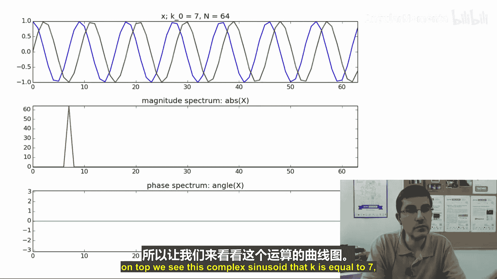

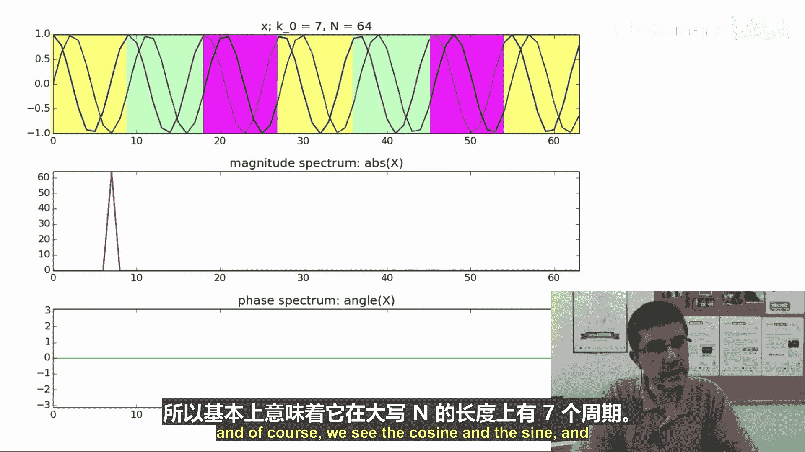

And when we compute the DftT again we see the magnitude and the phase the phase a little bit mess C。

 so let's not talk about that right now lets just focus on the magnitude and here we see clearly the value of 64 at one location which is at location k equals 7 the rest of the values are0。

However， this is a very special case in which the complex sinusoid is one of the basis functions of the DFT。

 this never happens when dealing with real signals。

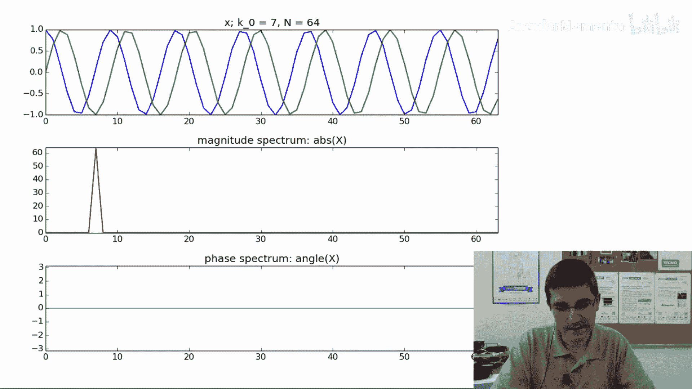

Let's see a more realistic example， the DFT of a complex sinusoid of any frequency。

Let's start with a signal x sub 2 in which is a complex exponential。

 but the frequency is not one of the frequencies of the DFT sinusoid。

 so the frequencies is expressed by F sub0 and it has an initial phase and it has the same duration so it has the duration of capital n but it doesn't have let's say a fixed number of periods in that duration。

So anyway， so let's put this sinusoid into the D FDA equation。

And we again get the product of two complex exponentials。

 we can sum the exponents except that the phase term of the sinusoid can be pulled outside because it does not depend on n and also being a geometric series。

 we can have a closed form。But its not so easy， is' not as nice as the previous one。

 it doesn't have fixed values that are clearly identified。

So let's see a plot of this operation and how this function looks like。

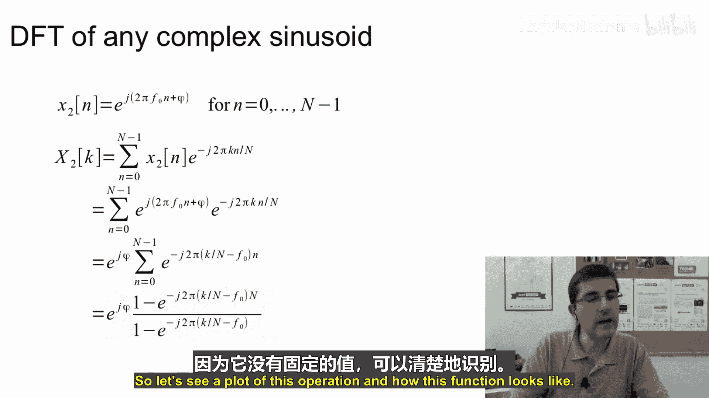

This shows the display of what is the DFT of a complex sinusoid。

That doesn't have a discrete frequency， it's not as nice as the previous case。

So in here we have taken k equals 7。5， so a frequency that is not an individualte value n capital n is 64。

So here means that we do not have an integer number of periods within these 64 samples。 in fact。

 we have 7。5 periods。And when we compute the DFT， the first thing that we notice is that the magnitude spectrum has positive values for all k。

Of course， there is one area that has a prominence and is the area around 7。5。

 so in fact for k equals 7 and k equal 8 has the same value。

And for the rest of k has a much smaller value。The phase， let's not talk much about it here。

 but is not that relevant for this situation。Okay， but even this is not that real。

 we do not encounter complex sinusoids like these in our physical life。

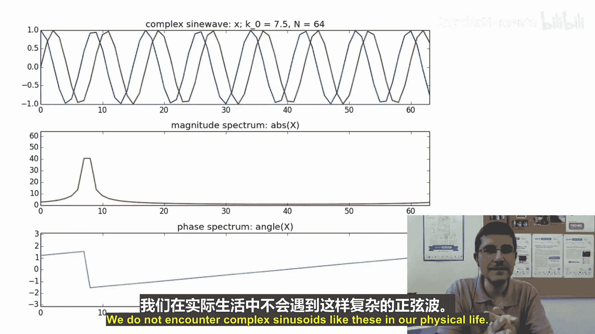

So let's go a step further and compute the DFT of a real sinusoid， not a complex one。

 thus something that is closer to the reality of sounds。But it's a bit more messy。

So let's take a signal that is a real sinusoid。With a frequency。

 that is an integer value of frequency。So by using Euler's identity that we talked about。

 we can express this cosine as the sum of two complex sinusoids。

And if we plug this real sinusoid in the DFT， and then we express it as the sum of the two complex sinusoids。

 we basically can do the same operation that we did in the previous case being the DFT a linear function and we will talk about that。

 we basically can express the DFT of these sum of two complex sinusoids as the sum of two DFTs of each sinusoid separately。

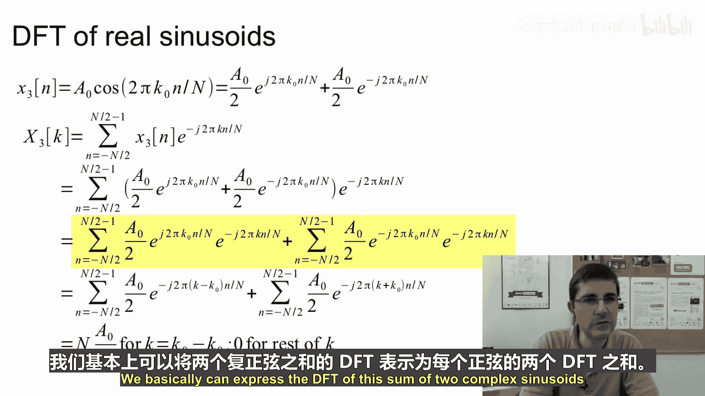

Therefore， the result is basically two DFTs that we basically have seen one is of a frequency of negative frequency and the other is the DFT of a frequency of positive frequency and with a given amplitude each one。

So what the result， basically we go through the logic that we did before is that it's going to have an amplitude a sub0 over2 for two frequency locations。

For the frequency location of k sub0 and for the frequency location of minus k sub 0。

 and it will have0 for the rest of k。And let's see plot for it。

So this shows the output of calculating the DFT of a real sinusoid。

 but we have complicated a little bit more and we have not expressed it for k equal to an integer value。

 but again for a k being a floating point value in this case， 7。5。

So if we take the real signal and take the DftT of that， we will see that it has two bumps。

 one around minus 7。5 and the other around 7。5 and again it has positive values for all k。Okay。

 however， still， we do not find sinusoids like these in our daily life。

 but we're getting quite close。 Some sounds are not that different from a real sinusoid like this one。

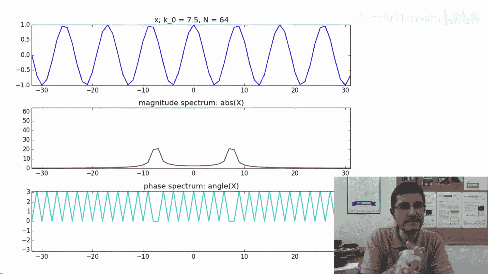

So one of the great properties of the DFT is that is invertible。

 which means that we can get back the original signal from its spectrum。

So this is the equation of the inverse DftT。In which our input signal now is the spectrum is capital x of K。

And then we do a similar operation like the DFT， we multiply by complex exponentials。

 but in this case is not negative exponential is a positive exponential because we are not taking the conjugate。

 so we are basically multiplying the spectrum by a complex exponential and then we are summing over all these results of over all capital n sample。

 and then there is a normalization factor that we include which is one over n。

So the main differences with the DFT is that the complex exponential are not conjurated。

 so we have a positive exponent。And there is this normalization factor， apart from that。

Is basically the same， but conceptual is very different。Basically what we're doing here。

 it's kind of a synthesis。 We are regenerating the sinusoids。

 we are recomputing the sinusoids that we identified。

So let's put an example if we start from spectrum， like one we saw before in which there was one positive value at k equal 1。

 so we started from a sequence of four samples and we obtained a positive value at k equal 1。

Okay so this is a spectrum of a sequence and now if we apply this inverse DftT function。

 therefore we multiply each of these spectral samples by the samples of four sinusoids for complex sinusoids of different frequencies。

 we will see that the result is basically the signal we started with。

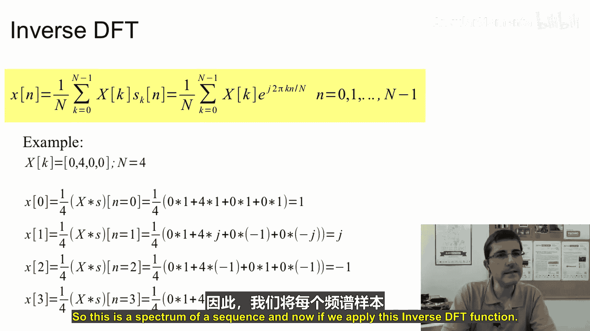

So this is a complex signal， the result that has 44J minus-4 and minus4J。

 so this is the inverse forier transform of this spectrum。

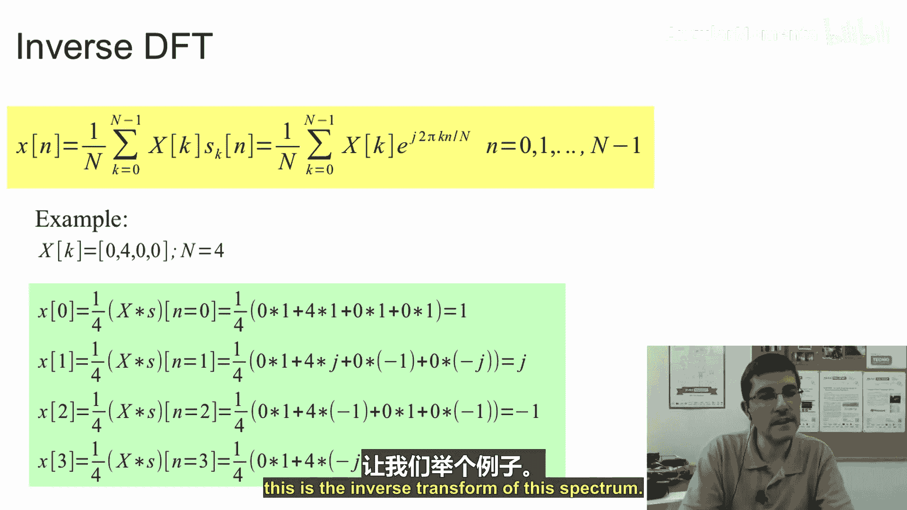

And。Let's show an example， so for real signals we do not meet the complete spectrum in order to recover the original signal。

 we saw that it was symmetric， so it's enough to have half of the spectrum and typically we use the positive side of the spectrum so if we have。

 for example， in this figure we have a given magnitude spectrum。And of course。

 we have a phase spectrum。Then we can do the imverse of that and we can compute it using these equations。

 so we first have to generate the negative part of the spectrum。

 so the positive part will be the magnitude multiply by the complex exponential to the phase。

And the negative part is going to be the magnitude again， multiply by the negative part of the face。

And then if we do the inverse D of T， we apply that equation into this whole sequence。

 this whole spectrum capital x of k， we will get back a real sinusy。Okay。

 so this is a sinusoid that has the length of the spectrum we started from。

In this case it's 64 samples， the spectrum had 32 positive samples and 32 negative samples and the inversese for your transform has these 64 samples of a real sinusoid。

Okay。So we will come back to these concepts in the next lecture。

 so do not worry if you still are not understanding completely this concept。

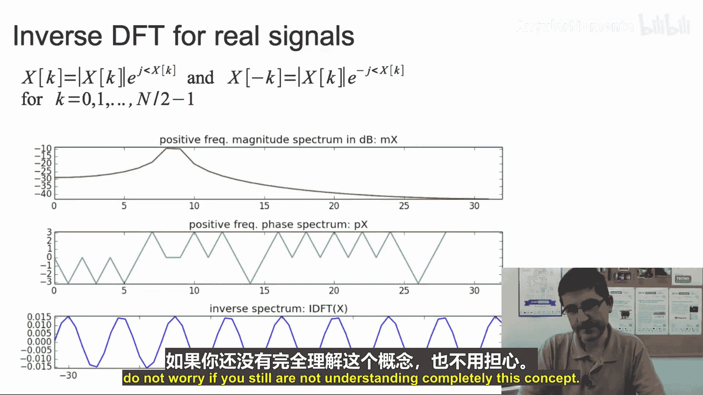

So again， you can find a lot of information about the discrete free transform in Wikipedia and of course。

 on the website of Julius。And here you have all the standard credits that we have in every class。

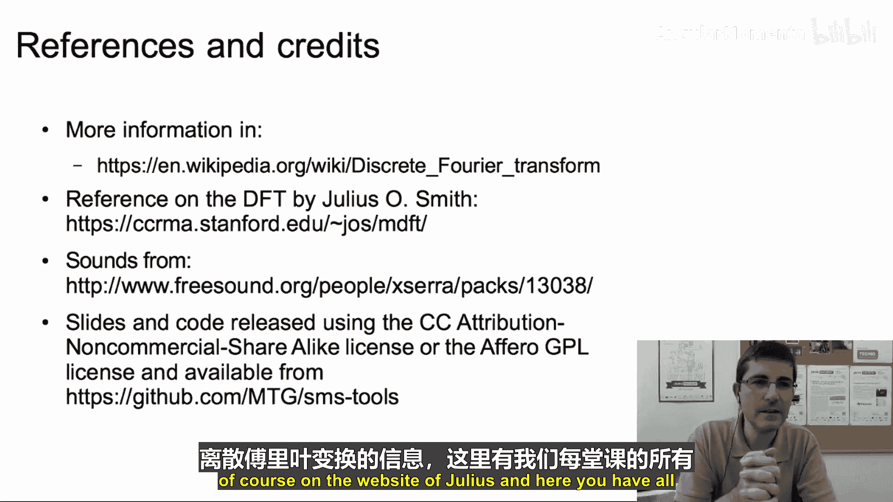

So in the first part of this lecture， we introduced the DFT equation。

 and in the second part we have seen how the DFT works when the input is a sinusoid。

 we have also explained the inverse DFT。If you have been able to understand this。

 you're doing very good。You should have no problem with the rest。So see you next less。Thank you。

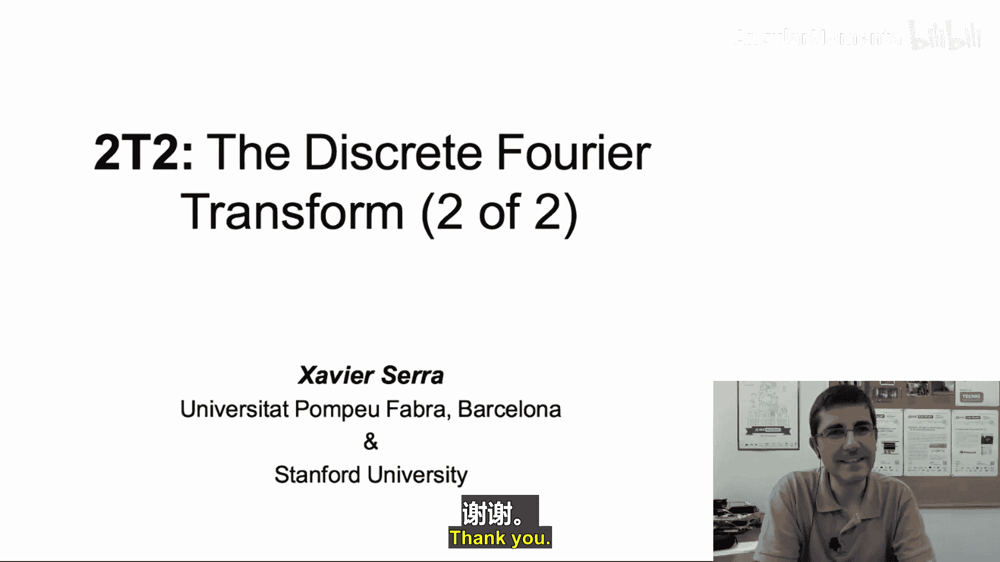