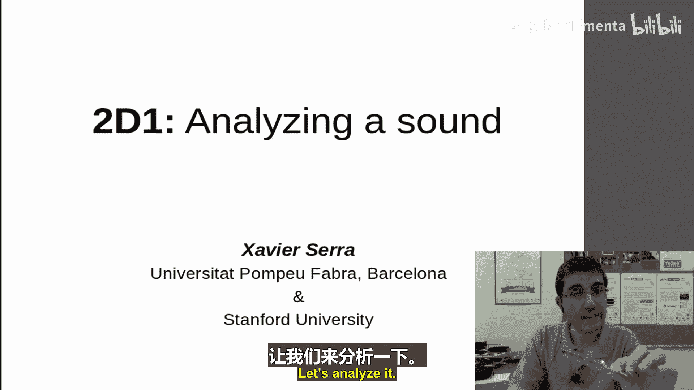
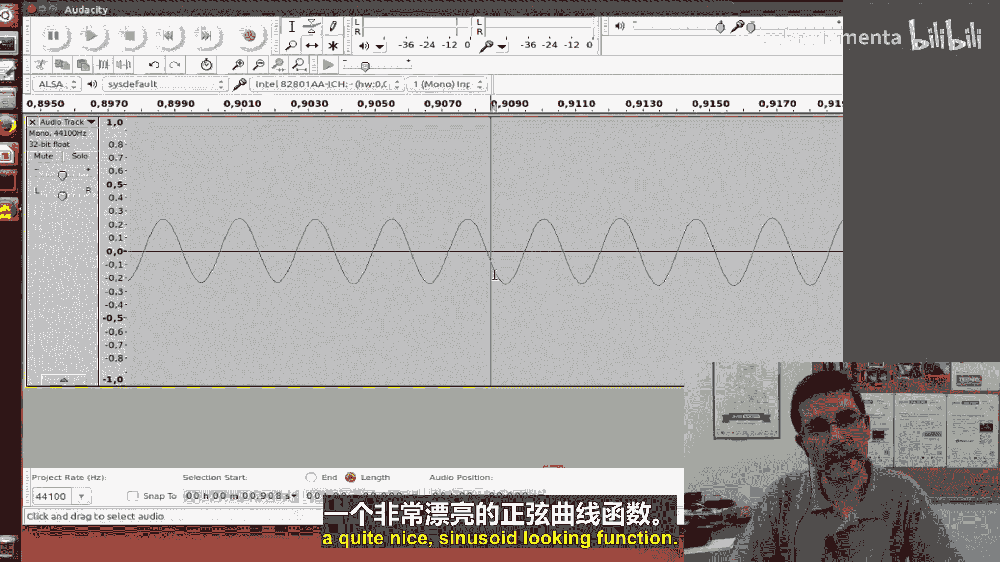
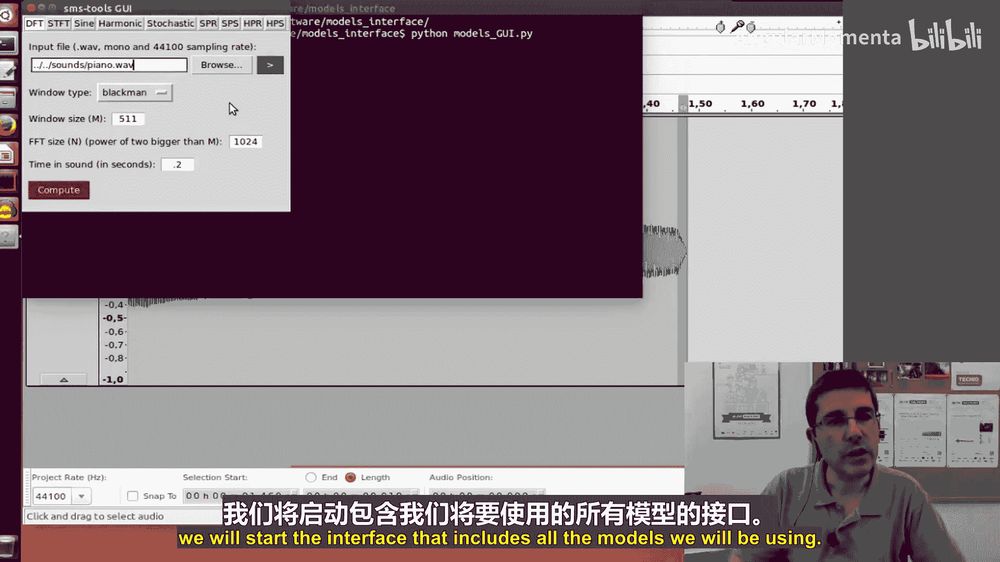
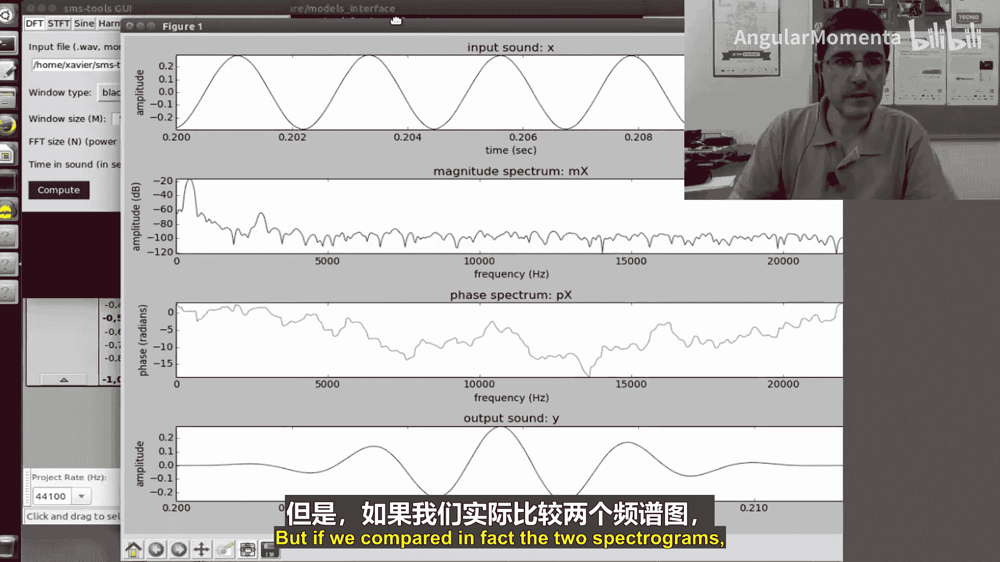
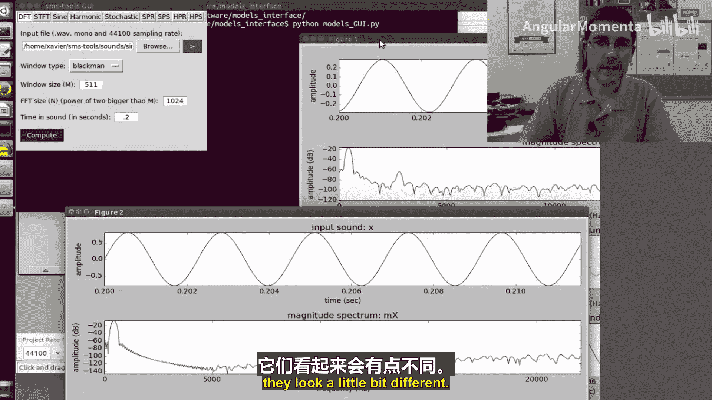
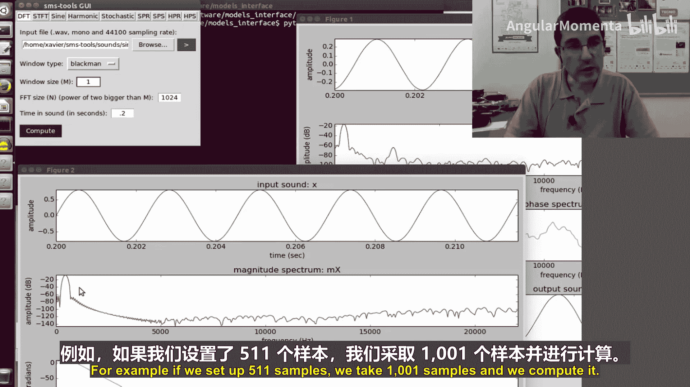
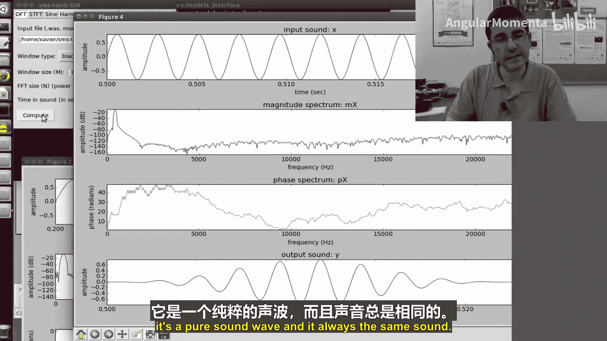
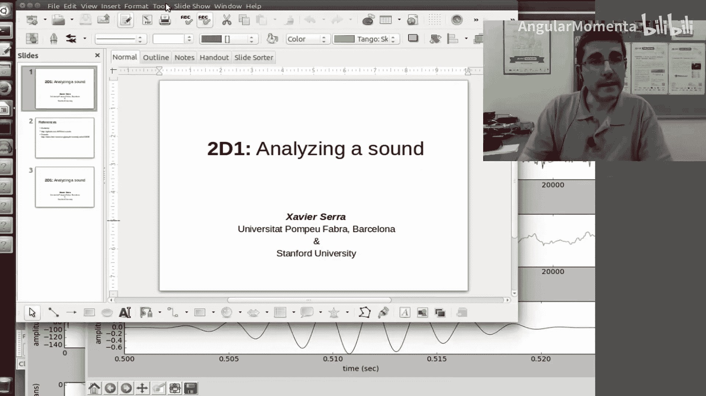
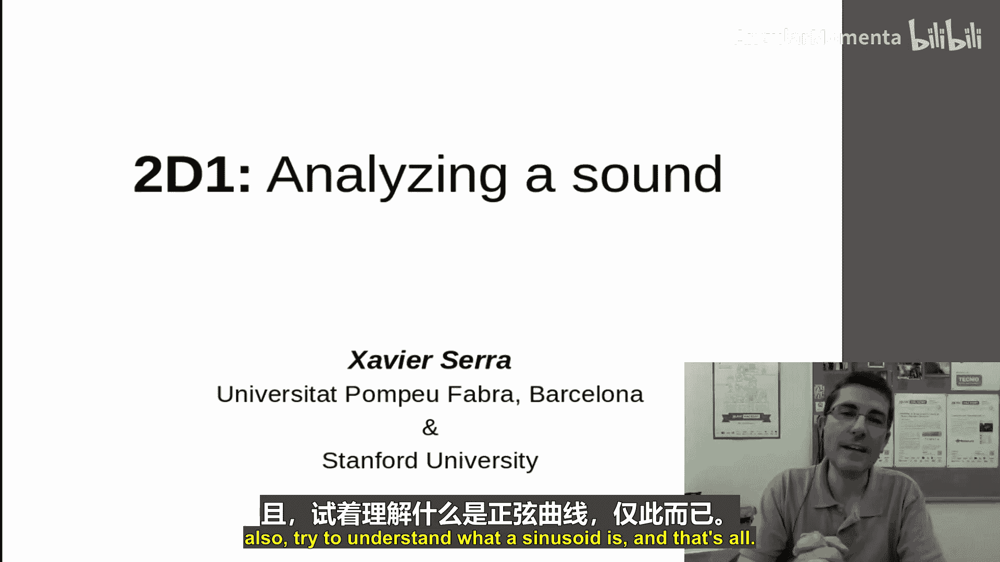

# 【巴塞罗那庞培法布拉大学】音乐应用中的音频信号处理-｜-Audio-Signal-Processing-for-Music-Applications-p14-02_02_01_分析声音--BV18Xr6BeEX5_p14-

Welcome back to the course on ours Pro for music applications。In this second week of classes。

 we are talking about the discrete for your transform。And in this demo， in this lecture demo。

 I want to put that in practice by analyzing a sound， in particular。

 I want to analyze the sound of a tuning fork。A teethning fork produces a very clear tone。

 this is why it's used to tune other instruments， and it produces a very clear frequency。

So let's try that， let's analyze it。

So we will open audacity and we will hit the record button。And with。The microphone。

 we will record the tuning form。그。Okay， that should suffice。呃。

Here now let's delete the parts of the recording that are not the tuning fork。let's hear it again。I。

Yes， that's the tuing fork。 maybe let's select the loudest part。Okay， and let's zoom in。Okay。

 to check if， if it's really like a sinusoid， we can zoom in。To the end。And yes。

 it looks like a quite nice sinusoidal looking function。

When we presented audacity， we mentioned that we can visualize the spectrogram。

 which the spectrogram is basically a time varying DFT。

So this is the time varying DftT of that sound a recorded of the Tning fork。And clearly。

 it shows a very strong line。Around around 500 hertz。Which is basically the frequency we are hearing。

In fact， this tuning fork， if if we look at the device， it says that is it produces 440 hertz。

 So these must be the 440 Hertz frequency。 However， we also see other horizontal lines。

 which means that there is also other components that are present in these sound。

So in order to analyze it a little bit more deeply， let's save the file， maybe before that let's。呃。

Clean it a little bit more。 And let's make。Of。A 18 at the very beginning。And they in at the very end。

 that always helps。To be heard and to be analyzed by other programs。 and now let's export it。

 This is a sound that is was recorded at 44100 and it's a monophile。

 so these will create a dot wave file and。We will save it under tuning fork name。Okay。

 there was one there。Okay， and now we can go to the SMS tools through the terminal。

It's in the sub directory models。Interface， and if we type Python。Models。GY。

We will start the interface that includes all the models we will be using。

 And the first one is the DFT。 So let's go get the sound。

That we recorded in the home directory。And was the tuning fork。Okay， and now let's hear it。Okay。

 now let's with the default parameters， let's analyze it。Yeah。

 that's clearly the a fragment of the input sound。This is the DFT of that sound。

 the magnitude un the spectra。And then we do the inverse the FT。

 and we get this shape that is also very much apart from a smoothing window that we have applied。

 It's very much like the original sound。And here， clearly， we see a peak in the magnitude spectrum。

 And if we put the the the cursor， it shows that it's around 400。40 Hz。But also。

 we see other components softer， but that they are also present。

Maybe to check how a real sinusoid is analyzed and how it looks like in the DFT in the spectrum。

 let's open up a sine wave that has been synthesized。So in here in this directory。

 I have a sine wave at 440 Hertz。Okay。Okay， that's a sine wave at 440 Hertz。

 it clearly sounds very similar to the tuning fork and now let's compute it。Yes， it's similar shape。

 but if we compared， in fact， the two spectrograms。

They look a little bit different。The one of the tuning fork looks clearly more noisy than the one of the electronic sinusoid still the electronic sinusoid doesn't look ideal。

 but it clearly looks with a very clear pick， and the rest looks much softer than in the episodeson in the tuning fork。

Okay， so with that， we can analyze sounds。 and of course， we can change the the size that we analyze。

 So， for example， if we instead of 111 samples， we take 1001 samples and we compute it。

Now we are taking a bigger chunk to be analyzed， but basically， the spectrum。Looks。

 little different because， of course， we have more samples。But the general shape is the same。

And we can play around with the parameters to visualize different parameters。 For example。

 we can just instead of starting at 0。2 seconds， we can start at second05 so a little bit forward in the sound。

And the sound looks very much the same because of course。

 it's a pure sine wave and it's always the same sound。

And that's all I wanted to say。

Basically。We have used audacity to analyze the sound of a tuning fork。

And then we have saved the file and used the interface available on the SMS tools package that we have developed to analyze the DFT and compare the result of the DFT of these tuning fork with the one of pure electronic sine wave。

Okay， this sine wave its in free sound so you can get it there。And that's all for this class。

 hopefully this has given you a practical view of what the DFT can do with real sounds and also trying to understand what a sinusoid is。

And that's all I hope to see you next class， bye bye。

