# 【巴塞罗那庞培法布拉大学】音乐应用中的音频信号处理-｜-Audio-Signal-Processing-for-Music-Applications-p15-02_02_02_Freesound简介--BV18Xr6BeEX5_p15-

Welcome back to the course on a processing for music applications in this class， in this demo class。

 I want to introduce Freetown。You already might have noticed that all the sound that I have been using and the sounds that we will be using come from this website from Free sound。

 so it's a great resource for this course and I want you to understand a little bit more and to take advantage of it as much as possible。

 so Free sound is a website that was started at the music technology group near from Pav in Barcelona。

Close to 10 years ago， but the truth is that it being maintained and supported by a large community of people that believe in it。

 that love to play around with sounds and that are contributing and maintaining this website。

So let's go to the website， okay。So here is the website。And。

Is a website that already has a huge number of sounds currently has more than 20，000 sounds。

 and there is a lot of activity around it， so there is more than 50，000 people every day accessing。

 downloading sounds and contributing some way or another。But anyway， let's start using it。

 So typically what you do is in the search menu， you will type the name of some sounds。

 So for example， let's type a flute note。Okay， and these returns。

The sounds that it has found that include these two names， either in the tags or in the descriptions。

 it has found 1074 sounds。So let's go maybe to one of these sounds。

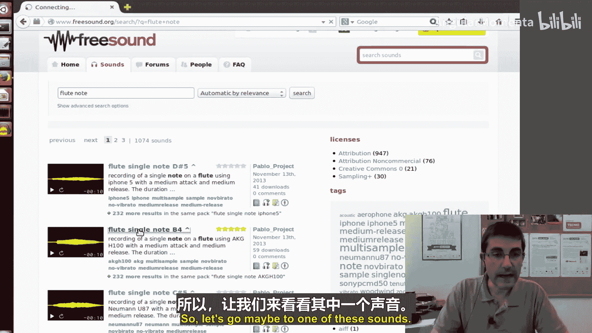

Okay， so this is a sound of flute note before， and we can play it。

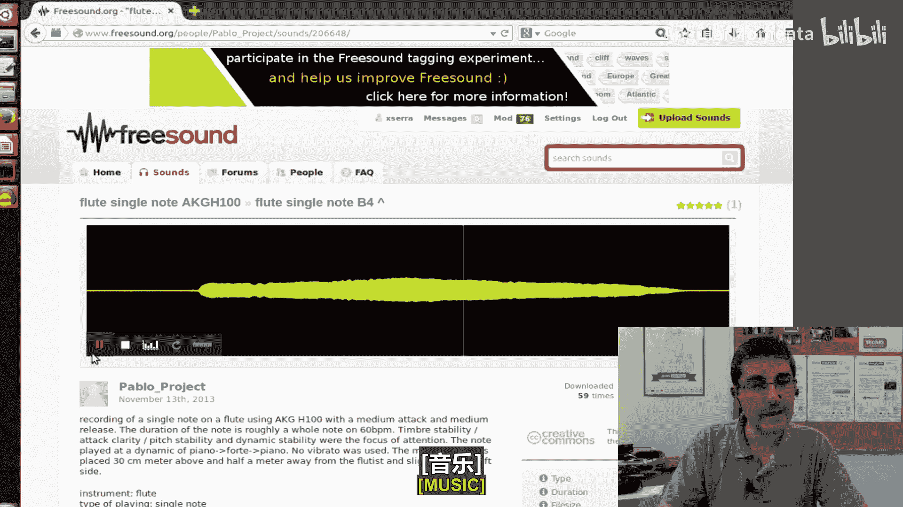

Okay so typically all the sound entries include a description of the sound。

 this one is pretty good so it has a description of how the sound was recorded and what it is and then it has some of the key descriptions of the sound and also it has tags that this is a very useful way for then other people find this sound through different concepts that might be related to this sound and here it has all the technical information about the sound。

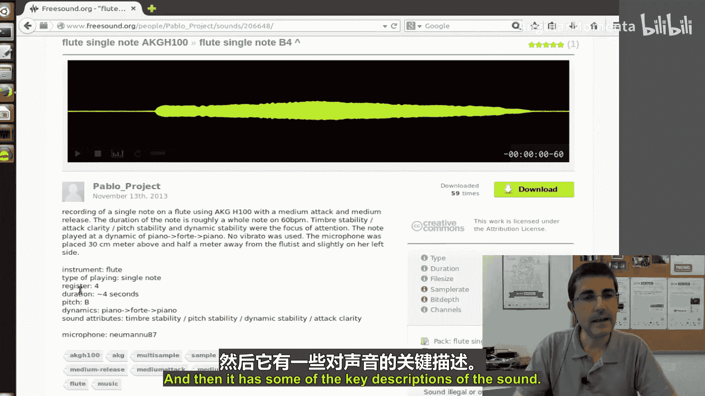

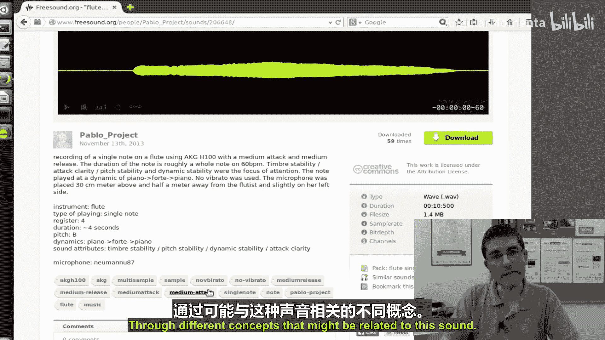

Okay， let's go back to。

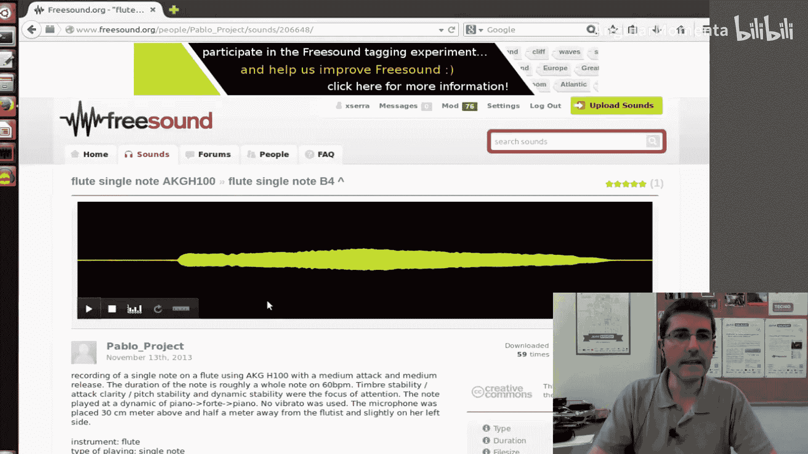

The sound。

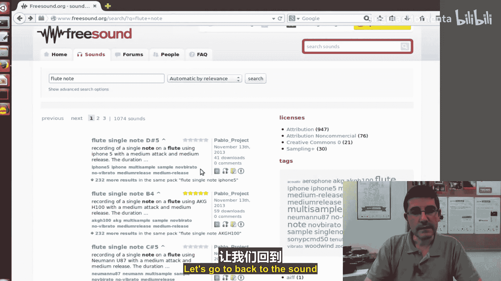

Resolves that we found。 And here we have many other sounds。 of， for example， even sounds that。

 of course that are not a flute。 For example， this okcarina sound， but in the description， it。

 it mentioned that is a flute like sound and we play it。Okay the okcarina has a flute like sound。

 but one way to search for sounds that is quite interesting is through a similarity， which in fact。

 what this does is analyze all the sounds a free sound。

 it analyzes a spectrum of all these sounds and it looks for other sounds that might have a spectrum similar to this one。

 So this okina sound has a spectrum similar to these one。 So for example。

 this is a one second nose floatte and。

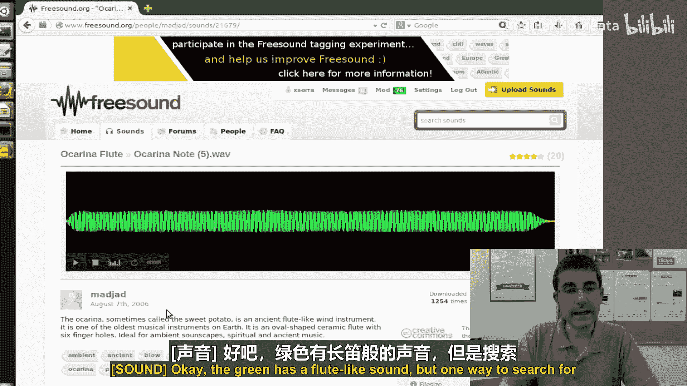

And yes， it's a sound very similar to okarina。 And if we play all these other sounds。

 the distance increases， so they will be less and less similar。

 but they have a similarity with these this sound。 So that' that's pretty good。

 So let's go back to the main page And in here also you can search for sounds and information through many other ways。

 if you go to the sounds page in here， you can browse through all the sounds。

 according to like the tag and the packs， or for example。

 an interesting browsing possibility is what is called a geotax。

 So geots are sounds that have been sort of identify with a geotac So sounds that have been recorded in a particular location in。

In the world and that people have identified the place where this was recorded so you can find if you look in Barcelona。

 of course there is a lot of sounds from our city because we are very active there。

 so this is Barcelona， there is 2300 sounds coming from Barcelona。

 but there are sounds from all over the world， and you can navigate through these sounds these way so that's pretty good。

Of course once you like one sound， you can download it so for example。

 in the case of the sounds of this course， I label all the sounds with a particular tag which was ASP course。

 so if we look for a sound that have the ASP course label or tag you will find them all here。

 so in this case here it has all the sound that I have been uploading for the course。You can play it。

 of course。 But if we want to download this sound， we can just simply click at the download。

 You have to be logged in， which in the， in my case。

 I am already logged in so I can just download it。

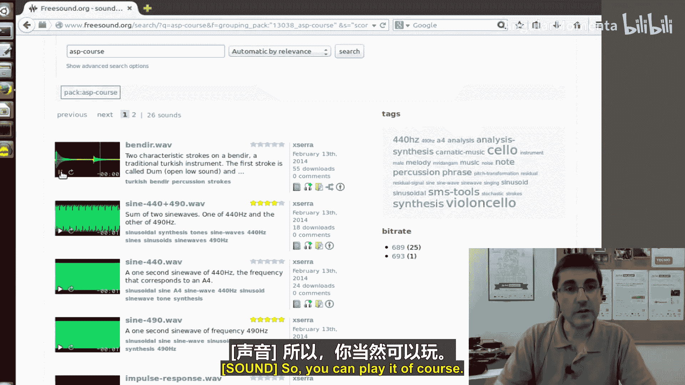

And it will save the file in the same format that the sound was uploaded。 So that's pretty good。

 But what I want to do now is to do the opposite to upload a sound。

 I think it's very good for people to upload sounds in this class that might be of relevance for the course or you might have a sound that might be interesting to analyze or you might have a sound that you have transform and that you want to share with other people。

 So I encourage to upload sound and maybe put the same label legacyP course so that other people can can find your sounds。

So let's think of a sound that we might want to upload that is is not there。 So， for example。

 let's see if there are many Soooth synthesis sounds of a So tooth。 there' is quite a few。

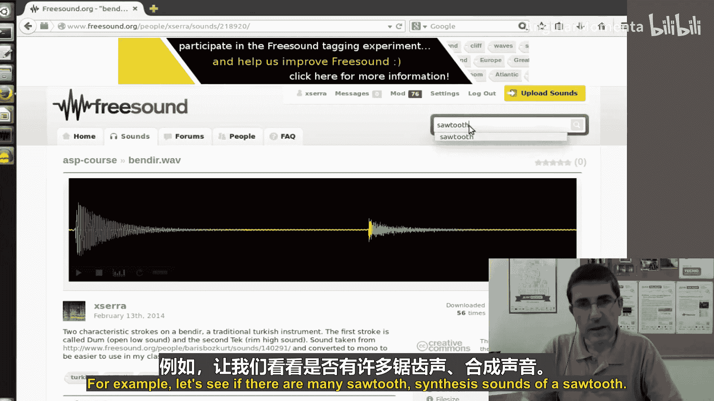

But I don't see the standard kind of straight soth of high quality here。 There is one。

 which is very weird because it's 8 beats。 So okay。

 so let's go to audacity and let's generate a tone using a soooth。

 Okay so let's select soth frequency 440 herz and let's put an amplitude of 0。

5 and let's have 5 seconds soooth Okay， so this is it。 Let's get it。Okay， so we will upload that。

 Let's maybe to make it nicer。 Let's add a fade in at the beginning， a fade out at the end。啊。Okay。

 and that's it。 Now we can save the file， export it。And in the main directory， let's put so tools。

And it's 440 herz。Okay， so let's。Gance。Save it。

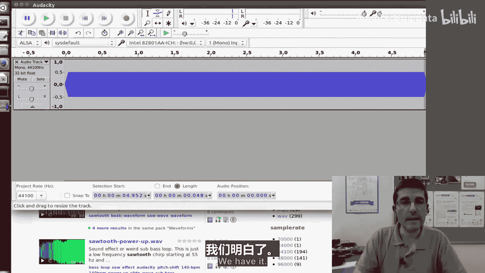

We have it now from the the free sound website， we can just click at the upload sounds button and here upload and we'll have the Sous440 Herz。

So， that's。Okay。It's already done。 and now what is important is to describe the sound。

So it has the option to describe the sound。 And here we click describe and we can specify text and description of the sound。

 So， for example， for description， we can say， okay， this was a Soth。啊。Generate the waveform。

ForExample。Of frequency。440 Hz。诶。Of five。Seconds。ジ。Genrated。With。How大 city。Okay。Let's put 5 seconds。

 Okay， and then in terms of tax， we might put， of course， the word saw tooth。嗯。We can use 440 Herz。

440 is a 4。 So that's pretty good。 iss electronic sound。 It's produced with synthesis techniques。

 and it's put in。 Also， it's quite a common word。 It's a waveform。Okay。

 that that should do it So that's pretty good。 And let's just well in the pack these are the packs I have and maybe I have a synthesis pack so maybe let's put it there and the license there is three types of license I can use create the common0 that means public domain。

 anything can do attribution that means people have to say that it comes from free sound or restrict that it should not be used commercially so normally I like the attribution so I will put attribution and I will submit it。

And that's it， it has already been uploaded and now there will be moderators that will check if this sound was well described and it is not infringing any legal thing idea didnt take it from any other place and then it will come up in three sound。

Okay， that's basically what I， what I wanted to say。 So let's go back。To hear and。Okay。

 so we have talked about free sound。And a very important concept I want to emphasize and that you should be familiar with is all these licensing issues。

 Creative Commons is a great set of licenses and for sound are very much appropriate and free sound uses then。

Very well。Okay， and then we have used audacity to generate these os。

 and we have referred to this pack in within threeso where I keep all the sounds for the course。

And that's all， so I have introduced free sound， hopefully this has been of interest to you and I encourage you to take advantage of it。

 to use it， get sounds from it， but even more to upload sounds to put things that you believe might be of interesting and might be interesting to the community through these course you will have the opportunity to generate and record sounds that might be of relevance to free sound。

So anyway， thank you very much and I hope to see you next class， bye bye。

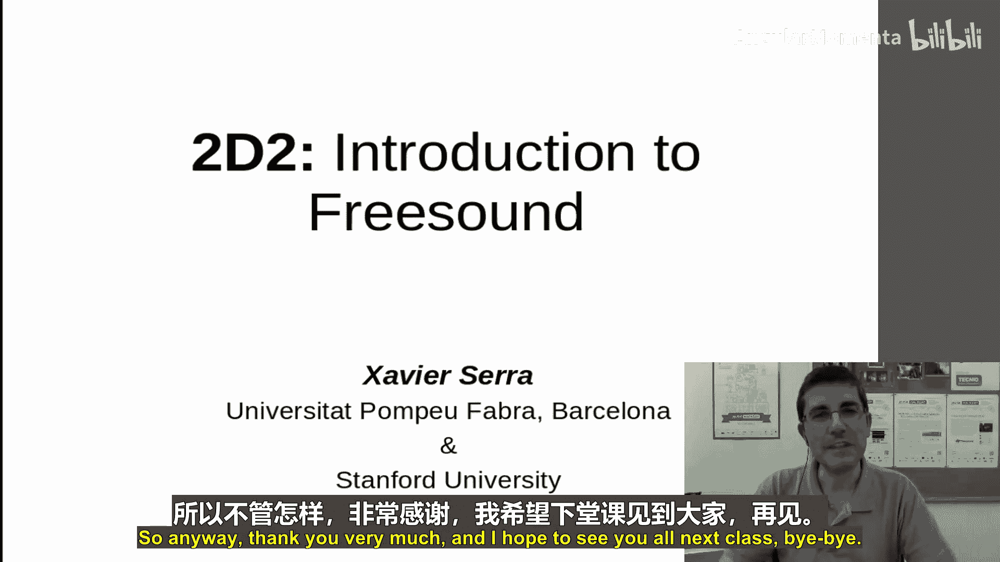