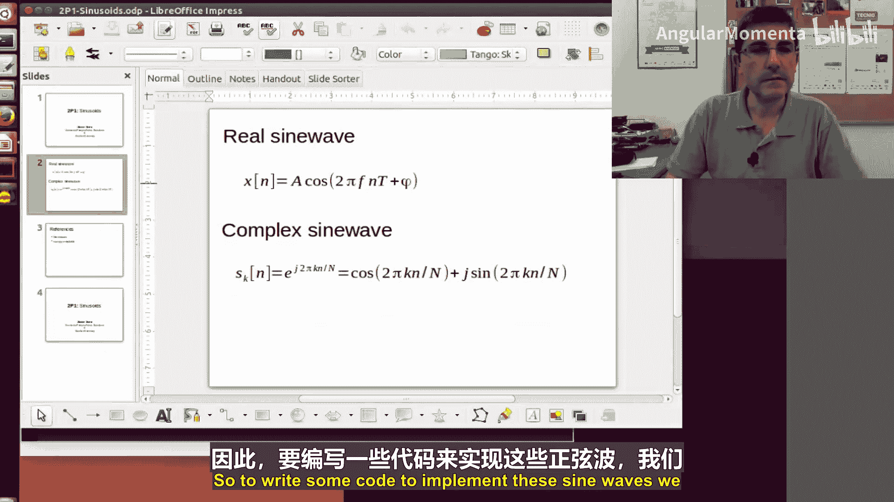
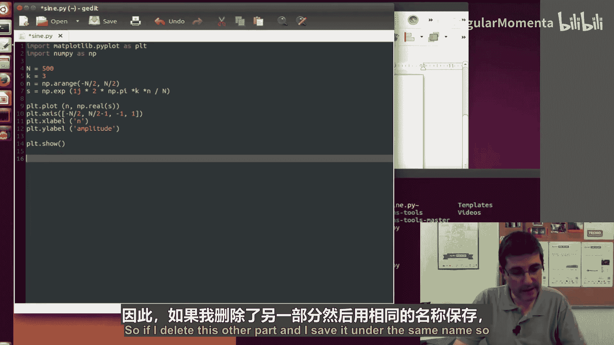
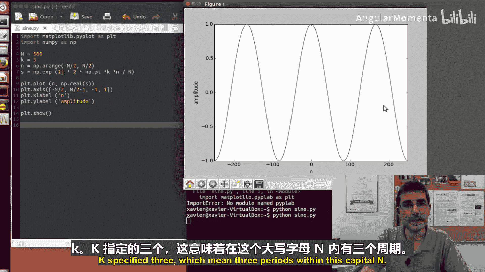
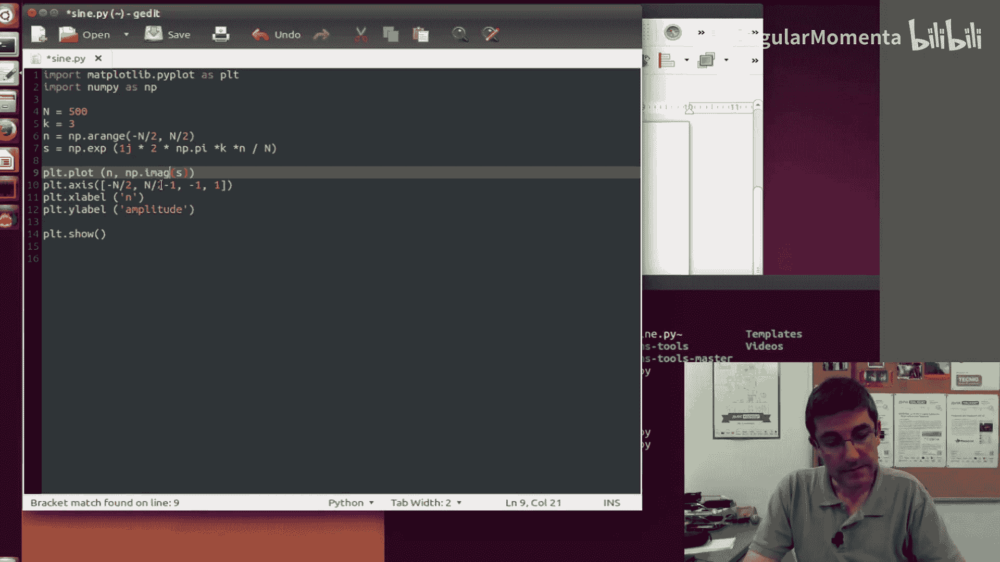
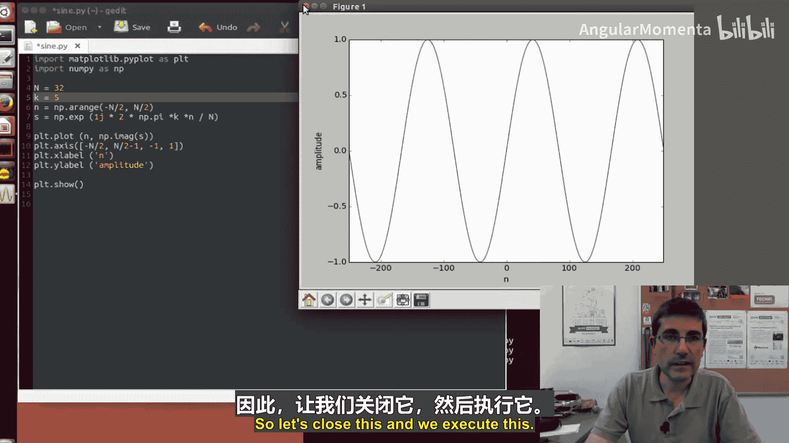
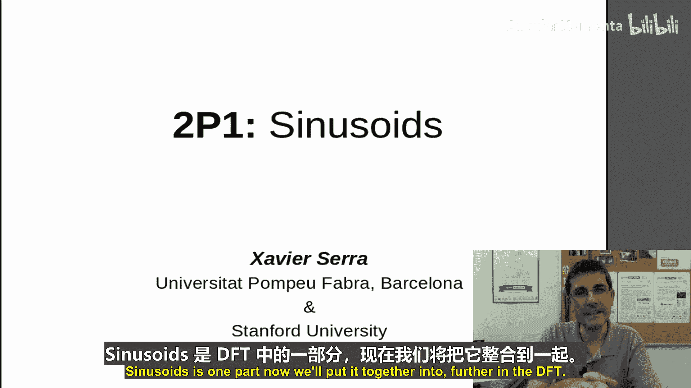

# 【巴塞罗那庞培法布拉大学】音乐应用中的音频信号处理-｜-Audio-Signal-Processing-for-Music-Applications-p16-02_03_01_正弦波--BV18Xr6BeEX5_p16-

Hello， welcome back to the course scenarioio in processinging for music applications。

We have been talking about sinusoids since the very beginning。

 cusoids are at the core of what we will be doing。This week in the DFT。

 sinusoids are part of the DFT and in order to understand the DFT。

 it's fundamental to understand sinusoids。So in this class I want to teach how to program sinusoids。

 how to code sinusoids， and in particular we will be playing around with two types of sine waves。

The real sine wave， which is a sequence of numbers in real numbers that can be computed by calling this function。

 so it has an amplitude， capital a and we can call the function cosine with an argument which is2 pi with a frequency and the time index and it's a time index without a discrete and then the capital T is thesembling period and then we have an initial phase。

And then we will also compute a complex sine wave， the ones that appear in the DFT。

 These are complex sine waves that are discrete and they do not have any time information So it just with an index n and the frequencies an integer value。

 So these complex sine waves are always periodic for a given capital n。

 so we define a capital n which it's going to be the size of the DFT and then these complex signs are always have fixed number and of periods within that n and these depends on K。

 so in fact K is the number also of periods within that capital n。서도。

Write some code to implement these sine waves， we need to open up a text editor， in this case。

 G edit， and we can start typing Python commands that then will be part of a file will be a script that then we can execute using Python。

Okay， so we first need some packages and typical packages that we will always need。 One is the。

The library for plotting， my plot leap。Particularly pilela， and we will call it PLT。

Then we will always need numpy。And this will be our package for playing around with vectors and arrays。

Now we can start typing code or defining the sinusoid， the real sinusoid。

 so the real sinusoid has an amplitude and let's define an amplitude of 0。8。It has a frequency。

 let's say at 0 that in hertz， let's say1000 hertz and it has an initial phase phi。

 let's say pi over2 pi is a variable defined in the nu packet。

 So that way put NP dot pi and now we need the sampling grade because we need to compute the sampling period or we need to display the real sine wave in time。

 So our typical sampling grade will be 44000 or 100 Okay now since we do vector operations for the time index。

 we will define an array。And we will be using。This function range from Ny that allows us to define。

A range of values。And an increment。 and then automatically it computes all the values between these two limits。

 So this will be an array of floating point numbers going from minus0。00 to2。

002 in increments of1 over FS or capital T， which is a sampling period。

And now we are ready to compute the our function。 So it will be amplitude a times cosine。

 and in the argument will be the two pi So two times NP P dot pi。Times the frequency。

times the time index， which is the TRA， and then we need to sum the initial phase feehi。

And this will be our time function。Our sinusoid。And in order to plot it。

 what we will do is to plot the time array with respect to the x values。

 and a good practice is to define axis values。 So， for example， in this case。

 the axis in the the horizontal axis goes from -00。022。002。

 and in the vertical axis will go from minus-08 to 。8。

This will define the axis or what we are seeing in the plot and then also it good practice to label the axis。

 so we need to label the X axis so with an X label and X label will be time。

And then we need to label also the y axis with the y label， and that will be amplitudeted。Okay。

 and that's it。 And The only thing left is to call the the show。Command so that it will display。

 And hopefully， if I didn't type anything wrong， it can。It can be computed。

 so we save it under a name， sign do py。Okay， it's an。You can go to the terminal。

And here we have the sign dot Py file， and we can execute it by tapping Python and sign dot Py。Okay。

 gives me a error that says that。嗯。Okay， I type wrong the， the name of the package。

 I had to type pipe plot。Not byい。I plot。AndNow that I see also the cosine is wrong。

 cosine is a function within Ny， So I have to put MP dot cosine。Okay， so two bugs already。

 let's execute it。AndNow it's okay。 we have a sinusoid。 We have the time in seconds。

 the horizontal axis， time 0 is in the middle。And the amplitude is in the vertical axis。

Until so we have four periods of this sine wave。Okay， now let's go for the complex sine wave。

Which is gonna be， a little bit more。Complicated。The packages are going to be the same。

 So let's type it here。 So we might be able to re some of this code。

 So the first thing we will need to do is to define the variable capital n。

 which is going to be our array length or sort of like in the case of the DFT， the size of the DFT。

 And let's say it's 500。 And the frequency is going to be an integer。 So let's say。Okay equals3。

And then in terms of the， the index in the time index is going to be integer values。

 So it's going be， and we can just easily。Just say N range， and we can display it from。

minusus n over 2 to n over 2。That will be time indexes that will be created。

 and now we are ready to compute。Complex sine wave。

So the complex exponential is a function that exists in nu pi。 So we just say NP dot x。

 And now in terms of the arguments for J， we just say1 J， then it's two pi， so two times NP dot pi。

Then， we multiply by k。We multiply by n， and we divide by capital N。And that's our complex sine wave。

And in order to display it。Well， we cannot display the complex to the representation。

 so what we will do is we will display well n and against the real part of S。 so in order to do that。

 we will say NP real and we will get S and this will display the real part of this complex s wave。

And now， again， we might want to。I have some specific access labels。So the axis will go in this case。

 from minus n over 2。To n over2， in this case，-1 because that 0 is also one of the values。

 And then in terms of the vertical axis， we just say from -1 to1 because it's normalized to one。Okay。

 and then for the labels， the X label。We will say that is just the end。And indexes。And for the。

The Y label。The same thing。 we have the amplitude。Okay， and that that should do it。

 The only thing left is， again， the。The the show command。And that should do it。

 So if I delete these other part。And I save it under the same name。 So it's the sign。

Hopefully， if they don't have any error。Okay， it displays the real part of the complex sine wave。

 which is a cosine。 So at times 0 is 1， and it has exactly three periods， which is k K specified3。

 which means three periods within this capital n。 Now， if instead of the real part。

 we want to display the imaginary part。

And。

Can computer again。And this is the sine part。 So at time 0。

 it's a sine wave and its three periods of the sine function。

Okay so in the DFT what we are doing is for different ns。 So in the case the n is the DFT size。

 so for example， let's change the n let's put 32 for example。

 and then K is one of the sinusoids of the DFT so for example。

 let's put number5 So let's close this and if we execute these。

This will look a little bit different。Okay， so this is much fewer samples。 It's only 32 samples。

 and there is five periods of of of the， in this case， the imaginary part of the sine wave。

 but of course we have few samples per period。 So that that's why we see it so jack。But anyway。

 this is a computer。Sine wave and is the kind of sine wave that we will be using in the DFT。

And that's basically all I wanted to say， so we have been in this class。

 we have been talking about sine waves and we have been explaining how to code them using Python。

 specifically we needed two packages， nuI and MatplLi。Nampy。

 it's going to be a fundamental package for handling all these arrays that we'll be using and thatcl willll always need it because we'll always be plotting things。

And that's all so this was the first programming lab first lecture in this second week。

 so in the next programming lecture well actually will go into the DFT so we will go into how to program the complete DFT Sus So it is one part now well put it together into programming the DFT so I hope to see you next class Thank you。

