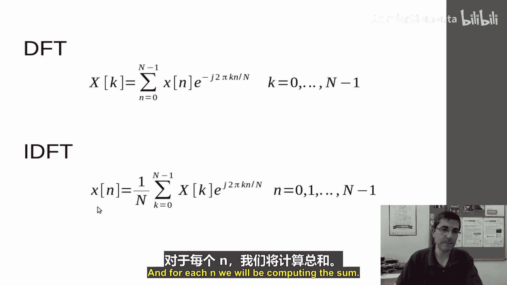
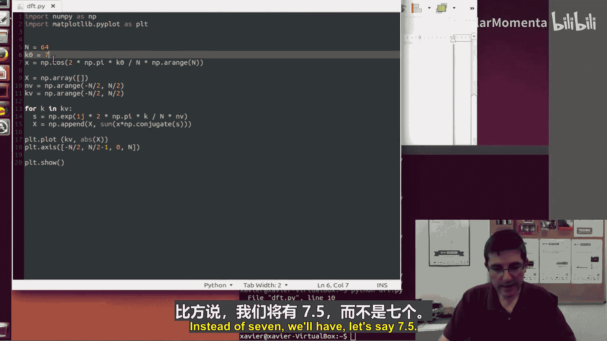
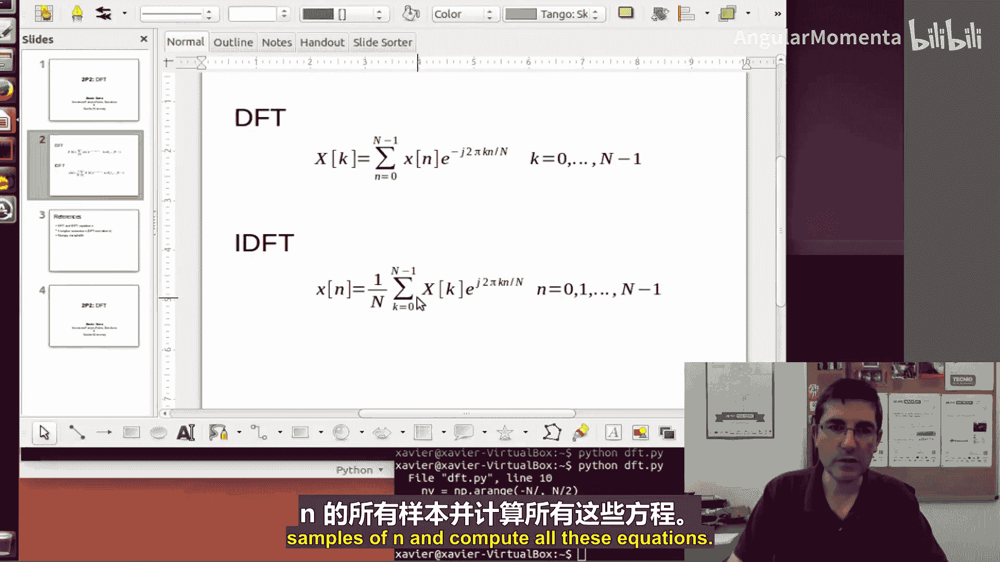
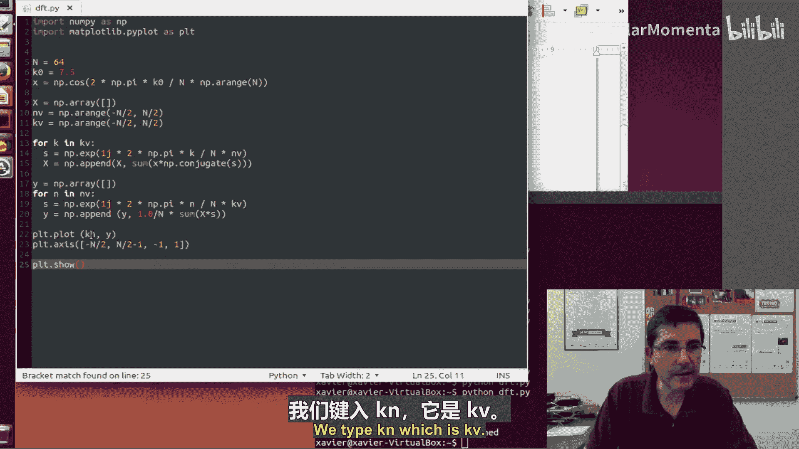
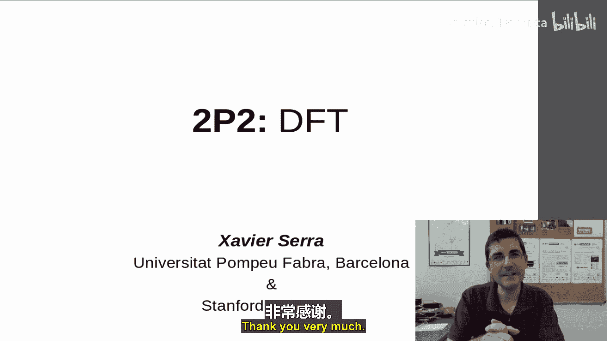

# 【巴塞罗那庞培法布拉大学】音乐应用中的音频信号处理-｜-Audio-Signal-Processing-for-Music-Applications-p17-02_03_02_密度泛函理论--BV18Xr6BeEX5_p17-

Welcome back to the course onar or processing for music applications。In this week。

 we are talking about the DFT。And in this programming lecture。

 we're going to learn how to program it， how to implement the DFT equations in Python。

In particular were going to talk both about the DFT equation。

 the direct version of the DFT and the inverse DFT in the DFT will be basically willll be computing all the x of k。

 so we'll be computing all the spectral values present in a given signal x of n。

 so we'll be iterating over all k and computing this sum and in the inverse well be iterating over time over all n and for each n we will be computing this sum。

So， let's start。 Let's go to。Text editor。And we'll start by implementing the DFT。

 So the first thing we need to do is to import Ni。That's our package for array processing。

Now we have to initialize our output array of spectral samples， so we will create an empty array。

Okay， capital x， and will be now iterating over all frequency samples。

 So what we do is use the function range。That basically creates values from 0 to n minus-1 So now goes from 0 to n minus-1。

 and now we have to create the complex exponential at every frequency at every k。

 so well create complex exponential。Times2 pi okay multiply by the frequency we want and we need to divide by capital n and then we need to create for all n so we will create an array of time samples of indexes that will go from0 to n minus1。

Okay， and that's a complex exponential at frequency K。 And now we can compute the output spectrum。

 and we will do that by app。To the existing spectrum， whatever was from the previous computation。

 and we will compute the sum of the input signal X。Bye。Multipied by the conjugate。Okay。

 of our complex exponentials。 So this is the inner product that we talked about in theory。

 and that's it。 That's our DFT implementation。We can save it in a file let's call DftT dopyy and so this is a script that will run that in order to see if it works well we need to put an input signal so let's before the code of the DFT。

 let's start using a particular signal let's define a signal of size n and that will be equal to 64 and let's have frequency that could be for example 7。

Okay， on now we can declare the。Time signal as a， let's say， a complex exponential。

 And we will have a complex exponential that will be， again，1 J。Multiply by two times。Pi， by the way。

 I left here。 also the nu package。 Okay to pi。 and then we multiply by our frequency K 0。

 our frequency index， we divide by n。 and again， we need to create an array。

Of values so that we can compute n capital n values of an input signal。 And that's it。

 Now we compute the DFT。 And we just， in order to see if it did anything。

 we just we will plot the result in order to plot， we need to import。Ma plug leap。My plot leave the。

Pippe plot。Okay。P plot， and we will call it Plt。Okay， and now in the plotting， we will again。

Do a time index being NP range capital N。 And the spectrum is a complex signal。

 So we'll just plot the the absolute value of it。And that should do it。 And then， we will。

Have somees axis so that they will go from 0 to n minus-1。

 and the horizontal axis will go from 0 to n。And that should do it。 Now we just show it。

And if we save it。And we go to the terminal and we just type Python dftt。pyy。Okay。

 there is a problem， mat plot。But plot leap dot。There is this typo here。At piping lot。Okay。

 that's better。啊。M。Plot， leap。哦。Okay， here anotherty of import。And another typo okay。

 I made another mistake here。Minus1。And。Okay， that's it。 So that's the DFT of a complex signal。

 And we see here that it's it's 64 at the location 7 and the rest is 0。 So the the the analysis has。

Proven that our input signal really was a complex sinusoid of Val 7。

Okay now let's do it with real signals。 So instead of having this complex sine wave。

 let's go to a real signal。 So most of the code will be the same。

 So the only thing we have to do is change our input signal to be a cosine instead of being a complex exponential which is the cosine and we don't have the J。

That should work。 So this is our complex， our real signal and we just save it and we compute it again。

Okay and now instead of having one peak it has two。

 so a real signal has two complex exponential results is the sum of two complex exponentials and we can visualize it here here the issue is that the axis are not so intuitive now because it gives 7 and then this other value which is not it should be minus-7。

 So a better way to implement these is instead of dealing with time index and frequency that's going from 0 to n minus-1 it's good to go from minus n over 2 to n over 2。

 So to do that what we will be doing is create some array that will be quite used for different things will be。

NP range， and this will be going from minus n over 2 to n over 2。Okay， and this is our time indexes。

 And also， we will have frequency indexes that will be our K indexes。 So now。

 instead of computing from， from 0 to n， we will be computing。

In the DftT from minus over 2 n over 2 to n over 2， so we'll iterate over K V。And in here again。

 we will be in our time index。 We will be N V。And hopefully that should work。 And then， of course。

 in the axis， we will have as output axis minus n over2 to n。Over 2 -1。 and in here。

 the plotting again will be over。给诶 gay b。Okay， so now。Well， there is another mistake here。In here。

 I missed the。Over two over two， okay。And now。Okay， this is better。

 So now we have centered around 0 and we have the minus7 frequency and the seventh frequency。Okay。

 what happens if we do not have an integer value frequency instead of seven， we will have， let's say。

 7。5。

， we save it。 We run it and。Well， clearly is very different Now the projection of our input signal into the complex sinusoids of the DFT does not return a single value。

 but it positive values for all complex exponentials so that means that the projection has positive values for all the spectrum and we explain these in the theory class。

Okay， now we can do the inverse DFT， the equation that we also talked about and we showed in the slide。

 so now we will be implementing the inverse DftT equation。

 so we will need to go over all samples of N and compute all these equation。

 So how do we do that So it's quite similar to the TftT。

 so what we will be doing is once we get the DFT analysis out we will now create the inverse DftT code。

 So we will first again initialize the output signal Y with an array that will be an empty array。

Okay， and we will be now doing a loop， but over n。Okay， so we'll be doing over n in N V。

And we will have to compute their complex exponentials。

 but they're going to be a little bit different。Because now here the complex exponentials is 1 j multiply by 2 multiply by NP dot pi and in here instead of multiplying by all for every k will do it for every n divided by n and here we will have array of frequencies of Kv So this way this basically s is the sum of all complex exponentials of all possible frequencies at a given sample and now the output will be again we will keep appending the output samples and we will be appending to the y sample the sum of the spectrum X。

By。The S， which are the complex exponentials。And that should do it。

 This should compute the inverse DFT while we are missing something in the there was one。Over N。

AndAnd multily， which is the normalization factor of the inverse DFT。

 And now to plot what we're going to plot is we're going to plot for all。Samples。

 we're going to plot the output signal y and the axis will go again from minus n over2 to n over2 -1。

 but being a time signal， it's going to go from -1。Do one。And that should do it。 hopefully。

 if we execute this。Okay， there is a problem of K here， we typed KN， which is Kv。

And now we run it。Okay， this is the output signal y。 So at time 0 is a cosine。

 so this was a cosine function， and it has 7。5 periods of our signal。 That's the input signal we had。

 and this is exactly the same than the output signal we have computed。And that's all。

 That's all I wanted to say。 So basically， in this。Class。

 we have implemented the DFT and the inverse DFT equations。

So please make sure that you understand those equations， and of course。

 we have been using complex sine waves。The DFT sine waves to implement that。

 And in the in the codinging， we needed two packages， the N and the mat plug lip。

And that's it so we have hopefully completed the DFT explanation， we talked about the theory part。

 we made some demonstrations and now in this programming class we have been able to actually implement it and of course this is not all this just the very beginning it's going to get a little bit more complicated。

But please hang on and hopefully I will see you next week with more advanced topics。

 Thank you very much。

