# 【巴塞罗那庞培法布拉大学】音乐应用中的音频信号处理-｜-Audio-Signal-Processing-for-Music-Applications-p18-03_01_01_傅里叶性质1--BV18Xr6BeEX5_p18-

Welcome back to the course on Art processing for music applications。Last week。

 we introduced the discrete Fourier transform。But that's not enough if we really want to understand it deeper and if we really want to understand how it behaves when we deal with sounds。

This is what we will be doing this week in these theory lectures we will be introducing the properties of the discrete free transform in this first one we will talk about four properties。

 linearity， shift， symmetry and convolution。

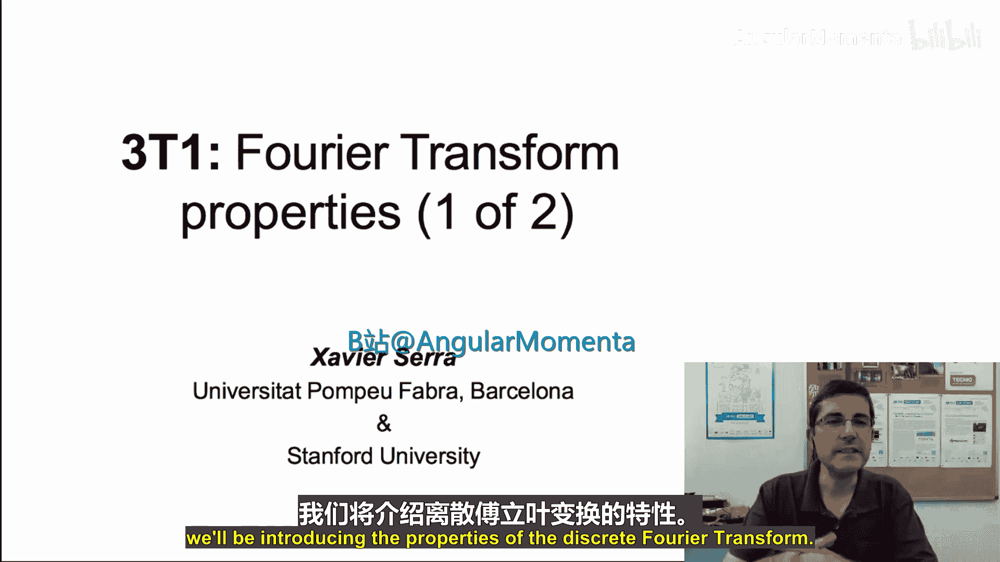

So， let's start。Bennerdi is a very convenient property of many mathematical operations。

 in this case of the DFT。It basically means that is a well behave operation。

If we start with the linear combination of two signals， x1 x2， then in the spectral domain。

 in the frequency domain， it also corresponds to the linear combination of the spectrum of the individual signals that we put in。

And it's very easy to prove if we start with the DftT of these sum of these two signals x1 x2。

We can see easily that we can group， we can separate this summeter into two sums one。

For A X1 and another for B X 2。 So basically， we are computing2 DFTs。

And since the scalar values do not depend on n， we can put them outside the sum。

 and therefore we will get the small a multiply by the DftT of x sub 1 plus B multiply by the DftT of x sub 2。

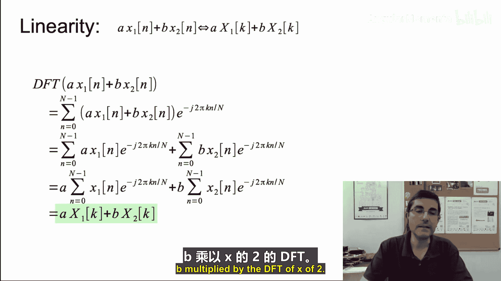

And we can exemplify this with two real signals。If we start with a signal x1 that has given amplitude and frequency on another signal。

 x tool， which is also sinusoid with a given amplitude and frequency。

 we can compute the DFT of these two signal separate so we can see the magnet spectrum。

 the absoluteps value of signal x1 and the magnet spectrum of the signal x2 and we can sum the two。

 so on the left plot we can see the sum of the two magnet spectrum。

But if we had computed the DFT of the sum of these two sinusoids， the result would be the same。

 So the DFT of summing the x1 and F x2 is the same than having sum， the two DFs。

 And this is basically a result of the linearity property of the DFT。

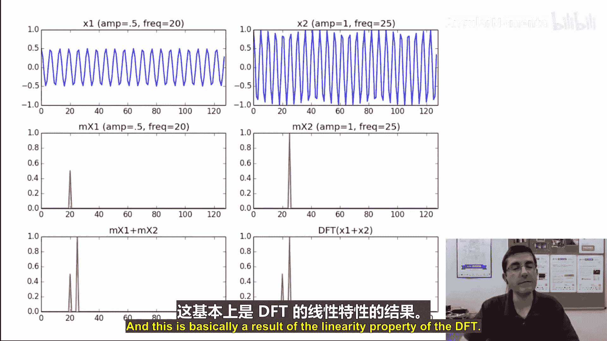

Let's go to another property， the shift one， shifting means displacing samples of a signal。

And in the DFT case， it means that if we shift the samples in the time domain signal。

 we shift x n by n0 samples in the spectral domain。

 it corresponds to having the spectrum of the signal X K and then multiplied by a complex exponential。

And again， it's easy to prove if we start with the DFT of this shifted signal。

Then we can change variables and if we change n minus n sub0 and give it the name M。

We will see that then we can split these complex exponential into two complex exponentials。

 one that is M and the other， which is minus n sub 0。And therefore。

 then we can see that we have a DftT of the signal X M and it becomes a complete DftT of just a signal x。

 and then we have this complex exponential that has n sub0 value that does not depend on M so it becomes separate and therefore the result is that we have this complex exponential multiplying the spectrum of the signal x。

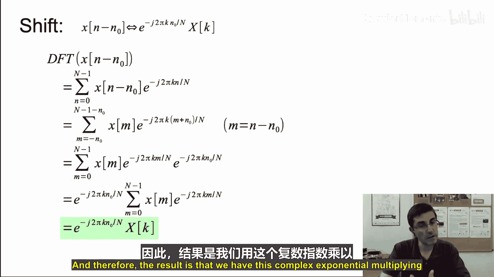

And we can see an example of that too， so here we see two signals。

 x1 x2 and one is the shifted version of the other1x2 has two samples shifting applied to x1 by the way this is a sous one period of a sous waveform。

 and then if we take the DF of these two signals， we see that their magnet to the spectra。

 the absolute value of the magnitude spectra is exactly the same。 that is no difference。

 and this is because the complex exponential that multiplies the spectrum does not affect the magnet spectrum。

 the magnet but the phase spectrum is definitely different we have two lines that have different slope。

 and this is because the multiplication by the complex exponential in the spectrum affects the phase value but not。

M value so this is an exemplification of this shifting property of the DftT。

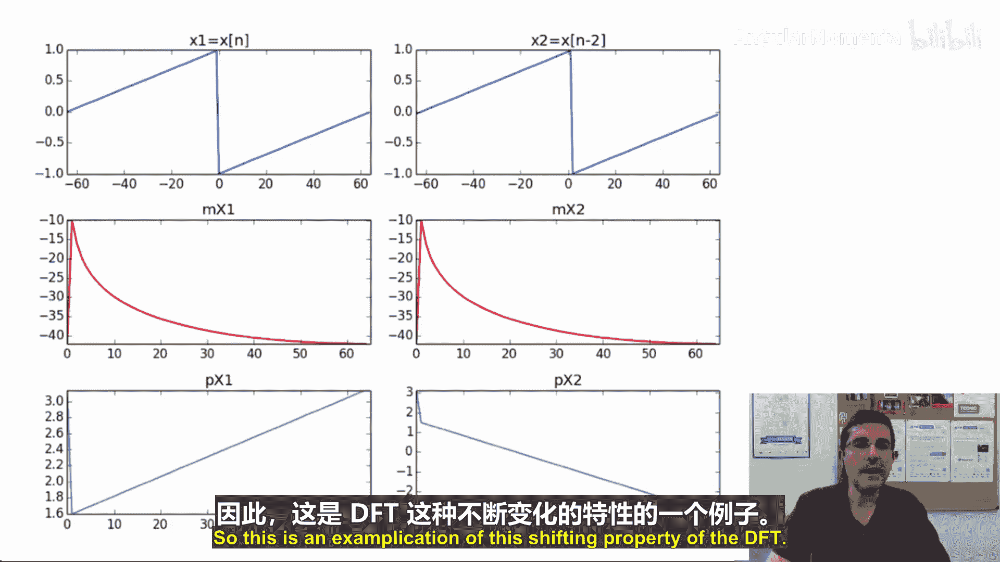

Now let's talk about symmetry and in the DFT， we have a whole bunch of symmetries and that's good。

 They are going to be very useful for many operations that we'll be doing。So for example。

 if we start with a real signal， which is the type of signal that we will be dealing with。

 then if we take the DFT of that real signal， the real part of the complex spectrum is going to have aneven symmetry and the imaginary part of the spectrum will have an odd symmetry。

And then if we look at that from the polar representation of the spectrum。

 we will see that the magnitude spectrum has an even symmetry and the phase spectrum has an odd symmetry。

And then if we look at another type of signal， a signal that is also real。

 but at the same time is even has an even symmetry itself， the time the main signal。

 then if we compute the DFT of that， then we will see that the real part of the spectrum has an event symmetry。

And the imaginary part is all zeros。And then again if we look at from the polar representation。

 then we see that the minus spectrum has the same even symmetry and the phase spectrum is all zeros and we can see it from this example in which we star from a triangle a triangle is an even function and of course it's a real function in this case and we see these symmetries we see that the real value of the spectrum is even and the imaginary part is all zeros and the absolute value is even and the angle is all zeros。

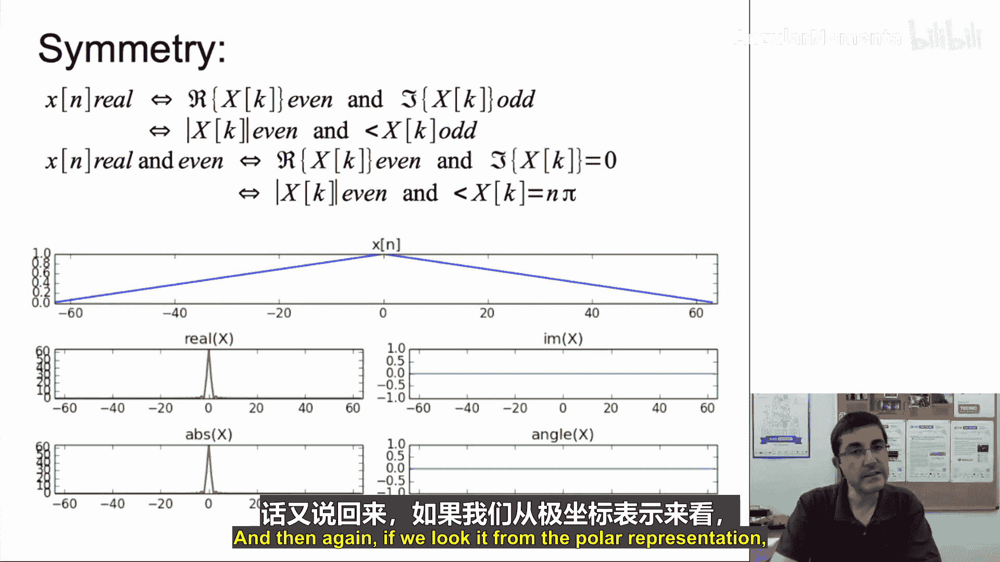

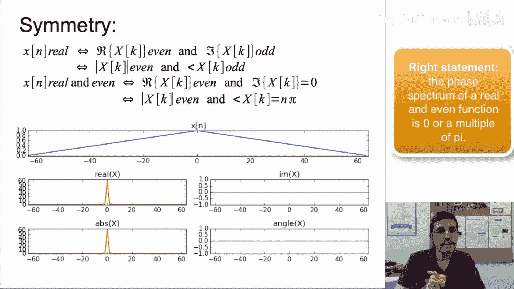

And we can show these symmetries also in real signals。

 this is the sound of a soprano of a vocal sound that we can hear。

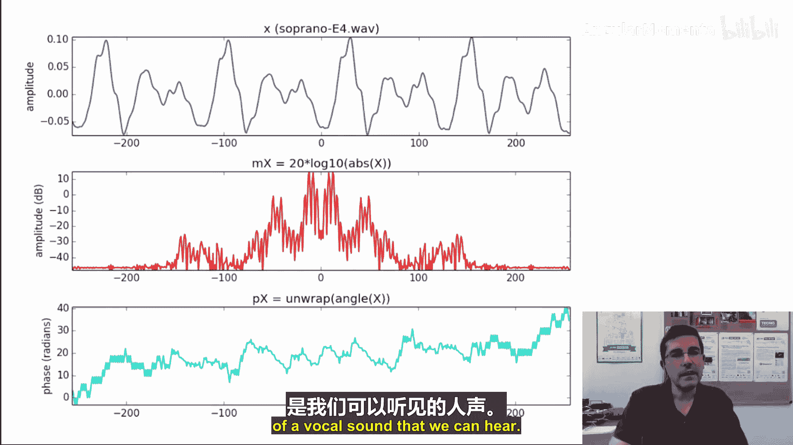

Okay， so if we take a fragment of this voiced sound。

 we see that the spectrum in polar coordinates looking at the magnitude and the face can displays these symmetries。

 The magnitude spectrum displays this even symmetry。

 the right part is exactly a saying that the left part around zero。 So that's a perfect mirror。

And the phase has this odd symmetry， which might not be as easy to visualize。

 but clearly we see that the right part is kind of inverted with respect to the left part。

 So this is this odd symmetry。

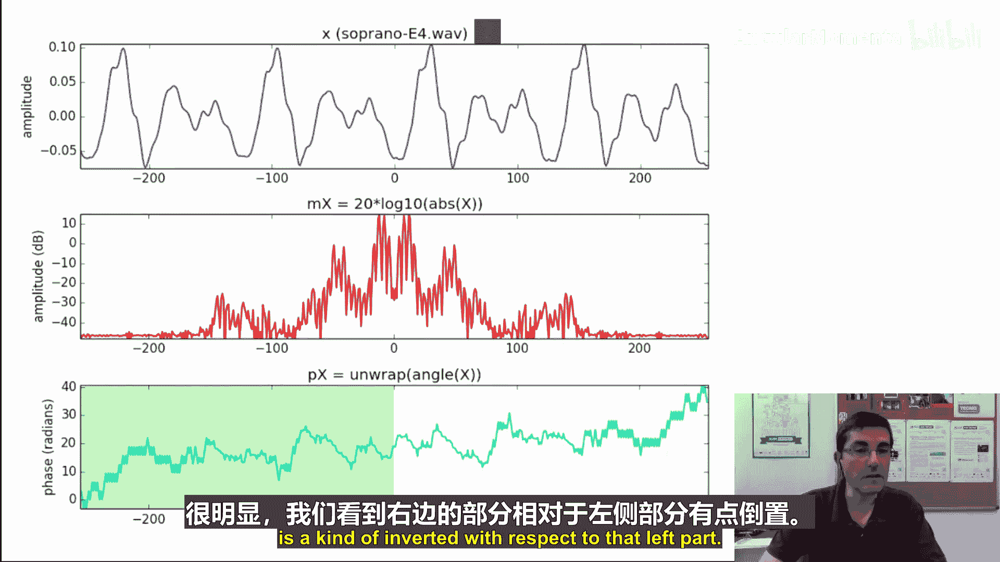

And to finish， I want to talk about the property that relate with convolution。

So it basically says that if we convolve two signals in the time domain， to time domain signals。

 then in the spectrum domain， it corresponds to the product of the two corresponding spectrum of the two signals。

And again， it's quite easy to prove if we start from the DFT of this convolution of these two signals。

 and then we put the equation for the convolution and we can separate the variable x sub1 that just relate with M and then x2 which has n and M。

 but this second part is basically the DFT of a shifted signal of x2 being shifted。

 so as we just explain the shifted operation in the spectral domain corresponds to the product of a complex exponential by the spectrum of the signal。

 so here we see x2， the spectrum and the complex exponential corresponding to that。

And then this complex exponential becomes part of the DftT of these x1。

 therefore we have the DFT of x1， and we get this product of the DFT of the X1 signal with the DFT of x2 signal。

And like most properties， this is a reversible property。

 so that means that if we multiply two signals in the time domain。

 it also corresponds to convolving the two spectrum in the frequency domain。

 let's show two these two views of this property。

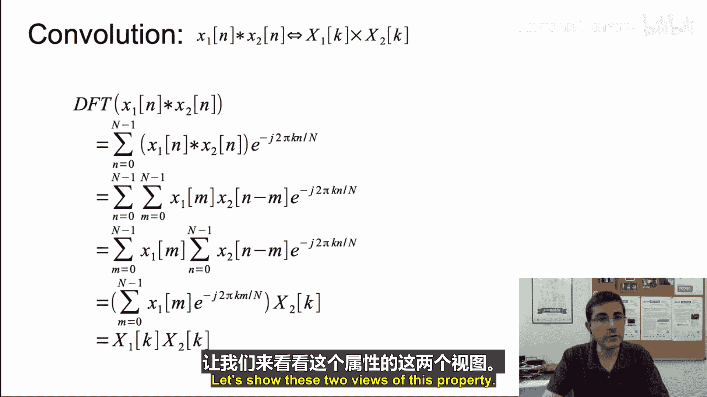

So for example， if we multiply two signals and this is an example of this multiplication and the corresponding。

Convolution in the frequency domain。 so here we start with two signals x1 x2。

 we have the DftT of these two only we are showing the magnet spectrum and we see clearly the magnet spectrum of these two signals。

 these are even unreal function so we see these even symmetries。

And then this spectrum can be convolve， so if we convolve this to spectra。

 we see this on the right hand， this is the convolution of these two spectra。

 which results into this shape， but the same shape can be obtained by multiplying the two signals。

 multiplying x1 by x2 and then taking the DFT， the result is exactly the same。

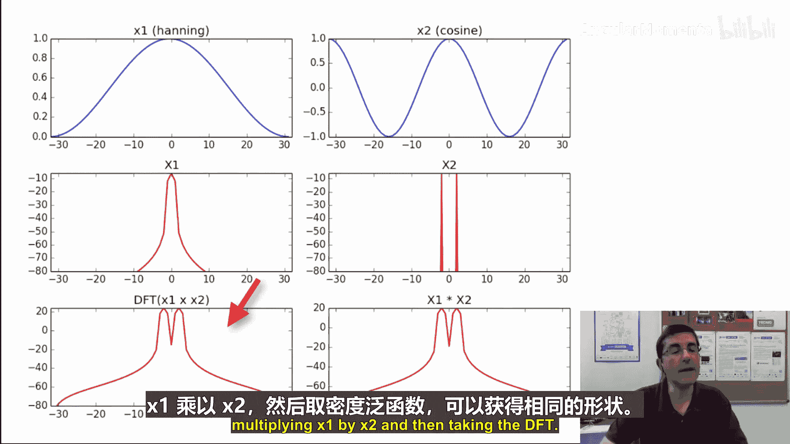

And we can show another example， which is very common in filtering。

This is an example of filtering a sound， in this case， a sound of the ocean by an impulse response。

 First， let's hear the two signals。Okay， so this is a sound of a very of a notion sound。

 So it's a very noisy type of signal。 and then we can hear the impulse this。So it's a tiny sound。

 It's an impulse response of a space。 and we can then convve the two。To get the filtering operation。

 This is the standard thing。 but with in the context of the DFT。

 we can see the DFT of the ocean sound capital X 1 and the DFT of the second sound x2。

And then this idea of convolution can be done by multiplying these two spectra。

 So on the right hand bottom， we can see the product of these two spectra and on the left hand we see the DFD of the convolution of the two input signals。

Okay， so basically that means that filtering can be accomplished both in the time domain by convolving two signals or in the frequency domain by multiplying the two spectra。

 and that's quite a very convenient property that that we can take advantage of on the DFD。

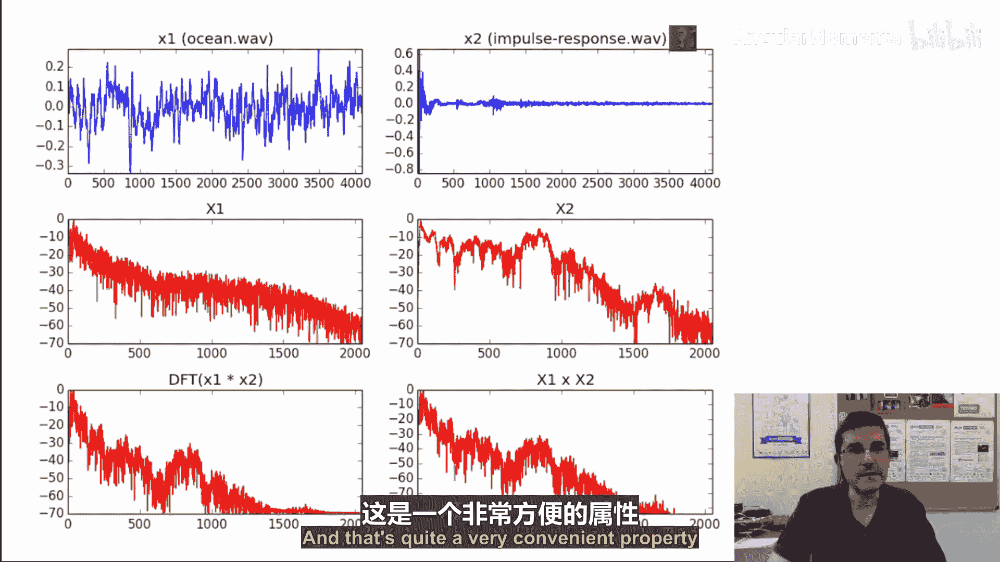

Okay， so you can find quite a bit of information about these things in Wikipedia and especially in Julie's website。

 there is a very detailed explanation of all these properties and the proofs。

The sounds I played come from free sound and of course。

 all these is available under all these open licenses。

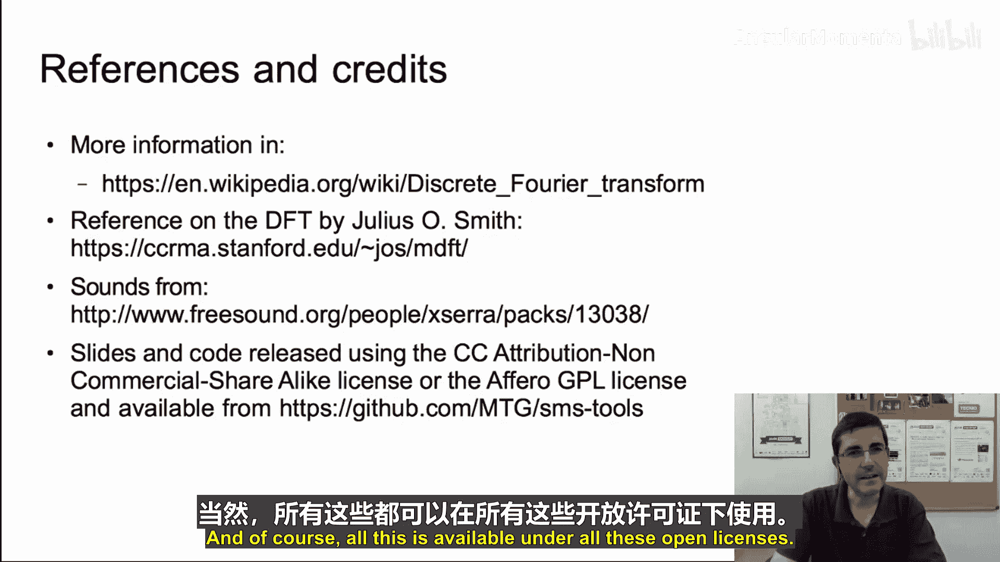

So this is all for today， in order to understand the DFT in more real situations。

 we have gone through some of its properties in the second part of this lecture。

 we will continue with some more properties。 So I hope to see you then。 Thank you for your attention。

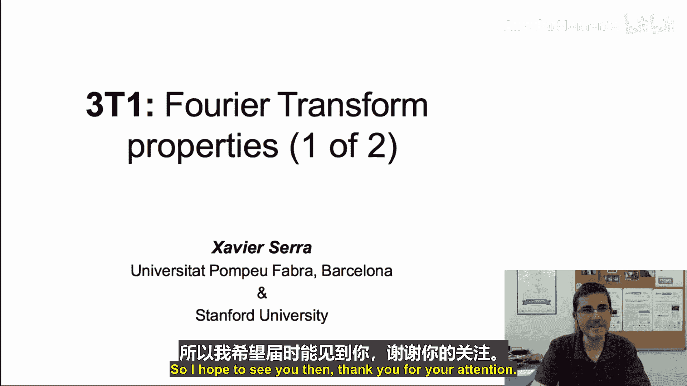