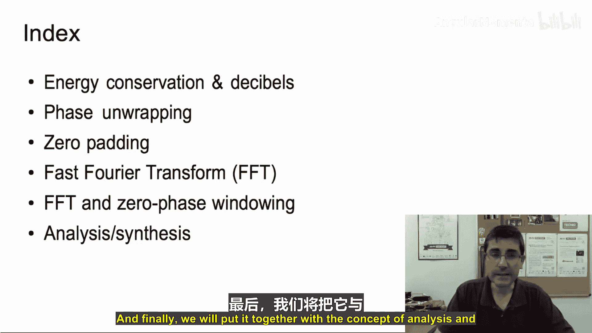
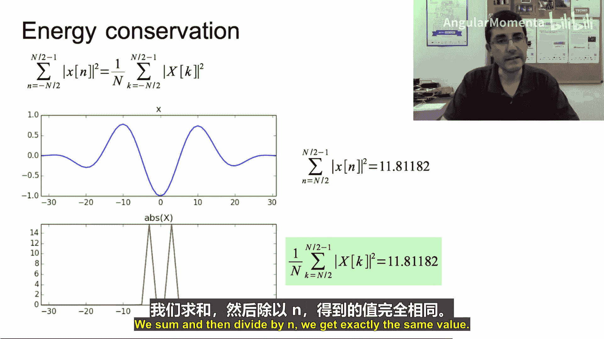
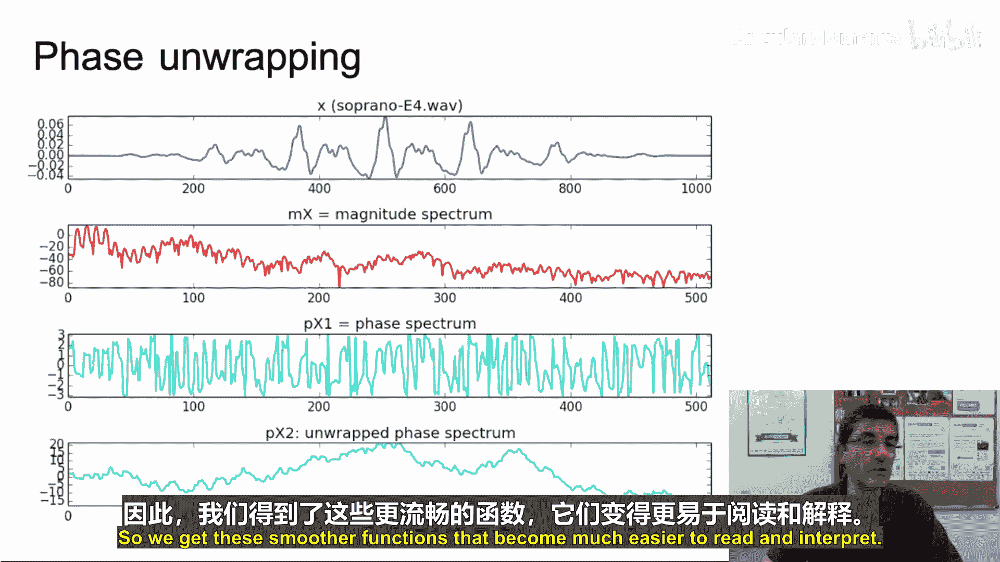
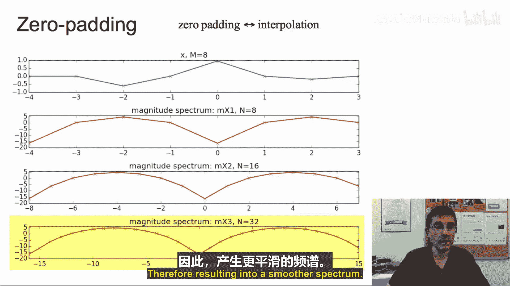
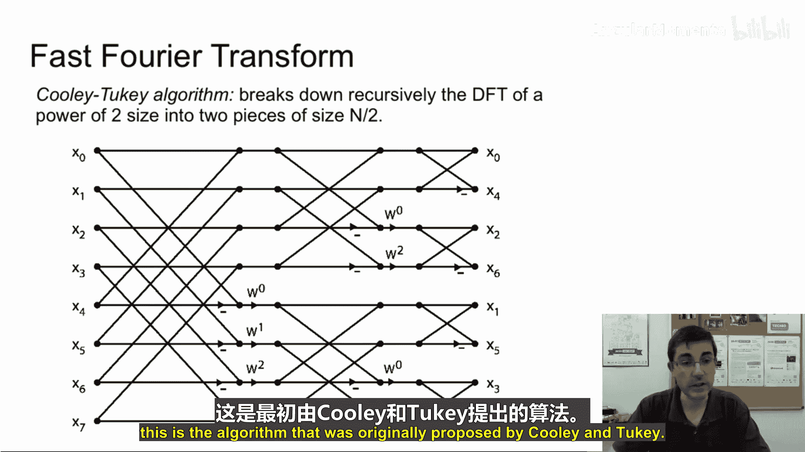
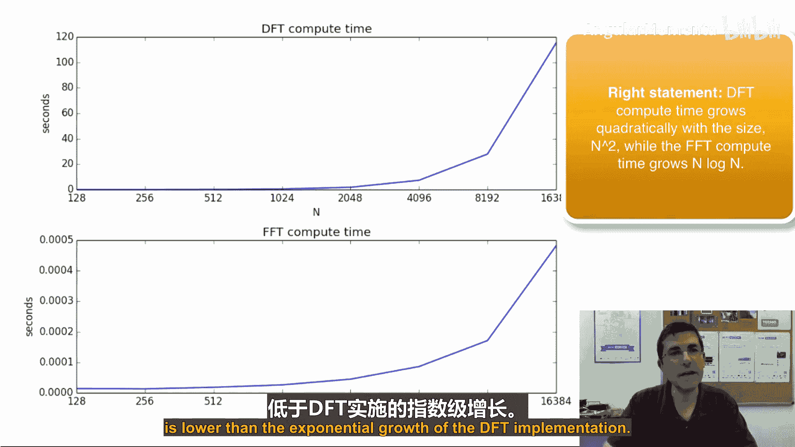
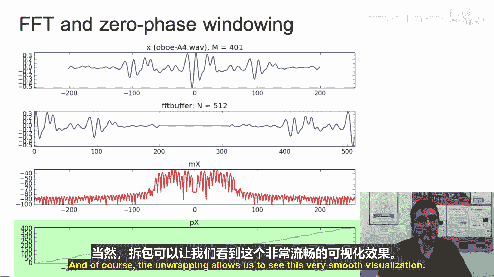
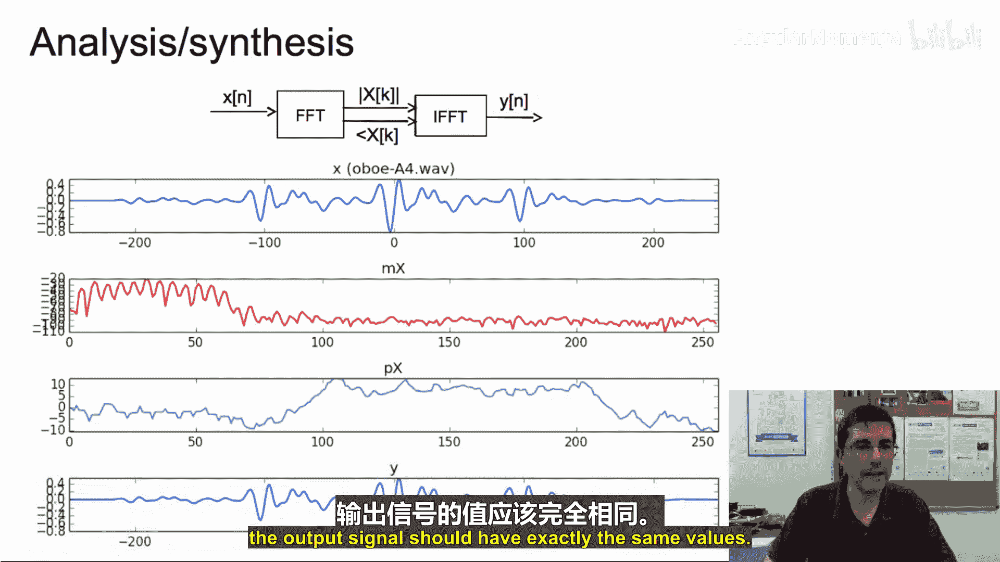
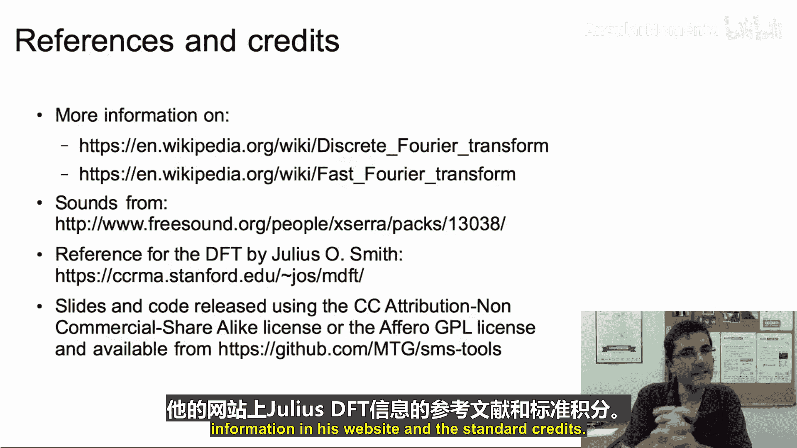
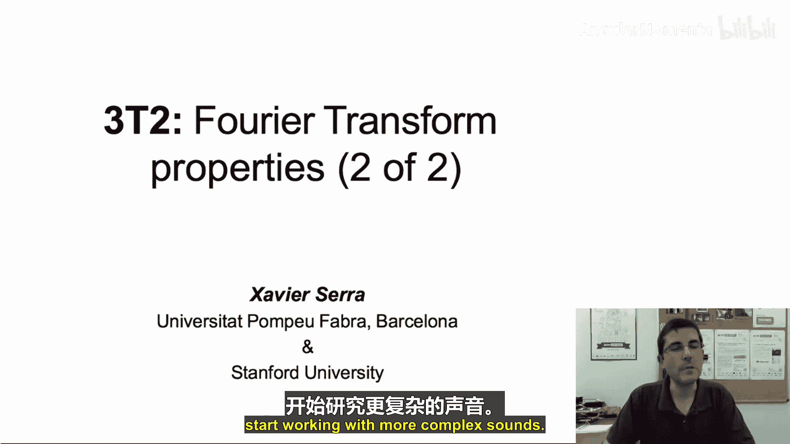

# 【巴塞罗那庞培法布拉大学】音乐应用中的音频信号处理-｜-Audio-Signal-Processing-for-Music-Applications-p19-03_01_02_傅里叶性质-2--BV18Xr6BeEX5_p19-

Welcome back to the course on using or processing for music applications。

In the first part of this lecture， we presented some properties of the discrete Four transform。

 we now continue with some more properties that will be very much useful when using the DFT。

In particular， we will talk about energy conservation and decibels。Face and wrapping zero padding。

 the Fast Fourier transform， the Fast Fourier transform together with what we call zero phase windowing。

 and finally we will put it together with the concept of analysis and synthesis of a sound。

Okay， so let's start。The property of energy conservation relates with the idea that the energy of a signal。

Both in the time domain or in the frequency domain can be measured in the same way。

 and it's basically the same。So we can either compute energy in one domain or the other。

So the energy is defined as the sum of the square root of the absolute values of a signal。

And in the frequency domain， if we take also the absolute value squared and summit and if we just add this normalization factor by dividing over n。

 we get the same value so here we see an example， we have a time domain signal。

 we do this the energy calculation and we get this value 11。

8 and if we do the same thing in the frequency domain in the square of the absolute value with sum and then divide by n。

 we get exactly the same value。

Okay so a concept related to energy is amplitude， which is what we normally use and either in the time domain or in the frequency domain。

 when we obtain the polar representation of the spectrum as a signal it's theFT。

 the amplitude is obtained by computing the absolute value which is a linear measure， however。

 for the case of sounds， a more intuitive representation of the amplitude can be obtained by converting it to decibels into a log value so the decibels are defined as we see here as 20 times log 10 of the absolute value of the signal。

So from the original time domain here we can see the。absoluteol value。

 the spectrum in a linear representation， and what we are now saying that is a more intuitive way to visualize the amplitude in the frequency domain。

 so using decL scale。Okay， so the spectrum of a signal includes the amplitudeted now computing decibels and also the phase。

And face and wrapping is a way to represent the face spectrum of the DFT in a way that is easier to visualize and understand。

So here we see an original signal， the magnet spectrum indescives and the phase spectrum computed as the angle of the complex value of the spectrum。

 and here we see clearly there is a very messy type of visualization。

 so the unwrapping what it does it basically smooths that out by adding two pi whenever there is a discontinuity。

So since this is bounded between 0 and2 pi， whenever it reaches beyond2 pi。

 it wraps back and it goes to0。 So what we are going to do is to unwrap that and let it grow as it behaves in a natural way。

 so we get these smoother functions that become much easier to read and interpret。

Zero padding means to add zeros at the end of a signal。In the context of the DFT。

 if with zero pad in one domain， it produces an interpolated signal in the other domain。

So here we see an example of that。We start from a signal x of size8。

And this is the signal from which we compute DftT， so its DftT will also be of size8。

 and in here we see the absolute value well in this case computed into DB into decibels of these eight samples。

Now， instead of computing the DftT of these eight samples。

 we can compute the DFT of these eight samples plus eight samples of0。

 therefore having the size of the DFT to be 16 this is the second plot so by computing the DFT of size 16。

 but of only these eight samples what we are seeing is that is a much smoother visualization。

 the samples of n equal 8 of the magnitude spectrum of any1 are exactly here but apart from those there are interpolated values in between so that to make the spectrum a smoother and we can even do more if we0 but even more up to n equal 32。

 we will get more interpolated values in between therefore resulting into a smoother spectrum。

Okay so now let's talk about Fourier the fast Fourier transform。

 the DFT can be a quite demanding operation， the implementation can be quite slow if we don't pay attention about some efficient implementations。

 so the fast Fourier transform is that is an efficient implementation of the DFT equation and it does that by taking advantage of symmetries。

So what it does is that it restricts the input signal to be of size a power of 2。

And because of that and thanks to that， then there is a whole bunch of symmetries that appear and so in this example。

 for example， of having eight samples of signal， we can combine them so that we can group them and take advantage of these symmetries and then perform computation at these pairwise type of signals and therefore having a much more efficient computation。

There's other algorithms that take advantage of other symmetries in this case this is the algorithm that was originally proposed by Coian Tuki。

And here we can see a little bit the difference in computation time between the standard DFT and the FFT。

 so here in my laptop I computed the DFT that I showed last week in Python implementation and a compute of different DFT sizes and I computed the time that it took so it was as the size of the DFT was increasing the computation time increased exponentially and here the last one I tried 16。

000 it was close to 2 minutes of compute time。If I use the FFT implementation that comes with Python。

 of course， is an efficient implementation also because it's implemented in C。

 but clearly we see the huge amount of difference between that， so an FF0 size of 16。

000 samples is much less than a millisecond to compute time。

And the growth of this compute time is growing not exponentially。

 but it's growing a little bit flatter， so in fact it's growing at the growth of n log N。

 which is lower than the exponential growth of the DFT implementation。

Okay， so in order to use the FFT， we need to have the input signal to have a power of tool length。

But we want to compute the spectrum of any length signal。

So this is the way we propose to compute the spectrum of a signal， we would first do zero padding。

 and then we will be using what we call zero phase windowing。

OkaySo let's go through this example if we start from a fragment of a sound x that has a given length。

 let's say 401 samples。Now we want to use the FFT， so we will need to use power of2。

 so the next part of two will be 512。 so we will add zeros。 So this next representation has zero。

 but it doesn't add them at the end。 it does it by kind of splitting the signal through the middle in a way that this is what we call the zeropha windowing that the zero sample which is the center sample is at the left side of the buffer。

 that's where the zero sample is then we have the positive sample up until the middle with the zero padding included。

 and then from the right side we have the negative samples， the samples that are negative time。So。

 this is the way。We will pack the signal in what we call the Fft buffer now before calling the FF and if we compute the Fft of that and then compute the spectrum in DV and the phase with unwrap unwrapping the phase we see this visualization in which we see the symmetry of the magnet spectrum and we see it quite nicely we see quite smoothly and the phase we see the odd symmetry of the phase and we see a various smooth phase visualization because of two reasons because we did the zero phase windowing and because we did the unwrapping so because of the zero phase windowing basically we are getting rid of the shifting distortion that would occur if we had not centered all the samples around zero and of course。

The unwrapping allows us to see this very smooth visualization。

Okay， so that's this is the last part of what I wanted to talk about。 So we have seen the DFT。

 We have seen different properties。 So now we can put it together and doing the analysis and synthesis of the DFT in what we call the analysis synthesis type of operation。

So we can start from a signal， compute the F50， represent it correctly in the magnitude and phase。

 and since there are symmetries， there is need to only show half of it， the positive side。

 So this is the positive side of the magnet spectrum and the positive side of the phase spectrum So the spectrum was twice as long and then we can do the inverse for your transform from these and reconstruct the original signal and it should be exactly the same。

 So if we do things right， the input signal， the output signal should have exactly the same values。

So we have seen this slide before， this is just a slide for giving some references and credits。

 information on the DFT is available in many places about the Fastpho Transform2。

 the sounds from Freeso， again the reference for Julius DFT， information in his website。

 and the standard credits。

So with this lecture we complete the presentation of the relevant Fourier transform properties that are of relevance to our audio processing work in the next lecture we will take this further and start working with more complex sounds。

So I hope to see you next class， bye bye。