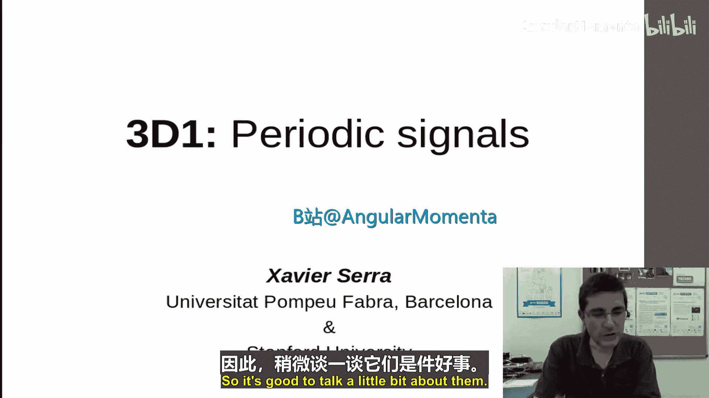
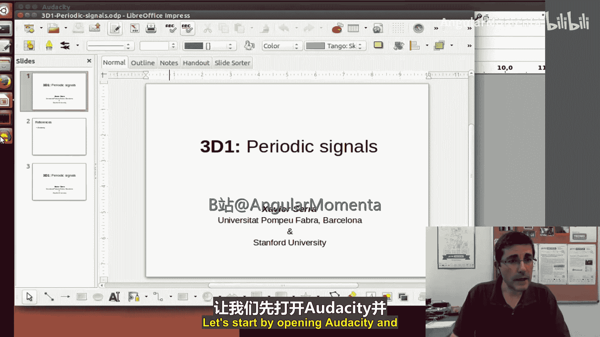
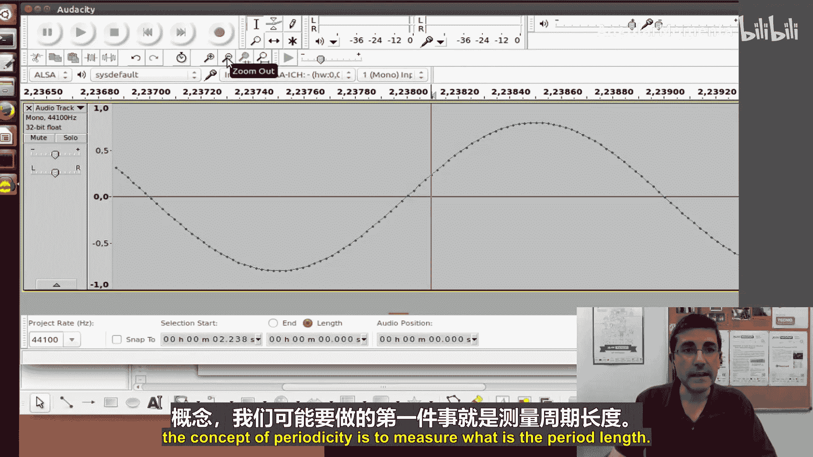
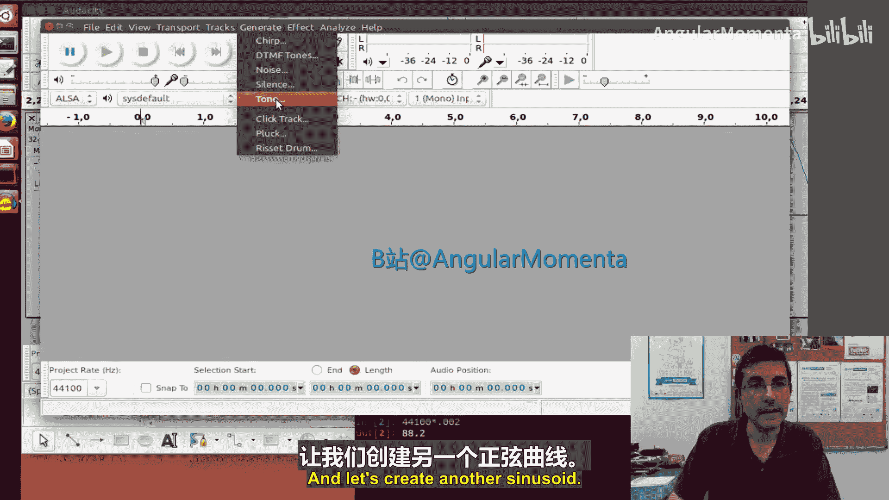
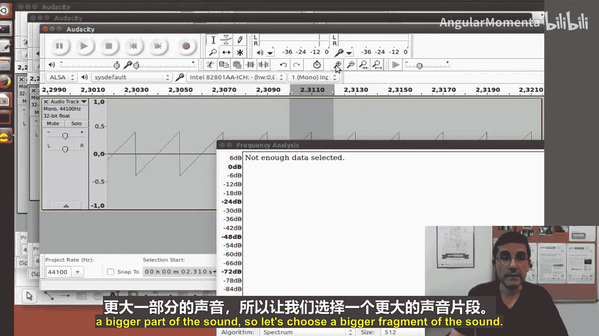
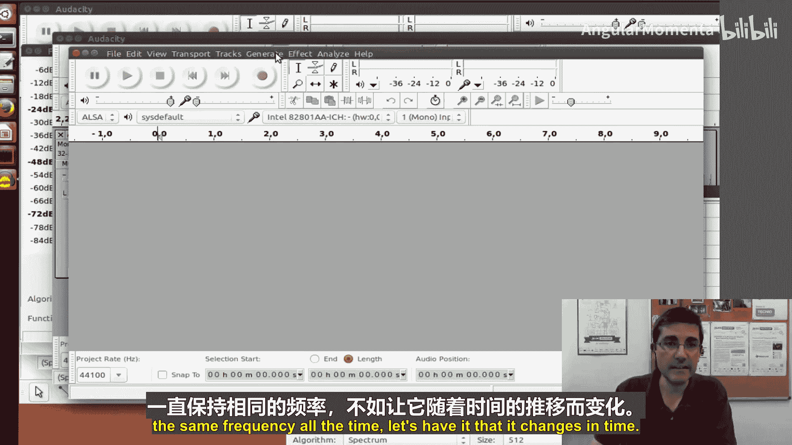
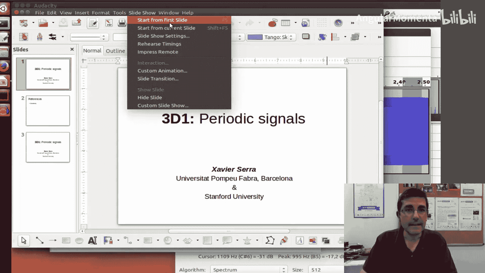
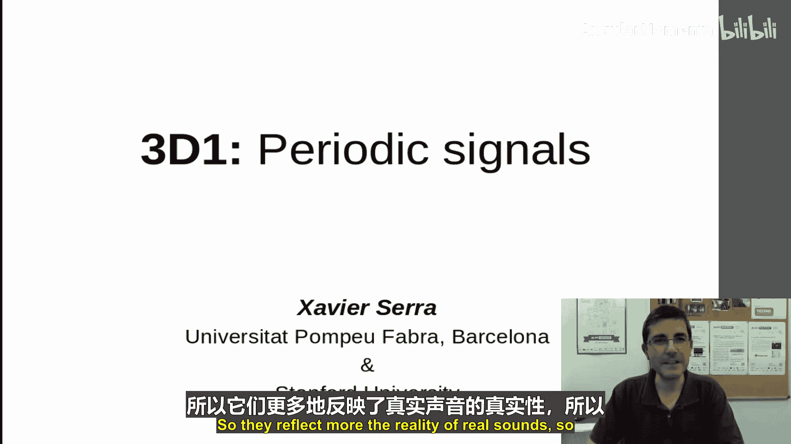

# 【巴塞罗那庞培法布拉大学】音乐应用中的音频信号处理-｜-Audio-Signal-Processing-for-Music-Applications-p20-03_02_01_周期信号--BV18Xr6BeEX5_p20-

Welcome back to the course scenarioar S processing for music applications。

In this demonstration class， I want to talk about prioric signals。

Pioic signals are at the basis of understanding most signals and are also at the basis of Four analysis。

 so it's good to talk a little bit about them。

Let's start by opening audacity and generating some periodic signals。

 so here it has a tone generator and the most fundamental periodic signal is the sine wave that we already have seen。

 so let's generate a sine wave of 500 hertz。

Duration of five seconds and Pluto 0。8。Okay， so here is our sign wave。let's hear it。Okay。

In order to see that it periodic， we can zoom。Into it and here we see the sinusoidal oscillation。

 the periodic oscillation of a sine wave， if we zoom even more we're going to start seeing the samples that are present in this signal。

 this is a discrete signal so we have generated this signal at 44。

100 Hertz so well have that many samples per second。

so the first thing we might want to do to understand the concept of ferity is to measure what is the period length。

，The idea of periodic means that there is a period that is repeating a cycle of the sound。

So this is a cycle of this sinusoid， and in here we can see what is the length of this selection I made and it says that is 0。

002， so that means 2 milliseconds。If we go to the terminal and have Python in。

 we can use it as a calculator so we can convert this period length into frequency。

So the inverse of the period。 So one over。002 will be our frequency。And of course。

 it gives us 500 hertz， 500 hertz is the frequency of these sinusoid。

OkayAnother thing we might want to check is okay， this period has a series of samples。

 So how many samples does one period of this sinusoid has Well in order to compute that what we should do is start with the sampling rate。

 the sampling rate is 44100 and multiplied by the duration of this period So if we multipied by 0。

002。And it gives me 88。2， which is the number of samples of a period。 Of course。

 it should be an integer number。 So I guess it's going be 88 samples in one period。

Now let's generate another sinusoid， but of a different frequency， so let's maybe open a new file。

Okay， and let's create。Another sinusoid。 But instead of 500 herz， let's put， for example， 5000 herz。

Okay， so this is the sinusoid of 5，000 hertz。 we can hear it too。Clearly much higher。

And we can also zoom。And to see the periodicity。But here we already see that is not so nice。 In fact。

 the samples are not really shaping a smooth sinnooidal function。

 This is because there is less samples per period。 Therefore we don't have a very smooth version。

So how many samples are in one period， well， not that many， in fact here we can even count them。

And it's 1，2，3，4，5，6，7，8。 So in fact， we have like 8，9 samples per one period。

 not exactly because they don't coincide， of course， with a period。 Of course。

 it makes sense because if we had seen that the frequency of 500 had 88 samples in one period。

 Now that we have 10 times the frequency 5000。 the number of samples will be 10 times less。

 So it's going to be around 8 or 9 samples。 That's pretty good。Of course。

 this relationship between the number of samples and the frequency is a very important one and related with the sampling rate。

The bigger the sampling rate， of course more samples will have and for higher frequencies will have more samples at 44100 as we go up in frequency and if we go even higher like 10。

000 or even 15，000， the number of samples will be very less and therefore the shapes will not look like a sinusoid even though it's a sinusoid。

Okay let's look at another periodic signal， but different from a sinusoid。

 so we will create a new file and we will generate a tone， but in this case let's generate。

 for example， a saw tooth。And instead of 5000， let's go back to the 500 herz and maybe the amplitude。

 we don't have to put it that high because this is a very rich sound and it will be quite loud otherwise。

Okay， so this is a soooth waveform。 Again， we can now listen to it。Okay。

If we zoom in into this waveform， well， we see that it's very periodic。

 And since the sampling rate is high enough and the frequency is kind of low， we can if we zoom in。

 well， we have a lot of samples per period。But in this case。

 the period which we can measure and it's going to be the same thing， 500。

 it doesn't mean that there is one frequency at 500 hertz。 In fact。

 this waveform has many frequencies， it has 500 Hertz as the fundamental frequency and it has multiples of that so that it's a harmonic sound and how can we check that well we check that with a spectrum analysis。

And in the audacity， we have the possibility to plot the spectrum。

 and here now it tells me that there is not enough data because I have to choose a bigger part of the sound。

 So let's choose a bigger fragment of the sound。

Now if we report plot now we can visualize the spectrum of this soth and clearly we see that it's a quite complex spectrum in which it has many peaks in order to understand this。

 I think it's good to compare it with the sinusoid we started with。

 So this was the sine wave we started and if we do the same thing that we have done now with the sawth that is to compute the spectrum。

Well， we see now that it's clearly very different。The spectrum of sinusoid has only one measure peak at the frequency in this case。

 500 and the spectrum of these sos has many peaks which correspond to all the frequencies present in this harmonic signal。

Okay， now let's even do something a little bit more complicated。 Let's see that we can generate one。

Signal， but instead of being the same frequency all the time， let's have it that it changes in time。

 So these are normally called chirp functions。 So let's have a sine wave being a chirp。

 and let's go from the two frequencies we have mentioned。 So from 500， let's go up to 5000 Hz。

And let's have the amplitude as08 all the time， and let's have these five seconds。So now we have。

Kind of a gllyando， a chirp。 And of course， we can play it again。So it's a frequency that goes up。

And again， we， of course， we consume， but we will see that the period keeps changing in time。

So here at the beginning， well have a period that is going to be quite long。

 it will be the 500 hertz， the 2 milliseconds， and by the end it will be much smaller。

 it will be 10 times smaller。And of course， we can visualize that by analyzing the spectrum of this signal。

 so if we select a portion at the beginning and analyze the spectrum。

We will see that it has around 500 Hz frequency。And if we go to the N， So we go to。The end of the。

Of the signal。Here。And now we compute the re plot the spectrum。 Well， it has shifted。

 It's going towards the 5000 Hz。 So it's it's also one single peak， but much higher。Okay。

 and that's that's a good way to visualize and understand periodic signals。Anyway。

 so this is all what I wanted to say today about periodic signals。 So let's go back to the slides。

And well， we haven't used much。 We basically have used audacity。

And we have talked about electronic periodic signals， synthesized periodic signals。

 These are signals that are quite good to play around with because we know how we generate them。

 and so therefore when we analyze them， we know what to expect。 So in next demo class。

 we will complicate that。 So we will actually analyze more complex signals。

 sounds that might have some part of the periodic might have some parts that arere not periodic So they reflect more the reality of real sounds。

 So we hope to see you next class。 Thank you very much。

