# 【巴塞罗那庞培法布拉大学】音乐应用中的音频信号处理-｜-Audio-Signal-Processing-for-Music-Applications-p21-03_02_02_复杂声--BV18Xr6BeEX5_p21-

Hello， welcome back to the course on processing for music applications。

In the previous demonstration class， we talked about periodoric signals。

Those were very simple signals generated synthetically and using audacity。

 we tried to make sense of them by looking at the time waveform and by looking at the spectrum。

Now I want to go to complex sounds so to sounds that are have a much more complexity than those ones and see what we can do with it。

Okay， so we'll start with Sonic visualizer。And we will open up a file， so let's open a speech file。

Okay， so this is a sound of a male speech。 Let's hear that。 Do you hear me， They don't lie at all。

Okay， now we can of course， zoom in into different parts of the sound and we'll see that there is some parts that are more periodic。

 some parts that are not periodic at all。 So for example， this N。

 this ending that we can also select。And play。Do。Doong。It has different portions。That we can analyze。

 for example， here in the in the middle here， it has the more voice portion at all。 So if we zoom in。

 we will see that it's quite periodic， of course it changes quite a bit。

 but it has some repeating patterns that evolve in time。Instead。

 at the beginning of the of the attack of this sound， that it has the T sound。

 and this clearly is non periodic。 So we see that it's quite noisy。

 is the consonant that is very much non periodic。Okay， in order to reinforce these ideas。

 we can of course， use the spectral analysis。And in Sunni visualizer。

 there is the concept of paines and we have the different panes that we can we can display and there is one that is the spectrum so this is the spectrum of this sound at a particular location at the cursor that we are in and as I said in the previous class it's better to visualize the horizontal in a linear steps maybe put here in lines and then kind of maybe have a better D range to look at and if we are in the kind of the vowel type of area。

 we kind of see the peaks that correspond to the harmonics of this sound。Instead。

 if we go to this the beginning， this attack the T sound。

 clearly this is much noisy and is more difficult to see。

Maybe if we change the DFT size by changing it here， we might be able to see it a little bit better。

 so this is size we take 2048 samples and we will see a little bit differently the spectrum。Okay。

 let's look at another maybe more complex sound。 Let's look at， for example， this chillo double。

This is a sound that there is two notes， let's hear that。So it's not a monophonic sound。

 it's a polyphonic sound。And these two frequencies are we can hear them quite well。

 One is quite stable， and it goes throughout in the same frequency。

 and then there is this little scale going up and down。Okay， so if we zoom in into here。

We will see that it's very hard to see any periodicity because of course we have these two sounds playing at the same time in some areas that might be kind of the two nodes they might reinforce each other in terms of frequency and we might see some periodic oscillation。

 but typically that's going to be quite hard so here we might infer some periodic oscillation for example。

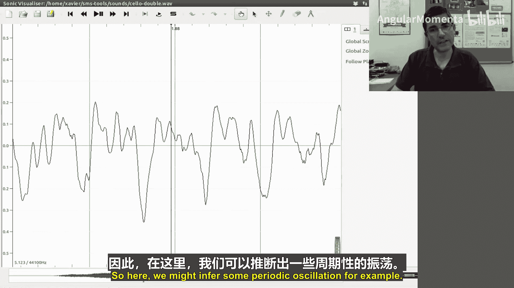

Okay， in the spectral domain。 So if we compute the， the pain and we。

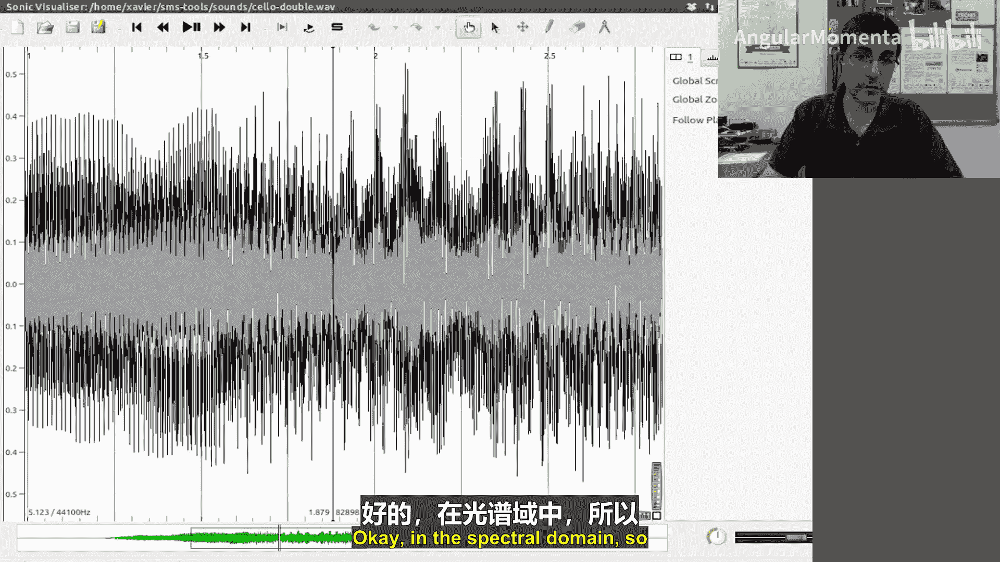

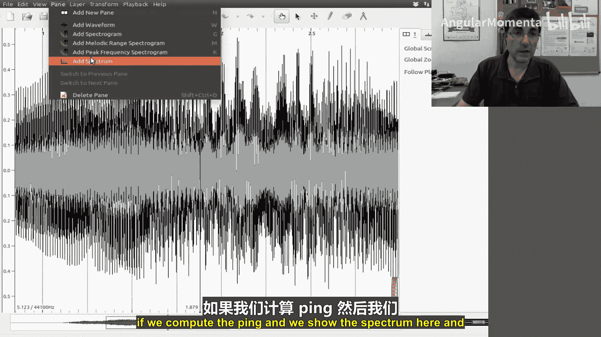

Show the spectrum here。 And again， we will do it linear lines here， and then maybe zoom。

So that we see better， okay here。Well， we see that things change and we can identify the harmonics of these two kind of melodies playing together if we would zoom into here and too bad that sonic visualizer doesn't allow me to zoom into these region we would see the different harmonics of the two voices that are being sounding together。

 So clearly in the spectral domain， we can try to identify things that in the time domain are much harder。

 and we can step through the sound and figure out different aspects。

 and then let me finish by presenting and even a more complex sound that I don't think even with the spectral analysis we can make some sense out of that thats for example。

 these orchestral sound。

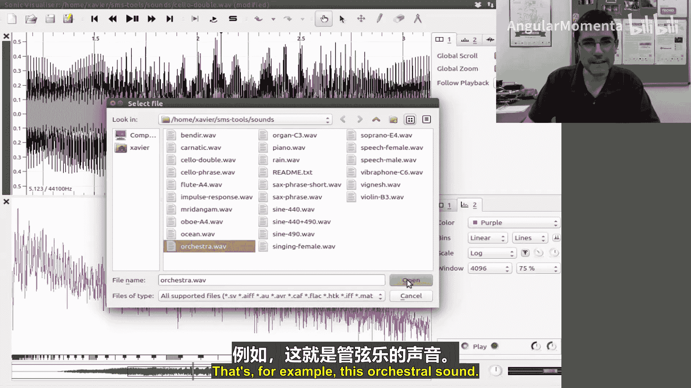

This orchestral sound， we can play it。

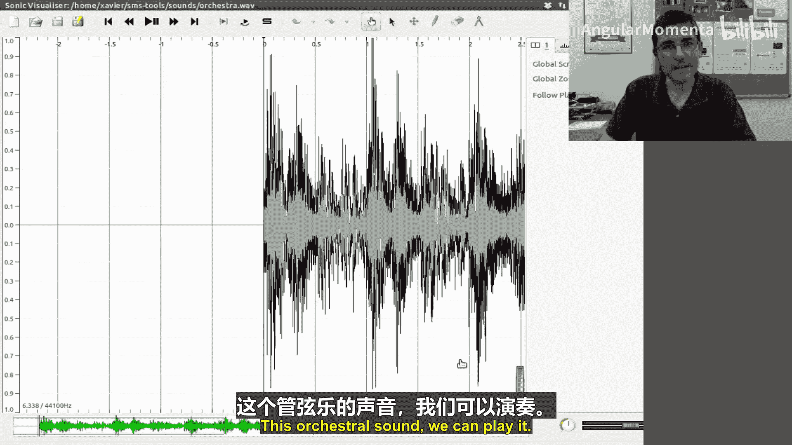

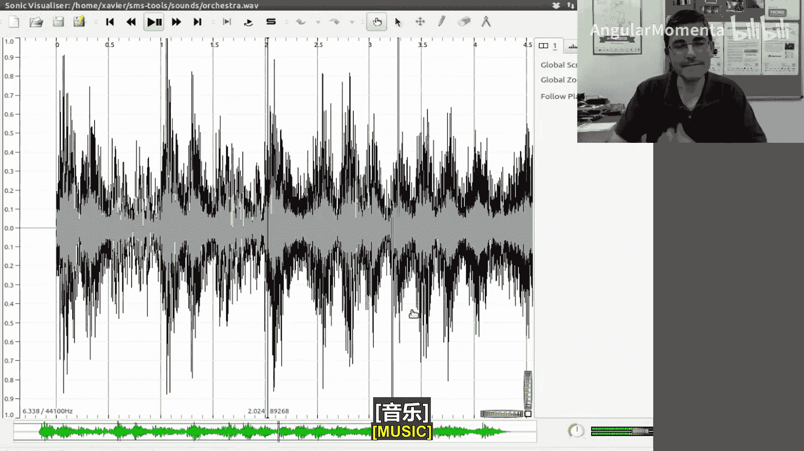

Okay it's a full orchestra with many string instruments， is's a Chinese orchestra playing。

 and there is percussion instruments， a whole bunch of things。

 So if we zoom in we very hardly we will make sense of any of it。

 It looks basically like random noise， but of course there is a lot of structure into it。Hopefully。

 the the spectral analysis should allow us to make some sense out of all this。

 So if we open the spectrum pane。

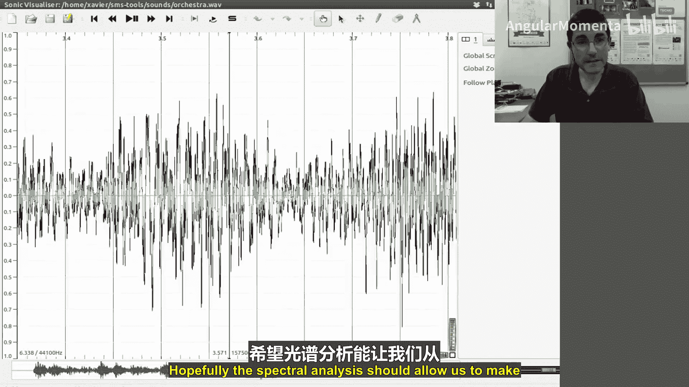

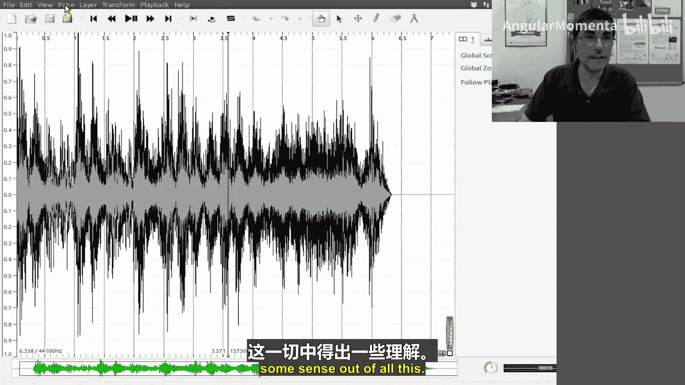

And then again， we change it to linear。 We put it smoother， and we tried to。

Make literally better visualization， well。It's very difficult， but we will learn that well。

 there is some clear peaks here that with them we can make some sense of some of the prominent voices that emerge。

 So we will try to understand it， but of course this is very difficult。

 In fact is beyond the kind of a spectral analysis that we will do in this class。

 These required techniques that in fact， there still are open research problems and it's very difficult to analyze a signal as complex as this one。

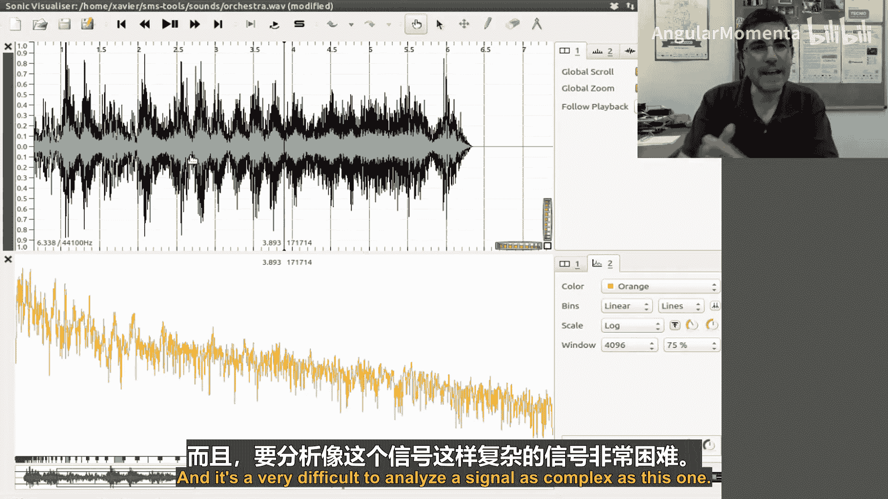

But basically， that's all I wanted to say。

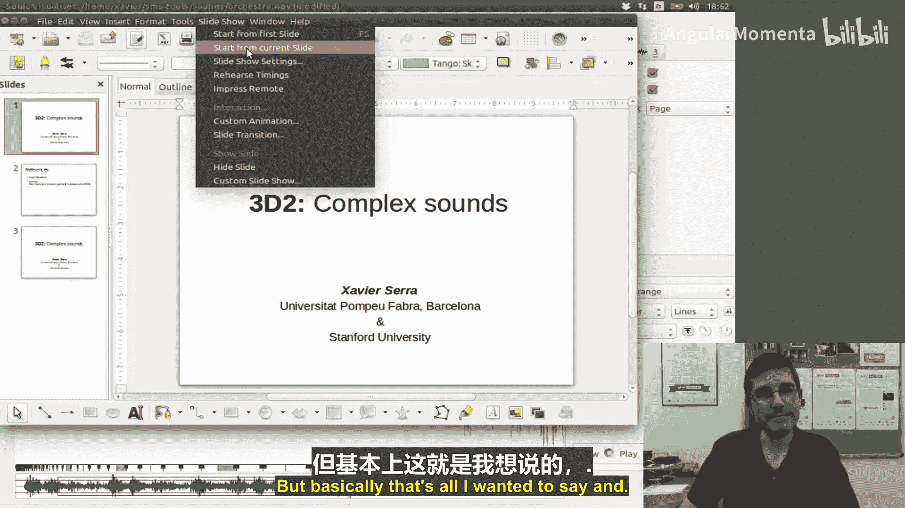

What we have used is sonic visualizer to analyze different types of real sounds。

 we analyze speech sound。 we analyze a cello sound that had to melodies to notes playing the same time and then these orchestral sound。

 all the sounds are in free sound， but we have seen that is not easy。

 of course real sounds are very complex。 maybe the speech is the easiest we can try to grasp something when there is several melodies being played at the same time but of course in a full orchestra that's really difficult。

 but anyway we don't desperate and we will try to make some sense out of that and in the next classes we will we will learn about how to handle them。

So that's all for today we tried to complement what we mentioned last time with periodic signals and trying to analyze complex sounds and we use sonic visualizer which allows us to visualize some of these spectral analysis a little bit better than audacity and that's all for today so next class we will introduce our tools。

 the ones that we have developed the SMS tools to try to see if with those tools we can do something else in terms of analyzing sounds。

 so thank you very much for your attention and I see you next time。

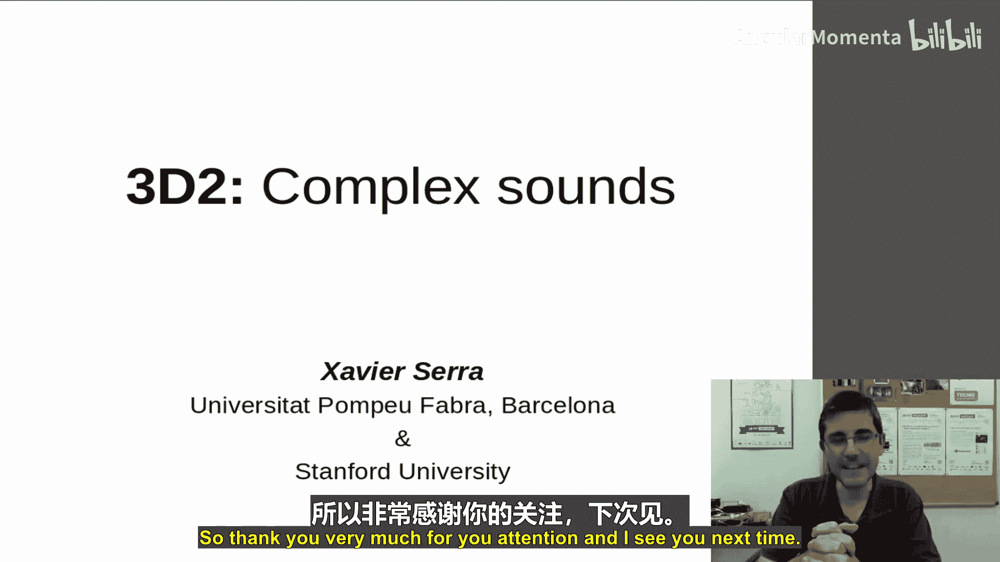