# 【巴塞罗那庞培法布拉大学】音乐应用中的音频信号处理-｜-Audio-Signal-Processing-for-Music-Applications-p22-03_02_03_频谱--BV18Xr6BeEX5_p22-

Hello， welcome back to the course on our using or processing for music applications。

In the previous demo classes of this week， we have analyzed some sounds。

 we analyze some electronic periodic signals， and we analyze some real sounds。

 and we use audacity and sonic visualizer， especially to look at the spectrum of these sounds。

And now in this lecture， I want to continue that and try to use the tools that we have developed for this particular path。

 so the SMS tools and do the DFT analysis to see if we can understand some sound。

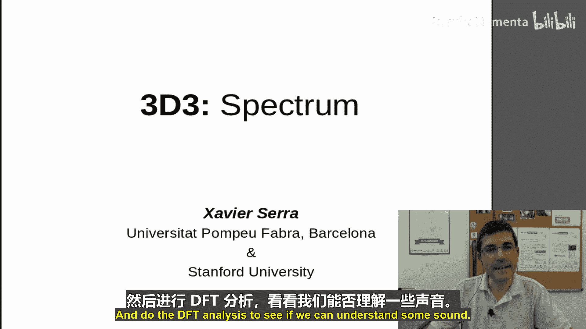

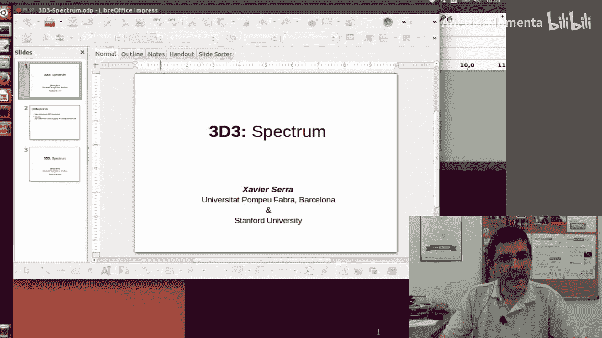

So let's first open with audacity a file so we can see the overall view of the sound。Okay。

 so let's take the violin sound。

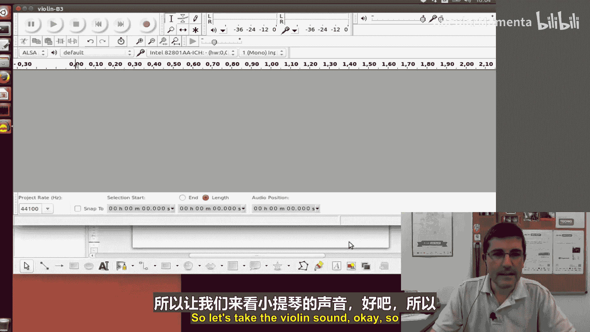

其实啲 is啊。A note of a violin。 It's quite stable。 So we can see that it's a length of。2 seconds。But we。

 instead of using audacity， let's analyze it with the interface of S M S tools。

So let's go to the models interface directory and just type Python and the model GY。

And this will open up the interface。Okay， this is the interface of the SMS tools where it has all these different models that we're going to be talking about。

 and now let's go to open up the violin sound。And using the DFT module so we can hear the volumein。

Okay， so we hear this note of the violin and in the parameters， well let's choose a size。

 a portion of a sound to analyze and for example let's use 512 we have to use a power of two for the FFT size because the FFT algorithm requires that and we don't have to use the window size of the same length but for now let's do that。

 and now we have to choose where we take these 512 samples let's say we choose the middle of the sound so let's take in a second one。

And we compute it。

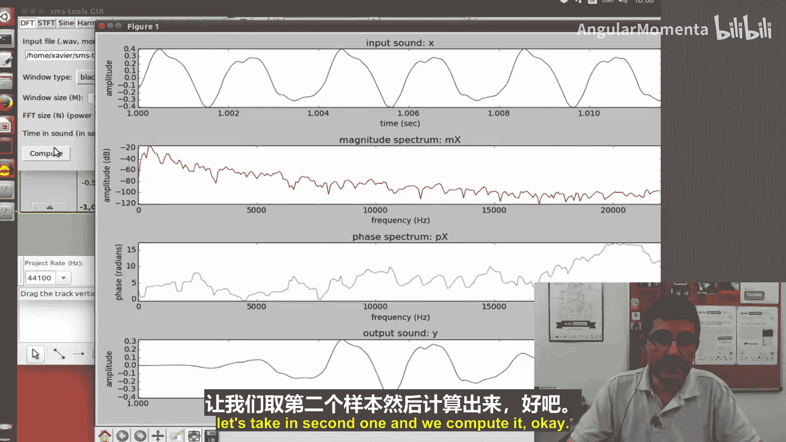

Okay so this is the analysis results， so these are the 512 samples starting at second one。

And then we have computed the DFT of that using the FFT algorithm。

 and we are displaying half of the spectrum。 We are displaying the positive side because it symmetric。

 so therefore the negative side is not required because it has the same information。

 so we are just plotting the positive side， both for the magnitude and the phase spectrum。

In the x axis， we are plotting frequency in hertz， and so we are plotting from zero to half the sampling rate。

so the sampling rate was 44100， so here we are ploting up to 22050。

Okay and the amplitude in the minus spectrum is in decibels as we explain。

 so we are showing it in Db and the maximum amplitude is minus 20 so here we don't have a complete the signal only reach 04 so that corresponds to minus20 decibels and it goes down to minus 120。

And the phase， we are ploting it using the unwrapping function。

 So instead of limiting the phase from0 to2 pi， we let it unwrap so that we see a much smoother shape。

 And that's going to be quite good， quite useful。 And then finally， out of these。

 we compute the inverse。And we compute another time domain signal is not the same than the input signal。

 because we have applied a window in the input signal。 And this is what we are seeing here。

 This is the windowed version。 That is the one that is basically captured in the spectrum。Okay。

 now let's try to see if we can understand something on the sound。

 and typically the magnitude spectrum is the most useful one。Here， well， we see things。

 but maybe we don't see what we would like to see， which kind of visualize the harmonics of that。

 So this might be because this is not enough samples。

 we don't have enough information to visualize and separate all these frequencies。

 we need a bigger frequency analysis。 So instead of 512， let's take the next power of two。

 So the next F50 size，101024 and let's compute it。

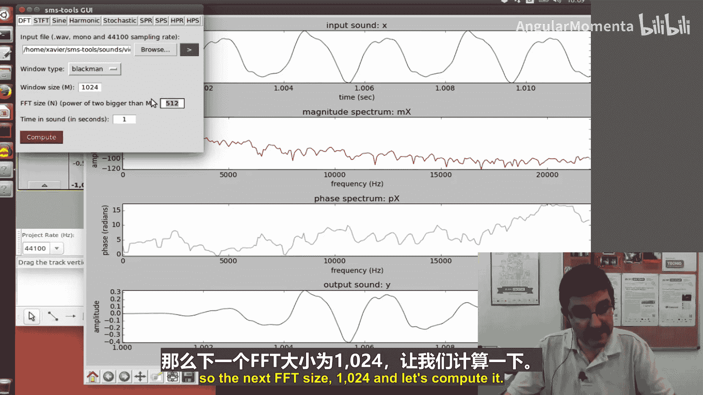

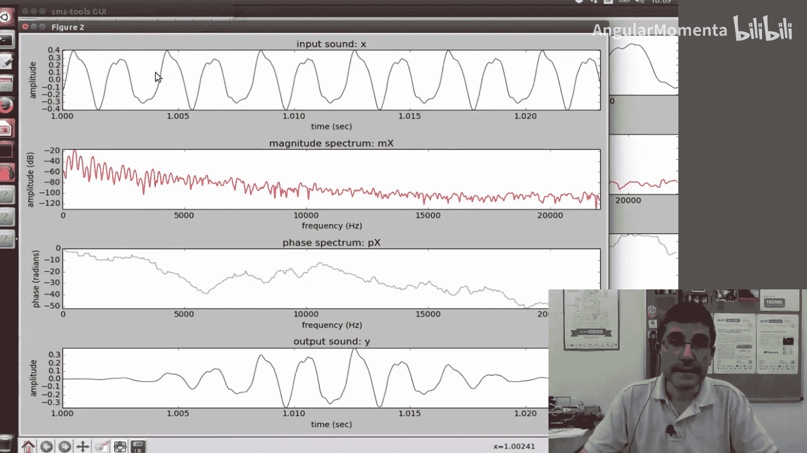

Okay， and now it's a little bit better。 Okay， so we can see compared with the the previous one that。

 of course， we have taken more samples and the magnitude spectrum gives us some more information。

For example， here， we see clearly these peaks and this corresponds to the harmonics of the sound。

 So that's quite useful information。Okay， now， maybe in order to see what what can we understand about the sound。

 let's look at another portion of the sound。 Of course， as we saw， the sound is quite stable。

 But if we go into the the beginning。 if we zoom into the very beginning of the sound。

 there is a region of the attack， it's a little bit different。

 So let's see if we can capture that difference。

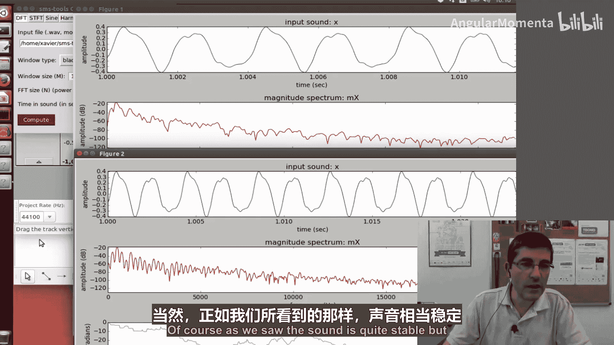

So let's go back to our interface and let's do the same analysis。

 but instead of doing the analysis at time1， let's do it at time zero， so we compute from time0。

And now， well， we see clearly that the sound is maybe not as smooth as we had it during the middle of the sound。

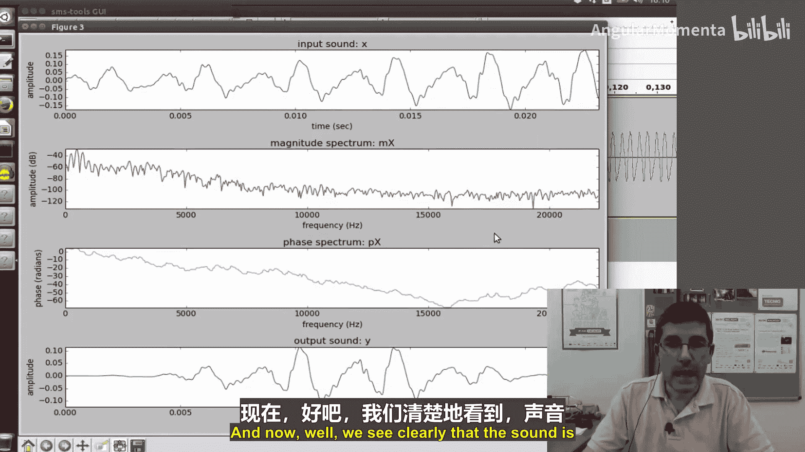

And what were also seeing is that the spectrum is a little bit different。

 we see during the attack that maybe the harmonics are not so clear。

Because at the beginning of the sound， there is more the attack of the bow of the noise。

 So there is the harmonics are not so well identify。 whether in the middle of the sound。

 clearly the harmonics are stronger。Instead， at the beginning， there is more noise。

 so these irregularities that we see in the time domain waveform are captured in the spectrum by seeing all these more kind of random and sort of irregular shapes that we see in the spectrum。

Okay， so this is the kind of things that the spectrum analysis allows us to visualize and therefore to understand。

Now let's go back to the window that of the control parameters。

 let's go back to the middle of the sound and let's talk about the difference between how many samples we take and the FFT size we compute。

We do not have to take the same number of samples of the FFT。 For example。

 we can take 801 samples and then0 part to the FFT size and compute the result。 So if we do that。

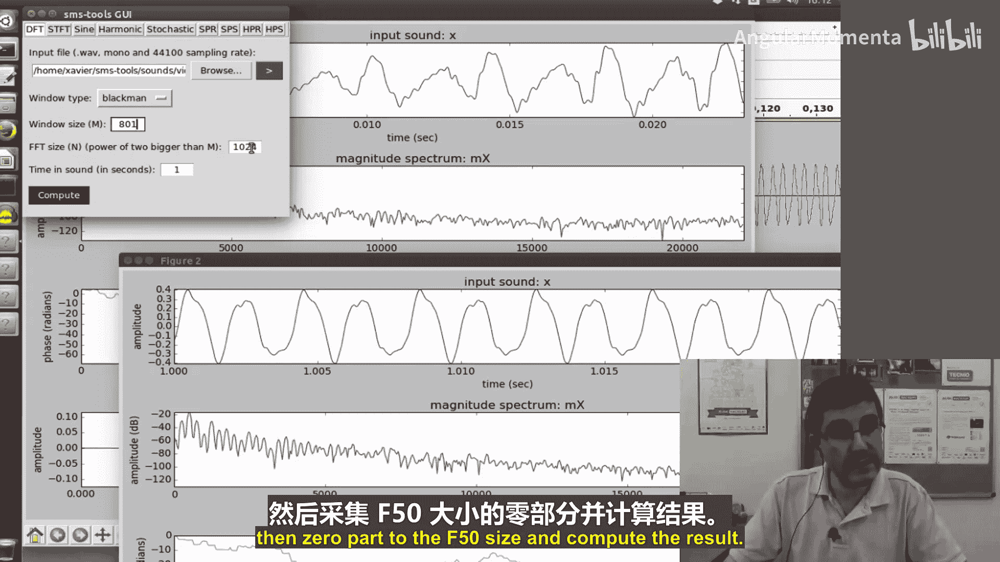

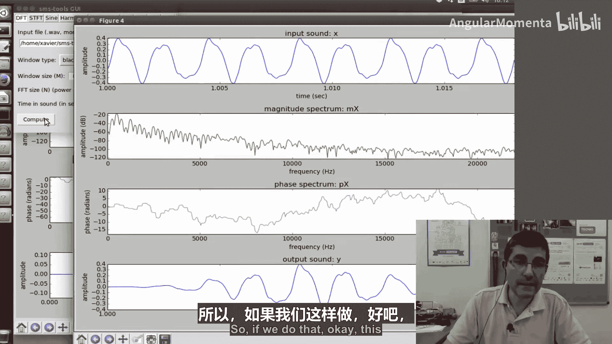

Okay， this is similar to the previous the analysis we did。At before in which we took more samples。

 we took 1024。 So this in now there is less samples。 and the spectrum， well。

 they look okay both Of course， in the one that we took more samples of the input signals。

 we see the harmonics a little bit better than the one that we have compute now with 800 samples。

 but is as smooth as as the previous ones。 So both are equally as smooth。

 This is because the F50 size in both cases is 1024。Okay， now， let's， well， let's。

 maybe get rid of the， the， the one we just computed and let's compute again the 1024 samples。

 which may be the。

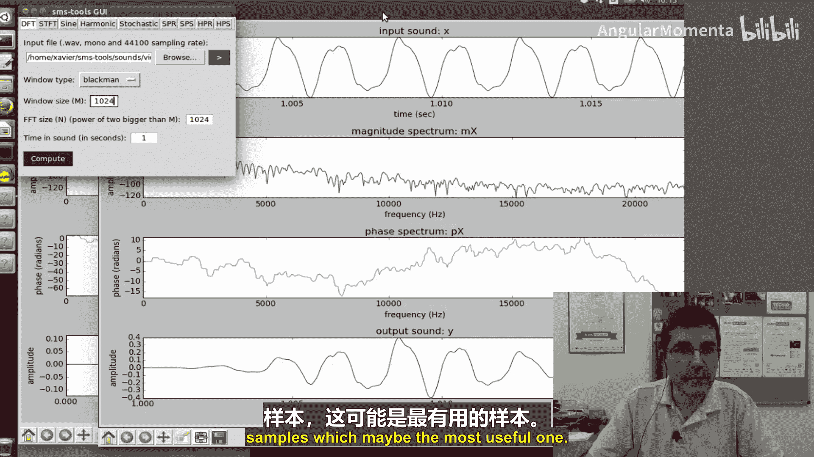

The most useful one。And now let's try to understand a little bit more about the sound。

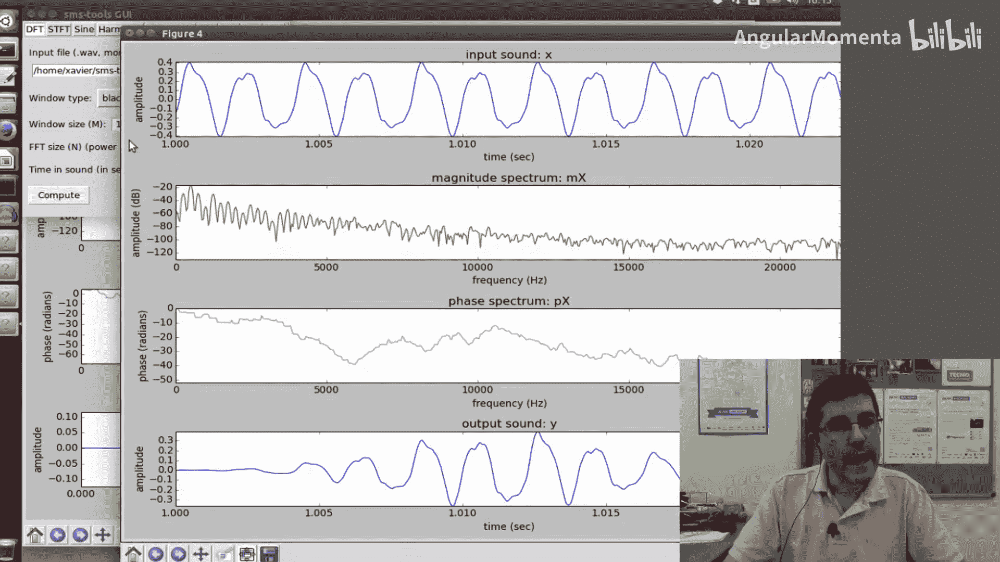

By zooming into the beginning， where it seems that the most activity and the most interesting information is。

 So with this figure interface of Python， we can choose。A rectangle。 So for example。

 in the magnitude spectrum， we can just choose the first 5，000 hertz。Okay。

And we can see these harmonics， the peaks of the first 5000 herz quite more clearly。

 and we can do the same thing with the phase spectrum。Okay， so we'll take the first 5000。Htz。

 and this is the phase of what correspond to these frequencies， the same frequencies。

now we can start seeing other things of the sound。 for example。

 we can see that these peaks are equally spaced and we can look at the frequency of them here in the lower right corner。

 it tells us what is the location of the X of the cursor at the x axis and we see that it around 240 hertz。

Because the dimension is in hertz。And if we look at the next one is around 200 480 hertz。 So in fact。

 these are the harmonics of the sound。 The first is the fundamental。

 so the fundamental is around 240 herz， and this is twice the fundamental。

 and this will be all the multiples， the harmonic multiples of the fundamental。Okay， so that's good。

 So that's a way to identify the fundamental frequency of the sound。And in the phase spectrum。

 it's pretty nice， basically what we are seeing in the corresponding frequency of the harmonics。

 we are seeing the phase of this harmonics， the phase at time 0 where we have a centered the analysis。

 So if we look here， for example， the corresponding location of the first harmonic。

 it says that is around minus2。8 radiance because the vertical axis is in radiance。

 and this is in fact， the phase at time 0 of this particular harmonic and we can go to the next harmonic and measure the phase or to the next harmonic。

 So visually we can identify the magnitude andpha of the components of this sound。😊。

So that's going to be very important and very useful and clearly with these interface with the SMS tools。

 we can zoom into the sound in ways that the sonic visualizer or audacity was not so easy to do。😊。

So anyway， so that's all I wanted to say。

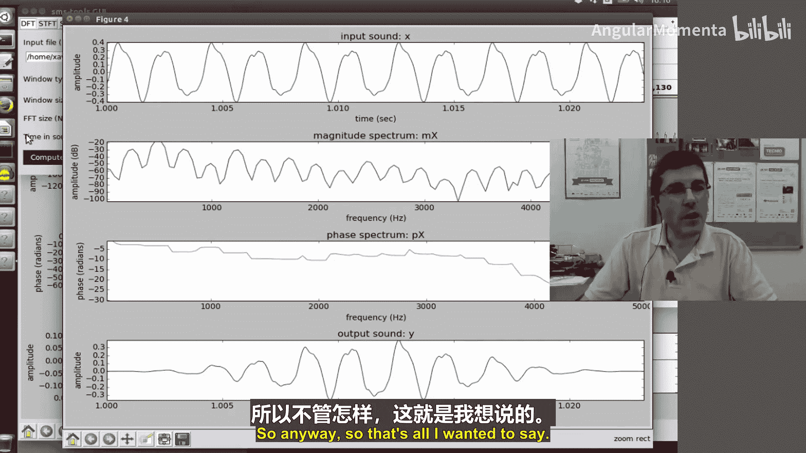

So basically， we have gone through the SMS tools， this interface of the DFT in particular。

 and we have analyzed of bioolin sound， which is available in free sound and we have played around a little bit with different parameters of the DFT。

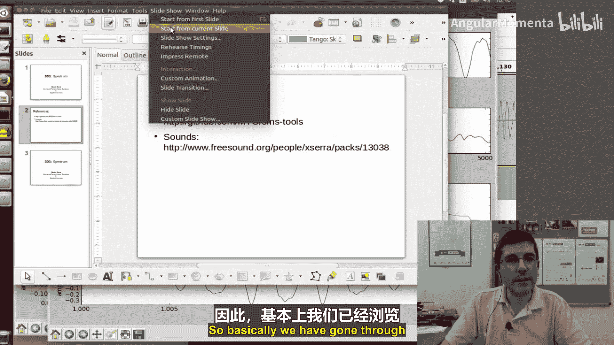

Okay， and that's all for today with these three demonstration classes we have tried to see the different tools that we can use for analyzing the sound。

 visualizing the time domain visualizing the spectrum but of course there is much more to do so next week we will continue and we will go into a little bit more complicated things。

 so I hope to see you then bye bye。

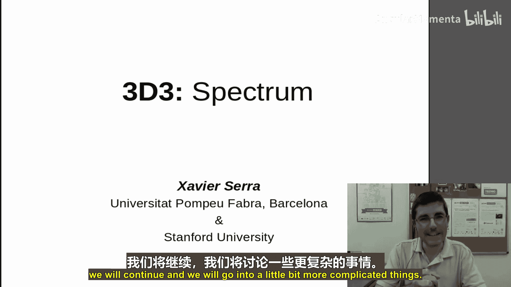