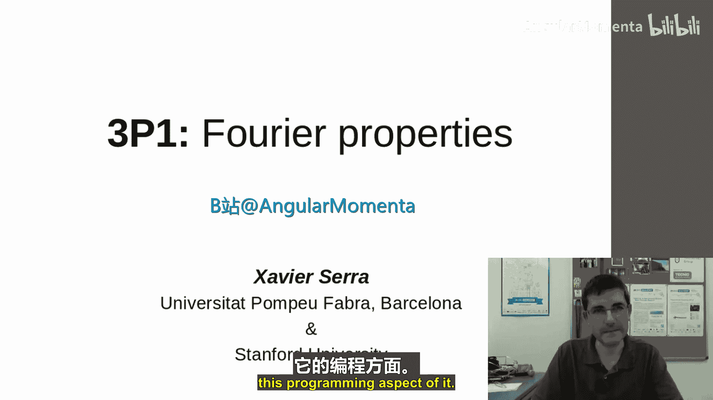
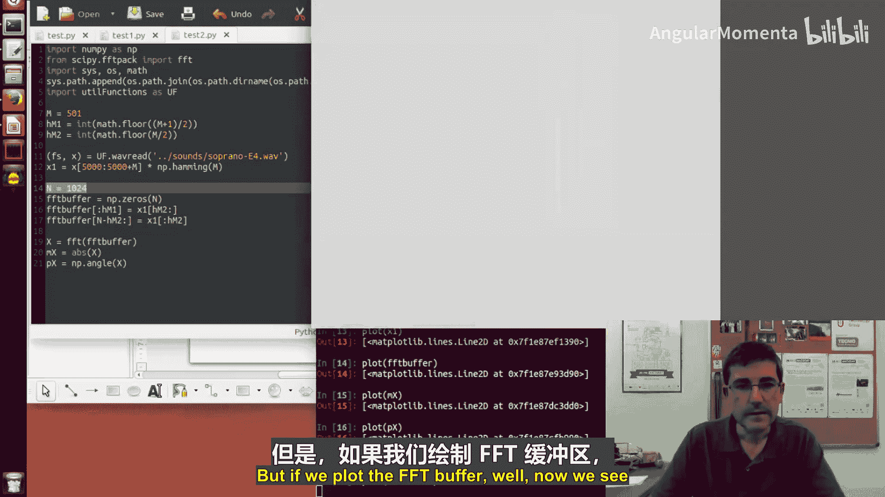
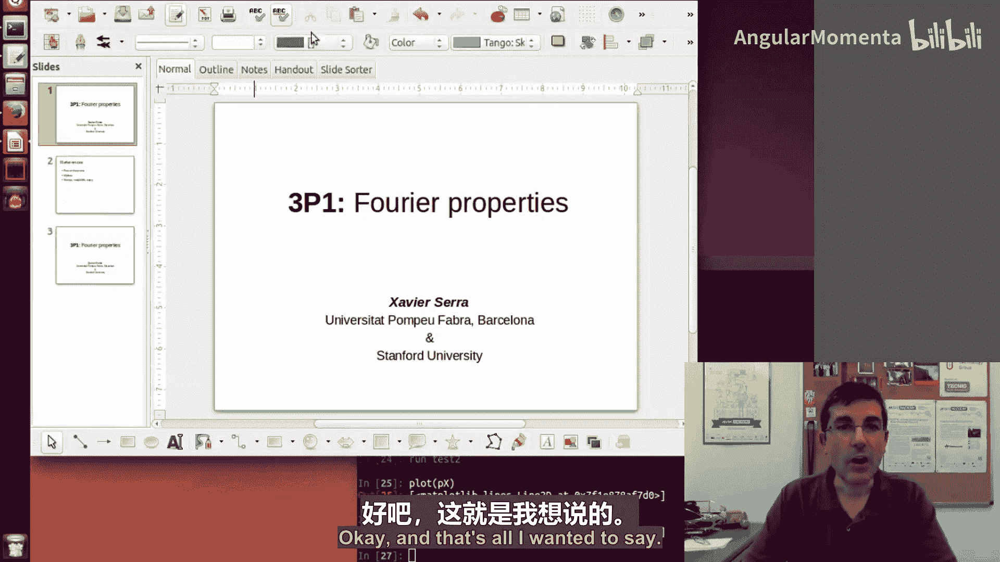
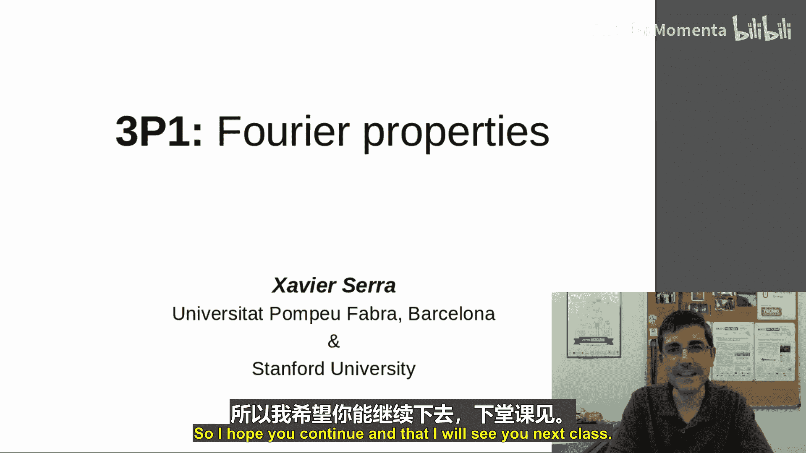

# 【巴塞罗那庞培法布拉大学】音乐应用中的音频信号处理-｜-Audio-Signal-Processing-for-Music-Applications-p23-03_03_01_傅里叶性质--BV18Xr6BeEX5_p23-

Hello， welcome back to the course on our Re processingcesing for music applications。This week。

 we are talking about the Fourier properties and theorems。And in this programming lecture。

 we're going to be using that to actually implement the analysis of a sound using the Fourier transform。

And we will take advantage of those properties to better understand this programming aspect of it。

Okay， so let's first go to a terminal。 And we're going to be working within the S M S tools kind of package。

 So we'll go to where we have kept the S M S tools。Code that we downloaded from Github。

 and we're going to be working from the workspace directory。 Okay。

 so now we are within the workspace directory， and now we can start i Python。

 So today we're going to be using i Python， which is an interactive shell that is very convenient for interactively calling Python commands。

Since we're going to be using Matpl Li all the time。

 there is a way when we start Ipyython to already import Matpl Li。 So we do that by calling Pla。Okay。

And this will execute i Python， and it already will be using the Mac Li as part of that。Okay。

 now we want to start typing Python， but it's much easier to do it from a text editor。

So here is our G edit text editor， and I already typed some of the commands of what I want to explain。

 so this is a very simple script in which I imported three packages， so NI。

 the standard array processing package。Then I wanted to use a triangular function。

 so I got that from sippi， so I imported that function。

 and I want to use the DFT implementation in Python， the F5T algorithm。

 so I get that also from sippi from the FFT pack。Now we declare we create a triangular function。

 an array of values that is a triangular shape。 So I compute 15 samples of a triangular function。

 Then I call the FFT algorithm。And here it's very important to notice that the size of the input signal is 15 samples is not a power of  two。

 even though we mentioned that in order to use the FFT algorithm we require to have a length of a power of two signal。

 but this implementation of the FFT， when the input signal is not a power of 2。

 then it just implements the DFT， the standard implementation of the equation of the DFT。

 therefore it does not take of the advantage of of the power of 2 and of the implementation of the FFT。

But so therefore we can use the Fft for any size， of course we will have to try to use part of 2 when this is called very often。

 and then after computing the spectrum capital X， we obtain the magnitude。

And the face of the spectrum。Okay， so from I Python， we can execute this file。

 This file is in our workspace directory。 It's test dot P Y。

So I can execute the script by just typing run and test no need to type the dot Py because it knows that we are executing Python files。

Okay， so now it has executed these commands。 It hasn't printed or plotted anything。

 I didn't ask for any output in that way， but it has computed all these variables。

 So these variables are now known into the environment。 So if we， for example。

 just type the variable X。 it shows the array of our triangular function that we have computed。

And we can plot it， if we plot。X， so plot is the mat plot leap function。

 I don't need to make reference to the packet， but just directly the function plot。 and I plot X。

 I display the triangr function going from 0 to 14。Okay。

Then the magnitude and phase spectrum can also be plotted， so I just can plot Nx。

And this is the magnitude spectrum。Okay， and this requires some explanation。

 The magnitude spectrum of a real function， like a triangular function。I symmetric。

And here there is a symmetry， but maybe a living misleading。 The symmetry is around 0。

 and the way this has to be understood is as a circular buffer in which the center is 0。

And then the first half of the array are the positive values。

 and the second half of the array are the negative values。 So， in fact。

 the sample 14 is also the sample-1。 Okay so this keeps repeating left and right。And therefore。

 this ending is the negative part。 and then we can understand this symmetry very clearly。Okay。

We can plot the phase spectrum by typing plot P X。ok。And it shows this quite complex function。

 which is kind of not so intuitive from what we talked about。

When we analyze a real function and an even function like the triangular function。

 the phase should be 0。 This was one of the symmetry properties of the DFT。

 And here the face is not0 Y。 well， because our time signal。

 the triangular signal was not centered around 0。 It had a shift operation。

 It had a shift of half of the triangular function。

So from what we just talked about the concept of centering around zero in order to compute that a triangular function that is centered around  zero。

 we have to place the triangle in a different way。Let's show that。Okay， in this second file。

I have added three lines。That。Change the triangular function in a way to center it around 0。Okay。

 so after computing the triangular function。We are creating a variable。

 which we call F50 buffer of the same size as x。All initialized with zeros。

 So MP dot zeros is a way to create an array of empty values。

And then what we're going to do is locate the triangle around 0， which means。

That the first part of the buffer will be the n of the triangle。

 So this way of accessing the array basically says that from seventh location of the input signal to the n are placed at the beginning。

Of the 50 buffer。And the second part of the triangle。The second half is is placed at the end。No。

 this is the first part of the triangle is placed at the end of the FF0 buffer。

And then we do exactly what we did before。 We compute。

This array that has the triangle now center around 0 and we obtain the magnitude and phase spectrum。

So again， this file is in our work space so we can just execute it。Run desk one。Okay。

 and now what we are interested is in the FFT buffer。 So if we show we plot the FFT buffer。Okay。

 we see the triangle but placed around 0。 What does that mean， Well， the center of the triangle。

 the value 1 is now at location 0。This is the second half of the triangle， and the first half。

Is now placed in negative valuess。 It place at the end。This would be the negative samples of n。Okay。

And if we now look at the magnitude spectrum。Well， it should be the same。

Than before is exactly the same。 The magnitude does not change。

 What we have done is a shifting operation。 We have moved the triangle from 0 to 14 to -7 to 7。

 So the the magnitude does not change， but the phase should be very much different。Okay。

 so let's plot the phase well。That looks strange， but let's understand the access to understand it。

 This is there is this factor， exponential factor here of E to the -15。

 So basically these numbers are0。 now there is some numerical error， but these are tiny。

 tiny values is not 0 to 4， but is 0 to 4 to the-15 so basically this means that these is all zeros and of course。

 there was some numerical error that is caused by when we we use computers。So anyway。

 so this is zero phase result。Okay。Okay， now let's look at a real signal。

 let's do the for analysis of a real signal， and for that I created another file test too in which we basically use some of the same code but added code in order to be able to read a sound file。

So we have the same packages， but here we need to include a file that is within the SMS tools directory call U functions that has the WF read function。

The W read function is a function that reads a file。

 and then it converts to floating point numbers normalized to minus1 to one。 So this is what we need。

 That's why we import that。And then instead of having some fixed values， we have。

Define some variables that allows us to define any section or any type of M values that we want any duration of input signal。

 so what we do here is a way to compute the duration of the second half and of the first half of the input signal so we can then center things around zero。

 and this allows us to handle even a not size values。

so this is just simply two variables that allow us to decide where is the middle of a window。

 then we read the input signal， we read a file， a sopranno W file and we store it into a variable X and the sampling rate fs。

 and then were just going to take a fragment of that so we're going to take from the X array。

 we're going to take the values that go from 5000 to 5000 plus the size of the window so 501。

And then， we will multiply by。A window， a smoothing window。 We'll talk that more in next week。Okay。

 so now we have a signal X1， which is a short signal， 501 samples。And then we do what we did before。

 we're going to center this signal around zero in the FFT buffer。

 and this is all this code does that。And then we just compute the result。So， let's execute that。So。

 this is test。9。And let's first plot the original sound that。We read。 So the whole。Suprano sound。

This is the whole soprano sound and it has more than 50，000 samples， close to 60，000 samples。

 and this is normalized from minus-1 to1， so it's not that loud， so it goes to from minus0。10 to 0。

15。Now， let's plot the FFT。 Well， let's first plot the fragment that we chose。 the X1。

 X1 is the fragment that we chose from the， from the singing voice already windowowed by this moving humming window。

 So these are the 501 samples。And now we have to put them in the FFT buffer， centered around 0。Okay。

 so we plot。The FF0 buffer。And this now is the same fragment of the sound， but centered around 0。

 the second half of the signal is in the positive time， and the first part is in the negative time。

Okay， and now， of course， we can plot the spectrum。 We can plot the magnitude spectrum。

so this is the magnitude spectrum and here we see the symmetry that we saw before。

 So this is the positive part at the beginning， and here is the negative part at the end。

 and we have 501 samples。Of course， we only need half of it because the others is redundant。

And if we look at the phase， we can plot thex。And this is the phase which looks quite noisy。

 and now we will try to improve that， but this is what it is and its antissymmetric。

 so the first half is the negative values of the second half。Now。In order to use the FFT。

 what we want to be able to do is take the a power of two length。

Signal without having to change the fragment of sound we actually take。 So what we we can do is。

 well， here， the FFT size N can be independent of the fragment of sound we take。So here。

 so for example， now we can have an independently of M and n will be the FFT buffer in order to be able to use a part of2 and the FFT so we can just for example。

 put 1024。Now this will compute。The FFT and will use the FFT algorithm of 12024 samples， even though。

We are only going take 501 samples。 Let's try to understand that of a bit。 So we will run the test。2。

Now， the fragment of the input signal is the same。 But if we plot the FFT buffer。

Well， now we see that the second half is storing the same way at the at the positive side。

And the the。The beginning of the sound is placed at the end at the negative samples。

 and the whole middle are zeros。 This is the zero padding。So okay。

 so these are zeros that we have added in order to fill up up to the FF size。 and this is good。

Now if we look at the output at Mx。Now， if we look。Similar to the previous one。 But， in fact。

 there are more samples。 now， there are 1024 samples。And maybe here we are not seeing the difference。

 but now， for example， if we plot it in in DB， we might be able to see more information。Okay。

 so instead， the magnet spectrum， one of the things we mention is that we want to display in a logarithmic scale。

 So what we're going to do is multiply 20 times。The log， log 10。

 which is a nu function of the absolute value of x。Okay， so now if we save it and。Run it again。Okay。

 run this too。And we plot the magnitude spectrum。 It looks very different。Okay。

 it looks of course the vertical axis has changed a lot here we see again the symmetry。

 of course here again now it doesn't make sense to plot the whole thing。

 so typically what were going to do is we're just going to plot the values that go from0 from the beginning to half of the FFT size。

 which is going to be 512。Okay， so 512 is half of。The spectrum。 And this is what we normally plot。

Okay， this is the magnet spectrum。And for the face。

 one thing that we also talked about when we talked about the properties is that it's good to do an unwrapping of the face。

 So what we're going to do is call the unrap function。Okay， from Nmai。

And this will allow us to visualize this face spectrum better。 Just your view remember， the。

 the face spectrum looked very strange。 Now， if we execute with the unwrapping function。

 let's execute again that。 and we show the， the face looks much nicer。This， and in fact。

 we should only be watching the first half。 So in fact， let's watch the part that goes from 0 to 5。

12。Okay。And this is the phase spectrum。 And this looks， as I said， much nicer。 let's unwra the phase。

 and it it does this pi2 pi。And wrapping。 So it looks much smoother。Okay。

 so this is the normal way that we will be computing the the spectrum of a signal。

 and these would be of in this case of a real sound。

So this is a pretty good code that implements the。For a transform of a signal using the FFT algorithm and using some of the properties that we mentioned and understanding the issues of symmetry。

Okay， and that's all I wanted to say。

So， basically。We have used some of the Fourier theorems and properties。

 so please make sure that you understand them， especially the concept of symmetry， zero phase。

 windowing， the concept of TV scale， the concept of unwrapping the phase， etc。

 so that when we compute the Fourier transform， we can actually visualize and understand the values in a good way。

We use i Python， which becomes very helpful。 And so we can use a text editor for some aspects。

 and then for like the plotting and to display some things interactively。

 we can use the i Python command。 So that's pretty good。

 And we're starting to use number of packages。 Well， apart from Ny and Maly FFT part of spi。

 So that's going be a very useful package for us。And that's all。

 So we have tried to use some of the properties we talked about in the context of programming。

 so in the context of actually practical use， and we have basically developed a piece of code that implements the Fourier analysis of a fragment of a sound。

 so we are starting to get something interesting， So I hope you continue and that I will see you next class。

拜拜。