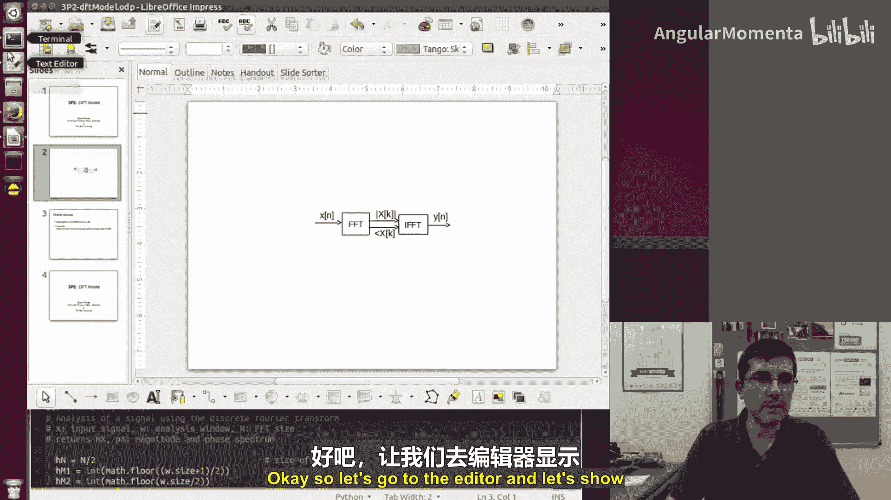
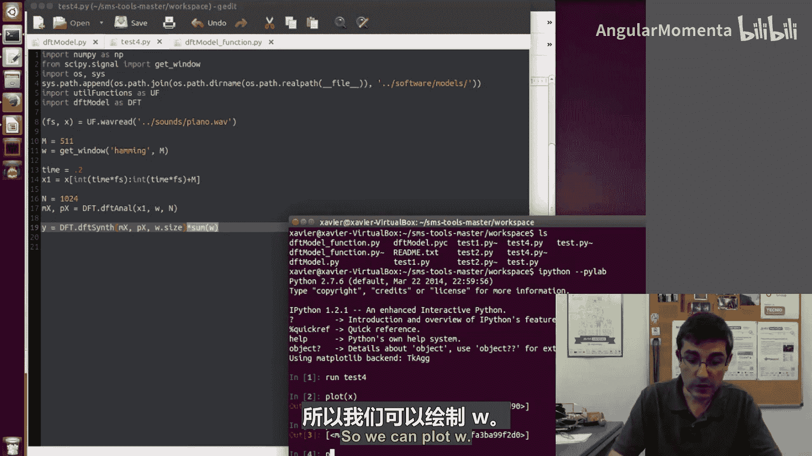
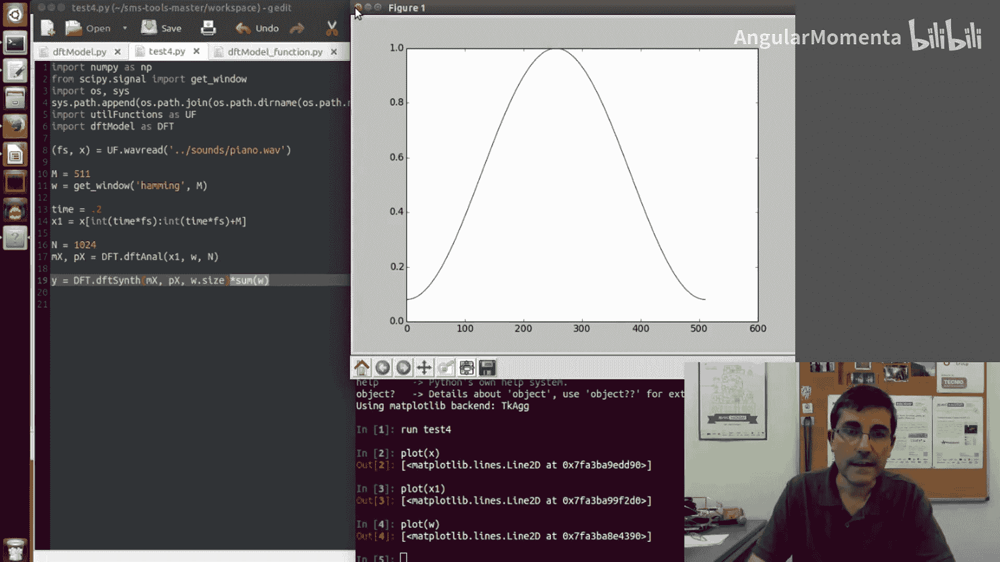
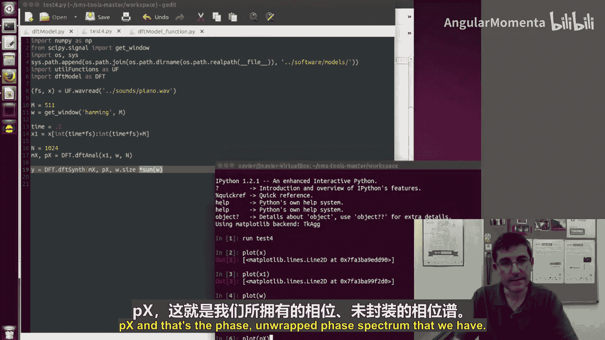
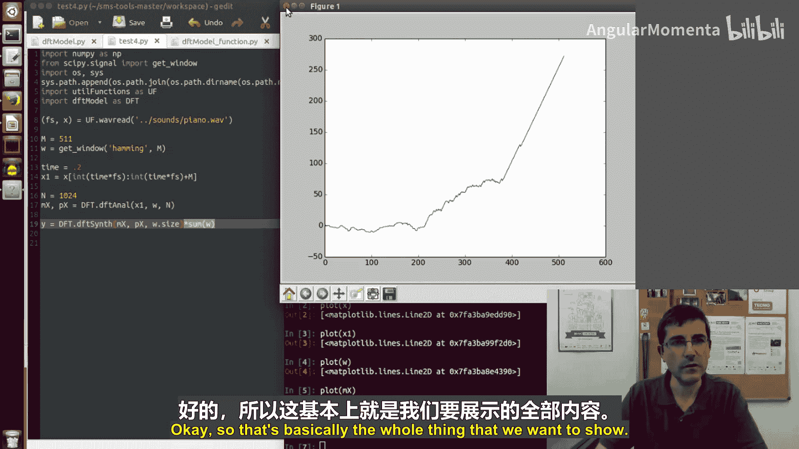
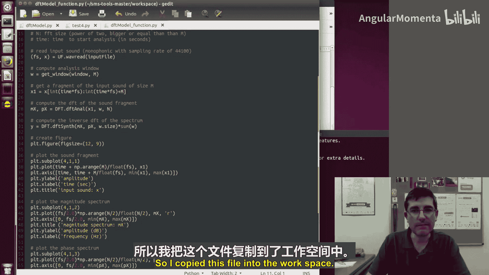
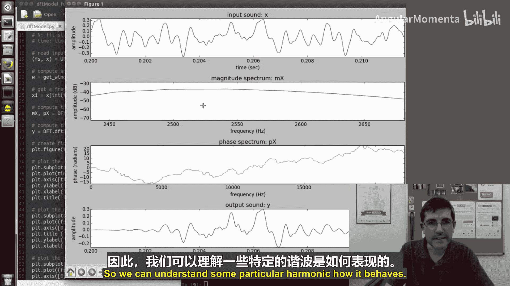
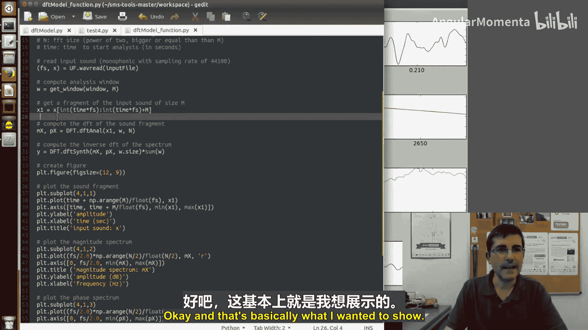
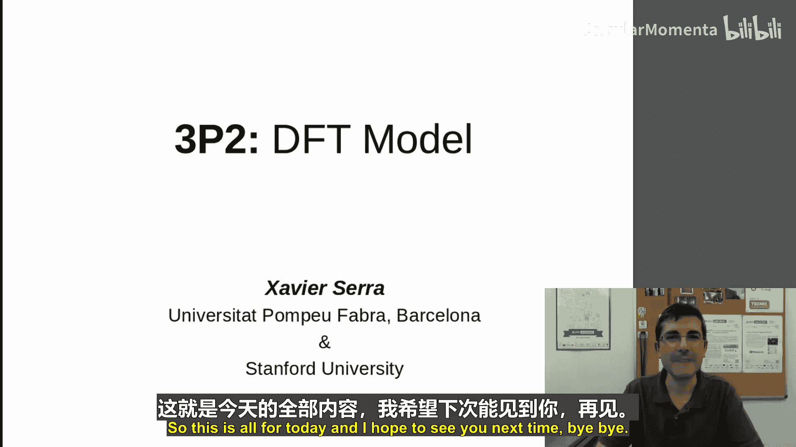

# 【巴塞罗那庞培法布拉大学】音乐应用中的音频信号处理-｜-Audio-Signal-Processing-for-Music-Applications-p24-03_03_02_DFT模型--BV18Xr6BeEX5_p24-

Hello， welcome back to the courseur and our or processing for music applications。

In this programming class of the third week of the course。

 I want to introduce the actual code that is within the SMMS toolss package that implements analysis and synthesis using the DFT。

In particular， what we're going to show is the DFT model function that。From a fragment of a sound。

 X of n。Performs the FFT algorithm。And then generates a magnitude and phase spectrum。

And then that can go into the inverse F50， and it returns another fragment of a sound that hopefully it should be identical to the input sound。

Okay， so let's go to well， the editor。

And let's show the the DFT model dot PY file that is within the models subdirecty of the SMS tools package。

In this file， you will find three functions， three function definitions。

The first one is called DFT model。And this is one that implements the whole analysis and synthesis。

 So the input is the input sound。X。The window that we're going to multiply by and the FFT size。

 capital N。And it will return。The output sound， y。And then many times we just need the analysis part or the synthesis part。

 so in this file we also find just the analysis， so from the same input X。

 the window W and capital n， it returns the magnitude and phase spectrum。And the DFT synthesis。

The function that implements the synthesis part has as input。

 the magnitude and phase spectrum and the size of the sound to be generated of the window sound。

 and it will return。Y， which is our output signal。Okay。

 and within that basically it has the code that we talked about in in the previous programming class in which we just have to window the signal and put it the signal in a way that is centered around zero what we call zero phase windowing。

 so for example， well let's look at at at the DFT anal function。

 which is very much like we showed in last class， so this beginning is declaration and creation of some variables。

Then we have the window that we input and we normalize it， then we window the actual signal。

 then we have this buffer and we centering the window signal in the buffer at0 then we compute the FFT and then we will generate the magnitude unpha values by taking the log for the magnitude and unwrapping the faces so that we get nice looking resulting spectra and in the synthesis is basically that' the inverse so again we have to declare all these variables and then well we have to initialize the output sound and a major difference is that the input。

 the magnitude unpha spectra are only half of the values since the spectra are symmetric。

DFT and now function only returns the positive frequencies。Therefore， in the synthesis。

 we have to recompute the negative frequencies from the positive ones。 And， of course。

 since our symmetric is very simple。The positive frequencies are just direct。

 So getting the magnitude and faces， we just convert to rectangular to a complex numbers。

 So by using this kind of Oulers formula。And then for the negative frequencies。

 we just get those but doing it， reading it in a reverse way so that we get the symmetry aspect of it and of course the phase we negate it so that we get negation of the phases and that's it then we obtain the inverse for your transform by calling the ifFFT function that gives us input the complex spectrum then we just get the real part because we want the real signal out of that and then we have to undo this zero phase is centering around zero so that we get back the signal as we had it originally。

Okay， so you can look at these with more detail， both the synthesises and the analysis of functions。

 I think they are quite well explained here so you can have a grasp of them。

 but in order to test them， I created a small program。OkayIn which I get all these packages。

 I specify the directory where these models are both the utility functions that I'm going to use and the DFT model。

 so from the current directory， I have to specify these relative path to the models directory so that it finds these two packages。

 the utility functions and the DFT models package。And now we going start reading a file。

 so I read a piano sound file also relative to this screen directory that's where the sounds are。

 and I use this function that already have been using to return an array of floating point values。

Then I use a function that generates the windows okay get window allows us to generate smoothing windows and we will talk more about it next week in this particular case。

 a humming window of a given size 511 and it returns an array of this values。

Then we need to get the fragment within the input array that I'm going to analyze。

 so I start at  second。2， and then I have to convert to samples so I multiply to the sampling rate and I get the samples of x that start at second。

2 and that lasts for m samples。And now we are ready to compute the DFT of that。

 so I call the DftT anL function from that module that we just saw the package we named it DFT。

 so we call the DFT andL and I pass it， the fragment of the sound。

 the window that I want to use and the size of the FFT， which I gave the number 1024。And then。

I can send the output values to the DFT synth。And get back the synthesized sound。

 It has to be normalized by the window。 There is a whole bunch of normalization factors that have to be used and sometimes are not so intuitive。

 but anyway， you can check it and you can make sure that you need this normalization factor。Okay。

 so now from the terminal， I am in the work space and I have this file。

 the test for there so I can start I Python。With the。

Pyla command so that I get the mat rod Li package into that。And I can run the test for。Okay。

 that's execute that。 So let's check that we did things， right， So， for example， let's plot the X。

 which is going to be our input signal。 Okay， that's the whole piano signal， a little bit long。

 more than close to 17000 samples170000 samples。We can plot just the fragment that we chose x1。Okay。

 this is just a fragment of starting at  point2。 We can also plot the smoothing window that we applied so we can plot。

W。This is our window that we're going to multiply by the signal。Okay， and then out of the DFT andL。

 of course， we can plot。

M X， which is going to be the spectrum。Okay， so this is the positive side of the spectrum going from 0 to half of these grade or half of the FFT size。

 So in this case， it's 512。Okay。And of course， we can also plot the phase spectrum。E X。

And that's the phase unra pace spectrum that we have。 Okay。

 so that's basically the whole thing that we want to show。 And then there is one。

Another file in the models interface directory that is the one that basically integrates the analysis synthesis and makes nice plots。

 And in fact， it the one that is being called by the interface that we are showing in in the demo classes。

 So this is the DFT model function file that again。

 it imports all these packages the same way that we did。 And then it has one single function， a main。

That has a pre defined variables that， of course， they can be changed and that we can compute and then it does the computing as we have done now。

 and then it plots several figures with correct plotting access and labels， etcter， etc cea。

 So I copied this file into the the workspace。 So I have it as theft model function。

 So if I run these。

嗯。It will execute the default parameters， and it will compute and plot this。

So this is the result of this analysis， synthesis of a fragment of the piano。

 and here now it shows in a nice way well with the labels， the time in seconds。

 the frequency in hertz and the amplitude explain in the decis， the phase again。

 and then the output signal， which is the window version of the input signal。

 and of course as we showed in another class， we can zoom in into fragments of these to visualize certain aspect of that so we can understand some particular harmonic how it behaves。

Okay， and that's basically what I wanted to show。

So， let's go back。So we have shown the analysis and synthesis of a sound and the code that implements that in different versions。

And so all of this is available in the GitHub directory that you have find here in the SMS tools that you download。

 you can look at， there is quite a bit of information about that and well explained and of course the sounds that we are using come from Pri where of course they are also in within the SMS tools directory so it's easier to have access to。

And that's all so we did we have seen how to program the DFT。

And how to use the actual existing code of the SMS tools to perform the analysis and synthesis。

 and hopefully this has allowed you to understand better than the DFT。

And this will be fundamental for understanding the next step， which will be next week。

 which is going to be the short time for here transform。

 we're going to put together these DFT analysis into an analysis synthesis framework that really works for any sound and that allows us to analyze and synthesize larger sounds。

 not just small fragments。So this is all for today。 and I hope to see you next time。 Bye bye。

