# 【巴塞罗那庞培法布拉大学】音乐应用中的音频信号处理-｜-Audio-Signal-Processing-for-Music-Applications-p25-04_01_01_短时傅里叶变换-1--BV18Xr6BeEX5_p25-

We'll go back to the course on arting or processing for music applications。Until now。

 we have seen how to compute the spectrum of a signal， it's EFT。

But real sounds cannot be represented by a single spectrum。Sounds change in time。

 and we need to capture this time variation。The short inquiry transform is our solution。Again。

 this lecture is divided into two parts， so this is the first one。

We will first present and explain the short inquiry transform equation and then discuss what we call the analysis window。

This is the short time for a transfer equation， basically a modified version of the DFT with few but important differences。

So for example， the input to the equation， the input signal is not just x of n。

But is the multiplication of W， which is our analysis window by a fragment of x of n。Okay， so here。

X has an argument that has n， our time index， but also has a frame number and a ho size。

So L is the frame number and this is our time index， so we will be iterating over L。

 so we will be skipping through time this way and capital H is our hub size。

 how much we going to hop from one time instances to the next。So basically。

 X is going to be changing in time according to L and H， and then at every time instance， at every L。

 it's going to be multiplied by this analysis window w of n。The rest is the DFT。

 So the only thing that changes is that the input signal changes。

 and therefore the output also is not a single spectrum， but a sequence of spectra。

There is the x sub L， so the variable L is the frame number。

 so that means that the output of the short time Fourier transform is going to be a sequence of spectra。

 each one of the same size and having magnitude and phase。

 but each one differently because the input will be a different fragment of the sound stepping through the sound in a progressive manner。

So to emphasize the idea of zero phase window that we already have talked about。

From now on we generally specify the time index to go from minus n over 2 to n over 2 minus1 so it's always centered around0。

 we don't have any phase changes， we don't have any kind of shifting in in the time and therefore in the spectrum。

The window in is a way to step through the sound， as， as I mentioned。

 So here we can see a depiction of that。 And if we use the analogy of image and video。

 we could relate a spectrum with a photograph。A static image。

 And then the short time for a transform with video， a time very image。

So here we see in this in this picture， the the whole。

Time for a sound at the bottom and how we are basically stepping through the sound by windowing the sound with this analysis window and therefore being able to get all the sound a sum of basically sound fragments。

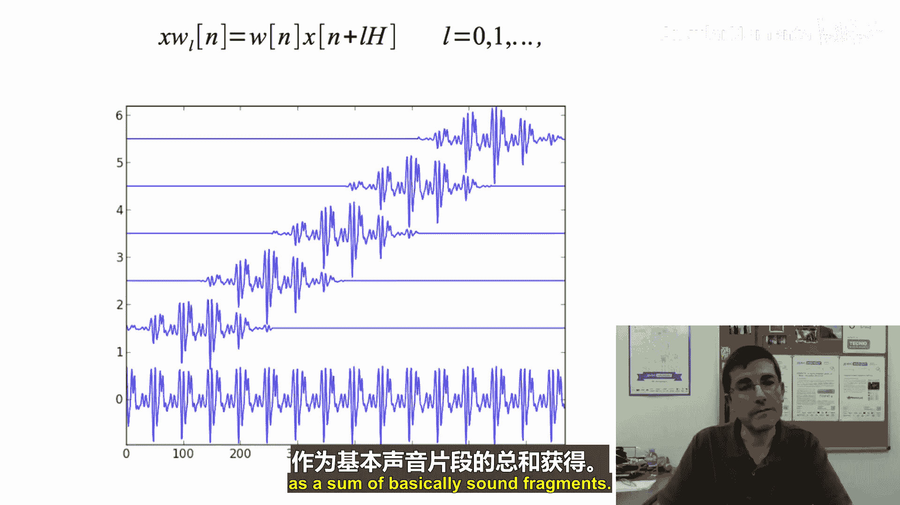

Okay， to better understand the fact of windowing a sound。

 let's put an example of what happens when we window a real sinusoid and then compute its spectrum。

So if we start from a real cusoid， sinusoid， we already have seen that。

 so it's a cosine with a frequency index， k sub 0 and an amplitude a sub 0。

 which can be expressed as the sum of two complex sinusoids， one with positive frequency。

 another with negative frequency。Then if we substitute the the into the short time for your transform equation。

 this signal and we window it。We can step through these different steps in which we first put x of n in the equation。

 then we are substiting by the sum of these two complex exponentials。

 therefore because of the linearity of the DFT， we can split these into two equally equations equal equations in which in each one we have a complex exponentials as the input signal。

And the amplitudes can be moved outside。 And basically what we get back to is the sum of two DFs。

Of the window。 and with a frequency shifting operation。

So basically again here we see that the result is the spectrum of the window。Of course。

 frequency shifted by the frequency of the input signal and multiplied by the amplitude by half of the amplitude of the input signal。

 plus of course， the other window at the other complex exponential frequency one is the minus frequency and the other is the plus frequency So this will be the result of this cosine so which is basically the transform of the window shifted to the frequency of the input signal and multiplied by the amplitude of the input signal。

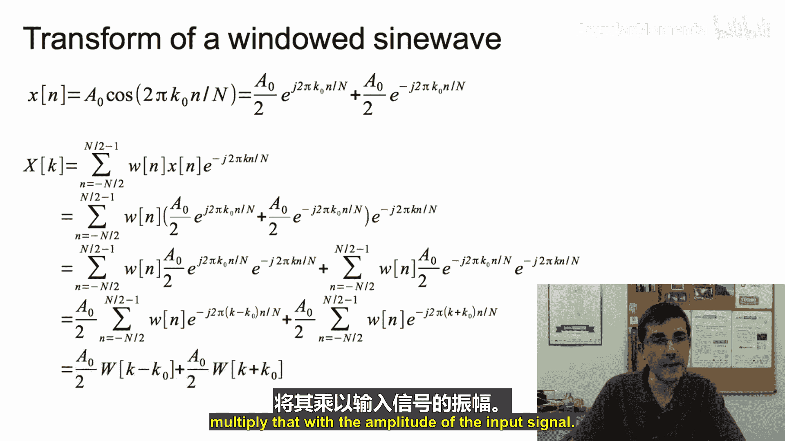

Well with these plots， we can understand this windowing process a little bit better。 So on the top。

 we have the window。And underneath is the window。Susoid that we have as our input signal。

And then the transform of the window can be shown on the top in which the transform of this window。

 which in this case is a hanging window， is the magnet spectrum centered around zero and with the symmetry and with the given phase and now if we take the DFT of the windowed sinusoid。

 well what we are seeing is basically the same shape than the window。

 but at the frequency of the sinusoid， at the two frequencies of the sinusoid the positive and the negative frequencies and at the phase of the sinusoid2。

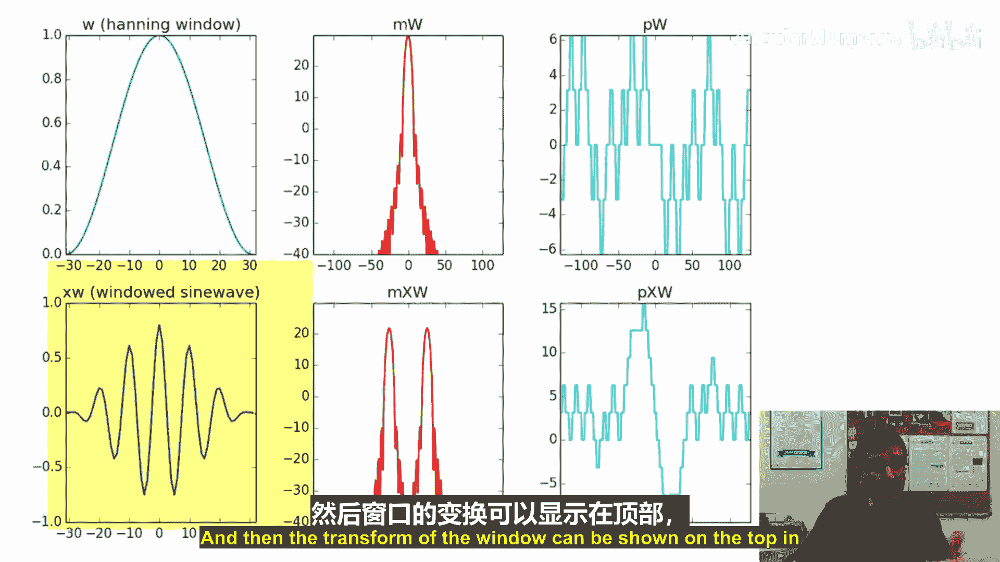

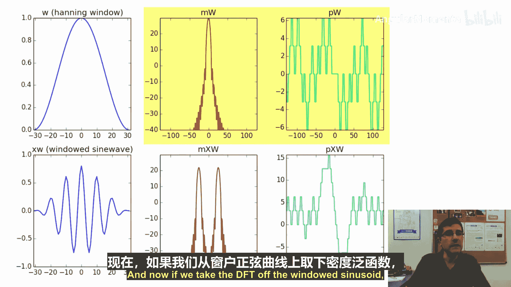

So we have the two values for the two phases with this antistry that this analysis results into。Okay。

 so from this discussion， we can realize the importance of the analysis window in the spectrum of a sinusoid and thus of any sound。

 It's clear that we have to spend some time explaining the windows。

So an analysis window is generally a real function and is symmetric around the origin。

 and this is the simplest window， the rectangular window。Its time domain is nothing to particular。

 but its magnitude spectrum is much more interesting。 So time domain。

 it just has value of one for the duration of the window in this case，64。

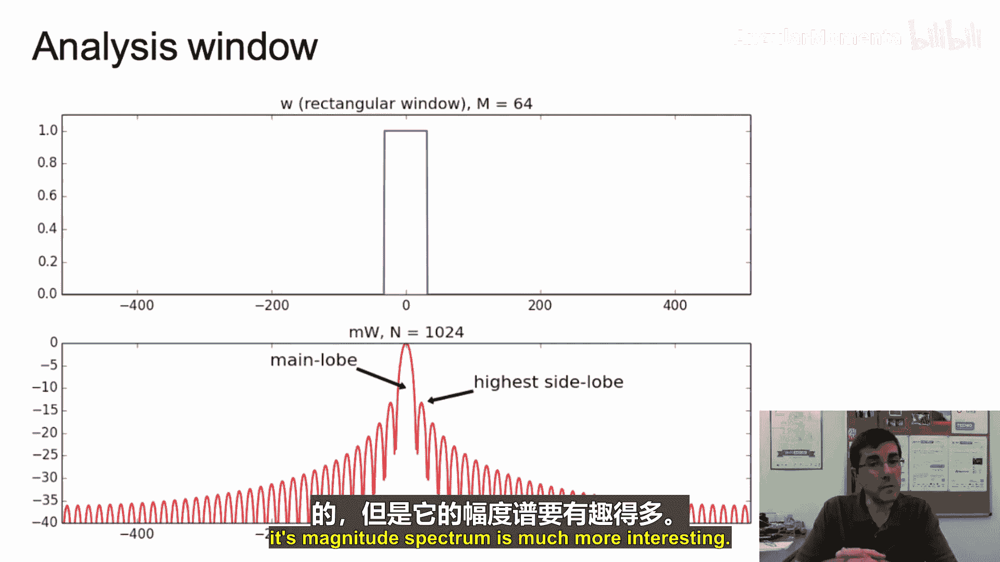

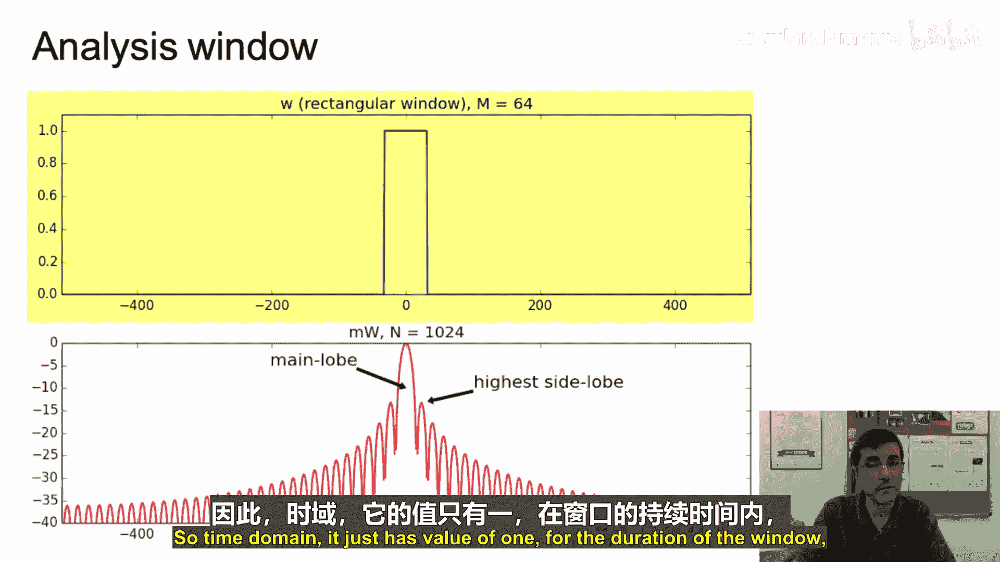

And the spectrum， the magnitude spectrum has a shape。

 which we call it is a sink shape because the transform is a sync function and it basically could be described in many different ways but we focus on two main aspects on what we call the main lo the peak at the center and we will be talking about the width of the main lobe mainly and then we talk about the side lobes which are these small small lobes next to it and we basically focus on the level of the highest of these side los so we will talking about the highest side lo level。

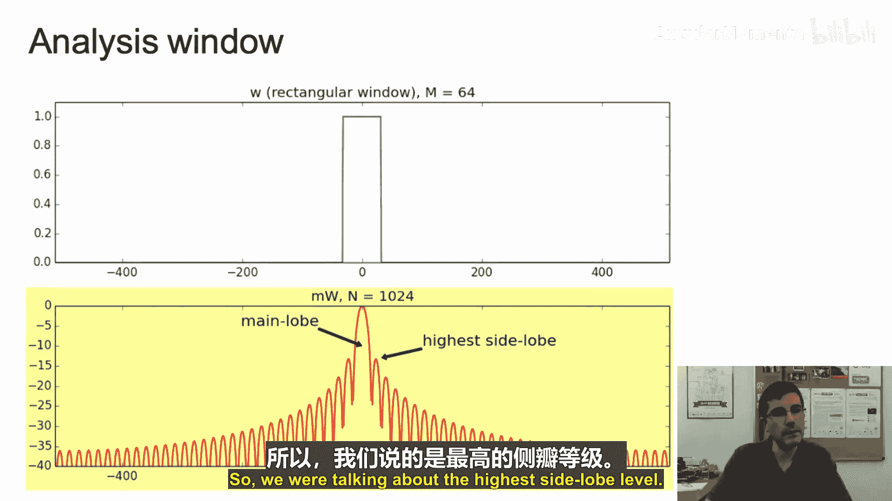

Okay， so there are many windows used audio signal processing and this is the list of windows available in the spi module of Python so we can go through them and we can see quite a variety of windows。

 some of them we are not going to pay much attention to but for example we be talking about the blackman window。

 well be talking about the hummming window， the humming window。

 we' will be talking about for example the triangular window， etc。

 some others are not so much use in audio。Each window can be distinguished from the others by measuring the main lobe width and the sidelobe level。

And each window offers a different compromise with respect to these two values。

 So let's show some of them。

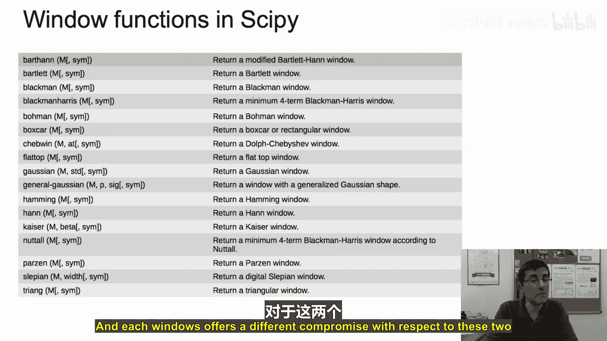

So star the first one is the rectangular window， and the equation shows how to compute it。

And the spectrum is what we call a sync function is the sine pi k where k is the frequency index divided by another sine function。

So if we look in the plots， the spectrum could be thought is well is the magnitude spectrum。

 so it's the absolute value of this WK， so basically is a sine function with a kind of a attenuated function applied to them the boundaries。

 so it results into this shape very characteristic shape that is going to be called is a sync function。

And talking about how to describe it， we mentioned about the width of the main lo and this has two bins and two bin means two samples。

 and these we have to be careful because this is measured when the DFT is the same size than the window So if we take a window size of the same size of the window。

 let's say 10 samples， then it's going to be two bins， but generally I think we do zero padding。

 then the number of bins is higher， but this is because of the zero padding and we normally do it in order to better visualize the shapes。

 So in fact， this shape has been generated by a lot of zero padding so that we can have this is smooth visualization。

 but strictly speaking， the number of beams that we refer to is2 and the side lo level the highest side lo level is minus 13 point。

TheDcibel， so the distance between the centered peak and the firstcyclclo level。

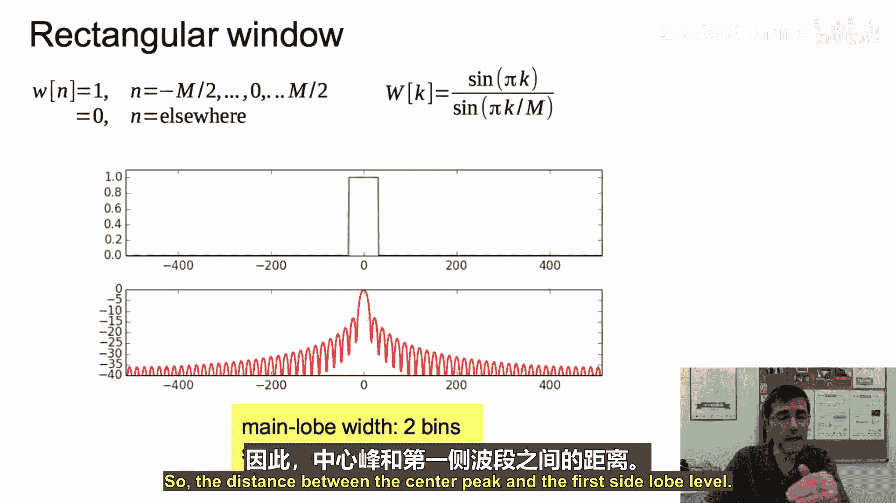

Maybe the most popular window is the honey window， which is a raised cosine。

 So the equation is we do 0。5 plus 0。5 of the cosine。 So this raises the cosine。

 So it's just one cycle of that cosine。And if we compute the spectrum。

 it also can be expressed as sums of these sync functions。 In fact。

 all the windows can be expressed in the time domain by sums of cosines and in the frequency domain by signs sums of this sync function。

So in this case， is the sum in the frequency domain of three S functions。And again。

 the two values that characterize this shape， this frequency domain shape is the width of the main lobe。

 which is forbiin， so twice as much as the rectangular function and the site lobe level is minus 31。

5 decibel so which is lower now the main lobe is wider and the site lobe level is lower。

The humming window is very similar to the hanging， but with a small and significant difference。

It's a race cosine with a step at the side。By having these small steps into the sides。

 we get a magnitude spectrum that maintains the same main loop width。 So that's good。 It doesn't。

 It doesn't get wider， but in exchange， we get。Much lower site lobe level minus42。7 decibels。

 and this is as we're going to see an important thing。

 the ideal is to have the lowest side lobe level and the narrowest possible main lobe。

So this is a good window。 Of course， nothing comes for free。 So the sidelobe levels。

Do not decrease so abruptly as they go away from the main lo。

The blackman window is the sum of two sinusoids， and with that we accomplish a significant improvement in terms of the site lobe level measure。

so we see the magnet spectrum which the main lobe is wider is6 bins。

 but the side lo level is lower is 658 deccibels and that's good because that's starting to be quite useful value at the side lo level for many audio applications。

 we will come back to that。And then。Finally， the window I want to end talking about is the Black Manharris window。

 which is a very special one。Because we could basically say that it has no sidelos。

So it's sum of several cosines， in this case， is four cosines。

With different coefficients in the summing。And then in the frequency domain， the magnitude spectrum。

 the main lobe again gets wider in this case is8 bins， but the side lobe level is minus 92 decibels。

And if we think about it in terms of signal to noise ratio。

 which is a very important factor in digital signals。

 92 decibels is basically below the noise flow of 16 beats of the kind of signals that we deal with。

 so basically that means that these silos and if we consider them as artifacts or as noise they are not heard in other windows we could say that these sidelos are artifacts that can be heard。

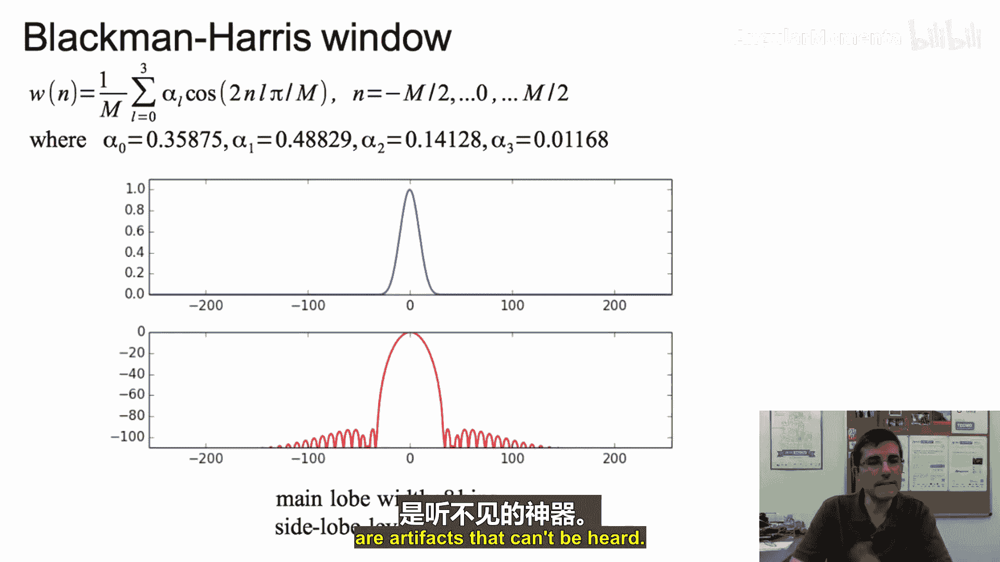

Anyway， again， we will come back to that。And now to finish。

 let me just compare some of these windows being applied to the same sound。

 So we start with a fragment of a sound。Of a certain length。

And we are applying three different windows。 The first one is the rectangular， the next one humming。

 and finally the black man， clearly very distinct spectra。And by looking at these。

 we can see kind of that may the best。For this particular analysis is the black man。

We see a smoother spectrum， we see these peaks much more clearly distinct， and in fact。

 these peaks correspond to the harmonics of the sound。

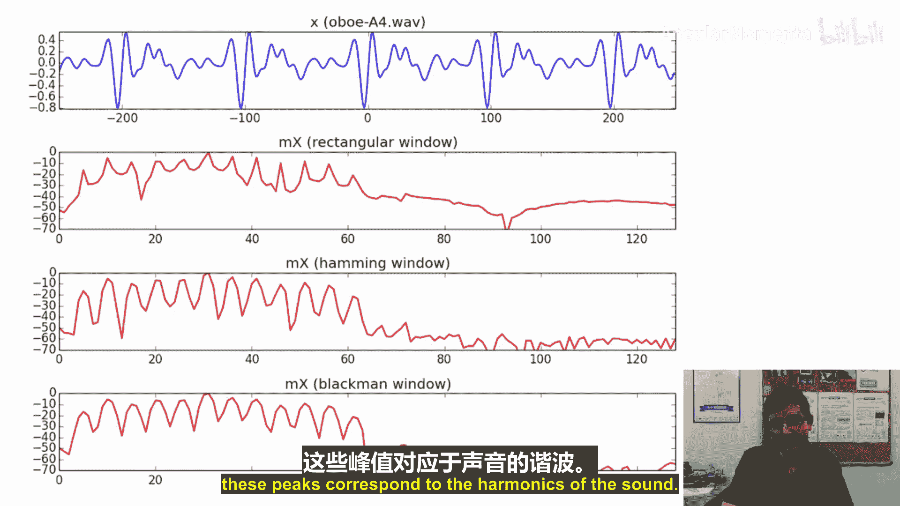

Okay， so this is all and there is a lot of references for the topics I covered。

Especially about Windows in Wikipedia， you can find quite a bit of information about the short time for a transform about Windows。

 Julius in in his website and his online books discusses this quite a bit。

 so that's a very good reference。And that's the race standard gravitys and references。

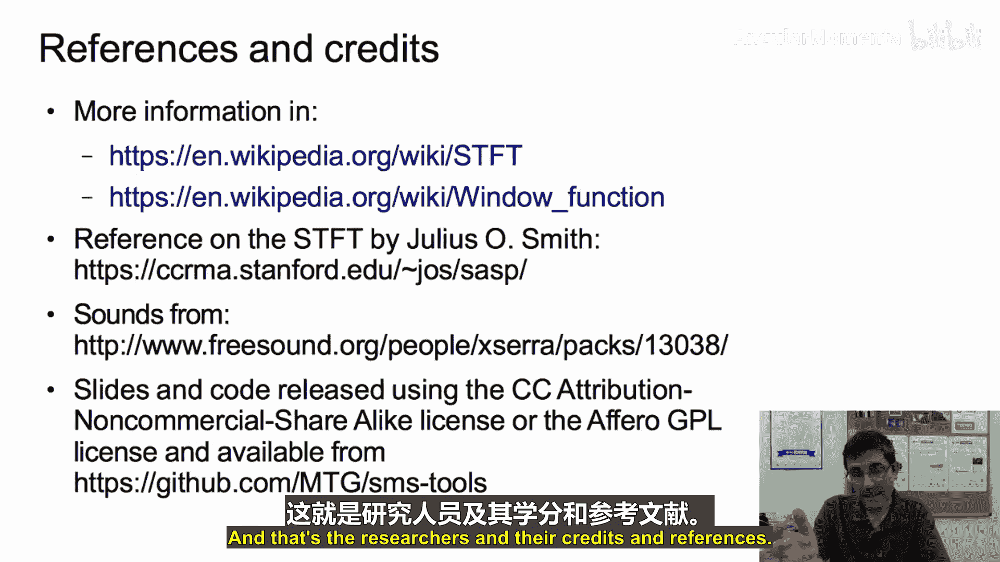

So this is all for the first part of the lecture on the short time forier transform。

 we have explained the basic equation of the short time forier transform。

 and we have focused on the analysis window。In the second part， we will continue with this topic。

 so I will see you in next class。

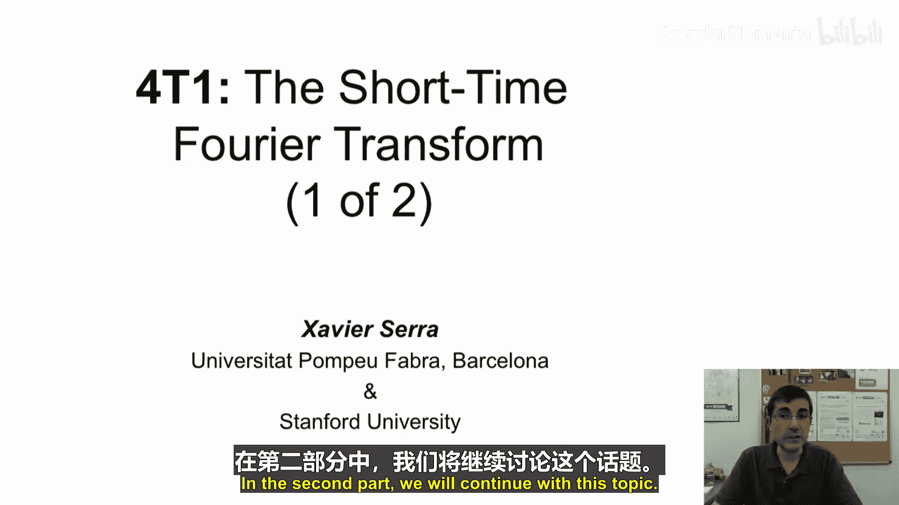