# 【巴塞罗那庞培法布拉大学】音乐应用中的音频信号处理-｜-Audio-Signal-Processing-for-Music-Applications-p26-04_01_02_短时傅里叶变换-2--BV18Xr6BeEX5_p26-

Welcome again to the course on N Pro for music applications。In the first part of this lecture。

 we started talking about the short term for transform。Now， let's continue。

We will cover quite a few topics， but each one is quite short。

We will first review the concept of the SDFT and analysis window， then talk about the window size。

Then the F50 size。Then the hub size。Then what we call the time frequency compromise。

And then once we have covered all that， we can do the inverse of this analysis process so we'll do the inverse of the short time for a transform。

 and finally we can put it all together into an analysis synthesis system that can be used to analyze and synthesize any cell。

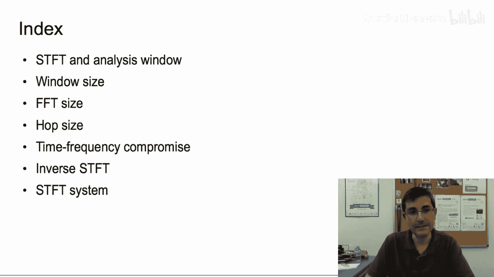

So we saw this equation in the first part of the lecture。

 we now know that the short temporary transform is the time varying version of the DFT。

And that windowing is a key concept to understand SDFT。So for example， in these plots。

 if we start from bioolin sound that we can listen to。Okay， then the。

 the magnitude spectrum of one fragment of one of the frames。

Is quite different depending on the window we use。If we use a rectangular window。

 we can see this first mag spectrum， if we use the blackman window， we can use this second one。

So now let's try to understand a few more things about this the short time for return from about the windowing process。

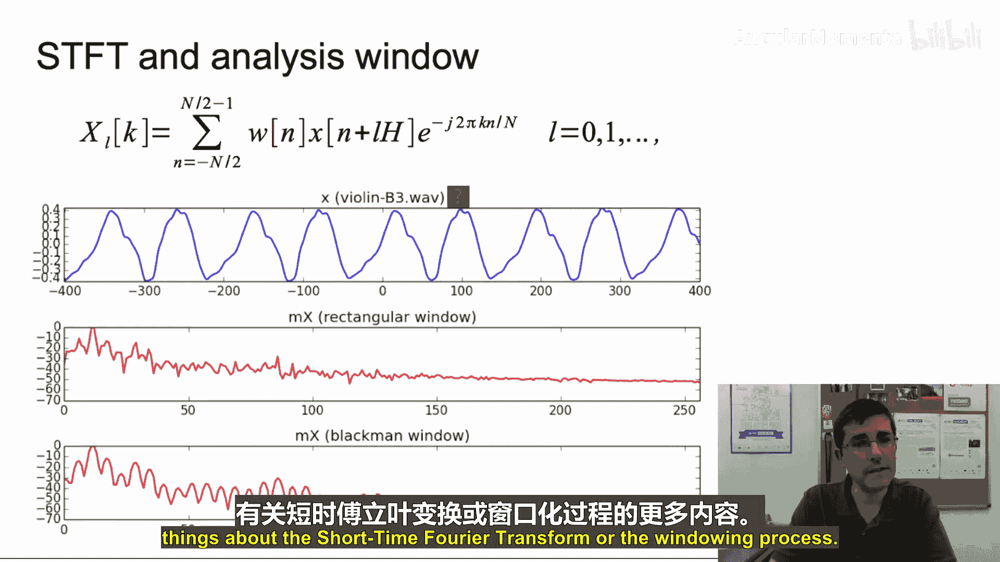

So we talked about different types of windows in the last class。

 but these windows can be of any size。And what is the effect of these size？

So here we see an example of。The same sound。And choosing the same window， but with different sizes。

One is with size 128， and the other is with a size 1024。Clearly， very different。

 and the result is amazingly different。 The magnet spectrum of the small window。

He has very little information。 It has very few samples。 He has basically 128 samples。

And in the larger window， we see quite a lot。 We see a lot more detail of the sound of what's going on。

So that's going to be a very important compromise to be done when we use the window size and the phase spectrum。

 of course， it's also different， but a lot of these issues will be much more clear in the magnitude spectrum。

 so we'll focus a lot on discussing the effect on magnitude spectrum。Okay。

 another important issue that has a significant effect， even though it's a tiny difference。

 is the concept of even an odd size window。So we can take the same window and have a size 32。

 which is aneven size， or we have a size 31， just one sample less， and it's an odd size。

If you look at the manuscript spectra。 They basically look the same to minus spectra are the same。

The difference is not significant， but the phase spectrum is quite different。In one in the even size。

 there is a slope， So these are by the way， of course centered around 0。

 So clearly if it's an even side， it cannot be perfectly centered because we have to have a sample at zero and then if it's even it will have different number of samples on the right hand or on the left hand。

In the other hand， if we have a node size window， we can have a sample right in the middle and then have the same number of samples on both sides。

 Therefore， it can be perfectly symmetric around 0 and therefore get the zero phase value that we have talked about before。

So whenever we can， we're going to be using all size windows。

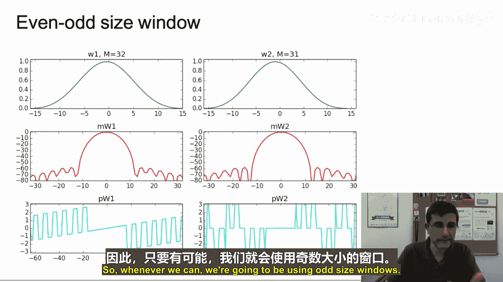

The window size has been chosen according to some resolution criteria。

 the number of periods or the resolution that we need to have。

 and well again be talking more about that， but now we have to choose the FF size。

 which is independent of the window size because we have the opportunity to do zero padding。

So in this example， we show we start from a given window size， 512。

And if we choose the same window size and the FFT size。

 we get this first magnitude plot and we see a pretty decent minute spectrum with all these peaks that correspond to the harmonics of this obsome。

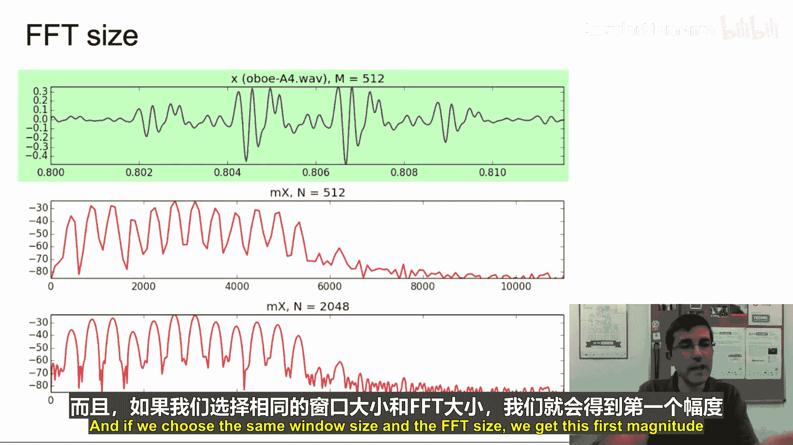

But if we do an FF0 size larger， so we do an FF0 size in this case of 2048 sample。

 so we0 but quite a bit is four times larger。 the FF0 size than the window size。

 we see a spectrum which is much smoother fact much nicer and this is something that is going to be very much desirable。

 something that we will be looking for is spectrum that are quite smooth so we can identify things much better。

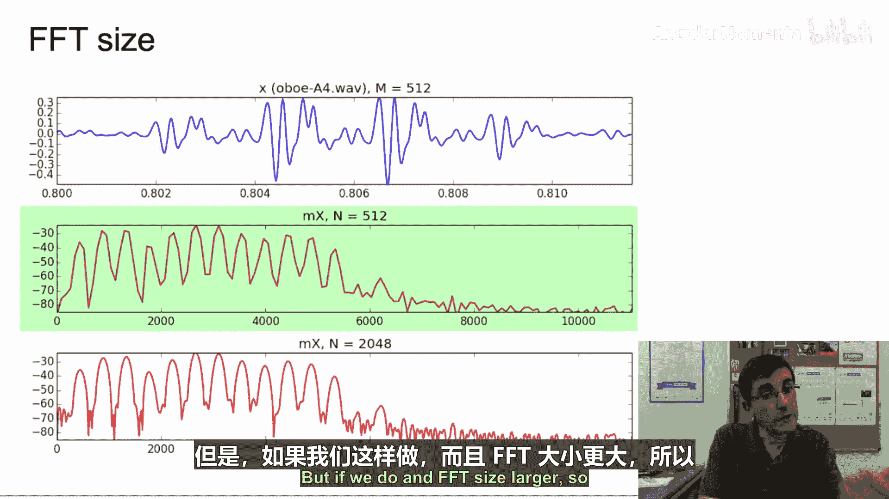

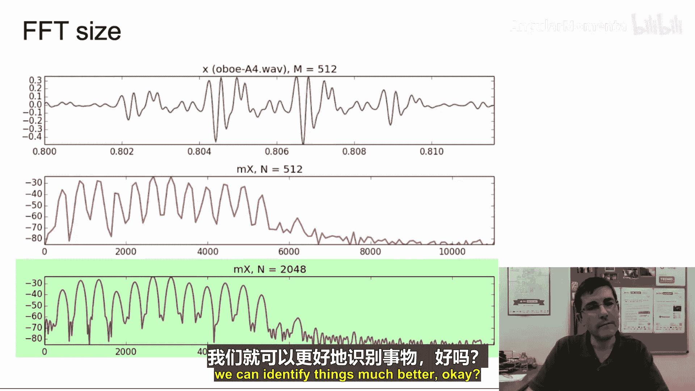

Okay。Then the final step of the short time for a transform analysis loop is the advancements of the windows。

 the advancement of the frames， what we call the hopping， the hop size。

So the window advances H samples after each DFT。And then with this equation。

 we see the effect of this hopping。So by just taking the window function and hopping by a given age。

 we get a function a that depends on this hopping factor and of course， of the window size。

And here we have two examples to hopping factors different。

In the first one with a window of 201 samples， we are hopping 100 samples。

 like half of it and the red function is this a function the sum of these windows clearly is not a very smooth result it has like this oscillation is basically we call a modulation that in fact will be heard in in the rethesis that we will do with a short time for your transform on the second plot we see the hopping of 50。

 So basically one fourth of the window size。

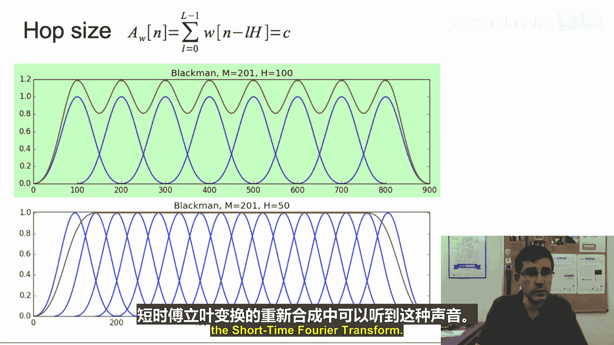

And apart from the boundaries in which we see clearly that there is the effect kind of a distortion。

All the middle is very much like a straight line， and this is the kind of things that we would like to have。

 we would like that the hopping does not affect so it can maintain an identity and so this a function should be a straight line。

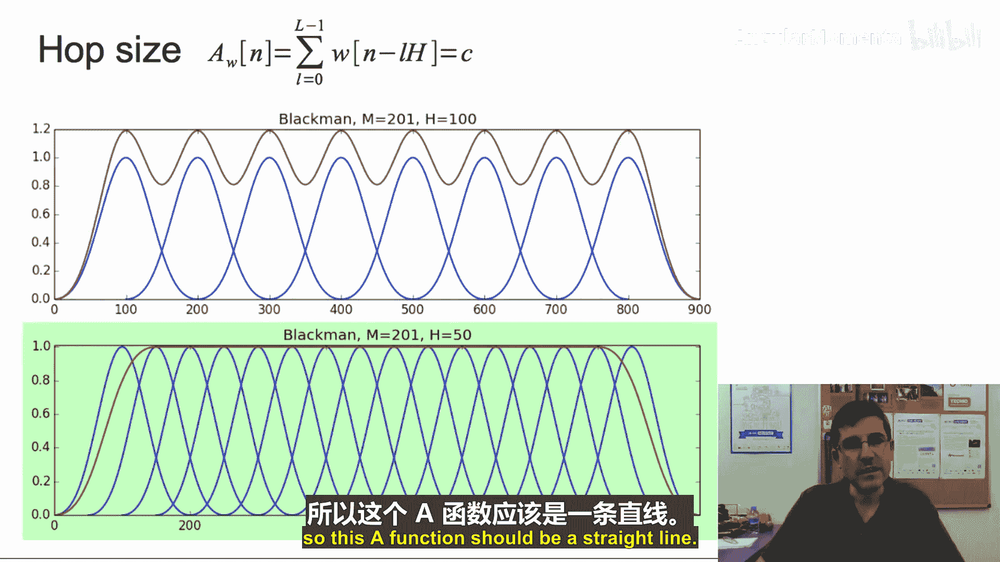

Now， we can put all these concepts together to analyze a real and complex signal。

 like a piano phrase。🎼So first let's listen to the input sound Okay。

 so choosing all the parameters in the STFT， it has a number of effects in the output。

 The most important one is what we call the time frequency compromise。On the top plot， we see the。

 the magnitude spectrum。Of the whole SDFT analysis。 So basically， it sequence of DFT。

The vertical axis is the frequency， the horizontal axis is the time。

 and the color intensity basically is the magnitude the magnitude value in the magnitude spectrum。

so here we see very clearly the attacks of the piano and kind of the horizontal aspect correspond to the harmonics of the piano。

 but on the second plot which has a bigger window and FF size four times。

 so it has 1024 samples for the window we see that the horizontal lines are much better defined。

 even though in exchange of the vertical lines of the attacks that are not as crisp as clear。

So this is what we call time frequency compromise。 if the window size small。

 we might get a good time resolution in exchange of a poor frequency resolution。

If we take a bigger window size， we will get a better frequency resolution。

 so that's what we see better horizontal lines in exchange of not so good time resolution so not so good crisp like attacks as we see in this second plot。

And then， of course， typically we only show the magnitude spectrum。

 but the phase has also valuable information。 So in here we see both the magnitude spectrogram and the phase spectrogram。

 In fact， what we are seeing is the derivative of the phase And if we take the derivative。

 what we' are seeing is kind of when there is a flat region on when there is a phase that changes a lot。

 So in fact， here we can also kind of see this horizontal structure that relates to the stable peaks that correspond to the harmonics So whenever the color is more clear it means that it's more stable and when we see this darker color it means that there is a bigger slope so that there is a bigger phase change。

 So it's a little bit harder to read these。And visualize this phase spectrum。

 But they have some very interesting information that we're going to be using。Unlike like the DFT。

 the short time for the transform has the inverse transform。If we do things right。

 we can recover the original sound from the amplitude and phase spectrogram。

How to do that where what we are basically doing is what we call overlap and adding this different output spectra。

 So we'll be computing every individual spectra of every frame。 So x sub L， and we take the inverse。

 DFT of every x of L as we show here。 and then there is this shifting and summing which correspond to this idea of。

Shifting and adding over the previous frame in such a way that we basically compensate all this windowing and we recover the output signal。

So basically， the output frame of one single frame is going to be this Yw sub L。

 which is going to be the result of one fragment of the input sound multiply by the window。

And then the overall output sound will be the sum of these window output fragments。

 and what we see here is in this equation is we identify the effect of the window。

 basically we have this summing over all the windows and this is the possible distortion or artifact that might be applied using this process。

 So if this sum of the windows is a constant and is one the input will be equal to the output。

 but if the sum of Windows is not equal to a constant， a constant。

 then we definitely going to have some distortion modulation that will be her in the output sound。

So graphically， basically we are just doing exactly the same in the analysis。

 so is the inverse process so we are overlapping and adding every single fragment to recover the whole signal。

And now that we know how to analyze and synthesize a sound with the SDFT， we can build a system。

And we will show that in the and we will implement that in the programming lectures。

And this is the diagram of a complete analysis synthesis system using the short time for a transform。

 So we have the input sound x of n， then we have the window that we apply and we use to select portions of the sound。

And from this windowed fragment， we compute the FftT and results in the magnitude unpha spectrum。

 and at every frame we do the inverse of that and recovers the output sound。

 which is going to be a window signal because it has the window in it。

 and then with the overlap at factor and if we do it correctly we generate an output signal that should be identical if the window and the hub size is correct to the input signal。

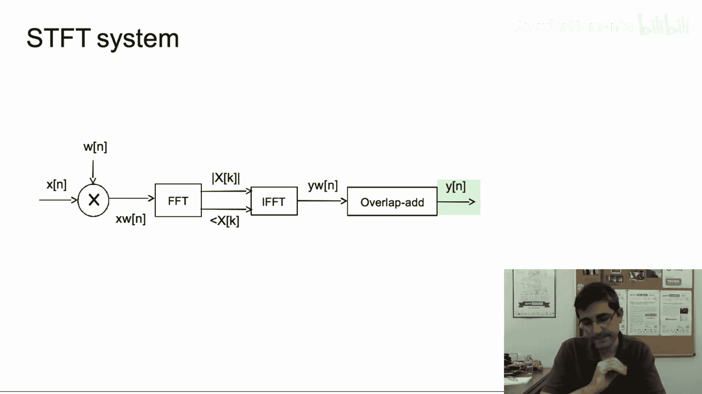

So this would be an example of a complete sound analysis and synthesis of a sound at vary in time。

 we start with the piano sound that we already heard。

 we see the magnitude spectrum with a given window size。

 a50 size and ho size in a way that the overlap is correct。

We see the derivative of this set phase spectrum。🎼And then we see the y the output sound。

 which is the inverse of this spectrum， and we can listen to that。And clearly， in this case。

 is identical to the original because we did the hopping and the windowing correctly。

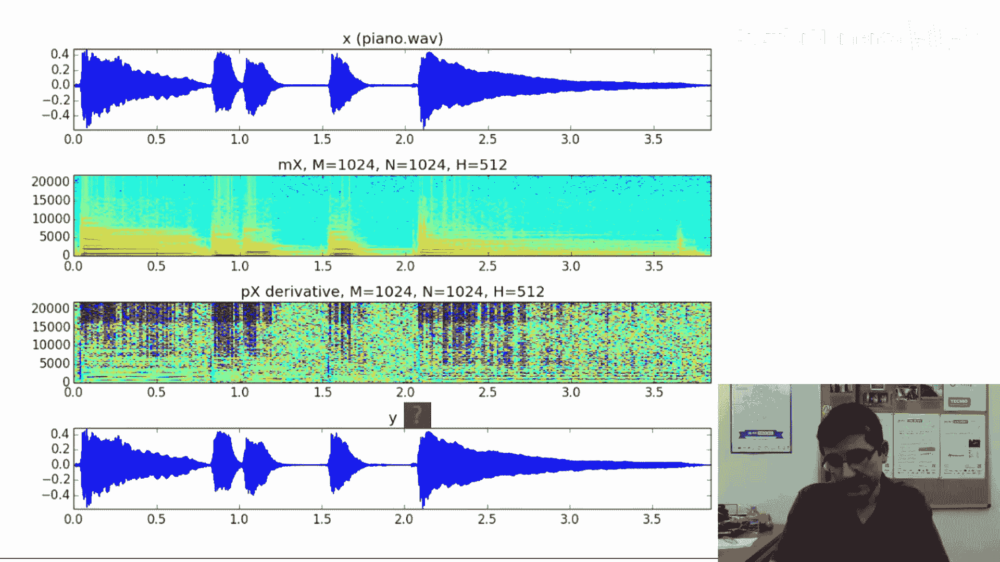

So again， quite a bit of references are available on this topic。

 both on Wikipedia and on Julia's website。

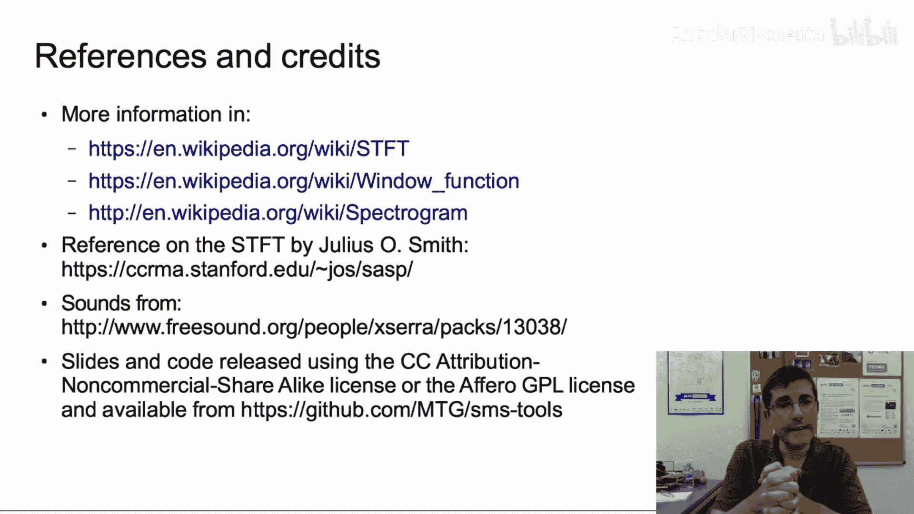

And that's all for this class with the second part of the lecture。

 we have completed the topic on the short time for your transform。

We now know how to analyze and synthesize any sound。And of course。

 in the demonstration classes and in the programming classes of this week。

 we're going to put that in practice。But even that。

 this is just the beginning of the interesting stuff。

We will now be able to really do powerful things building on top of the short time for transform。

 So stay with me and you will see。 see you next time。

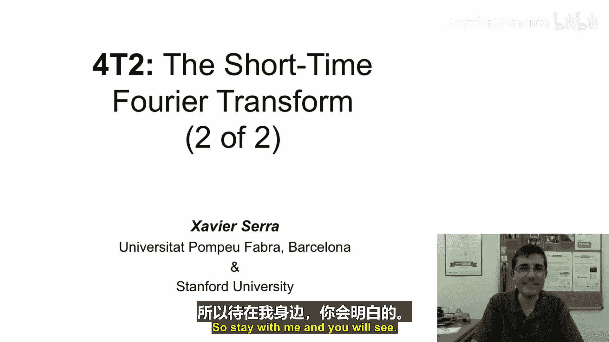