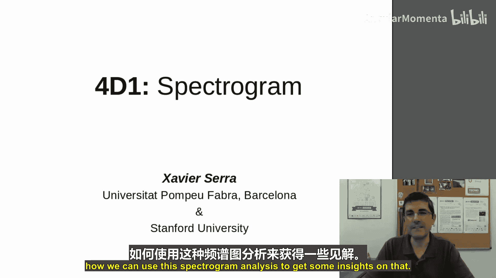

# 【巴塞罗那庞培法布拉大学】音乐应用中的音频信号处理-｜-Audio-Signal-Processing-for-Music-Applications-p27-04_02_01_频谱图--BV18Xr6BeEX5_p27-

Welcome back to the course in original processing for music applications。This week。

 we are talking about the short time for transform。

 and the spectrogram is basically the output of the SFT is the visualization of the time varying spectra that we compute。

So in this demonstration class， I want to use the spectrogram。

 the short time for your transform to analyze a voice sound so that we can understand better the SDFT and at the same time understand better given sound。

So we'll start with a sonic visualizer and this is the sound I want to analyze。

 it's a note of soprano singing。 Let's hear that。 Okay， that's a quite high pitch sound。

And it has quite a bit of bivaro， this frequency oscillation that is characteristic of oporic singing。

And to understand a little bit better the sound， let's open the spectrogram。

 So let's open the pain of the spectrogram。 So here it is。

And so we see now clearly some information of this boy sound。

 we see these horizontal lines that correspond to the harmonics and we see this oscillation。

 which is basically this vibrado that is present。To go a little deeper。

 let's open another pane with a single spectrum of this timeering spectrum。 So let's。First。

 show it as in a linear scale， the horizontal axis。 Let's have lines as interpolation。

 and the window， let's use the same window then for the SDF。 So we'll use 1024。 Okay， and this is it。

 Let's maybe make it zoom in and stretch So that we see same things that we would see in the spectrogram。

 Okay， so this is one slice of the spectrogram。 So all these horizontal lines correspond to these peaks that we see here。

Okay， and now maybe lets let's change things。 Let's change， for example。

 the the window size if we change to 256， both analysis。

OkayNow what we are seeing is a much smoother shape。 We are not seeing the individual harmonics。

 We are just seeing an overall shape， which basically correspond to what we call the forements。

 the resonances of the vocal track， which is what makes us be able to distinguish between vowels。

 for example， So each vowel has a characteristic foreman structure。 Of course。

 if we move things will change a little bit。 but of course， the vowel remains the same。

 So it will not change that much。If we go back to the analysis size that allows us to visualize the harmonics and when we move。

 well we see few more changes because the harmonics are changing more than just the forants。Okay。

 so now if we want to change the type of window， we can go to the the preferences。

And in the analysis tab。And let's put this away from this here in the last option， we see the window。

 the analysis window to be used。Current is the black man window。Let's change， for example。

 to the rectangular window， which is the square that we cut the signal the area abruptly。

 and let's apply that。Okay， so clearly it doesn't look so nice。

A single spectrum looks with quite a lot of kind of noise with the noise floor is very high。

 So we see very few of the harmonics。 And in the spectrogram。

 we see these vertical lines with this kind of a distortion of it。Okay。

 so that's clearly not that good， So we definitely would prefer for this sound， the black Man window。

Okay， now let's do the same kind of analysis using the SMS tools。Okay with the SMS S tools。

 we have the the single spectrum using the DFT option or the time varying spectrumtrogram using the SDFT option。

 So let's first start with a single spectrum。Let's go to the。To the soprano sounds， or soprano E4。

Okay， and let's analyze in the middle of the sound like 0。5。

And let's use the same values that we used before。1024 for both。

F50 size and window size with a blackman window， and we can compute。

And this is basically what we saw before。 This is the 1024 samples we have started with。

 This is the magnitude and phase spectrum， and we see clearly the peaks corresponding to the harmonics And in here we see the phase spectrum which we didn't see before。

 and also we see the inverse of this。 So this is the windowed signal that we generate back by taking the inverse FFT of this spectrum。

And of course， we can do the same thing。 We can change windows， for example。

 if we change the window size to 256 and also the FftT size to56 in the same location we compute。

Well， we see we are， of course， taking much less samples and the spectra are much smoother。

 less information there。OkayOne advantage， of course。

 that with this interface we have is that we can independently control the window size from the FFT size so we can put the FFT size 12024 and maybe a window size not that large。

 maybe 801。And when we compute。We are taking less samples than before。

 but still the frequency resolution is quite good and it's quite smooth because we have been doing zero padding。

 and so the shape of the spectrum is quite nice。 Okay。

 let's look at all these from the short time for a transform perspective from the spectrogram。

So we will get the same sound。And again， let's put 1024，1024。

 and the hop size has to be at least much smaller than the window size in a way that the overlap lab at factor ats correctly so for 1024 in the blackman window at least we need one fourth。

 So let's put 256。And we compute。Okay， and this is the result。So we have the input signal。

 the magnitude spectrogram， the faces of the time varying phases and the output sound and the output sound。

 well its very much the same than the original because we have done a good reconstruction with a good overlap。

However， if this overlap is not correctly set， for example。

 lets let's put the same than the window size， for example，1024 and let's compute it。Well。

 clearly now is something wrong in the output signal。 And if we can listen to it， Okay， of course。

 we see this modulation。That is at the frame rate， because we are not overlapping correctly。

 So at every frame， we see a burst of sound， and they don't balance out by the overlap factor。

 So we definitely need to have a much smaller ho size。And anyway， that's all I wanted to say。

 basically I encourage you to play around with these parameters。 you can change the window size。

 you can change the FFT size， the hub size， the type of window and in between the DFT and the SDFT。

 I believe you can get a good grasp of all these different parameters and the effect they have in the visualization of the spectrogram。

 and also in the reconstruction of the signal。So， let's just finish and。Today。

 basically we have used Sonic visualizer to analyze voice sound and to visualize the Spectrogram and the individual spectrum。

 We have also done the same thing with the interface of the SMS tools。

And of course we have used the sound， this soprano sound from Free sound。

So this hopefully has given you a more practical view on the STFT and has allowed you to understand how useful might be to use this type of techniques to visualize a particular sound。

 in this case， a sopranno sound。Of course this is just the beginning of these more analysis。

 this more complex analysis， so in next in next demonstration class。

 we're going to analyze a more complex sound and we will see how we can analyze time varying sound that have much more structure and how we can use this spectrogram analysis to get some insights on that so thank you very much for your attention and I hope to see you next class。

