# 【巴塞罗那庞培法布拉大学】音乐应用中的音频信号处理-｜-Audio-Signal-Processing-for-Music-Applications-p28-04_02_02_分析声音--BV18Xr6BeEX5_p28-

Hello， welcome to the fourth week。Of the course on now or processing for music applications。

And in this demonstration class， I want to continue what we started in the last one。

 which was to analyze a sound， in that case， a sound of a soprano using the short time free transform。

 the topic of this week。So in this lecture， I want to analyze another sound。

 a sound that can give us another view of the short time for a transform。

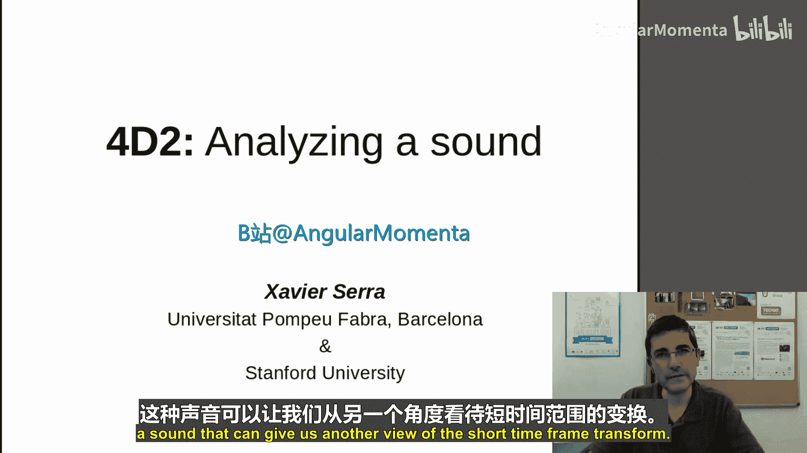

So let's open the Sonic visualizer and this is the sound we're going to analyze today。

 and this is the sound of a piano。🎼And so let's let's listen that Okay。

 so this is a very simple piano phrase， quite clear， five notes。

So let's go directly to the SMS tools。And let's go to the short time for the transform module。

 So let's go to the piano sound。あ。That is here， piano。2f。Okay。

 and now let's decide about the parameters。 Okay， in the last class。

 we mentioned that the black man was a quite a good choice for what we were doing。 So let's keep it。

 the window size。 Okay， this is not as a high pitch as the as the voice。

 So we will meet quite a bigger window size， So I don't know， let's start with， for example。

 let's say，1501。 This is a not size window。 and this is something that we will whenever possible we will do。

 if we take windows with an odd size， that means that they can be centered around 0。

 and especially for the phase analysis that's gonna be very convenient。 So let's。Use that。

 And let's take that as as a habit of using always odd sizeize windows。

The FFT has to be bigger than that。 and of course， normally now we will be always using power of two so that is efficient。

 you can use the FFT algorithm。 So the power of two bigger than 1500 is 2048。That's a good size。

 and the hop size has to be for the blackman window has to be a hub so that the windows overlap correctly。

 So let's say they have to be at least one fourth of 1500。 so that would be around， let's say 325。嗯。

Okay， that will be around one fourth。And， let's compute。

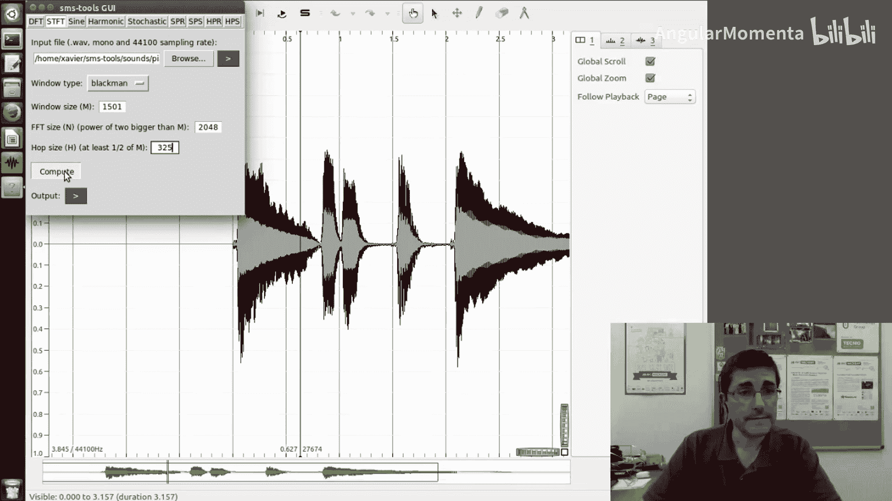

🎼Okay， this was the input sound， the magnitude and phase spectrogram and the output reconstructed。

 So let's first just listen to the reconstruction Okay that's pretty good。

 So I guess we haven't lost any information from the analysis So that means that the hop size on the window size were chosen correctly so that they they overlap correctly。

And well， in the phase spectrum， we see it looks like very minimalist， but it's quite interesting。

 We see these very clear vertical lines。And these correspond to the attacks。 Basically。

 this means that during these attacks， the phase is quite disrupted。Is quite chain。

 There is a quite big transition there。 That's something that we see very clearly in the phase information。

 And in the more steady during the notes， we see more these horizontal structure。

 That means that the harmonics maintain a kind of a phase continuity that can be identified in the phase spectrogram。

In the magnitude spectrogram， we see well， we see very clearly the harmonics， these red lines。

 and we see that as as the sound evolves， piano being a percasid instrument in the attack。

 there is more energy and so there is more harmonics and as the time evolves。

 the harmonics are decaying and especially they decay the high harmonics and the low harmonics are staying more。

 we also see quite clearly the attacks of the sounds and what is going on during the attack。

 So that's quite interesting。Okay， now let's zoom in and let's go into some detail of that。

 So let's use the option of this figure of doing zooming into a rectangle。

 And let's just take this middle note， the fourth note from a little bit before the attack。

To around when the node ends。Okay。And that's what we're getting and what we' are seeing， in fact。

 is the discretization of the analysis。We have zoom enough so that we can see this vertical kind of quantization。

 these vertical bars， these correspond to every frame， every spectrum。Compte it。

So at every bar correspond to the number of samples of the hop size。

 so this was these 325 samples that we are hopping from one frame to the next and vertically we also see these kind of discritization。

 these horizontal lines that are more narrower because we have taken quite a bit of samples in the F。

 we have taken 2048 samples so that we have a pretty good frequency resolution。

Let's compute with a different set of parameters。 For example， let's use a window size。

Which is smaller， for example， let's use 201 samples and let's use an FF size correspondingly smaller。

 doesn't have to be that big。 So let's say 256。And of course。

 the hub size has to be accordingly to the window size， at least one4， so let's use 50。And now。

 let's compute it。It takes a little bit because it is， of course， being the hub size smaller。

 It has to compute more FFTs。

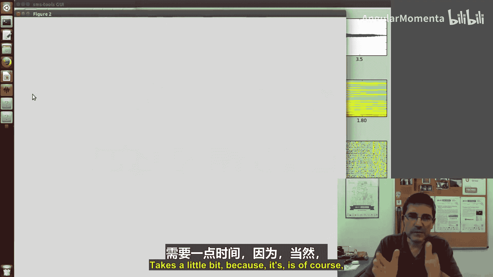

And this is the what we get。🎼Basically we are visualizing a similar thing。

 the analysis and then the rest synthesis and the synthesis is going to be pretty good。

 let's listen to that。🎼Since we have maintained the same relationship between the hop size and the window size。

 the identity is preserved。So the output sound is identical to original。

 but now let's zoom into the same region that we zoom before to try to understand the differences。

 Let's get a little bit。Before the attack， and let's get a little bit of the steady state。Okay。

 and let's compare it with the previous one。And this was the previous。 And this is this one。 Well。

 quite different。If we mentioned what we were talking about before。

 the concept of the vertical and horizontal lines。In terms of the vertical lines。

 we see them narrower。There are more frames per second here。So the resolution。

 the time resolution is bigger。Okay， so we see more things in terms of what how things evolve in time。

In exchange at the vertical axis， the frequency resolution is worse because the F50 size was much smaller。

 therefore these boxes are kind of larger in the vertical axis。

So we see less information in the frequency resolution domain。

And this is at the core of one of the things that are fundamental for the short time Fourier transform is what we call the time frequency compromise。

In the first case， we had a good frequency resolution and a not so good time resolution in exchange in this second example。

 we have a pretty good time resolution， but not so good frequency resolution。

 and that's a quite important consideration to take into account when we analyze a sound and to decide what is the best set of parameters for a particular sound。

Okay， now let's go into one aspect to the attack and try to understand some aspect of the sound by looking at these find spectrum analysis that we have started to do。

 So let's for that， let's do the DFT。Okay， and we will just compute the DFT of one location at the attack。

At the attack， more or less， it was around。Let's see it was 1。

54 that's kind of the where the attack is and let's keep this same resolution that we have。

 so let's keep 1601501 and let's have the FF size 2048 and let's use the piano sound。Okay。

 now we will compute it。Okay， this is the beginning and we see here that is the attack of the piano。

 so we see quite a bit of things going on here。The phase and the reconstruction。

 let's zoom into the beginning。So， let's just get。AMagnitude spectrogram up to， let's say， well。

 let's get up to 10，000 hertz。Okay。So we see quite a bit of things。

 Let's now recompute this with the same parameters， but a little bit beyond the attack。

 So when more is a steady state， So let' say let's say 100 milliseconds after。

 so one second and 64 with the same parameters。

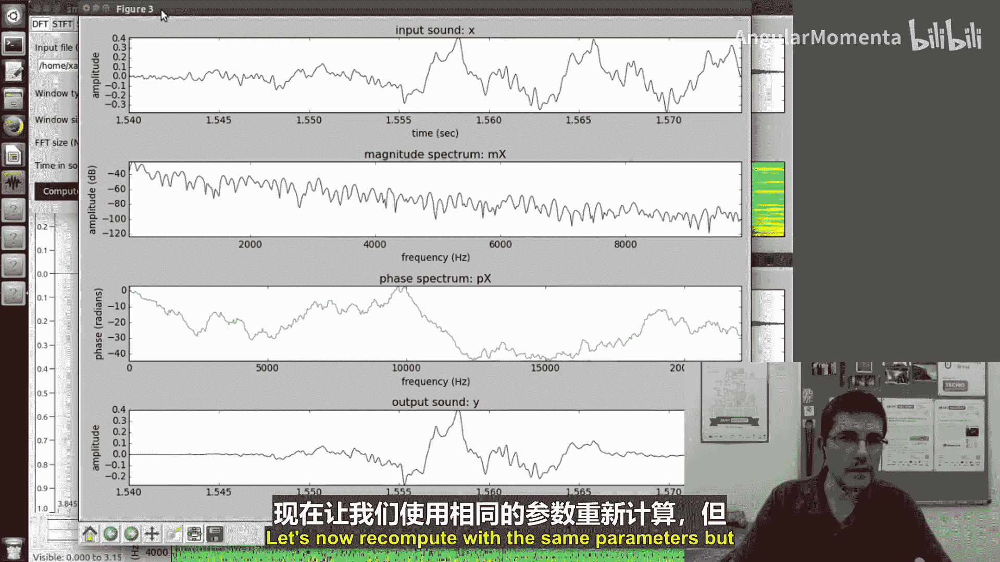

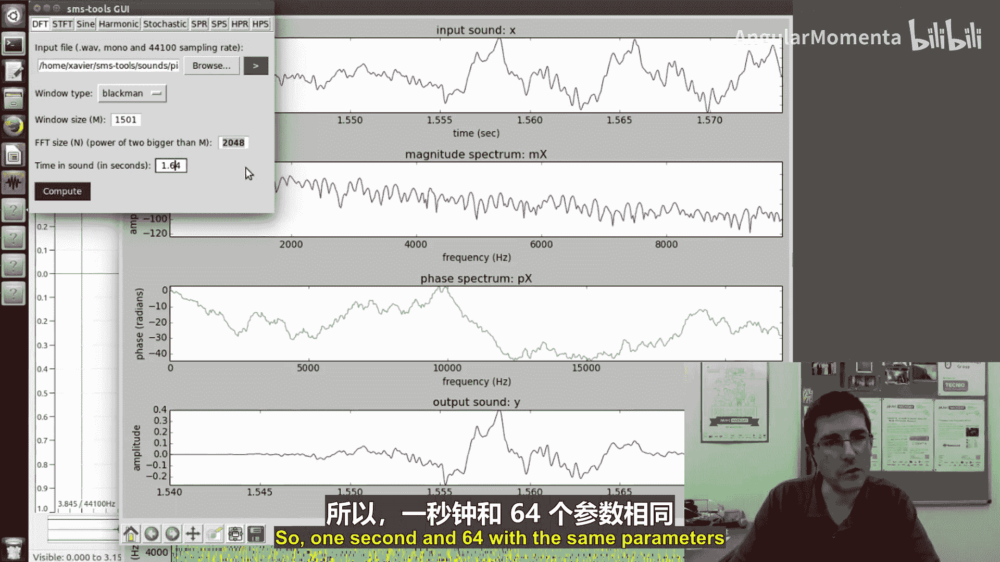

Okay， and this is another analysis。 and let's again， zoom into the same region。

 Let's just zoom into the region that goes。

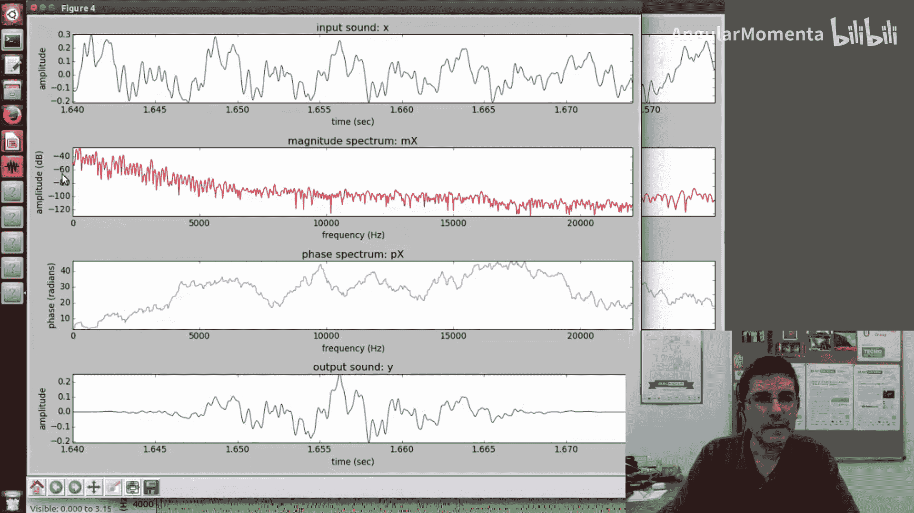

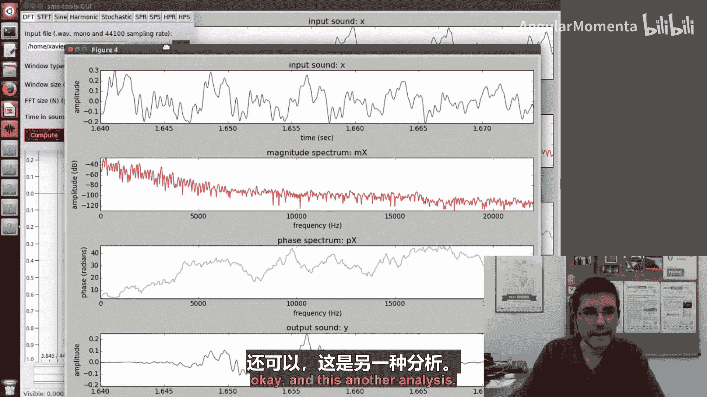

Until 10，000 Herz。And。That we get all the information okay。

 and let's compare it and let's see we can understand what is going on。

 what is going on at the sound level。

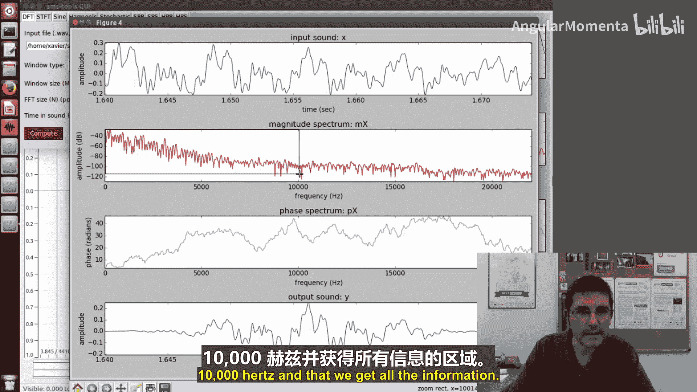

This was the top is the tag， the bottom is the more steady state。In the time domain。

 clearly we see the difference。In the frequency domain。

 I believe we can see also significantly difference。For example， in the attack。

 the harmonics are not so well defined。Because it's the beginning of the sound。

 the harmonics have not been started completely。 Instead， in the steady state。

 these peaks are much more clear， much more resolve。Okay。Then another thing is that in the attack。

 the kind of the noise floor， basically the energy of the high frequencies is higher。

So the high frequencies are much louder than or least substantially louder than during the steady state in which are the lower harmonics that are clearly louder。

Okay， so this is a good way to try to understand a particular sound。

 a particular fragment of a sound and and do a sound analysis using the short time for your transform that gives us some insight。

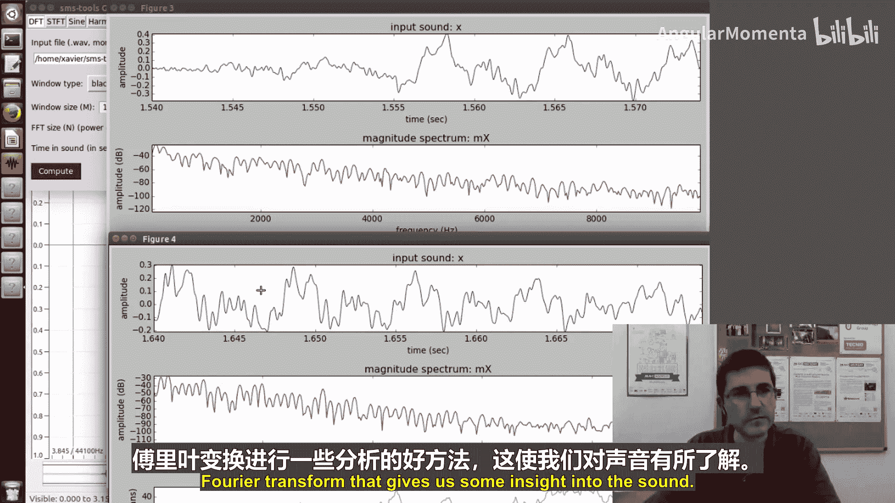

Inと the sun。Okay， so that's basically all I wanted to say。

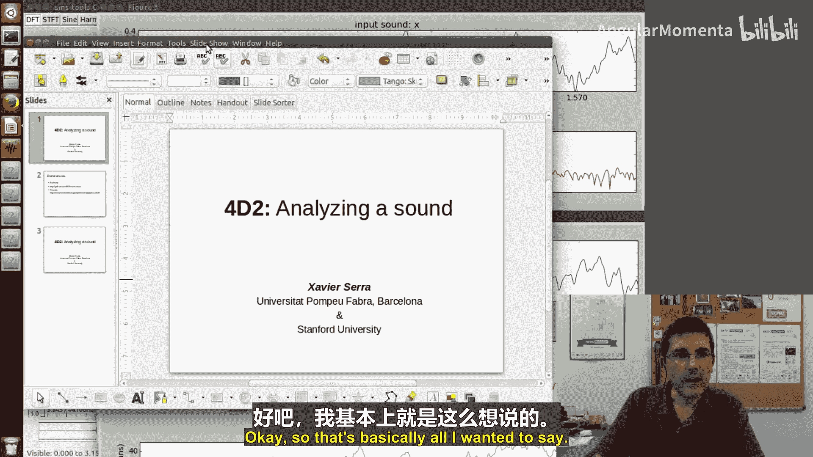

嗯。So we have been looking at sound， in this case， the piano sound using the SMS tools。And of course。

 this sound is available under free sound。And hopefully this has given you another insight into the tool we are building。

 in this case the short time free a transform， but at the same time has given you some insight into the piano sounds and I believe it's a quite an interesting instrument and sound and using these tools we can appreciate quite a bit of it。

So anyway， so that's it for the demonstrations of this week， so I hope to see you next class。

 Thank you。

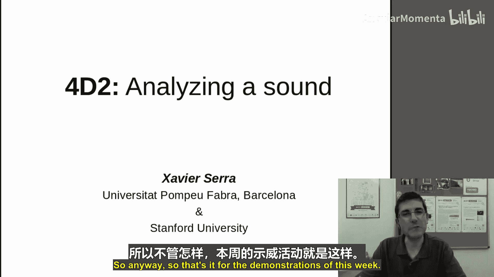