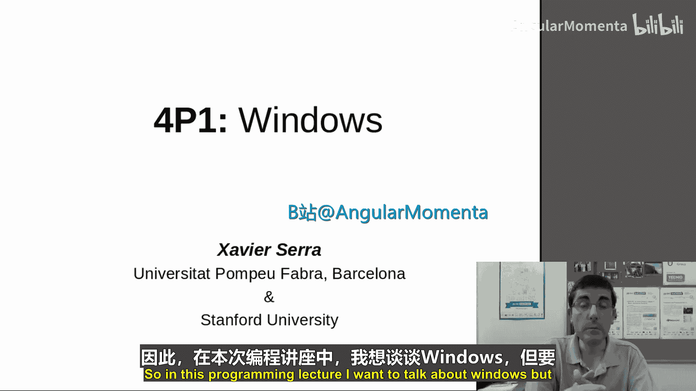
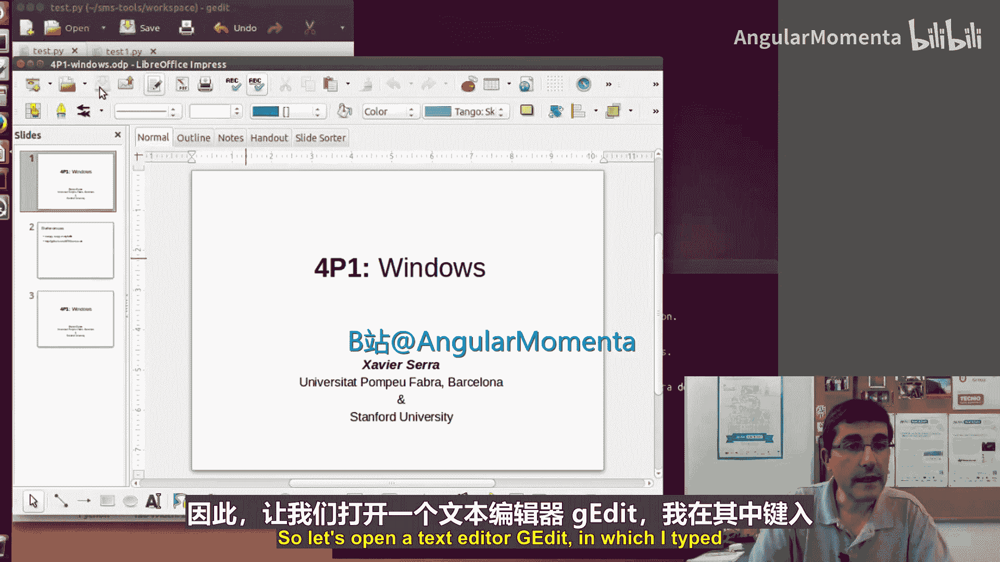
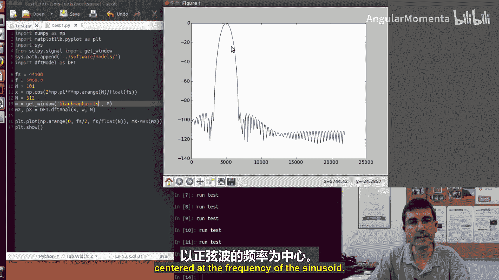
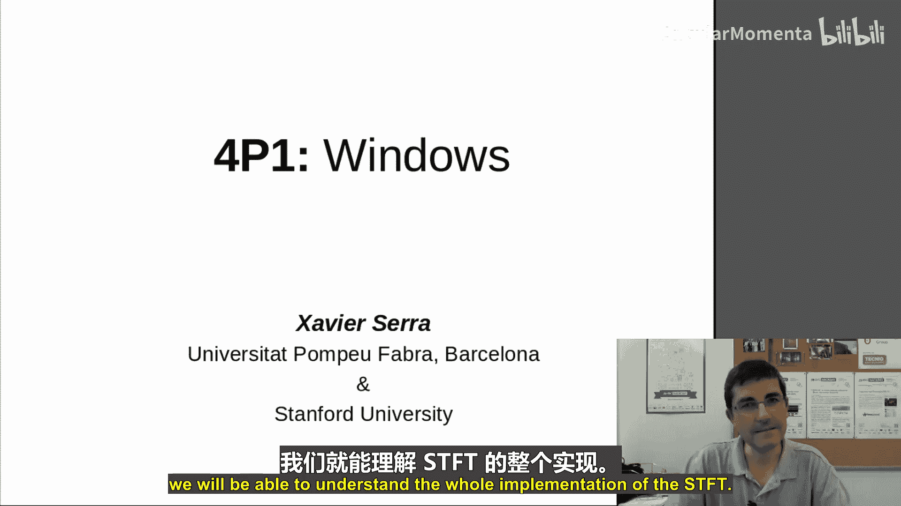

# 【巴塞罗那庞培法布拉大学】音乐应用中的音频信号处理-｜-Audio-Signal-Processing-for-Music-Applications-p29-04_03_01_Windows_1--BV18Xr6BeEX5_p29-

Hello， welcome back to the course on Art processingcesing for music applications。

This week we are talking about the short time for a transform and one of the fundamental elements of this transform is the analysis window。

So in this programming lecture， I want to talk about Windows， but from a programming perspective。

So let's open a text editor， G edit in which I type script that what it does is to get a window。

 in this case， the honey window， and then it computes the spectrum of the window。

But since I have to do all these zero phase windowing and center things around zero and zero padding。

 at the end the code is a little bit longer than what it would be desirable。

 so let's go through the code and talk about the main aspects of it。Well， first， we have the。

The packages that we need， we import Nampai， sip pie and mat Li。

Then we have the lines that relate to the window。 So we defined the window length， in this case。

63 and the variable that we keep that is M capital n。Then we call the function get window。

Which it has two parameters， the name of the window and the size。

 so the window I chose is the honey window， which is the race cosine function。

And then I need the variables that keep the middle of the window information。

 and it has to handle this even an art situation the middle can be different depending of even an odd side and so the two sides might have a different number of samples。

Okay then we need to prepare the window for computing the FFT。

 so to place the window at the zeroth location， so what we're going to do is we create a buffer of the size of the FFT when we want to compute in this case 512 samples and then we place the window around the zeroth sample。

So we take the second half of the window and place it at the beginning and the first half of the window and place it at the end。

Then we can compute the spectrum of this buffer。so we'll compute the buffer using the FFT algorithm。

 and then we convert the complex spectrum into absolute value and phase。

 the absolute value in order to convert it to decibels。

 which is the way that we like to see the information of the magnitude。

 we have to make sure that there are no zeros so that the lock of zero doesn doesn is not there。

 so we will have to check if the absolute value is below this epsilon value which is the minimum value we can have in Python。

So that's why we have these three lines of code。And then we compute the angle。Of the complex values。

And then in order to show it better to display the spectrum。

 the magazine phase spectra and see it centered in the middle， let's say of the array。

 we undo these zero phase windowing thing so that we place back the data in the middle of the array that is easier to visualize okay。

 let's run it。Okay， so we are in high Python and with the pilot in it。

 So we have the macro lip packet already in it， and we can run the。The script。 Okay， that's it。

 And now we can start plotting things that we have computed。 For example， we can plot the window。

Okay。So this is the hanging window， which is this race cosine going from0 to 1 and the 63 samples we have computed。

Then we can plot how this window has been placed in the FFT buffer so we can plot the FFT buffer。

Okay， so here the window is centered at zero， so we have the second half。

From0 to half of the window and the first half right before the 512 value of the F50 buffer。

And now we compute the FFT and we can plot the magnet spectrum resulting from that。

So this is the magnitude spectrum。Again， centered around 0。

 So here we have the positive frequency values。 And in the second part。

 we have the negative the negative values。 So a better way to display that。

 So it's to move things around and locate the the main loop in the center， so。That's how we need。

 And M makes1。Has the information in the center。And if we plug the phase。We can also show。

The location of the faces。 And here， what is important， of course， are the faces in the middle。

 And here we have this two pi discontinuities。 But basically everything is 0 modulu is2 pi。

And it's cleared， it's good because that means that we centered the window around zero。

 and therefore we have a what we call a zero phase window。

Okay in order to visualize the x axis better here I type some command to plot it in a way that the axis are better shown so here what I did was to plot against an x axis array that has been normalize so that the zero padding does not affect so we divide by n and multiply by n so we actually see the samples。

 let's say off with respect to the window and I also have normalized the magnitude so that the maximum is0 decibels and I am only plotting the values that go in the x axis from minus 20 to 20 and the D values I am plotting from minus 80 to 0 so now if we run these screen。

With these lines added it。 Well， we are seeing the magnitude spectrum of the honey window。

 but with an X axis that shows the centered around 0 and thel starting from 0。

 So now we can check the values we talked about that describe the windows we mentioned that the the main lo。

 the width of the main loop is an important characteristics of the window。

And in here we can see if we look from on the bottom right side where our x value is of the cursor and we can see that this main lo sort of deep is at minus2 and this other one is at two so clearly this main lobe at these location。

 the width is around four samples， what we call four bins and this is what we mention about the hunting window and then also we talked about the side lobe level。

 the highest side lo level and here again we can put the cursor at highest side lobe level and it tells me kind of the value that this has and it's around minus 31 decibels which is the kind of thing that we mention。

Okay， so now we can keep changing the window。 And for example。

 we can put instead of the humming instead of the hum， we can put the humming。

And compute the same script。 And okay， that's a different window。

And if we can measure the main lobe width， we see that it also has four samples。

 but now the side lobe level is much lower， so the highest side lobe is around-42 decibels。

 which is the kind of things we mention in the theory class。Okay， and if we go to another window。

 for example， we go to the。The black man window。嗯。Like men window， and we save it。

And run it okay well yes， that's what we saw in the theory class and now the main lope is wider。

 it's around six bin and the side globebe level is much lower around 58 decibels。And then finally。

 the last window that we also talked about was the black man Harry's window。Let man。

Harrys window that we can compute。And if we run it。Okay。So now， in fact。

 we are not seeing the side los。 And this is because the range that we are specifying doesn't even reach where the side los is。

 So let's change the display and let's change the access to instead of having-80。

 Let's put at least-100。So that when we show it now we are seeing the side los。 In fact。

 the highest side lo is around-92 decibels。And now the main look is quite wider， is around 8 bins。

Okay， so this is a good way to visualize and try to understand the windows and so please feel free to play around with that。

Now I want to do it， but with a sinusoid， so to analyze a sinusoid that has been windowowed。

And this is another script， this is much shorter because instead of calling the FFT and worrying about all these centering around zero and worrying about the zero padding。

 etc， I call directly the DFT and now function that we have in the SMS tools directory so now what I do is I specify the directory of the models where I have all the the models of the SMS tools and I import the DFT model file so that I can call these DFT andL function that receives a input the signal the window and the FFT size and automatically does all the operations that we just showed in the previous script。

Okay， so in this grid， basically what I do is I get a sine wave with a given frequency。 in this case。

 the frequency is 5000 hertz。Of course， a sampling rate， 44，100。

 and I compute 101 samples of a sinusoid。Which are basically going to be the same length of the window size I am using。

For example， in this case， I'm using the hanging window。

 but maybe let's change it and let's use the I don't know， for example the。The humming window。

OkayAnd now we compute the analysis and here I also display in a way the output so that I centered everything and talked about hertz So we are going to display only the positive part because the the fT and now only compute the positive part of the spectrum and then I will be displaying it showing it in hertz。

 Okay， so let's execute this file。That one。Okay， and this is the sinusoid of。

Of what I have analyzed and this is the shape of the window in fact。

 so this is proves what we talked about in theory that when we analyze a sine wave and we multipplied by given window in fact what we're seeing in the spectrum is the transform of the window centered at the frequency of the sinusoid。

 5000 hertz and with the amplitude of the sinusoid the amplitude in this case was normalized。

 so it's not is not here an important thing， but we would also see the amplitude of the sinusoid and of course we see the standard characteristics of of the window and here the x axis is in hertz so we need to understand the relationship between frequency in hertz and all these other values。

 the bins that we talked about。And of course， if we change the window and we compute the like what the one we mentioned。

 the black man。啊。Aman Hars。Okay， so now we do this。Computation， okay， and now we are seeing。Again。

 the black Maharris window， the magnet spectrum but centered at the frequency of the sinusoid。

Okay， so that's basically all I wanted to talk about in this lecture。

So we have been using some packages from Python and also， of course。

 we have been using the SMS tools in order to get DFT analysis code from that。

And that's all we have been focusing on one aspect of the shorttime period transform。

 which is the analysis window， which is a fundamental element and as we understand how windows work is going to be very difficult to understand how spectrograms and how the shorttime period transform and other spectral analysis systems work。

 so please make sure that you understand the concept of window in and how it affects when either by itself when it we see the spectrum or when we window a particular signal and therefore so how we see the spectrum of particular signal having been windowed in a certain way。

So thank you very much and I hope to see you in next programming class that we will basically put it together with the whole code of the short time for your transform and we will be able to understand the whole implementation of the STFT。

 so see you then bye bye。

