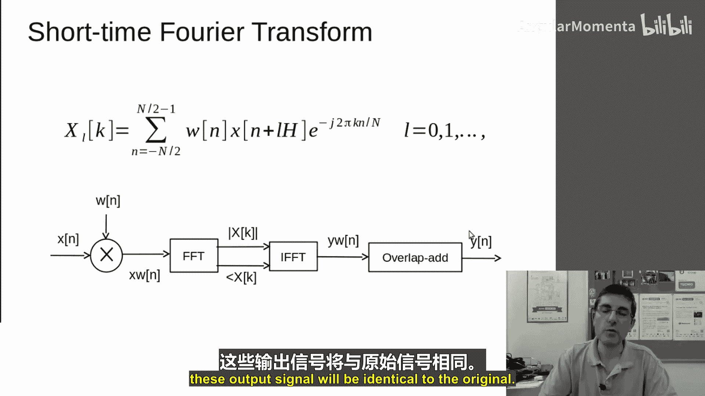
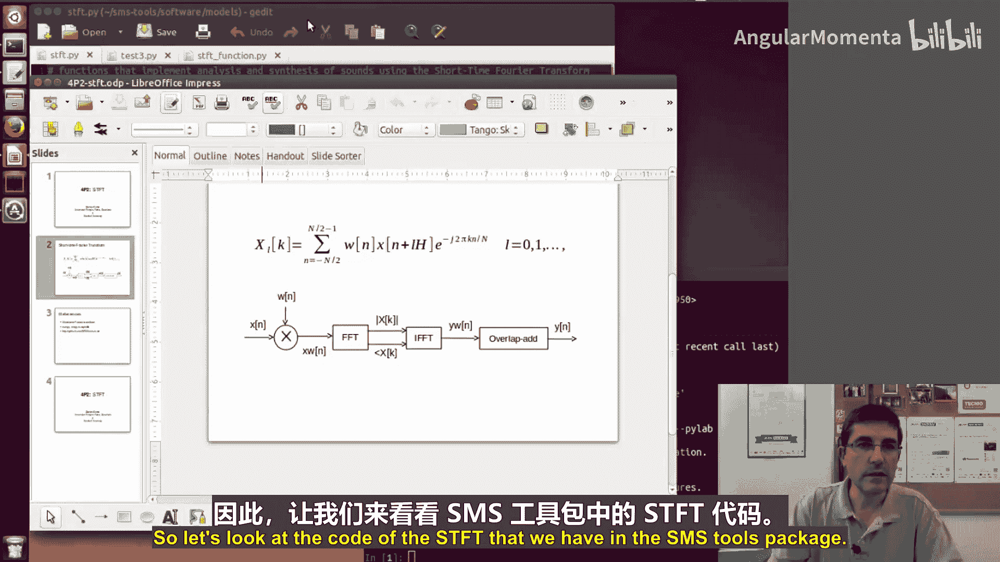
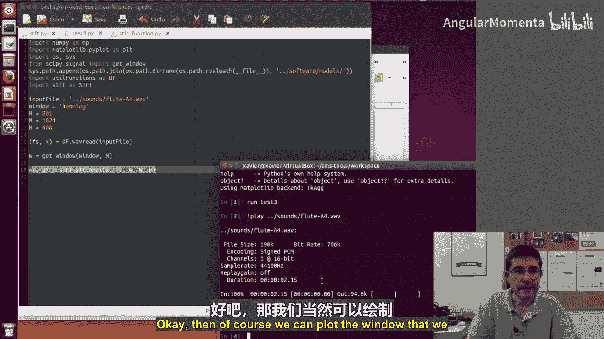
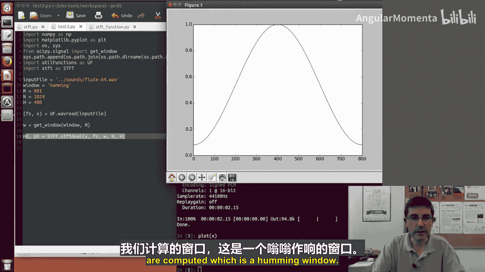
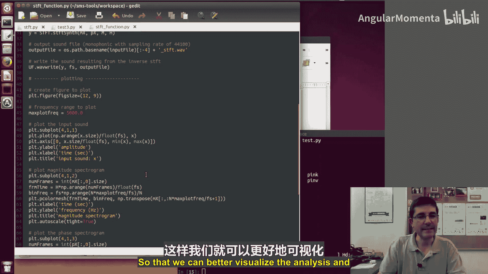
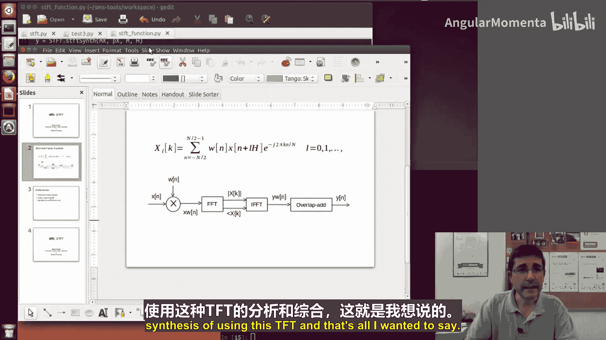
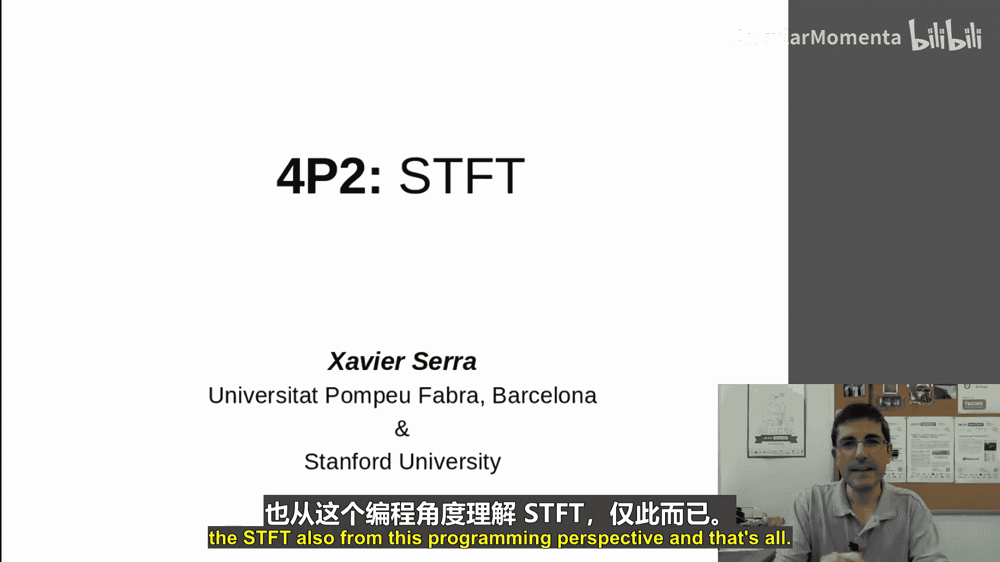

# 【巴塞罗那庞培法布拉大学】音乐应用中的音频信号处理-｜-Audio-Signal-Processing-for-Music-Applications-p30-04_03_02_短时傅里叶变换--BV18Xr6BeEX5_p30-

Welcome to the course on our processing for music applications。

This week is the week of the short time period transform。And in the previous programming class。

 we talked about Windows， we talked about how to get a window， how to display it。

 how to compute its spectrum and how to visualize the kind of things that we talked about in the theory class related to Windows and now in this second programming lecture。

 I want to build the whole short time for a transform system and talk about the implementation we have in the SMS tools package。

So we will basically be implementing the whole SDFT equation shown here。

 so basically well be iterating over a sound X， and we will be computing at every frame so the frame number is L。

 so we will be computing frames of the sound at each frame location。

 we will be multiplying the fragment of sound with a window w and therefore at the end well have a sequence of spectra。

 a sequence of in this case complex spectra。And if we see it as as a block diagram。

 So we start from the signal X of n， we multiply one fragment with our window。

 So we get a window signal。 That's what we compute the FF T off。

And then of course we compute the magnitude and phase representation of the spectrum。

 and then we can undo the whole process by calling the inverse F50。

 therefore obtaining the windowed synthesized sound and with what we call overlap at strategy we will be adding together these fragments into a whole signal。

 and hopefully if we have done the things correctly。

 especially if we have chosen the window at the hop size correctly these output signal we be identical to the original。

So let's look at the code of the SDFT that we have in the SMS tools package。 Okay。

 so it is the file called SDFT do py and in it we have three functions。

One， there is the SDFT。That does the whole analysis and synthesis。

 And then we just have the analysis and synthesis separate。 So sometimes it's useful。

 So we have the SDFT and L function and the SDFT synth function for the inverse part。

 But let's talk about the complete analysis synthesis。 So let's talk about the SDFT function。

As input parameters， it has the X our array with the complete sound。

We need to know the sampling rate of that sound。Then we need to pass it the window we're going to be using W。

 then the size of the FFT capital n and the hop size， how are we going to hop through the sound。

And basically， the core of the function is a loop。In this case。

 a wild loop that keeps advancing through the sound by a pointer。

 This pin pin is a pointer that keeps advancing by H by capital H by the hop size。

 So pin gets advanced at every iteration by capital H until it reaches the n。

 which is the n of the sound。And within that， we basically choose the fragment of the sound that we want to analyze。

And then we call the DFT andL function。So this is the function that we already discussed last week。

 which is the DFT model。 It comes from the package， DFT model。Okay。

 so we don't have to worry now here about the zero phase windowing， about the zero padding， et ceter。

 everything is done within this DFT andL function。And it receives the fragment of the sound。

 the window and the FF size。 and it returns the positive side of the magnitude and phase spectra。

 after that， we can do the inverse DFT， also calling the DFT S function。And therefore。

 that will return a window fragment of the sound， and then we can put it all together。

 overlap and adding the sound and creating the overall output array。Okay， and apart from that。

 the rest are basically initializations and ways to better analyze the sound and to make sure that the pointer is kind of start at the very beginning of the sound and can end at the very end of the sound。

 So I'm not going go into detail of that。 but please feel free to go over that and understand this code。

Okay， so now we have this function。 So that returns a sound。 And let's， let's use it。

 Let's write some code to use this function。 So this is a little script that I wrote to call SD F T N L。

In which I first have to get all the packages required， including the the the actual SDFT function。

 So this comes from the models and directory。And then I can get a file。Define the window。

And then define the size of the window， the F50 size and the hop size。

 And now we can read the file with W read。Get the window。Un called the SDF T function。

And this will fill out two variables， M X and P X， which will be including will include the。

 the sequence of magnitude and phase spectra。 Okay， so let's， let's run it。 Let's run test。3。Okay。

 that's quite quick。 So it analyze the sound and it obtain all these variables。

 So let's go through them。 So maybe the first thing we can do is to listen to the sound so we can just do the。

嗯。The exclamation mark play and the name of the sound， which is this flute sound。

And we can listen to that。Okay， so this is the sound of the flute。

And now we can go through the different variables that we have computed。 So for example。

 the first one is the sound that we read， the X array。

 So this is the whole sound the array of the whole sound。 So it's more than 80，000 samples。Okay。

 then， of course， we can plot the window that we are computed， which is a humming window。

And then we have the output array of magnitude and phases。 but those are very big variables。

 they are very big matrixes of values。 So in fact， if we put Mx dot shape。

 it will tell me the dimensions of the array， basically the number of frames and the number of samples in the spectrum that we have。

 So in fact， this tells me that we have 238 frames， and each frame has 512 samples。

 these 512 samples are the samples of the magnitude spectrum of half of the magnitude spectrum。

 So now we can access individual frames of that。 So if we put， for example， Mx and we access。

 for example， the frame number 50。And we plot the whole spectrum of that 50th frame。

These are the values of the magnitude。And， of course， we can， if we call the function plot with that。

Variable。We will plot the magnitude spectrum of that particular location。Okay。

 so this is the flute sound。 We see the harmonics， and we see how the higher values are much softer。

 and it's quite noisy。Of course， we can also plot the phase spectrum of that same location。

And this is the phase， the unra phase， so we can see all this nice looking phase shape。Okay。

 of course， we want to visualize the whole spectrum。 So in order to visualize the whole spectrum。

 the， the plotting command that can do that is what is the function is called P color mesh。

P color mesh， it plots a matrix as a kind of three dimensional shape。 So if we give it the P。

 the M X， it will basically plot all the frames。But it may plot it in a different way that we are accustomed to because the vertical axis is the time。

 So in fact， we see time going from bottom to top and the frequency is on the horizontal access。

 In fact， a better way to plot these with color mesh is to transpose it first so we can called the transpose function。

 So this will transpose the Mx in a different way， so that we can see it in a more meaningful way。

 So now we see time going from left to right and frequency going or the frame frequency going from bottom to top。

Okay， so that's basically how we compute the magnitude。

 the phase spectrum using the SDFT and how we can plot it。

 and there is a function file that implements all that and makes plots in a nice way and that's the SDFT underscore function and this is the one that is called from the graphical interface that we also use and here it has one function called main and it goes through the kinds of things we did and it does both the analysis and synthesis。

Okay， so the main has as input values， all the input parameters。And then it reads the sound file。

 it gets the window。 it performs analysis。 This is exactly what we did now。

 but then it does the synthesis， and it outputs the synthesis file into into a location with a given name and then it writes it by the way。

 here this file I just copied into the workspace， but I had to change the relative path of a number of these names。

 So for example， I had to change the path of the software models or I have to change the output file name because in here it was using a particular directory to store the sound file。

 So here I just write it directory on on on this directory。 Okay。

 so let's execute these So I have it。In this directory， So it's SFT function。

 So I can just run SFT function。Okay， and it plots well， the input sound， the magnitude。

 the derivative of the phase and the output sound。And this has created a file， which is called a。

What is it call is called piano S TFT dot Wf。 And， of course， from here again， I can play it。

 So I can say play S TFT。DI know piano。B然o。STFT。twof。🎼。Okay。

 and it's basically the same than the regional sound。Of course now from this file。

 I can really change and make the things differently if I want。

 so feel free to change how the plots are shown， but these is a quite nice way to plot the things with the correct access with the correct labels with the correct scaling so that we can better visualize the analysis and synthesis using the SDFT。

And that's all I wanted to say。

So basically we have gone through the short time Four a transfer。

 the implementation of the short time Four transfer。

 so make sure that you understand the actual equation and what the signal processing configurations that are involved in that and then of course we use a number of packages from Python together with the SMS tools that we have already developed and implement the DFT and the SDFT so we have been calling those functions。

And that's all so with this programming class hopefully you have got an idea of how to implement the STFT and how can we use the functions of the SMS tools to actually adapt it to our own particular needs。

 so please feel free to play around with that and make sure that you understand the STFT also from these programming perspective。

And that's all。 Thank you very much。

