# 【巴塞罗那庞培法布拉大学】音乐应用中的音频信号处理-｜-Audio-Signal-Processing-for-Music-Applications-p31-05_01_01_正弦模型一--BV18Xr6BeEX5_p31-

Welcome again to the course on Hoing or Proing for music applications。Last week。

 we talked about the short time free transfer。That offered a sound representation from which we can synthesize sounds without losing any information。

 and at the same time， it's a good tool for understanding， describing and transforming sound。

This week， we go a step further in the direction of obtaining a higher level representation that in exchange of losing a bit in terms of the identity properties of the STFT。

 we gain quite a lot of flexibility and level of abstraction in the representation。

This is what we call the sinus sort model， and we will cover this topic in three theory lectures。

 So this is the first one。We will first present the model， the sinusoral model。

 and then talked about how these sinusoids can be expressed in the spectrum and how can they be identified in what we call specpics。

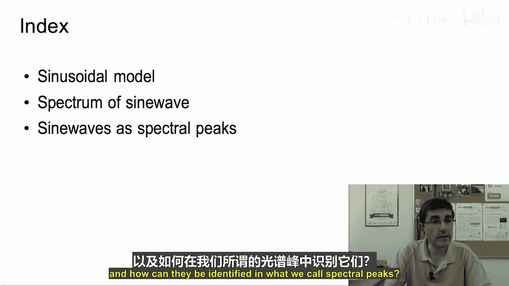

So the model is quite simple， it's just a sum of time varying sinusoids。

 so this equation we have seen it before， but here we are emphasizing two aspects。

 one is the idea of summing a finite number of sinusoids， capital R， so we have capital R sinusoids。

 and each of these sinusoids is time varying， it has an instantaneous and a frequency value that changes in time。

So changes as a function of the time index n。

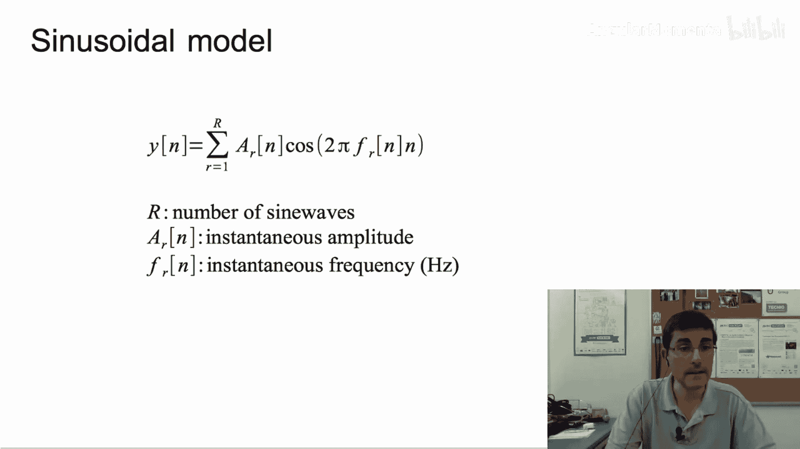

But we are interested in modeling the sinusoids in the frequency domain， in the spectrum。So。

 let's see how that looks like。Again， we have seen these equations before。

 So if we start from signal x， that is a real sine wave。

And then we take the DFT of the window version of this sine wave。We see that， of course。

 the sine wave can be expressed as the sum of two complex sine waves that are then multiplied by the window we use。

And being the sum of two exponentialial s waves， we can split that into two summeteries or separate DFs。

 So we'll have the DFT of the negative frequency and a DFT of the positive frequency。 Each one again。

 multiply by a window。And these complex exponentials can be grouped together。 And basically。

 this is the DFT of a shifted version of the transform of the window。Okay， so basically。

 at then we see that the first summeter is the DFT of the function W。

 So it's it's a big W and the frequency index is shifted。

 So we have shifted the the window and is a scale by the amplitude of the cosine by half of the amplitude of the cosine。

 and the other element is the the the same window， but shifted by the positive frequency and also scale by the same amplitude。

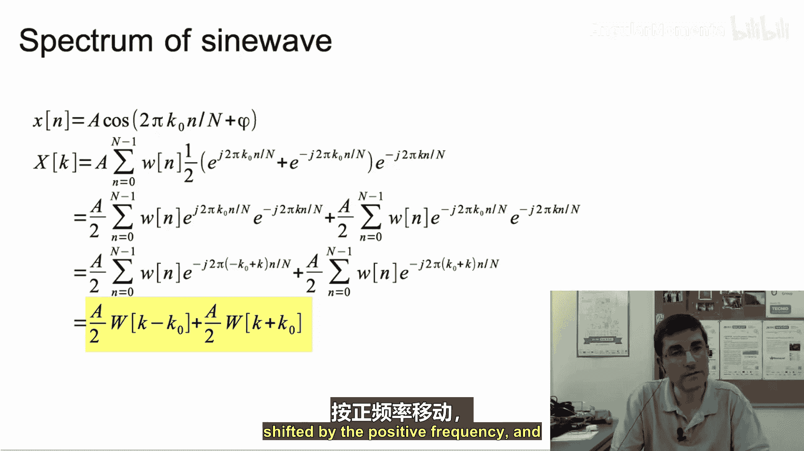

So if we start from a sine wave and we want to show it the plot of one single spectrum of this window sinusoid。

 we can see it like this。 So this is the positive spectrum。

 So we don't see the two windows we only see the positive one。

 So we are seeing the positive frequencies。 And so the contribution of the positive exponential and we see the shape of the window that we use。

 but of course centered at the frequency of the sinusoid， which is 440 Hz。

 which of course we can listen to the sine wave。And this is its spectrum。

 So a peak centered at 440 Hz and the phase that during the main low piece is flat that corresponds to the phase of that sine wave at location0。

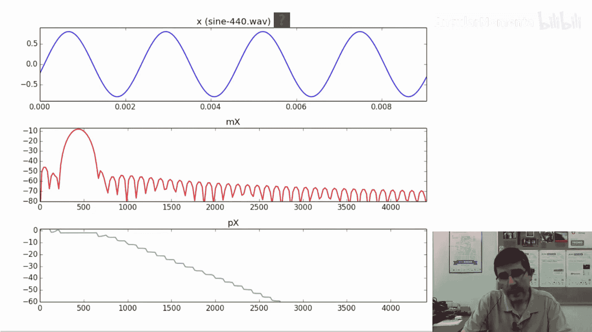

Let's make it a little bit more difficult。 What happens when our sound is made up of two sine waves。

So these are two sine weights， one at 440 Hertz， the other at 490 Hertz。

Together and we can also listen to that。so clearly it sounds like a modulated signal and in the time domain we can see these modulation so we see the low frequency which is like the modulation and the high frequency。

And if we compute the spectrum of that， the positive part of that。

 we are seeing the two contributions of the two sinusoids。

 So we see the two peaks of the two sinusoids。And in the face we see the faces of these two sinusocytes。

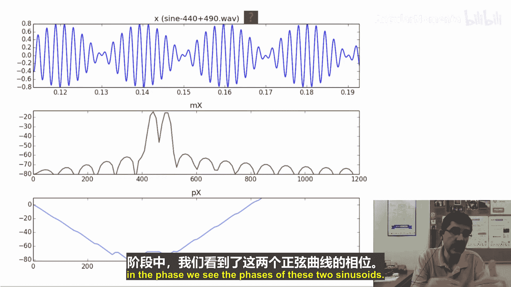

And now let's show an example of a real sound， a sound that includes many sine wavesigs like the sound of a noble。

 Let's listen to the ob first。Okay， so this is a noble playing the A4 note。

 which is around the fundamental around 440 Hertz。And in the spectrum。

 we clearly see all these sinusoids， which are the harmonics of the sound。 Here。

 We are only plotting the first 4000 Hz。 So we only think the first few harmonics。

 This sound has many more harmonics。But this is a good way to zoom into these shapes of the windows。

 and also we see the phase spectrum of that。But how do we detect the frequency。

 amplitude and phase of each of these sine waves？

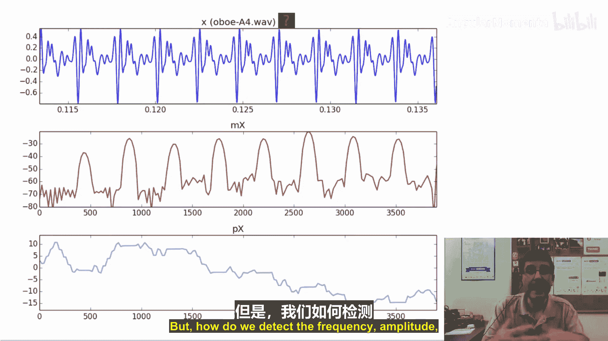

A simple way to identify a sinusoid in a spectrum is by just focusing on the spectral magnitude。

 on its location and on its height。So the location is the frequency and the height is the amplitude of the sinusoid。

So therefore， we consider a sinusoid as a peak in the magnitude spectrum。And of course。

 the issue is that the resolution of a magnitude spectrum is discrete， is finite。

And the maximum resolution we will be able to get is half of the the distance between two frequency samples。

 between two beams。 So that's the maximum frequency resolution that well get in measuring a sinusoid。

But we can do better than that。And way to do better than that and related to things that we have already mentioned is the idea of zero padding and of spectral interpolation。

So we'll be able to do zero padding to get a bigger FFT so that we get more samples and we can also do interpolation directly on the resulting samples to even refine the value of the frequency and amplitude values。

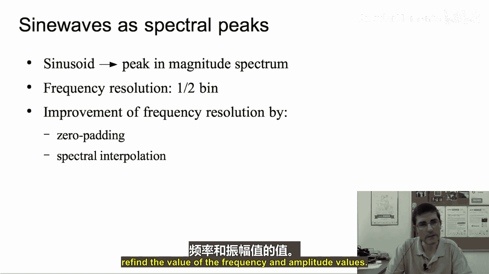

To detect the spectral peaks， we have to understand the fact of the window。

And the most important factor is the window size。So if we have a particular window。

 and one important concept is the bandwidth of the main lo in the spectral domain。

So the the bandwidth of the main lobe is B sub F expressed in hertz。

 So that would be the main lobe bandwidth of the window in hertz。

 and that's defined as the product of B sub S。 So the the main loopbe width of the window expressed in samples multiply by the sampling rate。

And divided by the window size。And so that would be the width of the main loopbe。

 and then if we considered a particular delta of the distance between two frequencies that we want to resolve。

 so we have two frequencies F sub K plus1 and F sub K。

 so the absolute value of the difference is the delta frequency that we want to resolve。

So what would be the window size capital M so that。

Two main lobes of the window are disjoin so that we can see these two frequencies as separate peaks in the spectrum。

So this equation here shows what has to happen。 So M has to be bigger equal than B subs。

 So the number of samples of the window。In the main law。

 multiply by the sampling rate and divided by this delta。

Or we can also change this delta as the absolute value of the difference of these two frequencies。

But in many cases， these difference between the two frequencies corresponds to the fundamental frequency because if it's a harmonic sound。

 the the distance between two consecutive harmonics is equal to the fundamental frequency。

 So if we consider the fundamental frequency， this delta that we want to be able to discriminate。

 then the bandwidth in her of the main loop of the window has to be smaller or equal than this fundamental frequency。

 So we see these lobes separate。 and therefore capital n。

 the window size will have to be bigger or equal than B sub S multipplied by f subs divided by f sub0。

Or if we express the period instead of the fundamental frequency。

 we express the cycle length as the period in samples。

 then this M has to be bigger equal than B sub S multiply by the period。

 the period of the harmonic sound expressed in samples， which is this capital P。

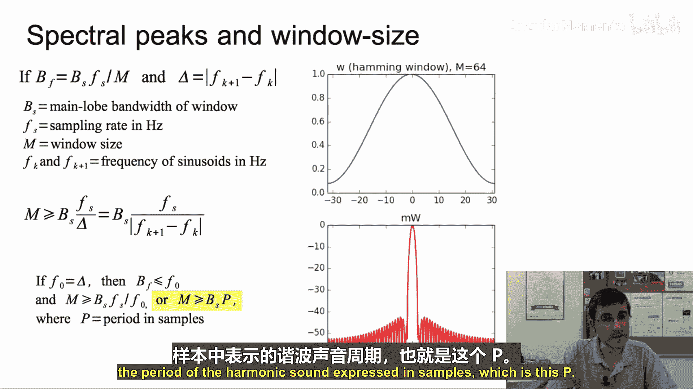

So let's show an example， let's start from a given window like the humming window that B sub S is equal to4。

 So the main lobe width is equal to4 and we have a given sampling rate。

And we have two particular frequencies that we want to distinguish the ones we show before。

 400 hertz， 440 hertz and 490 Hz。So， the difference。

Is these 50 hertz so we can calculate capital M that allows us to distinguish these two frequencies。

 so capital M will have to be bigger or equal than B O S for multiply by sampling rate 44100 and divided by this difference。

 the absolute value of this difference which is going to be this 50 hertz and that M will be 3528 samples。

 So if we take 3528 samples of this signal and we compute the dft off with some zero padding so that we see a smooth spectrum we see these minus spectrum。

 Clearly we see two clearly distinct peaks each one corresponding to the transform of a humming window and of course in the phase spectrum we also see the corresponding phases。

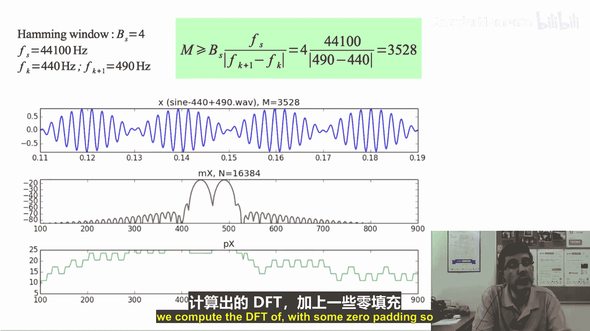

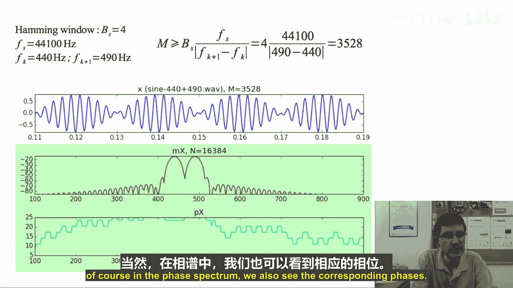

And let's see what happens with different sounds。 So， for example。

 if we have the sound of a noble that has a particular frequency， which is 440 Hz。

What the what should be the M。 So if we take an M of 401 samples。

 these 401 samples basically corresponds to four periods of this obbuso。

And then so if we compute the DFT of this signal multiply by a humming window and again with a zero padding to get an n equal to 1024。

 we see these harmonics quite clearly separated， so each each harmonic correspond to one main lobe of this humming window and they are quite clearly one after the other。

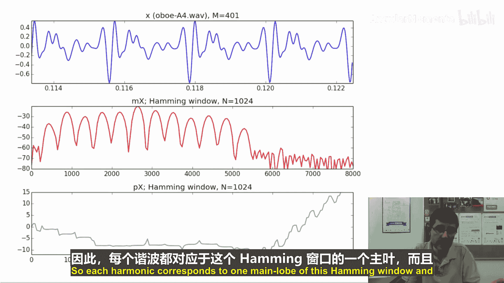

But now let's see if we increase this window size。 So instead of having these 41 samples。

 we have twice as many， so we have 801 samples and then we do the same thing。

 we apply the humming window and then we take the N FF which is larger we see these spectrum and so here because we took more samples the distance that now we can discriminate is larger。

 so in fact， we see that the main lobes are narrower than what we even need there is we even see the side lobes in between the two main loopbes because we took a bigger window size and therefore we are able to discriminate even more than the fundamental frequency。

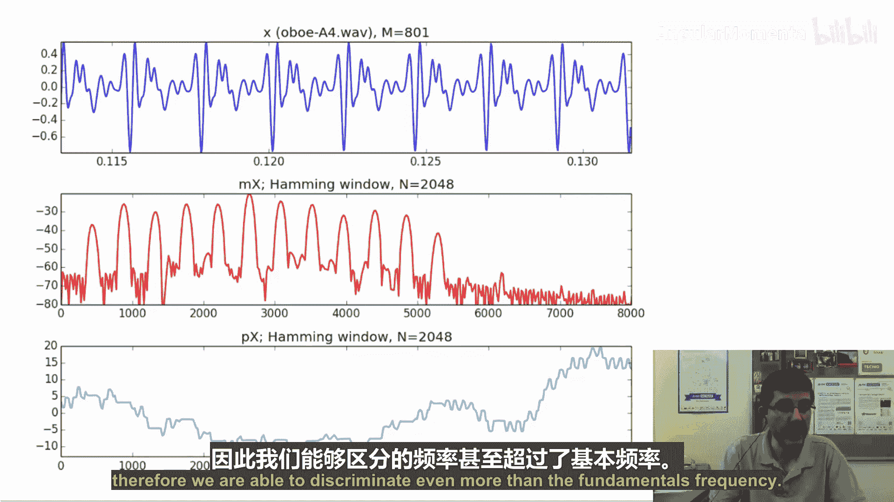

On the topics covered until now， there were quite a bit of references。

 but starting from this lecture on， the techniques are more specific to music applications and quite a bit less has been published。

This is good for me for the course， you'll have to pay more attention to what I'm going to be talking about。

Anyway， so apart from the standard references in Wikipedia。

 you can find a little bit about it and of course， again on Julia's references。

 you can find quite a bit more and more in depth discussion about these things。

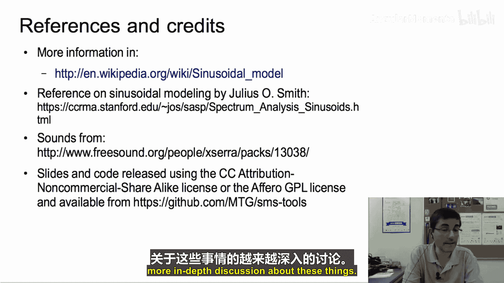

And that's all for this lecture we have presented this sinoid model。

 a sound representation that can be built on top of the short time for transform and that can reduce the amount of spectral information to be considered。

 However， to use it we have to understand a bit about spectra and about Windows。

 hopefully you understood some of that in this lecture。

Now we have to complete the explanation of how to identify the spec peaks and how to synthesize them。

 so this will be covered in the next two theory lectures， so thanks for your attention。

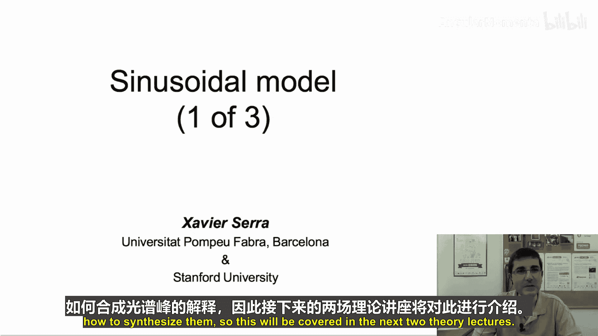