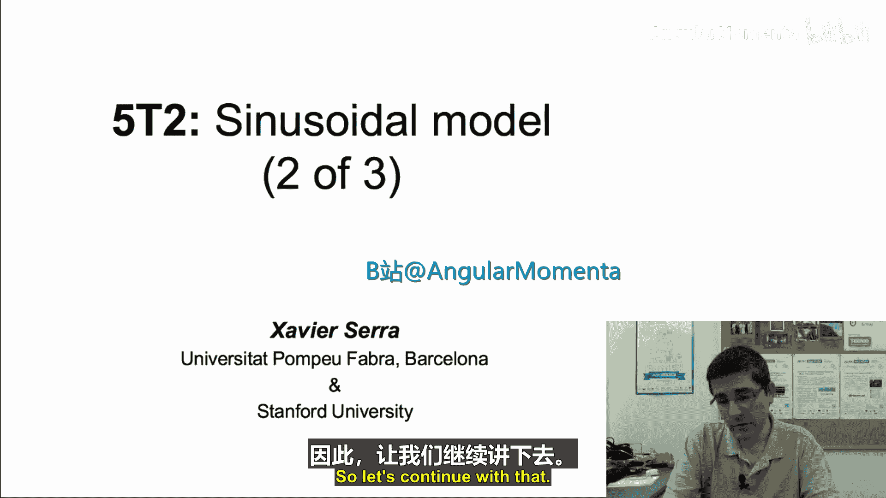
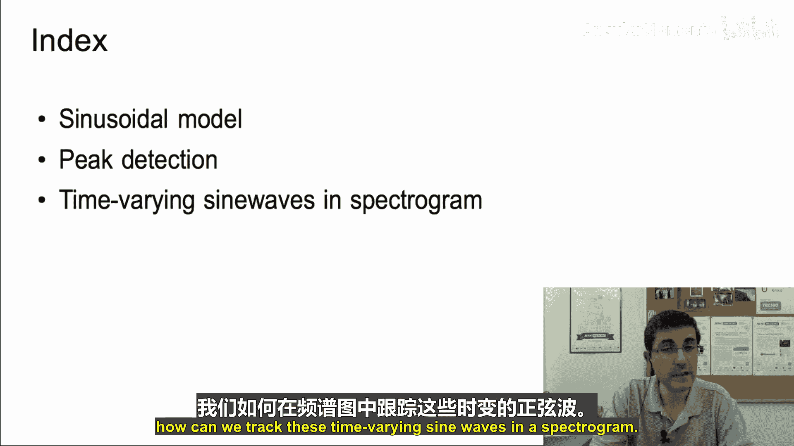
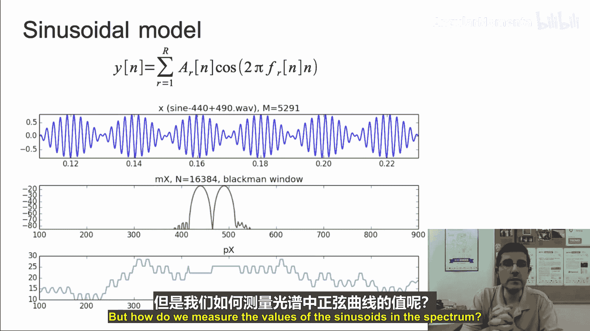
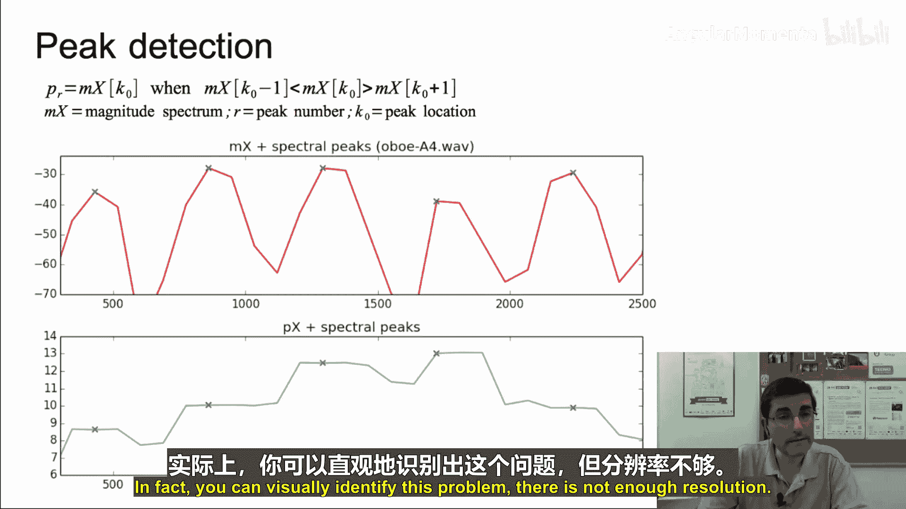
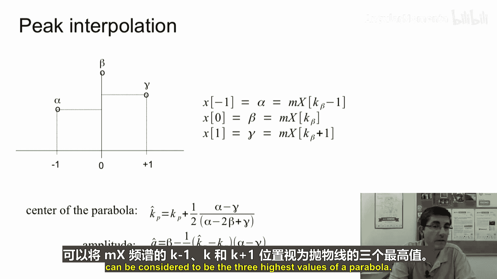
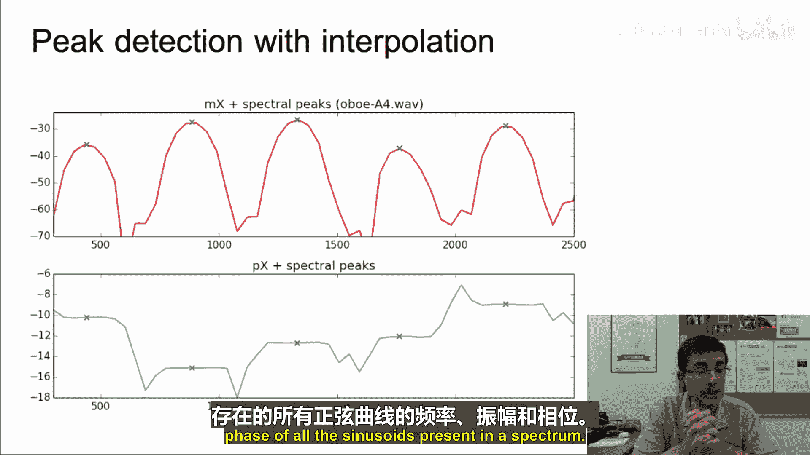
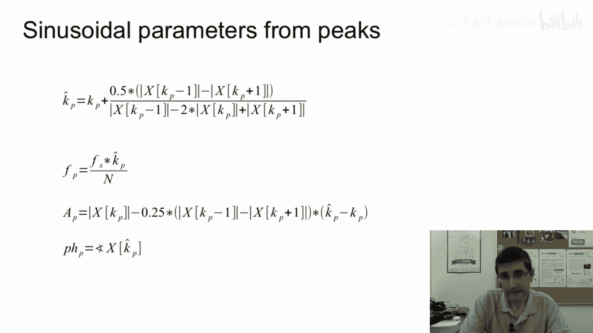
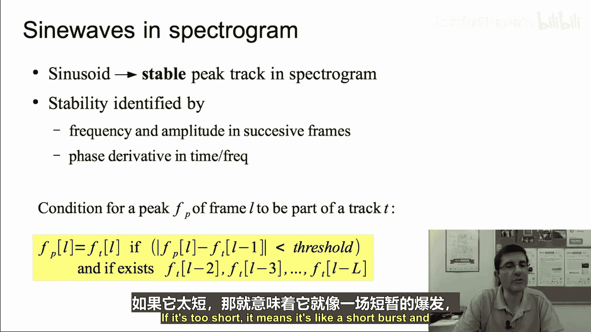
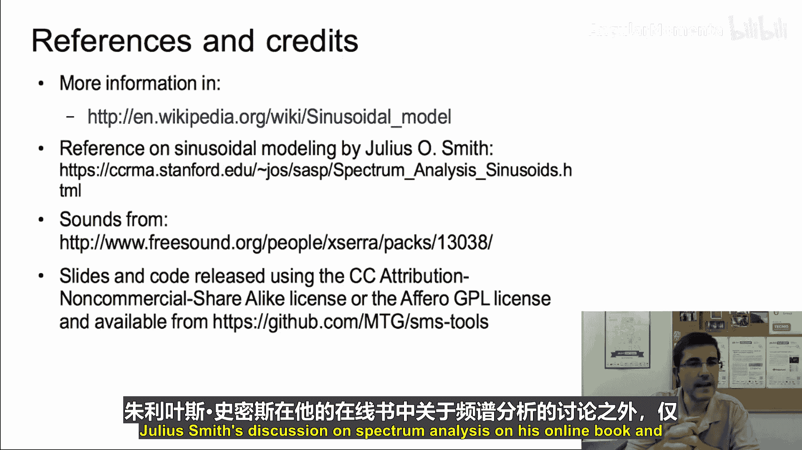
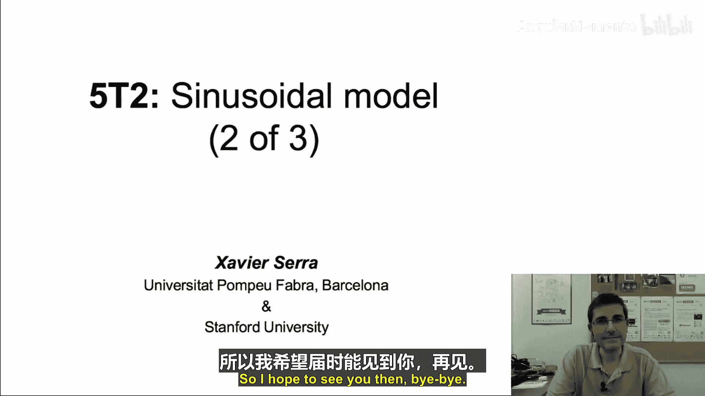

# 【巴塞罗那庞培法布拉大学】音乐应用中的音频信号处理-｜-Audio-Signal-Processing-for-Music-Applications-p32-05_01_02_正弦模型二--BV18Xr6BeEX5_p32-

Welcome again to the course So now ising or processing for music applications。This week。

 were talking about the sinusorra model。And in the previous theory lecture。

 we presented the actual model and a little bit about how these sinusoids can be visualized in the spectral domain。

 so let's continue with that。

We will first overview a little bit the model and then focus on the idea of detecting peaks in the spectral domain。

 which are going to be our sinusoids and also we're going to be talking about how to track them in time so these sine waves varying time in a particular sound。

 so how can we track these time varying sine waves in spectrogram。

So the the model is simple as a sum of timeer sinusoids。And in the previous class。

 we made emphasis on this idea that we need to detect these sinusoids in the frequency domain。

 therefore we need to choose a window size that is good enough to be able to isolate those sinusoids or at least be able to visually have separate peaks for these sinusoids in this particular case。

 these two sinusoids，440 and 490， we need a window size of 5291 samples in order for being able to have these two main lobes separate。

But how do we measure the values of the sinusoids in the spectrum？

Well， if we choose the window size correctly， as we showed。

 we will have a peak for every sinusoid in the signal。

Then to measure the frequency and amplitude of each sinusoid。

 we have to just find the tip of the peak and its height。

So we defined a peak as the location in the magnet spectrum。 So P of R。

 the peak is going to be the magnet spectrum at the location K of 0。 when the previous location。

 So the location of the spectrum when k of0 minus-1 is a smaller and the next location。

 So the location at K of 0 plus1 is also smaller。 So that's going to be what we call a local maximum。

So in this plot， we see a local maxima for the different peaks。so the crosses。

 the blue crosses are local maxa and also in the phase spectrum。

 what we basically do is just read the location of this local maxima in the phase spectrum so we have with this procedure。

 we have the location of the peak which is going to be k of 0。

 then we have the magnitude which is going to be Mx of k of 0 and we have the phase which is going to be px of k of0。

But theres a little problem。 in fact， you can visually identify this problem。

 There is not enough resolution。

So one solution to this resolution problem is to do zero padding。

We use an F 50 size much larger than the window size。 And we have been talking about that。 So。

 for example， in this particular example。We have increased the 50 size of the previous example， by。2。

The window size was the same， but we added zeros to the n up to the next part of 2。

And these results into a much smoother spectrum。 and now the local maxima computed in the same way。

 So these blue crosses are much better。 They are located in visually you can see that。

 they are located in a better place。 they are located in a place that looks like is more the center of the peak and therefore the magnitude and the phase will be better。

But if we want a good enough resolution， we will need to increase the FFC size a lot。

 and that will be quite computationally expensive。So is there any other solution？Well， yes。

 we can do a cheaper interpolation by using， for example， parabolic interpolation。

The parabo is a function with a shape， quite similar to the tip of the lobe of the spectrum of the analysis window。

In the D scale。 So this is the equation of a parabola。Where a P is the center of the parabola。

 A is the conative measure， and B is the offset。And this is a sample version of the parabola。

 so we have different values n， and so this is very similar to what we would see as a sampled function。

Okay。So to perform a parabolic interpolation on a spectral peak。

 we can just use the three highest values of the magnitude of the peak， so for example， in this case。

 the k minus1 k and K plus1 locations of the Mx spectrum。

Can be considered to be the three highest values of a parabola。 So the x minus-1， x 0 and x1。

And then we can apply the equation of the parabola in a way to find where would be the center of this parabola and the center of the parabola would be defined by this equation which k sub p。

 which would be kind of the frequency or the location of the center would be equal to this k that was the highest point plus these values。

 which is going to be the previous and the next values and compute it in this way。

 and then it's going to be very easy to read what would be the amplitude of this value so we can basically plug in the interpolated k sub p into the parabolic equation and obtain the amplitude。

 the height of。ak， so with this equation， basically we can refine the peak positions。

And we can combine it with the zero padding。 So to get a match a better result。

 So this example is exactly that。There is some。Parabolic interpolation together with some zero padding and if you would zoom into this。

 you would see that this is quite a bit better than the two previous examples。

 the one without any zero padding or the one with just zero padding。

So this will give us quite a good measure of frequency amplitude and phase of all the sinusoids present in a spectrum。

 so we will get these so we'll get a value of the frequency location of a peak K sub p and it will be computed with this equation。

 then we can convert this k into into hertz into frequency by multiplying by the sampling rate and divided y by n。

 then we can compute the amplitude。

By using this parabolic idea and finally the phase will be a very straightforward word。

 we can just read the phase of that location and this doesn't even have to have any any interpolation by just reading the closest that should be enough。

But these are the values of a single frame， and the sinusoidto model is about time bearing sounds。

So time bearing sinussoid。 so how do we go about that？

So we had to deal with spectrograms and and fine tying varying sinusoids。

And we will define time vary sinusoid as a stable peak track in the spectrogram。

So this variability will be constrained and we will define sort of peaks that evolve in time that sort of move in time。

 but not so much and this stability will be measured by the frequency and amplitude of successive frames we could also look at the phase derivative in time frequency for that in practice we are going to just focus on the frequency and amplitude variability but the phase is also a very interesting value to look at。

So the condition for a peak of a frame to be part of a track is defined by this equation。So a peak。

 a particular frequency of a peak F sub p a given of a given frame L will be part of a track if the distance between that frequency and the frequency of the previous frame so the track is coming from from the previous frame if that the absolute value of this difference is smaller than a threshold。

And also， if it exists a track for a certain amount of time。

 so we will be making a constraint in terms of the frequency in terms of that it doesn't change that much and at the same time we will make it a constraint in terms of how long has this track been in existence if it's too short。

 it means it's like a short burst and that's not really a sinoid。

So this is an example of tracking these sine waves in a sound in a bender。

 bendeer is a drum using Turkey and several other places so this is a non-harmonic sound。

 it' is a sound that is quite complex， but it has partials it has sinusoids and we can track them so with these algorithm。

 these black lines correspond to the tracking， but lets let's hear the bender first。Okay。

 so it it's an instrument that doesn't have a clear pitch。 and therefore。

 the the tracks are a little bit kind of very unstable and they keep changing and appearing and disappearing。

 So this is what we would find。And also， we can look at the same tracks in the phase spectrum。

 So if we take the phase spectrogram， which is the derivative of the of the phase。

 and we plot those black lines that the frequency tracks on top of that， we get these result。

 and it's quite interesting because clearly we see that the black tracks。😊。

Are in the places where the color is clear。 and these are the locations where the phases changes less。

 where there is more phase continuity。 So this indicates that also the phase information would be quite relevant in tracking these sinusoid because the phase information allows us to distinguish this variability stability aspect of a given partial。

So sorry， there are not that many references on these topics。

 so apart from the Wikipedia entry for Seusorro model or of course。

 Julia Smith discussion on all this spectral analyses on his online book。

And that's basically it。So this is all for this lecture we have presented sinus sortro model。

 sound representation built on top of the shorttime period transform that reduces the amount of information and that get rids of non-re spectral components。

 however its use for the analysis of sound is not as easy as the use of the SDFT we have to understand a bit more about spectra and about windows in order to make good use of this model hopefully by now you're starting to get grasp on that。

Now we have to complete the explanation of the sinuscerro model by describing the synthesis part。

And this is what we'll be doing in the next lecture。So I hope to see you then， by bye。

