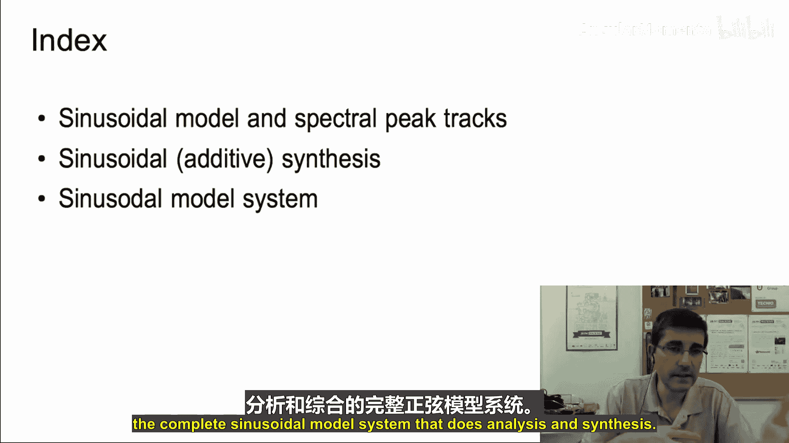
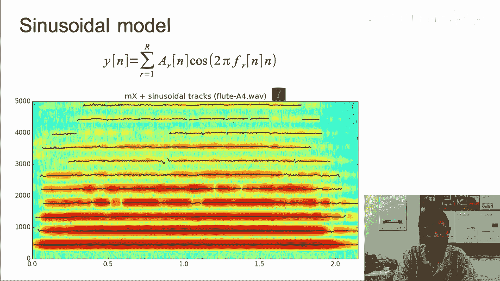
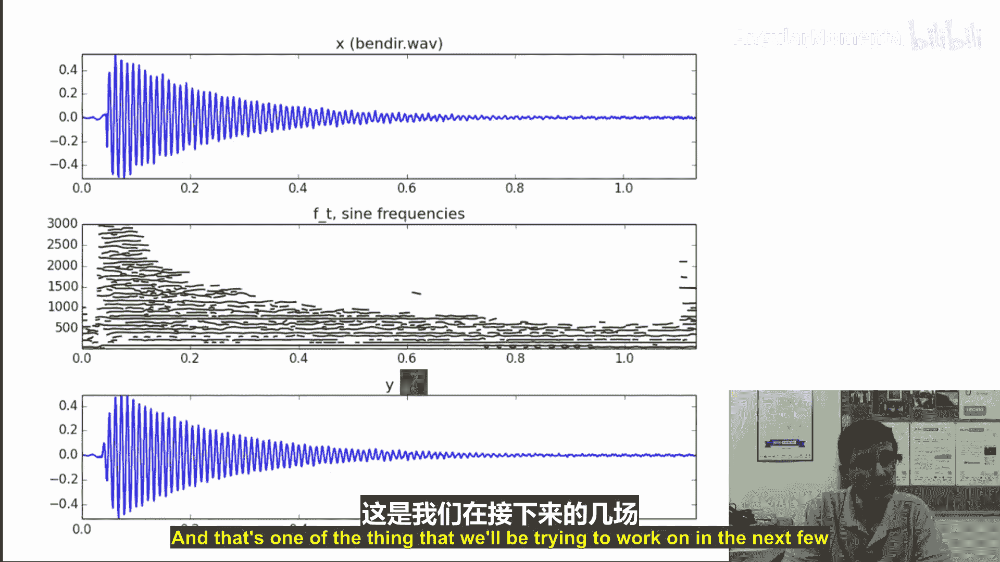
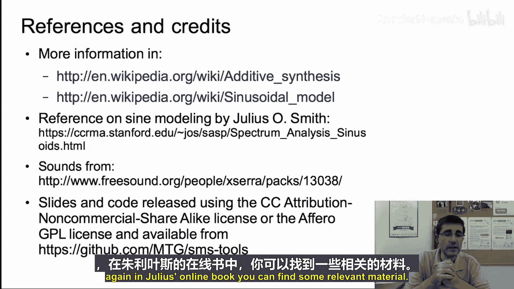
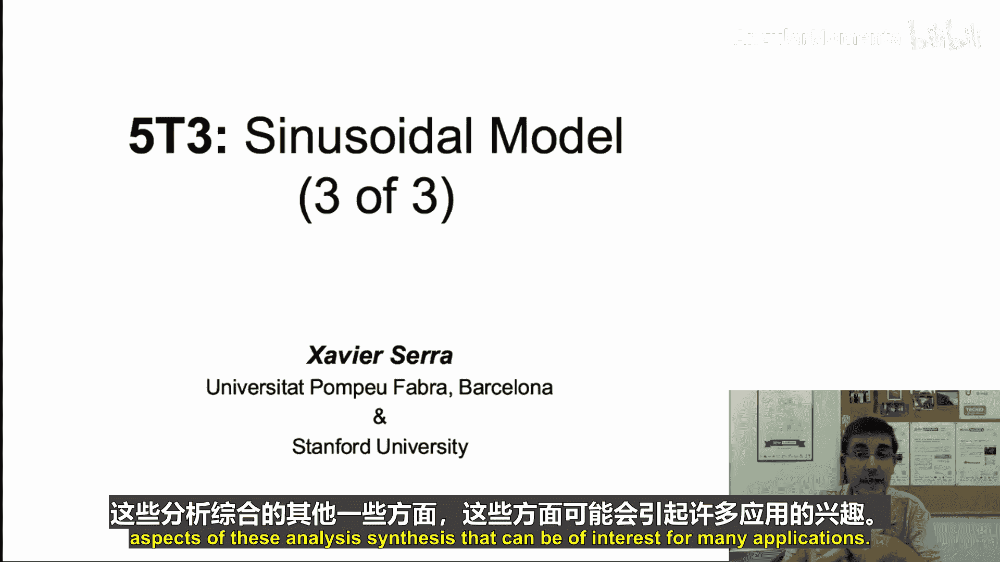

# 【巴塞罗那庞培法布拉大学】音乐应用中的音频信号处理-｜-Audio-Signal-Processing-for-Music-Applications-p33-05_01_03_正弦模型3--BV18Xr6BeEX5_p33-

Welcome back to the course for now seen processing for music applications。

In the previous two theory lectures， we presented the sinuscerro model， the analysis part。Now。

 in this third and final lecture， we will finish the topic by talking about the synthesis part of the model。

 therefore by generating a sound out of the analysis that we did。

We' will first review the model and the concept of spectral peaks and spectral tracks。

And then we will focus on the concept of sinusoidal synthesis。

 what is also called additive synthesis。And then we will finish by talking about the complete system。

 the complete sinusoidal model system， the does analysis and synthesis。

So as we showed in the last lecture， the sinusoidro model considers that the sound is the sum of time bearing sinusoids and it's expressed by this equation in which the output signal is the sum sum of sinusoids of time bearing sinusoids。

So a good way to show the results of the analysis is to plot the frequencies of the time during sinusoids on top of the magnet spectrogram of the sound。

Of course， it's sinusoid， apart from the frequency。

 it has also magnitudes and faces which are not shown。So for example。

 in this plot here we are showing the spectrogram of a fluid sound that we can listen to。

And then on top of that， we are showing these lines。

 which are the frequency tracks of the sinusoids that have been identified。Of course， again。

 there is much more than that， but it's a quite a good compromise and it gives us quite an intuitive visualization of this sinuscerial model。

But now from these values。That once we have analyzed， we want to synthesize the up。

The standard way to synthesize sinusoids is to use add synthesis。

 and this is the standard block diagram of an add synthesizer。

In which we have a series of oscillators。Each one from an input of a given amplitude and frequency。

 it generates a sinusoid， a time varying sinusoid， and then we can sum all these things together to generate the output。

 but how do we generate each individual sine wave？The most straightforward way to generate the sinusoid is to use the sinusoid of function directly。

 so this function that we see here can be easily implemented in a programming language like Python like you see here so we can have specific amplitude frequencies to control this function。

But this is quite expensive， especially when we deal with complex signals in which we might have to call these these functions hundreds of times and at every sample。

 So let's propose another way。We can can use the DFT to do actual to do synthesis。

 So if we start from the spectrum of a sinusoid and do the inverse for a transform。

So in this equation， we show how to do it。 So basically。

 we start from the magnitude spectrum of the sinusoid and the phase spectrum of the sinusoid。

 and we just take the inversese DFT of that。So here the plots show a very special case in which we would have the spectrum of a sinusoid that has one of the discrete frequencies of the DFT or of the FFT so we just have one value then we just take the inverse DFT of the whole array and we get this nice looking sinusoid of length 64。

Too bad that things are not that simple。 These only works for these frequencies that have a very discrete frequency。

 one of the Dft T ones。But we know also how to represent sinusoids that might have frequencies different from these discrete frequencies。

So such a sinusoid does not have a single spectral value， it has values for all frequencies。

 values that depend on the window that we consider。

And then to generate a sinusoid in the frequency domain。

 we have to generate the transform of a window and place it at the right frequency。

 amplitude and phase。So in here this equation expresses this idea that the magnitude spectrum of the sinusoid is。

 in fact， the magnitude spectrum of the window shifted to the right frequency and multipied by the right amplitude and again。

 the phase spectrum is also the phase spectrum shifted to that particular location。

And the plots show two examples of two different windows。

 So the same sinusoid with a different window applied to it。Of course。

 is expressed with different magnitude and phase spectra， and then when we take the inverse of that。

 we get a nice looking sinusoids， of course， with the window applied to them。But in the time domain。

 all samples have the same weight。And one great advantage of the frequency domain is that not all samples have the same weight。

So we might take advantage of that in order to make this whole process a little bit more efficient。

For example， these emphasizes the idea of the main lobe of these windows。The those samples。

 the samples of the main lobes are the one that carry the most weight， the most amplitudeed。

So in the examples before with the humming and black man haries。

 we can now plot just the spectrum of the main lobe samples and here we see the main lobe samples with a dark red and the rest of the samples with a light red。

And then if we just take the inverse theftT of just those samples of the samples of the main low。

 well we get these blue shapes， this sinusoid， which from a first look， they look okay。

 but if we actually measure the signal to noise ratio。

 So basically how this would be distinguished from a real sinusoid in a very synthetic sinusoid that would be perfect we see that the humming window has a bigger signal to noise ratio than the black Man Harris window because of course the samples of the main low of a humming window carry less weight than for the case of the black man Harris So in the humming window the signal to noise ratio is 63 db。

And in the case of the Pla Harris is very good， it' 102 deccibels。

 So basically the distortion or the noise is insignificant for audio applications。

So it's clear that the Plamanharris is a good choice for generating sinusoids in the frequency domain。

 we just need eight samples which are the main lo of blackmanhar has eight samples and if we just take those eight samples and do the inverse we can generate a sine wave as long as the FFT we have。

And then if we want to generate several sinusoids in the spectrum we can just generate several main lobes。

 so from this equation we can see that the sum of sinusoids in the frequency domain is the sum of main lobes。

 the sum of the main lobes of these windows in this case of the plaar windows because as we will see is the one that we'll be choosing so in this example we are generating three sine waves。

 one at 1000 herz another at 4000 herz at another at 8000 herz。

 so we place the main lobes of the windows in those locations， each one with the different amplitude。

 we also generate the faces for those main lobes and we can just take then the inverse dft of these spectrum of these combined spectrum and we get a signal which is in fact the sum。

Of these three sine waves， of course， multiply by a black man Harry's window。嗯。Okay。

 and then we can put together an analysis synthesis approach using this idea。

 So we start from a sound， a fragment of a sound in this case， an ob sound。

Then we compute the spectrum。We find the locations and this we can use any window， any DFT size。

 any FFT size， so it's whatever is appropriate for the analysis。

 and then we basically do an additive synthesis approach in the frequency domain by generating main loops from these cross values from these peak locations。

The FFT can be a different size。 The window in this case is a different one because we we're using a black mancur window。

 and then we do the inverse of that。 And hopefully this reynthesized sound is identical to or similar to the original one。

 of course， with now the idea that we have a black mancur window applied to that。

But we have one problem。And， and that's the problem of overlap at in the process of synthesizing。

The black Maharri window requires a big overlap。 If we want to generate a time bearing signal。

 the overlap of a black manharris should be very high， even bigger than one，8 of the。

Of the window light。So the solution is to undo the blackari window and apply a window whose overlap factor is a little bit better。

And this is a proposed approach that is commonly used， which is。

 as we see in the top plot is our synthesized signal which has this black Manhar window applied to that。

And then what we're going to do is divide by the black man and multiply by a triangular function。

 But we're going to do it on not the whole size， but only on half of the size。 So in fact。

 what we're going to do is multiply by these third shape。

 So we will divide by the black and multiply by the triangs or multiply by this。

Third shape that we see here and then the result is a similar function than the previous one。

 but now this function， which is half as long， has been multiplied by a triangular function that can be overlap by 50% so that's pretty good to like would be a 25% of the initial size。

Okay， so this is our approach that we will be doing and in which we can do an overlap of 25%。

 that's the one we required with this process so we start with with the spectrum with the black Man Harry windows then we do the inverses with the blackman Harries and then undo it and apply the triangular function。

 and that's it， we are done we can do analysis synthesis using sinusoidal approach。

Like we did with the SDFT， we can put it all together into an analysis synthesis system。

So we start from x of n， our signal， our complete signal， then we multiply by our analysis window。

 compute the F50， obtain the magnitude and phase spectrum。

 and now we are starting with sinusoidal analysis。We're starting with the detection of the peaks。

 detecting the in the magnet spectrum。The location and the amplitude and the face of the peaks。

 and then。We can track those peaks in time by applying some of these constraints of continuity of the frequency values so that we construct sinusoidal trucks。

 so we have a track per every time bearing sinusoid。And this is our analysis results。

 We have these tracks of sinusoidial values and then we can synthesize with what we just explain in this lecture so we can do it in the spectral domain by generating these main lobes of black man Harrys windows which is quite efficient which is neat to generate eight or nine samples per sinusoid in the frequency domain and then compute the inverse forier transform unob the synthesized sound which we can we can undo the window of the black man Harryries apply the triangular function in a way that we have an overlap at process that works at 25% and it reproduces quite well the original sound in some way at least a part of it let's see an example so this is an example of an analysis synthesis。

🎼ussing the sinnosolo model， so this is a sound of a bender。

 which is this Turkish drumlet just it's one stroke of ill， let's hear that。

Okay and then the analysis shows just the tracks， the sinusoidal tracks that we have obtained。

 so we see only the frequencies of them plotted in the time frequency space and then from those we can synthesize the sinusoids and hopefully recover the sound and let's hear that。

If you pay a little bit of attention， well it's not exactly the same， especially in the tech。

 you can hear some difference and that's one of the things that we will be trying to work on in the next few lectures。

So for the references in these topics， as I said， there is not much for additive synthesis。

 there is quite a bit， but you can look yourself in Wikipedia and again in Julia's online book you can find some relevant material。

And this is all for the sinusoidial topic at least from a theoretical point of view we will also demonstrate and do a more programming approach to that in these three lectures we have started from the short time for transform and we have seen how to analyze sinusoids on top of that and this is a way to simplify the spectrum so in fact it can be used for compression。

But at the same time， is a very useful representation for many other things。

 as we will see in future classes。So we'll continue in this direction towards a more useful and higher level representations that capture some of the prominent essence of a given sound。

 so next class we will take advantage of some of the characteristics of the sound to apply some more constraint in the model so that hopefully we'll get some other aspects of these analysis synthesis that can be of interest for many applications。

 so thank you for your attention and I see you next class。

