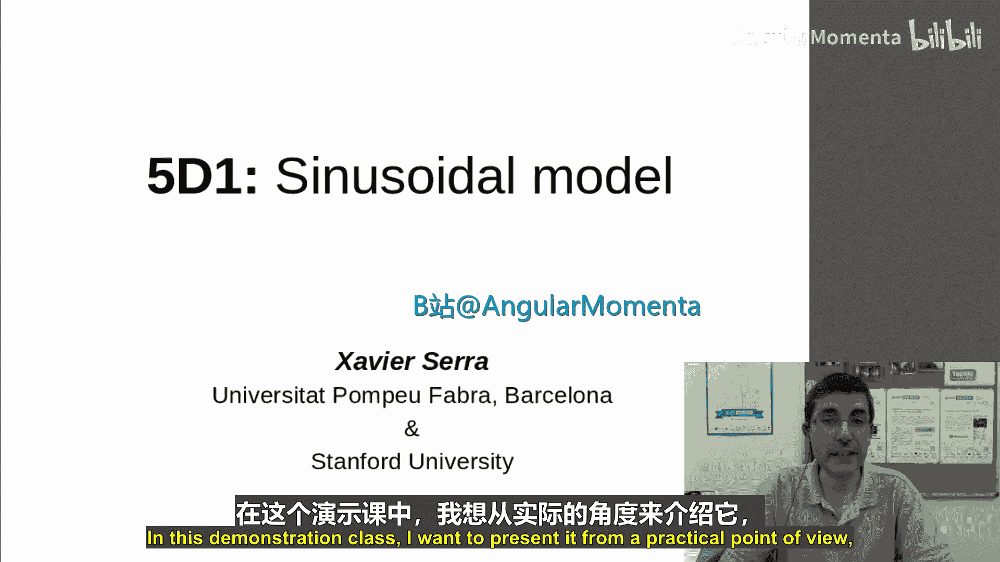
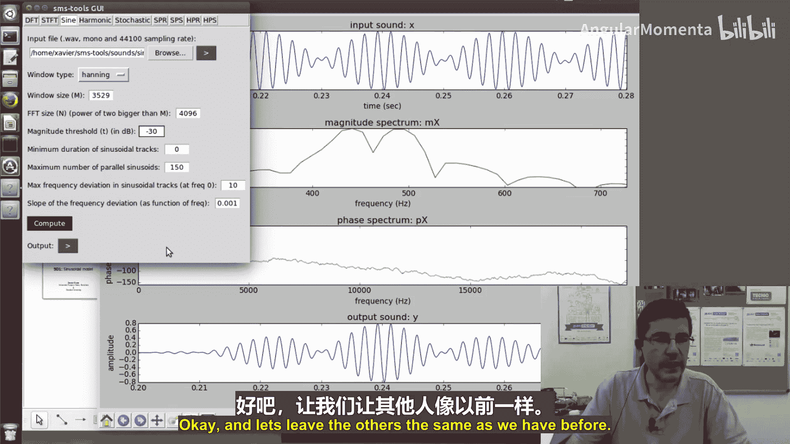
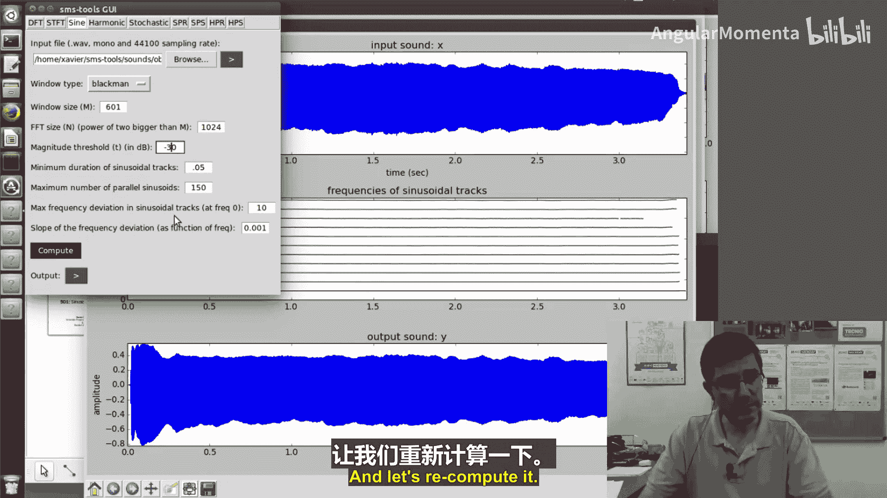
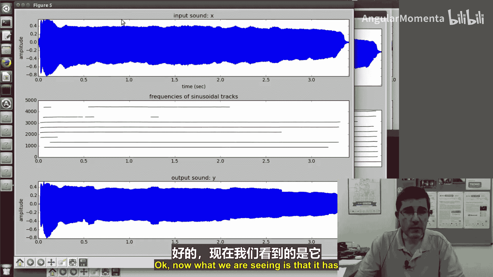
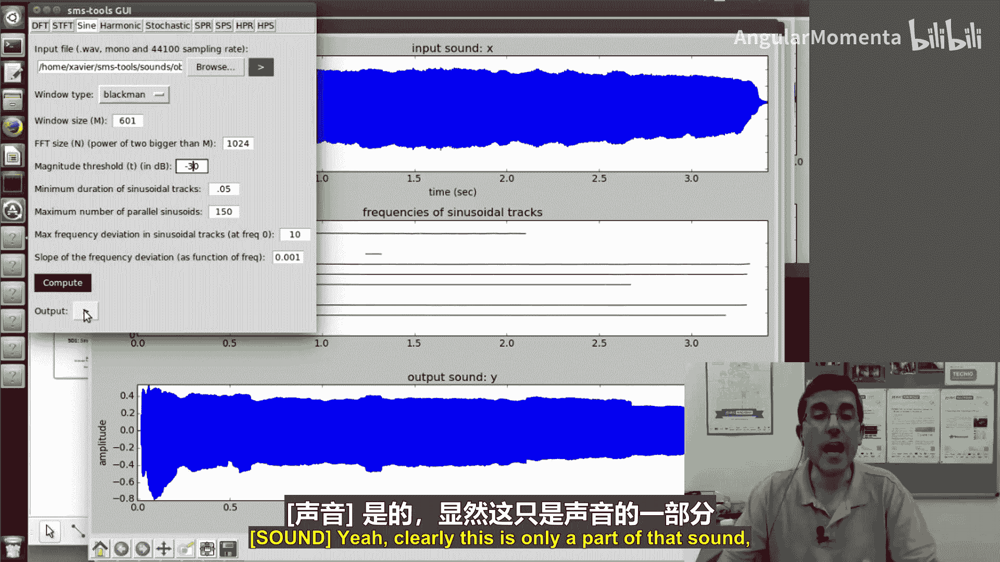
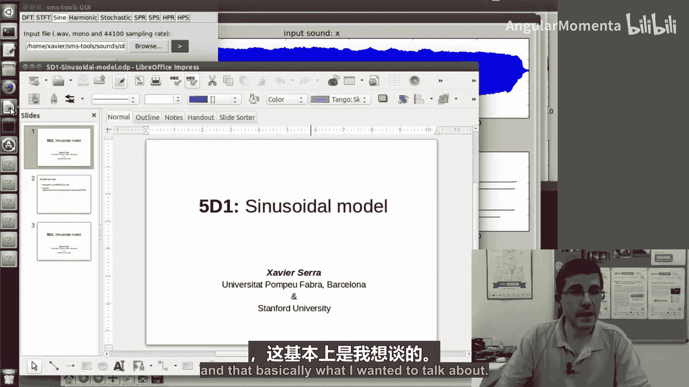
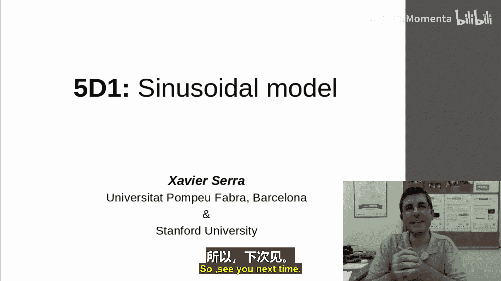

# 【巴塞罗那庞培法布拉大学】音乐应用中的音频信号处理-｜-Audio-Signal-Processing-for-Music-Applications-p34-05_02_01_正弦模型--BV18Xr6BeEX5_p34-

Welcome to the course in Nursing or Processing for Music applications。This week。

 we're talking about the sinussoto model。In the theory lectures。

 we actually presented the model and we presented it from a signal processing and mathematical point of view in this demonstration class。

 I want to present it from a practical point of view， so actually using it。

So let's go directly to the SMS toolss GY and let's start with the DFT model and let's open one sine wave。

These sound wave at 440 Htz。So let's listen to that。Okay， so let's use a honey window。 That's fine。

 Maybe let's use。Wdow size of 5，11 and。It be an FftT size of 1024， you compute it。

Okay so this is the sine wave， the magnitude phase spectra and the reconstructed signal from the spectrum。

 the same sort model will attempt to find the peak， the spectral peak， the height。

 the location and the phase corresponding to that location。

 of course you will do it for the whole sound， So we will start from the SDFT。

 So if we get the same sound。And get the same type of parameters，511 and 1 or 24。

 And let's just put this half of that。windowdow。😮，And this will be the STFT， and the spectrogram。

We listen the output。Great， pretty good。 So in here we are seeing this red line。

 which is basically the peak as it evolves in time， which is very stable。 And in the phase。

 we see this clear area， which is the flat phase of the main loopbe。 Okay。

 but now let's go to the sine wave。The sign model and let's do the same thing， let's open the sign。

Let's use the same parameters， 5，11。And 1 or24， and now we're starting with the parameters that are specific for sinnooidal analysis。

For example， we have the magnitude threshold which is the magnitude threshold in decibels that we're going to be looking for。

 so we're going to be looking for peaks that are within 50 db from the zero db from the maximum of the sound we can restrict the duration of the tracks for example。

 well let's just put zero so no no restriction we can restrict the maximum number of sinusso it's 150 it's plenty in fact there is only one and we can restrict the deviation from frame to frame in terms of how this track evolves and here we have put 10 at the lowest frequency and then normally it's good to that this deviation changes as the frequency goes up and as the frequency goes up it's good to increase this deviation so this is the increasing factor of this deviation as the frequency goes up。

Okay， so let's compute that。And okay， interestingly enough， we are seeing。More than one line。

Theresynthesis， we can listen to that。That's pretty good。 It's a sinusoid。

But in the analysis here we are only seeing the frequency values of the peaks。

 We are not seeing the magnitude or the phase。 So being there is four lines。

 but clearly they may not be the same amplitude。So where do these come from， in fact。

 they come from the sidelos。We specified a magnitude threshold of -50 and if we go back to the signal。

 the DftT and if we zoom into the peak， well were going to see that apart from the main peak there is side lobes that are peaks and are within 50 decibels of the maximum energy。

 so therefore these have been picked up。If we want to not pick up these side sidewalks。

 we should reduce this threshold， for example， minus 20。Now yeah， now there is only one line。Okay。

 lets complicate this and let's analyze a little more complicated signal， for example。

 two sine waves。So let's go back to the DftT and let's get rid of all these Windows and let's open the sum of two sineways。

 440 and 490 Hertz summing together。And let's maybe， well。

 we have to choose the the window size appropriate for a specific window。

 and we talked in the theory class that in order to do that。

We can use an equation that says that it has to be the number of beans of the window in the case of honey window is4 times the sampling rate。

 which is in this case， 4400，100， 44100 and we have to divide it by the frequency distance that we want to resolve in this case between 440 and 490 hertz。

 so 50 hertz。Okay， so this number 3528 is the size of M。 the minimum size of M。

 if we want the two main lobes of these two sinusoids to be separate。 So if we put here to 3，5。

 and we will put it as an odd size。 So we will put 3，5 to 9。 the FFT has to be bigger than that。

 a power of 2， and let's just analyze at this point。Okay。

 and now if maybe we zoom in into this region。We will see， okay， the two peaks of the two sinusoids。

Okay， then we'll do the the sinusso model。 We'll do the short time for a transfer。

 let's go directly to the sinusso model。 And let's put the same values。

 Let's get the sum of these two sinusoids， which maybe let's listen it。Okay。

 and now we can set up the values as 3，5。2，9， okay， and again， the 50 size40，96。And okay。

 the rest of the parameters， let's lower the the the threshold。 I think-20， maybe a too little。

 just so put minus- 30， for example。 and let's leave the others the same as we had before。

let's compute that。Okay， and now we have the original sound and the reynthesized。

 We can listen to that。Okay that's pretty good。 And if we zoom into this area。we see the two lines。

 the 440 hertz and 490 hertz。What happens if this size is not large enough， For example。

 What happens if it's 1800 And， of course， we don need such a big FFT。Let's 2 or48 is sufficient。

 And I think the in here， let's let's make sure that we safe and let's have a lower threshold。

 let's say minus-40。 and let's leave the others the same。Okay， and now we see something interesting。

 so we listen to the output sound。It's not that bad。But if we look at the analysis。

 it's definitely very different。Okay， we look at the analysis。Okay， what we are seeing。It's kind of。

 it gets confused。Sometimes it finds two， sometimes it doesn't。

 So clearly we don't have enough resolution for discriminating clearly these two sinussons。

 even though when we sum it all together， it doesn't sound that bad。Okay， but anyway。

 we'll have to pay attention to this and make sure that we understand how the parameters have to be set for analyzing specific types of sound。

 And now let's go to sound， a real sound。 Let's use the the ob sound and let's go directly to the ob sound。

Wwhich is it's the note a4 at 440 hertz， so let's calculate again the distance that we need to the size of the window that we need to have maybe let's change the window and let's put for example。

 a black man window let's okay what should be the window size for this sound。 the black man window。

 the number of beanss is 6 the sampling rate is the same44100 and now we have to divide by the fundamental frequency。

 the fundamental frequency of this sound is 440 hertz and thats the distance between two consecutive harmonics so we will put 440 hertz here。

And this is the size that we need 601 samples。 Okay， so let's put 601 samples， F50 size。 Well。

 let's put the next part of two。 And now of course。

 we are dealing with a big sound that has a lot of harmonics and they will go pretty much down。

 So let's put more a bigger threshold also lower value。 Okay， so let's put minus 80。

 And now we can these parameters matter a bit。 So they might be spurious kind of tracks。

 So let's get rid of tracks that are small。 So， for example，0。05。 So we get rid of that。

 in this case now we will need quite a bit of sinusoids。 And we definitely will need these deviation。

 So this will be a deviation that will be quite useful。Okay， and let's compute it。Of course。

 it takes longer because its it's a much more complex sound。 Okay， and this is the result。

 the original sound。The the tracks here， we only visualize in the first 5000。

 but if we would go higher， we would see more and we see pretty good all the horizontal lines。 And。

 of course， here at the end， maybe some harmonics that are disappearing。

 Let's listen to the original。And the syn size。Okay， that's pretty good。What happens if， for example。

 the threshold is not low enough， Let's put-30， for example。

let's recompute it。Okay， now what we are seeing is that it has not been able to capture all the harmonics。

 the harmonics that were too soft were not analyzed。 So let's hear what we got back。

Yeah clearly this is only a part of that sound and that's basically what I wanted to talk about So this was a class that tried to introduce the sinnooid model from a practical perspective and of course we have used the SMS tools。

 the GY and these sinusoidal sounds that we have the o sound we have been playing around with come from preso and that's also hopefully that has given you a practical view on the sinusso model of course these requires for you to practice quite a bit more it's very important to analyze many sounds and to actually see how what is the effect of the different parameters on different sound and in fact that's what we're going to do next demonstration class so I hope to see you in next demonstration class where we will actually analyze a more complex sound and go into the sinusso model。

Deeply。So see you next time。

