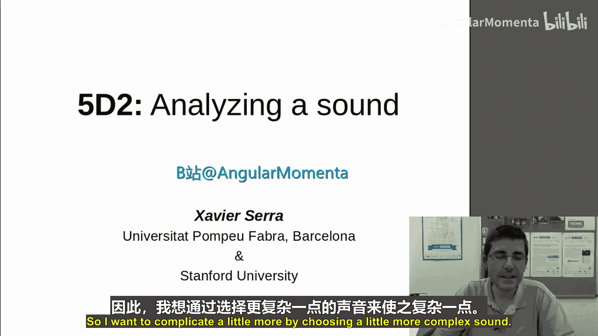
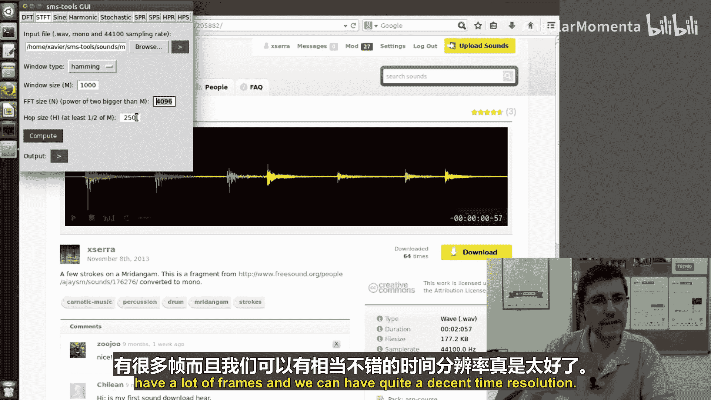
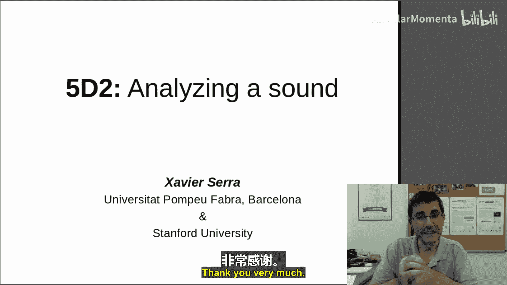

# 【巴塞罗那庞培法布拉大学】音乐应用中的音频信号处理-｜-Audio-Signal-Processing-for-Music-Applications-p35-05_02_02_分析声音--BV18Xr6BeEX5_p35-

Welcome to the course on A processingces for music applications。

In the previous demonstration lecture of this week。

 we talked about the sinnocer model from a practical perspective， so we analyze some sounds。

 some simple sounds， and we try to figure out what parameters from the sinuscerro model would give us a good visualization and reynthesis of the sound。

 so I went to complicated a little more by choosing a little bit more complex sound。

So we are going to analyze the Madrum， the Madronum is an instrument。

 a percaic instrument from the south of India that is played as part of the kadtic music tradition。

And in this picture， in fact， we sing A J on the Madranam and his TA of this cho。

 and in the voice singing is Vnish， which also is a collaborator in our group and we are are also going to be analyzing some of his sounds。

So let's go find some Madanga sounds。 And， of course， what we would do is go into free sound。

 So if we。Look for arm in a free sound。Well， we're going to see， well， theres quite a few sounds。

 There is 7000 sounds。Of the Madranan。 That's pretty good。 And the first one。

 let's maybe just open this first one。And in fact， it's a sound that was uploaded by a J。

And we can listen to it。Okay that's pretty nice， The Madrana is a very interesting instrument。

 it produces quite a few different qualities of sound。

 the way the instrument is hit and theres different balls that are called to produce different sound qualities and rhythmically is really complex。

 I mean it's the music of the knatic music tradition and the way that Madrana is played。

 it explores very sophisticated and complex or rhythmic structures。

Let's just use one of the these sounds。 In fact， as part of the package。

 the sound that we are using for this class， that is a sound by a J。 and in fact， is this。

This fragment here。诶。We can also listen for that one。Okay， so this is the sound and we can play it。

Okay， so let's analyze this sound by a J。 let's open the SMS S toolss GI。

 and let's start by looking at the short time for your transform。

So we'll go and get a mono version of this sound， Madrana sound。Okay。

 and we have to decide what parameters to use。 So before we can really make any decision。

 let's just take some default kind of parameters。 For example， let's use a humming window。

 that's kind of a default window that works quite well in terms of the window size。 Okay。

 we don't know match。 but okay， let's start with 1 thousand samples of the window。The F50 size。

When we don't know much about it， the bigger， the better if it is not take too long。 So， okay。

 so 4096。Seems like a good enough number。 And the hub size。Well， it should be。 It's good。

 That is the small as possible because perassive instrument with these sharp attacks。

 it's good that we have a lot of frames and we can have quite a decent time resolution。

 So let's compute this。

Okay， so this is the result。 the output should be the same because we haven't done。Yeah。

 it's the same。 We haven't done much to it。 And the ho size is is a good it's in a good relation with the window size。

 And now what basically we like to is understand a little bit the sound so that we can better choose the parameters。

 So let's think about the window size that best fits this sound。 So by doing for doing that。

 let's zoom into one of these sounds， for example， let's this one looks good because it has a lot of horizontal lines。

Okay， so these are the partials of a sound it's a membrane that creates some vibrations they may not be completely harmonic。

 but clearly there are some very stable partials of a sound of the resonance of the instrument and we would like to see what is the minimum distance between two partials so that we can decide what is the resolution that we need the best resolution that we need and by looking here on where the curs is。

 we can see for example that this first horizontal line is around 200 hertz and the second one is around 400 herz so that means that according to these at least the minimum distance between two consecutive partials is around 200 herz。

So from that， we can try to compute an appropriate window size。So as we， we said in， in theory class。

 we have to start with the number of beans of a window。 So let's start with like this humming window。

 So it's four beans。 and let's multiply by the sampling rate。

For44100 undivided by the frequency resolution we want to have in this case。

We make a guess of 200 herz that we identified as a distance that was present in these sounds。Okay。

 so this is 882 samples。Okay， so we would need these 800。And81， or let's say，83 samples。

 So that we have a。A frequency that is a not frequency size。 Let's still keep the 50 size big。

 So there's no harm on that。 And in terms of the hub size， well。

 it looks like we can have a smaller one。 So let's see 220。 That would be one fourth of that。Okay。

 and let's compute it。 That's not that different from what we started。 So， in fact。

 what we started was pretty good。Okay， so this is the kind of an analysis that should be okay。

 according to this measure。Now let's analyze the sound using the sinusorro model。

 so let's go to the interface and let's open the sign a model。So let's go for the Madanga sound。Okay。

And well， we have to choose the the parameters for that。 So let's use the same ones。

 So we have these 800 around 883。Samples。Let's use the same the humming window， the FSD size。

 let's leave it to this 4096。Magnus threshold， maybe we do not need that much， let's say， minus-60。

Duration， well， let's make sure that we have good enough tracks， so let's maybe 0。05。

Number of sinusoids 150。 Yeah we need quite a bit。 deviation doesn't deviate those that much the sinusoids in this type of sound。

 So this would be okay。 Let's just first try this one。 Let's see what we get。Wa， not that much。Okay。

 so we have analyzed the sound and we obtained very few sinusoids and if we listen to the result。

Well， not much there。 it has some sounds， but not much。 So what can we improve from this Well。

 the window size， I guess it was all right。Clearly。

 the magnitude threshold could be lower because clearly。This sound was not recorded very loud。

 and a lot of these things， especially during the the is， is quite soft。 And clearly。

 the sinusoidal tracks could be shorter because these the strokes are very short and some of these traors are going to be very short。

 So let's let's have it at 0。01。 Let's just have the rest as as it is。Okay， that's better。

 that's better。Of course， from this picture we might not get a good idea because we don't see the amplitude of each of these。

 but it gives you something and clearly on the waveform it's pretty good much better。

 let's listen to that。Yeah， that's pretty good。 That's pretty good。 Of course。

 one basic problem is the frequency resolution and the time resolution。

 this time frequency compromise。 So let's see if we can get better frequency resolution。

 So these harmonics。 I am sure there are some， as we can see here that are closer together。

 these are partials are not harmonic， in fact， So some are related harmically because in the resonance of the instrument emphasize a certain harmonics。

 but some are not completely。 So let's try to make it bigger windows so that we can capture partials that might be closer together。

 So， for example， let's go to 3000 and one samples quite a bit more。 See what happens。Okay。

 and let's just leave the rest untouched。And let's go here it。Okay， interesting。

 so we definitely got many more lines。But looking at the waveform doesn't look too good。

Let's listen to that。So in fact， if you pay attention。

 one of the biggest difference is that now the attacks are not crisp。

They there is kind of is mirrored。 We cannot see also here in the waveform that the attacks are not so good。

 So， okay， so that was not a good idea。 We might have gained on frequency or resolution。

 but we definitely lost in a time resolution。 So let's go back to a number that is maybe okay。

 let's have 1000。 which wass kind of a comp see what's happening now。And okay。

 thats that's pretty good that's looking at the waveform。

 it looks quite decent and if we listen to that。🎼The。Okay， it's pretty good。

 even though if you listen carefully， we are still missing a little bit of the sound， the sound。

 especially during the attacks， there is a lot of energy。

 there is a lot of noise into that that maybe with these sinusoids are not well captured。

 but that's one of the things that we'll talk about and well learn how to handle in the next few classes。

This is all I wanted to say in this lecture。So let's go back to the slides。😔，So we have。

Done a little bit of more analysis of a particular sound， in this case。

 the Madrona using the sininosoro model。And of course we have used the SMS tools and sounds from Free sound。

 hopefully this has given you a better understanding of the sininoso model and at the same time maybe you have discovered this new fascinating instrument which is the Madronum and which I encourage you to listen to it and especially in the context of Ktic music。

So this is all and I will see you next class， thank you very much。

