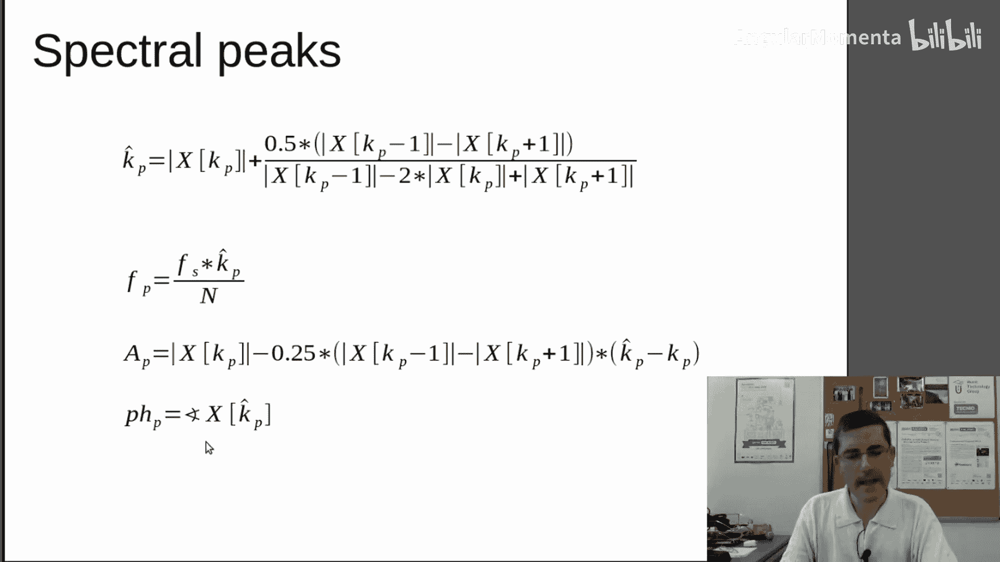
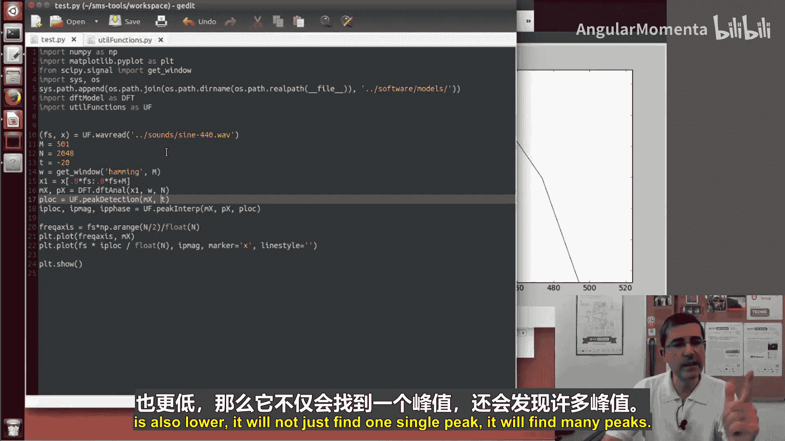
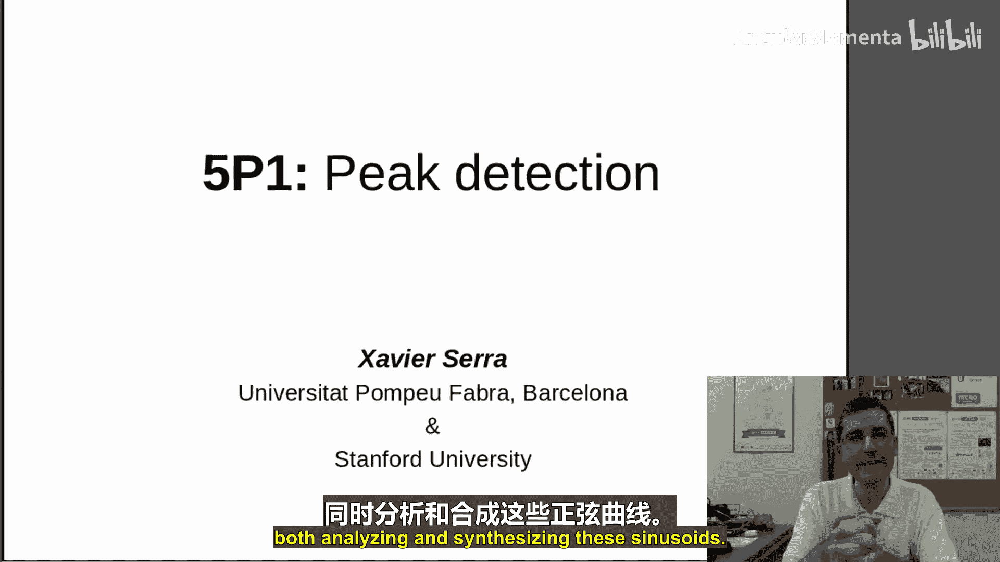

# 【巴塞罗那庞培法布拉大学】音乐应用中的音频信号处理-｜-Audio-Signal-Processing-for-Music-Applications-p36-05_03_01_峰值检测--BV18Xr6BeEX5_p36-

Hello， welcome back to the course on Noting or processing for music applications。

This week we are talking about the sinuscerro model。

 and we are considering sinusoids in the frequency domain， in the spectrum。And more particularly。

 we are considering that a sinusoid is a peak spectropic and from which we can measure the values of the sinusoid。

 so this is what we want to go over in this programming lecture from a programming perspective。

 therefore developing some code that would allow us to measure the values of the sinusoid。

And these are the equations we presented in the lecture class to measure the frequency amplitude and phase of a sinusoid using parabolic interpolation。

 so this first equation is the way to compute a parabola on the tip of a peak and obtaining the refined frequency value as this is as a location from0 to n which is FFT size。

 then we can obtain the frequency value in hertz by multiplying by the sampling rate and divided by capital n and then we can plot the location value in in the parabola and obtain the tip of it。

 which will be the interpolated amplitude value。And finally。

 we can also get the phase value by readinging the location of the frequency。

 maybe using a linear interpolation of that in the phase spectrum so that we get a refined phase value。

Okay， so let's go to text editor。AndIn here， I wrote some code to actually do this detection of a spectro peak。

So here I first imported some of the packages that I need， like the Nmpi and Maclo Li。

 the window from Sippi， then I go to pen。The directory from which I have some code that I am going to use is specifically the DftT model。

 so our DFT implementation and set of utility functions that I have in the SMS tools package。Okay。

 after I have all these packages， I can start like reading a sound file。

 so I read a sound file that includes a sine wave of 440 Hertz。

 so I know exactly what frequency I should get。And then I declare some variables that are going to be useful for computing the DFT。

 so M is our window size so how many samples of the sine wave I'm going to compute。

The n is the FFT size。And T is a threshold that they will be using for the peak detection。

So then I can get the window， I get a humming window of size M。

Then I read into the file sort of in the middle of the sound file so I can just get M capital M samples of the middle of the sound and then I can compute the spectrum using the DFTNL I return the magnitude and phase and then I'm computing the the peak okay so this big detection。

 this is a function that is declared in the utility functions， so let's go there。

This is the big detection function that has this input magnitude spectrum。And T。

 which is a threshold， the magnet spectrum is just the array of values of amplitude values in decibels。

 and T is the threshold in decibels that is going to be used to consider the minimum value below which we are not going to consider to have peaks。

So the computation is quite simple。 We check for three conditions in the whole magnitude spectrum。

 Well the whole we are discarding the initial value value 0 and the last value。

 So within between one and the size minus-1， we are looking for the values that are above threshold。

well above T， the values that are higher than the previousviews and the next values so that there are a local maxima。

 and then we are considering the peaks as being the values that fulfill the three criteria。

 there are above a threshold， there are above the next value and there are above the previous value。

And then well we add one in order to undo this one that the condition that we had and it returns the locations。

 an array of peaks of the locations of those peaks we can go back to our code okay so we call the peak detection。

 it returns the locations， and then to get the magnitudes of those locations。

 we just read those values from the magnitude spectrum。To plot that。

 well we have these lines for plotting in which we define first frequency axis。

 so we're going to be able to see the x axis in hertz。Then we plot the whole magnet spectrum。

So with the frequency axis and the magnet spectrum， and we plot the peak locations on top of that。

 So we plot the locations and the magnitudes。And we were going to plot an X on that those locations。

Okay without any line， so we just see those those locations。 So let's run that。

 we are in these in the workspace of SMS tools and I have this test dot PY so I can just run test。

Okay， and this is the spectrum of the sinusoid and of course it has a main lo of the humming。

 so let's zoom into that location， So let's just go into just the peak。

and this is the peak of the sinusoid we can see the cross and we can see some of the higher samples of the magnitude spectrum。

Okay， so in here we can see that the cross is at location429 herz more or less or 430 Hz。

 that's clearly quite far from the 440 herz。 Why is that Well， this is because our size。

 the F50 size was 512 samples。And with 512 samples。

 we have quite a bit of distance between two consecutive samples in order to compute exactly what is that distance。

 we can just do the sampling rate 44，100 divided by the Fft0 size， which was 512。And 86。

 this is the the distance in hertz between one sample， which is here it says 4 like around 28。

 and in here is 515 kind of thing。 So this is the 86 samples distance between these two。

So to improve the resolution， we can now increase the FFT size。

 So in here the n let's make it four times bigger here。 For example， let's make it to 2048 samples。

 So this should give us better frequency resolution。 Let's try that。We save that。 And in here， well。

 let's remember this plot。 so we can now， if we run。Again， and we zoom into the tip of the spectrum。

Okay。Okay， yeah， we can see that there is more samples now and in fact， if we even zoom more。Okay。

 we can see that well， now the tip， the peak has been computed to be around 430 Hz， and clearly。

 the distance between two consecutive samples has reduced。So in fact。

 it should be four times smaller。 if we compute that， we can just compute 44100 divided by 2048。

So now it's 21 hertz the distance， but still is not the frequency we would like to have。

 it's a little bit far， in fact， this 21 hertz resolution is not ideal。

So what we're going to do is to do this parabolic interpolation。So in the u functions file。

 there is this peak inter function that performs parabolic interpolation on this location that we have found。

 So from the magnet spectrum， the phase and the locations that it found these local maxa this function computes the interpolated values。

 So from the three highest peaks，Of each local maxima， the actual local max left and right values。

 it performs the parabolic interpolation to refine the frequency and find the center of the parabola。

 then it finds the tip of the parapola， the magnitude of it and then it uses the location to look into the phase spectrum and performs a linear interpolation because the phase in during this value should be quite flat and it performs a linear interpolation to find the actual phase value and it returns this three。

Now， let's get these three output values。So let's copy them and put them in our。Little program。

So we will obtain these by calling。The peak interpolation function。 So let's copy that too。

Copy and we put it。Here。Okay， so this is our peak interpolation function。No need to compute the Pm。

 So now it returns the interpolated location， Interpolated magnet。

 an interpolated phase by calling the peak interpretp and sending it the magnet phase and location values。

 So now we can plot the I lock and I Mac。And。Okay， so let's see if we improve this plot now so we had the peak at 430 Hertz。

 see what we can do with now this interpolation， so let's run again test。Okay。

 it complains about P in because it's part of the package UF。

 So I have to specify that it comes from there。And let's write it again。Okay。

 now let's zoom into the the tip of it so we can see how it does。 Okay。

 and we can zoom a little bit more。Okay， so here we see the values we had before。

 so the tip before it was this tip， so it was like around 430 and now it has found the cross is in between these two locations so it has moved the tip because it considers this the tip of the trila and now the cross it' closer to 440 still is not at 440。

In fact， it's around 439 or so。 So we are still1 Htz kind of difference。

 but definitely is much better than what we started with。Okay， so that's basically I wanted to show。

 So with this code， we can analyze a spectrum of a sound and identify the spectral peak locations that are within that spectrum of course。

 is if the sound is more complex than a sine wave and the threshold is also lower。

 It will not just find one single peak。 It will find many peaks。

Okay， let's go back to the， the slides on。Okay so we have been using the sinusoid model and part of it。

 the concept of big detection and using some of the packages of Python， Npi。

 sipi matli and some of the functions available in the SMS tools package we have been able to measure the spectral peaks of a sound and with that we are now ready to go to the next stage which we'll be talking about in the next programming class of actually handling more more real sounds and both analyzing and synthesizing these sinusocytes so I hope to see you next class bye。

