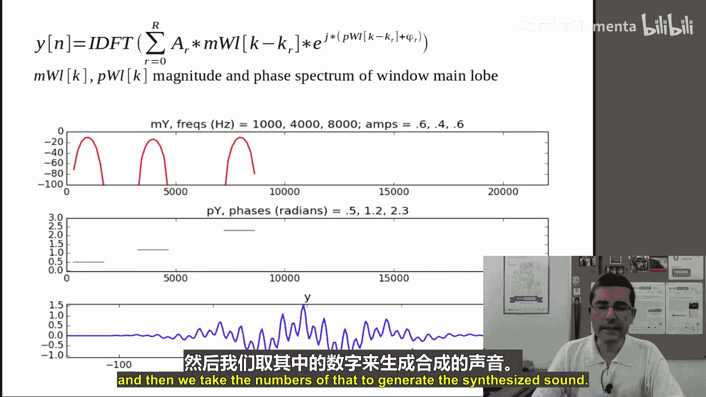
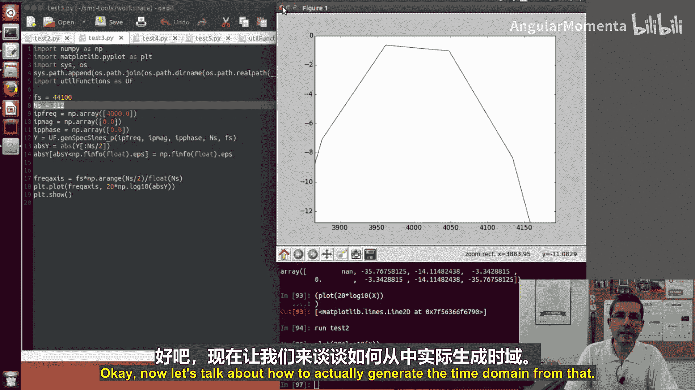
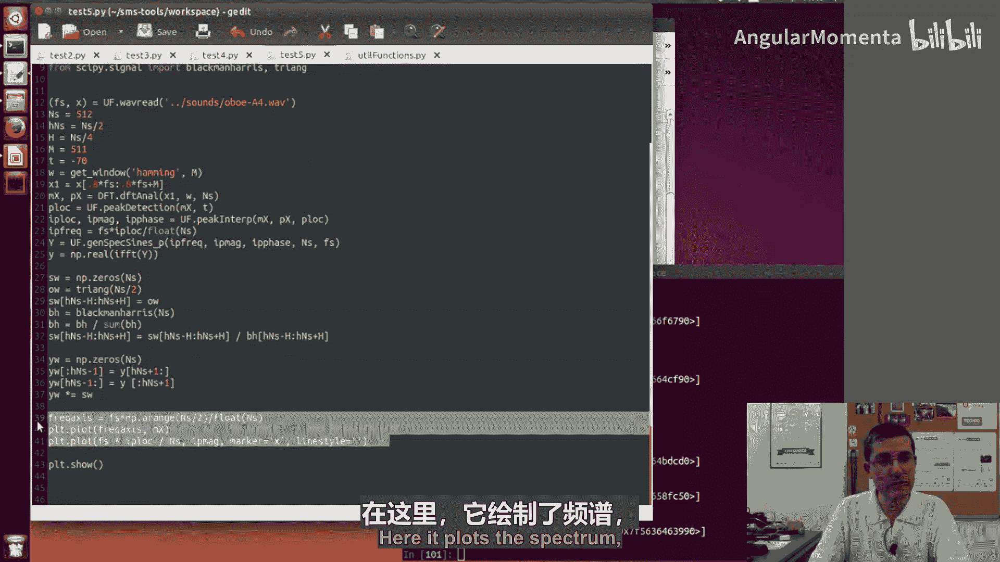
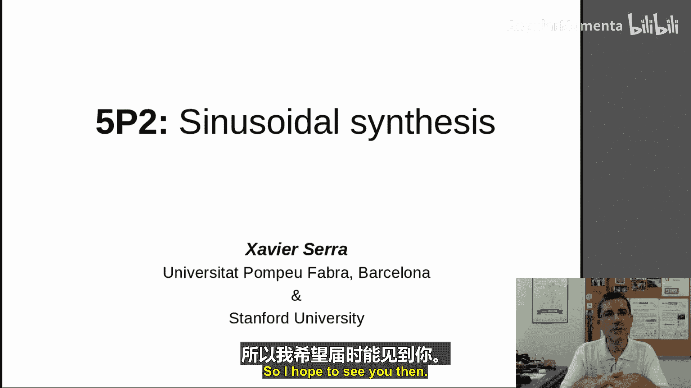

# 【巴塞罗那庞培法布拉大学】音乐应用中的音频信号处理-｜-Audio-Signal-Processing-for-Music-Applications-p37-05_03_02_正弦波合成--BV18Xr6BeEX5_p37-

We'llcome back to the course on analysis single processing for music applications in the previous programming class we talked about spectral peaks and how to program them。

 how to detect the values of the spectral peaks and that was the beginning of implementing the analysis synthesis using a sinusoid model so we identify the values of spectral peaks which hopefully correspond to sinusoids so in this second class I want to introduce the idea of how to synthesize a sinusoid from those ps so how to do basically additive synthesis。

So we will be doing it in the frequency domain， like we talked in the theory lecture。

In which we are basically synthesizing the main lobes of a black Manharris window and then do the inverse DftT of that。

So this equation shows the idea that we synthesize the sound y by taking the inverse DFT of a sum of main lobes。

And in here we see the plot of that so we see the main lobes already being generated。

 the faces already being generated， and then we take the inverse of that to generate the synthesize sound so let's show that and we first have to actually learn how to synthesize a lobe of a black Maharri's window so in these little code I show that so we call this function called GenBh lobe。

 and we give it the samples the bins that we want to generate to since we only want to generate the main lobe we just give the eight centered bins of that。

But first， let's look at this function， JBH lobe， which comes from the u functions file。

 And in here we have this JBH lobe。Wwhich implements the generation of a Bmahar window directly in the spectral domain in the spectral domain of B Mahars window is the sum of four sync functions and this is what this main loop does it generates four sync functions and it sums them together。

 its sync function has coefficient that comes from the equation of the blackmahar window。

And then in this of this sync function， we call a function called sync， which also is here。

Which is what generates one particular sync function。 Again， it only generates the main loop。

 It doesn't generate the whole sync function。Okay， so with these two functions we are able to generate the main lo of a Pla Mahars window。

 let's run this code。Okay， run this， too。And if we show the output x capital x。

 these are the eight samples of the black Maharris window in a linear scale。

So the center is this fifth sample， which is value 1。 if we take the absolute， well。

 the the lock of that， so 20 times lock。Then of these eggs， we will see it in log scale。And。Ploot it。

SoWe can plot this。啊。And we have one。Okay so this is the main lo in the log scale of black Mochar window if instead of reading these samples we read some other series of samples。

 for example， we just add 05 to this array and we save it。And now we。Run it again。And we plot it。

 Well， we had to plot。plot these。Okay， now we see that these are different samples。

 are there is no center samples so these。Basically in between two samples。

 this is how we generate main lobes corresponding to different frequencies because we are moving this main lobe around these samples。

Let's now do it with a function that the SMS tools does it。

 which is the function called Gen spec signs， so Gen spec signs has a input array of frequency magnitude and faces and then it generates the spectrum。

That includes all that。So in this code， I am generating one single sine wave at 4。

000 Hertz magnitude of 0 decibels and phase 0。And I'm generating the whole Fft0 of size 512 samples。

 and then I compute the absolute value and then here I plot the lock of that So the D value of that so let's show that let's run。

Thats。3。Okay， and this is one main lo of a sinusoid at frequency 4000 Hz。 And if we zoom into that。

 we will see。This is the main loop and of course this has been shifted exactly to have a center around 4000 Hertz if we go zooming in more。

 we will see that the tip of these peak。Is basically at 4000 Htz。

Okay now let's talk about how to actually generate the time domain from that。

 so we have to do the inverse forier transform from that and this is in this other script I implement that so after having done the gen spec signs I call the inverse FftT and then there is some code to undo the windowing of the black Mahar window we mentioned in the theory class that in order to have a good overlap a with not much small hop size it's good to undo the black Mahar window and apply a triangular function and this is what we do in this part of the code which generate a synthesis window which is S W which is the result of having a triangular window。

Divided by a black Moja window。And this is what we multipied by to the inverse of the DFT of what we obtain。

 So let's let's run this code。 Let's run test4。Okay， and we can plot the individual step。

 So let's plot the first absolute value of the spectrum。

So this is the complex spectrum of the sinusoid， well only the magnitude part of that so that we see both the negative and the positive side of that sinusoid。

So we see in here the x axis is not in hertz， so we don't see the exact values。

 but this would correspond to the 4000 frequency， both the positive and the negative side of it。

In linear scale。Then what we do is we compute the inverse of T so we can plot the inverse of T of that。

 so let's plot y and this is the black Maharris windowed sinusoid in the time domain。

So in which we see it's centered around 0， so we see the second half of the window in the beginning and the first half then。

 there is no zero phase here， well， there is no zero padding because we actually had the same window size and FF size which was 512。

Okay， so once we do that， then we undo， we divide by this we and multiply by a triangular window so we can show the result of that。

 which is yw U。And this is the signal that we would like to use in the overlap at step so in which we have divided the black Mahars and we have multiplied by a half length triangular window so it's only if the original was 512 now is' 256 samples so we will be able to overlap by half of that so we'll be able to overlap by 128 samples。

Okay， so we have seen the whole synthesis from some frequency values of a given sinusoid。

 let's put that together into a real analysis synthesis of a fragment of a sound。

And this is in test5。I in here。We are reading a fragment of a noble sound。

And we are going to do the DFT analysis。Then we will detect the peaks。

Then we will interpolate the pigs to get a more accurate value of the location of the sinusoids。

And then we will do the synthesis of that in the frequency domain and then do the inverse FFT and undo the window。

Here it plots the spectrum resulting spectrum， the magnet spectrum and the peaks of that。

 so lets let's show that so let's run this test5。

Okay， and this is the magnet spectrum of the obsound and we have detected some peaks with a given thresholdre。

 so lets zoom into that。And we see the crosses which correspond to the interpolated peaks here。

 we see the effect of the parabolic interpolation is huge because in here we didn't have any zero padding and the FF0 was quite a small。

 so the effect of the parabolic interpolation is really substantial。Okay。

 so now from these crosses we have the magnitude frequency and phase of each of these peaks and we can then compute the inverse of that and so we can plot the y。

Aray in which has the inverse of that。 So here we have the zero centered inverse FFT of all these sinusoids of the obosound。

And if we now center it and undo the black man and obtained and multiply by the triangular。

 we can plot the YW， which will be this。Windowed by a triangular function signal。

 and this is the one we will be using in the overlap at of the synthesis。

 analysis synthesis of the oversome。Okay， so that's all I wanted to say。Basically。

 we have looked another component of the sinuspho model。

We have done the peak sort of synthesis and before we talked about how to actually find the peaks。

And now what we are missing is the putting it all together into a complete analysis synthesis system of time vary and worrying about the continuation of these sinusocytes。

 so this is what we're going to be doing in the next programming lecture， so I hope to see you then。

知，拜拜。