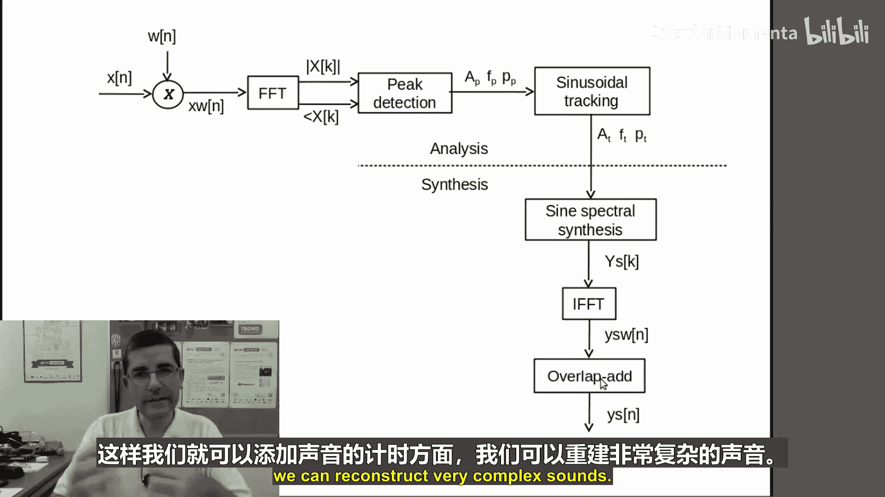
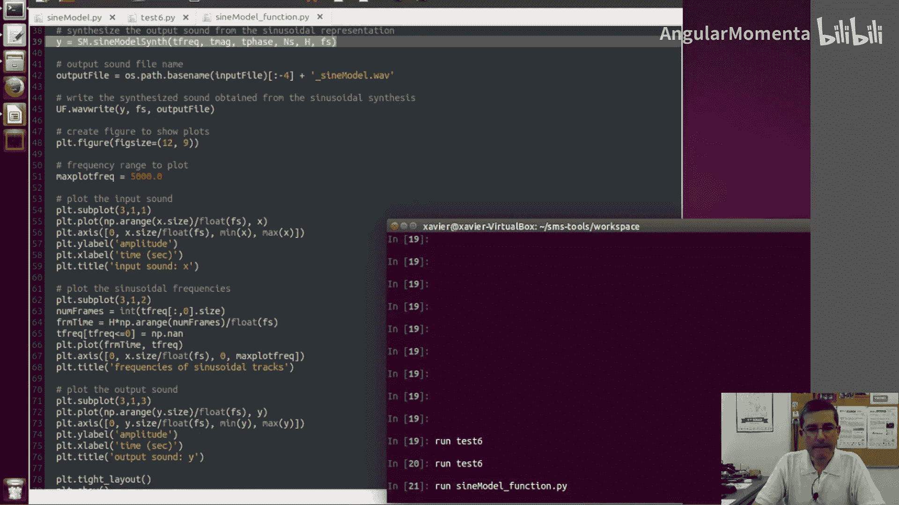
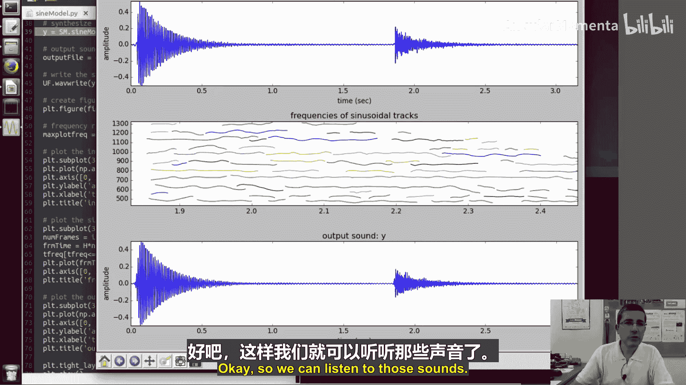
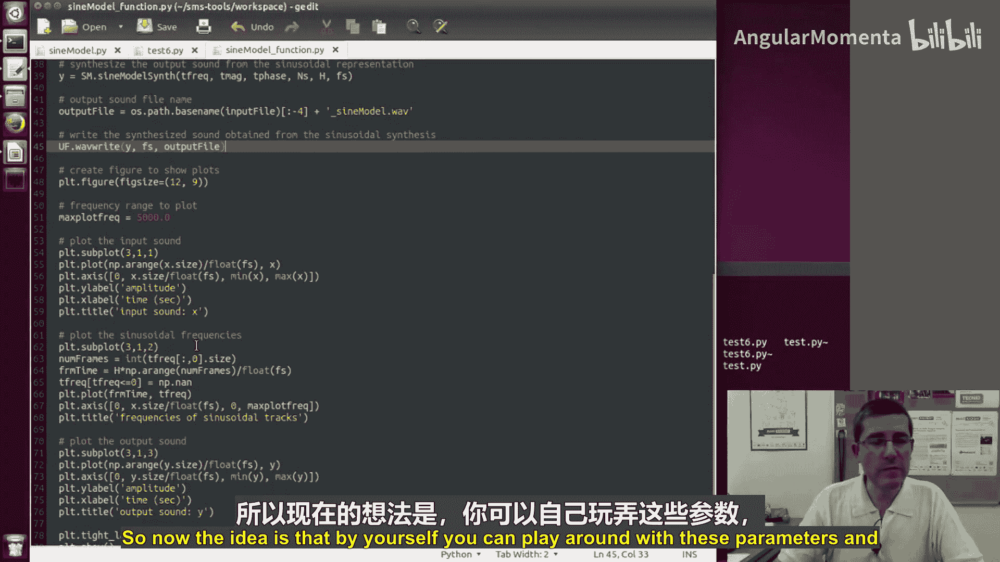
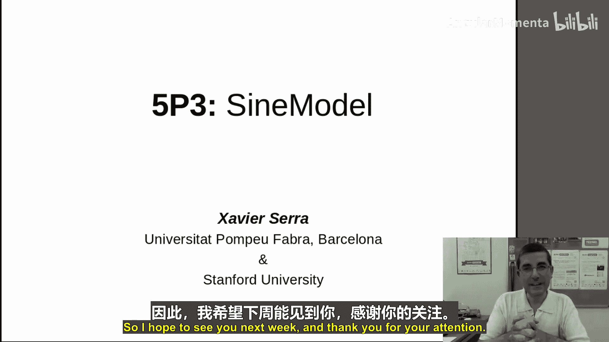

# 【巴塞罗那庞培法布拉大学】音乐应用中的音频信号处理-｜-Audio-Signal-Processing-for-Music-Applications-p38-05_03_03_正弦模型--BV18Xr6BeEX5_p38-

Welcome back to the course in nourishing or processing for music applications。

In this week that we're talking about the sinusoid model in the programming lectures we have been trying to put together a whole system for analyzing and synthesizing a sound using this sinusoid model so in the first programming lecture we talked about the pig detection how to detect the peaks of a spectrum which hopefully are going to be sinusoids then in the last programming lecture we talk about how to synthesize sinusoids from those values from the big values and now in this lecture we want to put it all together and add the missing components in order to actually analyze a complete sound so we start from signal of X and then we do the standard windowing FFT and these are the things that we talk about in this week so the big detection and how to get the amplitude frequency and phases of the Ps。

Then today we're going to talk about the sinusoidal tracking。

 so how to build tracks out of those peaks。Then once we have these sinosoidal tracks。

 we can do the synthesis so we can synthesize the spectral peaks or the shape of the sinusoids in the spectral domain。

 and then we can do the inverse FFT and do the overlap at so that we sort of at the time varying aspect of the sound and we can reconstruct very complex sounds。

Let's open up。The file that includes most of the functions that are needed in the sinusoidal analysis which is the Sinemodel。

pyY， which is part of the SMS tools package in this file we have several functions that are of use for the sinusoid modeling for example these first one is the sinusoidal tracking then there is another one which is cleaning sign tracks。

That we will talk about then there is one that implements the whole sinus sort model analysis synthesis。

 but does not include the tracking aspect because this is meant to be used in real time。

 so you cannot do tracking and allow some memory in in the in the process so we do not recommend to use that unless you want to develop some realtime kind of concept。

So what we're going to be using and we recommend to use is the sinusoidal sine model analog all function that just performs the analysis part and is able to do sinusoidal tracking because it allows to have all the tracks in one place and then do some post processing of them。

Okay， so in here the input is the whole input sound x， the sampling rate， the window， the Fft size。

 the hop size， then the threshold for the peak detection。

And then a number of parameters that are important to control the kind of these time varying aspects of the soidal tracking。

 So for example， one is the maximum number of signs that will be allowed at the same time。

The fault is 100 so normally you put quite a lot of them so to allow for creating and disappearing sine waves and then we control the minimum duration of a track so the default is 0。

01 so the tracks that are going to be shorter than this value are going to be deleted。

And then were going to control the allow deviation from one frame to the next of a given trap。

 so in this case this deviation which is in hertz， 20 Hertz it means that in the lowest frequency。

 it allows from one frame to the next for a peak to change a frequency by 20 hertz。

And still be part of the same track。 And then this f depth slope is a way to allow for this deviation to increase as the frequencies are higher in higher frequencies。

 normally you would like this deviation to get higher so we can change that by controlling this slope and the bigger these the bigger the slope and therefore the bigger the bigger the change with the higher frequencies will be。

Okay and then in the function， it's not that long， of course it has a lot of the parameters and the functions that we already have seen。

 the core is this while loop that basically what it does is iterates over the whole sound。

And it performs all the blocks that we talked about， so it performs the DFT using the FFT algorithm。

 it performs the peak detection， then it performs the peak interpolation。And then it。

 it puts the peaks into tracks。 And this is what we're talking about。Now。

 so let's look into this function， the sinnooid tracks。Which is right here， in this function。

From the peaks that the algorithm has found in a particular frame。And from the concept of tracks。

 the concept of a series of incoming tracks with specific frequencies。We are building tracks。

 we are basically continuing the incoming tracks or creating new tracks。

 according to these deviation parameters。So this function is liberty long。

 but it's a lot of cleaning and and setting up things。 The the whole concept is not that complicated。

 is simply the idea that。If there is incoming tracks and if not， tracks will be created。

 but from these incoming tracks， it finds the the peaks that are closest to those tracks。

And then if it's close enough， according to deviation， they will become part of the track。

So if this deviation is as small， we will add it， and otherwise we can also create new tracks here。

So if there are peaks that are left that have not been assigned to any existing track。

 we can create new trucks， so tracks will be created and will be disappearing if they are not used in the following frame。

So these returns a series of trucks。Okay so if we go back to the function of the assignine model and L。

Okay， after this tracking， it's done。Again， there is a whole bunch of variables needed to handle these tracks and how to pack them in and clean the metrics so that we save space。

But then this is done until then。 and then once everything is done before returning the tracks。

 there is a cleaning step。So this cleaning step receives all the tracks that have been computed for the whole sound。

 and it will delete the ones that are shorter than what we specify。 So if we go to this function the。

Cleaning off the tracks。Cleaning sign tracks。It's very simple。

 it just simply goes through all the tracks。That have been created。

 It looks for the beginning and endings of each track fragment。 Let's say。

 And if a track fragment is below。A given length。Then it will simply delete the track。

 it will set the frequencies to zero。And that's what it means to clean the trucks。

And that's all the sinusoid model does， the analysis of that。

So let's use a function that or a script that calls the sinnosoro model now so this is a script that calls the sinnosoro modelal and with a given set of parameters with a sound。

 the over soundund， with a given window， given FF0 size， etcter。

 all the parameters that we talked about so let's run this function or the script and well it will print the actual tracks。

Let's let's run this then run test6。Okay， so this of course。

 will take a little more than a single short time for your transform。 So this is the result。

Here we have all the tracks and we see the tracks in different colors。

And things that are important to notice here is that， for example， even if we see a single line。

 we can see that there are several colors。 That means that a track start was alive for some time。

 and then it disappear。 So a new tracks started。 and then it。 a new track started and disappear， etc。

 etc。 So this is the idea that tracks can appear and disappear。

 Then also we see that most of the tracks correspond to the harmonics of the sound。 but some do not。

 for example， here in the high frequencies clearly we see tracks that are quite shortly。

 and they may be tracking some noise component or they may be tracking some side lo of the analysis。

 and this is something that with the sound model， we can not do anything about it。

 Of course we can control the length。 So all these。Rracks。

 the the minimum length was the one that we established， which was 01 seconds。

 So all the all the tracks here， at least our 0。1 seconds。

 If we had set this up to a different value， for example， let's， let's leave it to  point0。

 So and now we can run it。Again。It will do the same analysis。

 but it will allow to do many more tracks。 So now， well it track。Things higher up。

 But if we zoom into the area we are looking at， yeah。

 we see many tracks that are very short and presumably correspond to fragments of little sounds or sidelos or things like that。

 So the cleaning of the tracks is a good way to get rid of all these kind of that typically may be corresponding to artifacts。

Okay， then we can do the synthesis， so the sine model synthesis is this function here。

And it will receive these tracks that we analyze， and from then it will call basically the generation of the spectral signs。

So it will iterate over all of them and it will generate the main lobes of the Plaamahar windows。

Here there is some consideration for the face。We might want to not pass any phase here。

 it passes them。The analysis phase， but in some cases。

 the phases will be reconstructed from scratch and it allows for reconstruction of the phase the synthesis stage。

Anyway。This sine model function， which is in the actual function that is called by the interface that we use in the demo class。

It has one function main that calls the analysis and synthesis of a given sound using the sinnooidal model。

So the parameters， the default parameters， it uses this bendier sound， and then it。

Does the analysis and then performs the synthesis， and it outputs the sound file。

 and it also plots the input sound， the sinusoidal tracks and the output sound。

 So let's just call this function。Let's close these one first and if we run。Sign model function。

 So we copied in our directory and we had to change a few of the relative paths of files。

Okay， so now it's computing the analysis and synthesis of this bendier sound。

so this is the original sound。 and here we see these trajectories and the recentynthesis from that。

 So if we zoom into here， for example， let's zoom into a particular area。

 we will see all these quite messy sinusoids that are coming in and out and in this type of sound that's quite normal because there is a lot of very partials that are very unstable and they disappear and appear in a short fragment so we can listen to to those sounds。

 for example， let's listen to the。

The resulting sound。 So we created。A file in this directory to synthesized is called bender assigned model so we can use the play system command to。

To play this out。Okay， and it's not that different from the original file that that the bendier we input it。

So anyway， so that gives you an idea of how to use the CM tools code and how to understand it。

 so now the idea is that by yourself you can play around with these parameters and really go into the different functions and understand what they do。

So let's finish with that and。So we have seen the whole sinus sort model from a programming perspective and within the SMSS tools package we have seen all the functions that perform all these different analysis tasks and synthesis tasks。

 so we have a pretty good code based which we can do a lot of bitter interesting things。Again。

 this is just one step into further complications on these models。

 so now we have seen the sininocerro model as a model that will allow us to do quite a few things but we can do more and so next week we will be talking about the harmonic model which is a way to restrict the sinuscerro model to track only the harmonics like in the ob soundund I think it was clear that it made sense to do that。

And we will also extend it with other new approaches to the the spectral analysis and sensitive sound。

 So I hope to see you next week。 And thank you for your attention。

