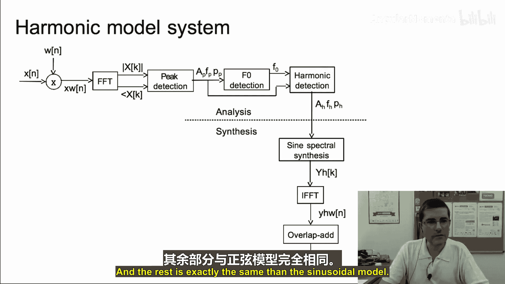
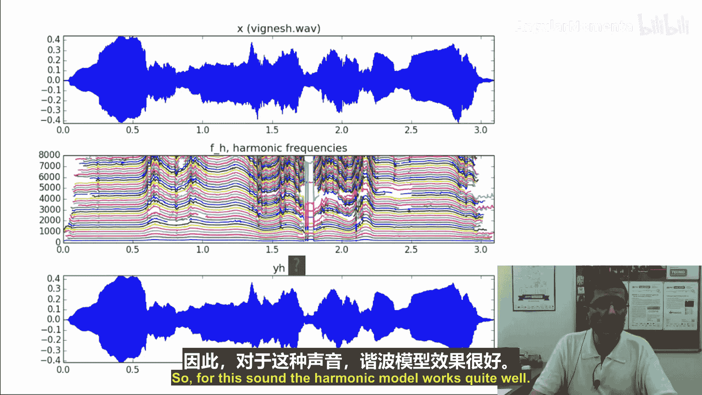
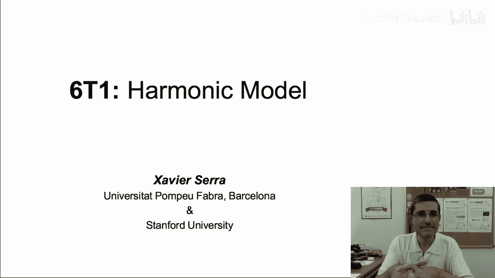

# 【巴塞罗那庞培法布拉大学】音乐应用中的音频信号处理-｜-Audio-Signal-Processing-for-Music-Applications-p39-06_01_01_谐波模型--BV18Xr6BeEX5_p39-

If you're watching this hopefully means that you have followed the course on audit single processing applications until here you just reach the half point。

 so congratulations and no need now to give up very interesting topics are still coming。

Last week we talked about the sinussoto model and now following in the path towards a more flexible and higher level representation of sounds。

 we present the harmonic model。We will first introduce the actual model。

 then talk about the difference between sinusoids， partials and harmonics。

 then discuss the difference between polyphonic and monophonic signals。

 then present the idea of how to detect this harmonics from a sound given that we know the fundamental frequency。

 which is going to be a topic of the next lecture。And then we'll put it together into an analysis synthesis system。

 the harmonic model system。So the equation of the harmonic model is very close to the one of the sinusoidal model that we already explained there is a single but very significant difference。

 The frequencies of the sinusoids are all multiples of a fundamental frequency。Thus。

 it's only valid for single source sounds produced by periodic or pseudoperoric oscillations。

 like the sounds produced by many musical instruments。So if we look at the equation， well。

 the output signal， Yh where we emphasize the idea that is a harmonic signal with the H that is。

 of course， the index n is a sum of our cosine functions。

 time varying with a time varying amplitude and time varying frequency。

 but here the frequency is not f sub R where would allow any frequency for any sinusoid。

 but is r f sub0， so that means that they are all multiples of f sub0， a small R is an integer value。

 so it means that all the sinusoid or either for different values of R。

 either the fundamental frequency or any of its multiples。

We can also express the model in the frequency domain。

 the time bearing spectrum of a harmonic sound is the sum of all the time vary spectra of the harmonics。

So in this case， we are expressing the idea of a sinusoid being the transform of the window that we use in the analysis。

 so the spectrum， the overall harmonic spectrum is the sum of all these windows。

 which a scaling factor of an amplitude a and a shifting factor of minus Rf in which we are placing this windows at the appropriate location of the sinusoid。

This is basically what we talked about in the sinnocer model。

 but now again here restricting the frequencies to be multiples of the fundamental frequency。

Here we show spectrograms of the sinnooidial tracks of two sounds that have different characteristics。

 The top sound is inharmonic sound， a note of a viphone and the bottom plot is harmonic sound。

 a voice singing mag a vowel。Let's listen the top one， which is this biberphone sound。Okay。

 this is a very simple sound， but it has lines that are nonharmonic。

 so that means they are not not multiples of a fundamental frequency。 Some are are related。 In fact。

 we listen a pitch in in this note， but there is some of these sinusoids that are clearly not perfect multiples of these fundamental。

 Instead， the second sound， which is a voice sound， which vary， so it's a little more complex。

 so this is the sound of v singing。 and here we see that the lines。

 the sinusoidal lines are very much multiples of a fundamental， they are multiples， in fact。

 of the first line。 and this is the typical structure of a harmonic sound。

In order to better understand the concept of harmonics。

 it's important to understand the difference between sinusoids， partials and harmonics。

 many people get confused with that。So a sinusoid is a mathematical function。

 so it's a function that we compute from an equation and is it has an analytical representation and therefore comes from a mathematical point of view。

 so the top plot is clearly spectrum of tools of such mathematical functions to sinusoids that we have computed with the sine function。

A partial instead is a component of a signal that is periodic and stable and that can be modeled as a slowly time varying sinusso Okay so here we introduce the concept of a real sound。

 a partial is a concept that comes from analyzing real signal and that has a certain behavior that can be approached can be modeled with this mathematical concept that is the sinusoidal function。

so this second plot is one spectrum of the fiberberphone in which we see that there are several of these components in the spectrum that can be approached or can be model with the idea of a sinusoid。

 others not， so in here clearly there is some very clear sinusoidial components and some other aspect of the spectrum which might be is not so easily model with the idea of sinusoid。

And finally， a harmonic is a partial of a sound that is a multiple of a fundamental frequency。

So it can also be modeled as a slowly time varying sinusoid。

 but it has this added restriction that has to be a multiple of a given frequency。

 So in this last plot， that is the obo soundund。 We see these very the peaks， the topics。

 these crosses， these are clearly the multiples of the first peak。

 which is the the fundamental frequency， but there is other crosses， which are not harmonic。

 they are not multiples of these fundamental frequency。

 These are maybe artifacts or maybe part of some signal that is underneath or maybe some side lo。

Okay， and looking at the phase spectra of the same signals。

 it also helps to understand some of these concepts。

So the top one is the phase of this two sinusoids， we see these very flat area in the main lobes of the two sine waves in the second plot with the biphone sounds。

 which clearly some areas that are quite flat where the cross is and that so hopefully means that there are kind of sinusoid and some others crosses are not in a stable region。

 a phase region。So that means that maybe they are not sinusoids。 And finally。On the o sound。

 we see the same thing。 Some Some of the crosses are clearly in a flat region。

 and this clearly means that is in a stable。Component。 so it's it's a flat face， stable component。

 And some of the crosses are not in such such areas， though。

 So that might give some indication that they are not sinusoidal or they cannot be modeled easily as sinusoidal components。

In order to use the harmonic model， we need to identify the sound sources that are harmonic。

🎼In the case of a polyphonic signal， there are several sound sources， and for example。

 there may be several instruments playing at the same time and some might be harmonic。

 some maybe not。 So for example， the stop plot is the fragment of a kinetic music concert in which we hear a voice and some accompanying instrument。

 let's listen to that。So the goal would be to identify the harmonics of the voice sound and looking at these sinusoidal tracks。

 well it may be not that easy， but still it can be done。

 We can try to track the harmonics of these voice sounds or other harmonic component that might be present。

A monoonic signal includes just one single source， like the one of a pillow。

 which is just a single voice that we already heard。 So it's dish So he is。

 in fact the same singer than the voice above。 But clearly here。

 we can see the time varying harmonics much easier And these sinnooidal tracks that we have identified can show very clearly the harmonics of the voice。

So the question is， how do I identify the harmonics of a sound source being in a monophonic。

 a signal or in a polyphonic signal？We are just focusing on harmonic sounds。

 So we would like to find the harmonics in a boenophononic signal or in one of the sound sources of a polyphononic signal。

 The major problem is the identification of the fundamental frequency of a sound source。

And this will be covered in the next lecture。 So here we will just assume that we know the fundamental frequency of the cell。

 So we will focus on the concept of a harmonic， and we will define that as being a spectral peak whose frequency is close to a multiple of the fundamental frequency。

And we can formulate this idea with this equation which we defined Fp a peak。

 the concept of it being a harmonic will be when the absolute value of the difference between f sub P and a multiple of F sub0 for a given frame L is smaller than a threshold that we give。

And at the same time， we define this idea of being stable as having been lived for some time。

 as having been in existenceent for some time， so we also make the restriction that these F sub H have had some existence for some number of frames before the Qrum frame。

 so we define a capital L as the number of frames， the minimum number of frames that we need to have in order for a harmonic to be defined as a harmonic。

The implementation of the harmononic model is a modification of the sinnooid model that we saw last week here we introduced two models。

 one is the F0 detection algorithm that again requires to be treated separately and we discuss in the next lecture and the idea of the harmonic detection which was what we talked about the idea that we select the peaks that are harmonic of the fundamental frequency。

 and the rest is exactly the same than the sinnooid model。

So lets this is an example of an analysis synthesis of the sininooidal model。

That was the this viish sound， the harmonics。Of that， of course。

 that always might have some problems。In the areas in which we don't have clear harmonics。

 like in the transitions， in this case， even in in the consonance of silences。

 we might have some problems， but in general it works。

 So from this sound that we already heard this is the synthesized sound。

 which is quite close to the original one。 So for this sound the harmonic model works quite well。

The concept of harmonic oscillations in the study of many natural phenomena is quite present in many books and references and you will be able to find them in Wikipedia you can find many of that。

 of course there is not much when we deal with specific music signals and sounds and the harmononicity of sounds but still you will find some things on Wikipedia and on some books。

And again， the sounds that you heard that they played come from Free sound。

 and you can find all the code for these plots that I showed in the GiHub repository。

So we have covered the harmonic model so we can use it to analyze and synthesize signals the application possibilities we will see that are much larger than with the susoidal model and we will show some examples of that the difficult step is the detection of the fundamental frequency and that's what we will cover in the next lecture so see you in the next class。

