# 【巴塞罗那庞培法布拉大学】音乐应用中的音频信号处理-｜-Audio-Signal-Processing-for-Music-Applications-p40-06_01_02_基频检测--BV18Xr6BeEX5_p40-

Welcome again to the course in our or processing for music applications。In the last lecture。

 we introduced the harmononic model and mentioned that in order for it to work。

 we need to be able to detect the fundamental frequency of a sound。

 what we call the pitch of a sound。We will use the terms fundamental frequency and pitch interchangeibly。

 but strictly speaking， they are refer to different concepts。 F0 is a signal processing concept。

 P is a perceptual concept。For our course， F0 is a more appropriate term to use。

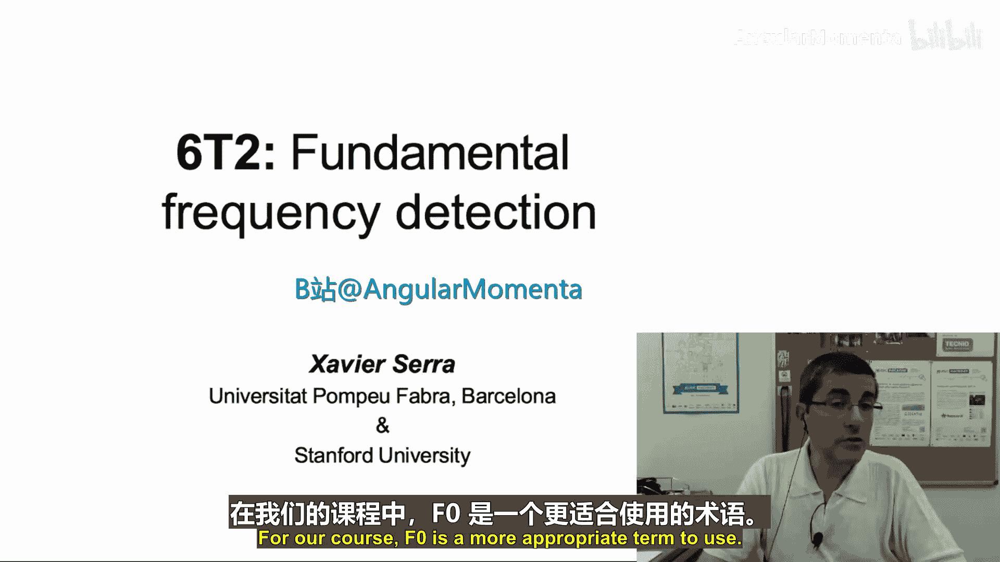

Many methods have been proposed to identify the fundamental frequency of a sound。

 and these methods can be grouped into the ones that work directly on the time domain signal and the ones that work on the frequency domain representation on the spectrum。

The time domain approaches work well on monophononic signals。

And the frequency domain approaches can be made to work on monophonic signals。

 but also on polyphononic signals， and that's going to be a very important advantage of this type of approaches。

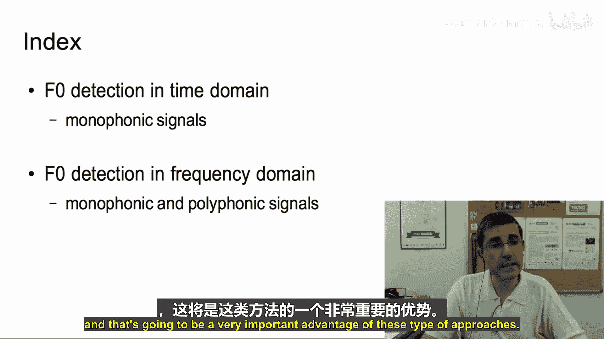

So to understand the concept of F0 detection， let's look at some sounds and to the spectrum。

This is a fragment of a noble sound that we can listen。The time signal clearly shows a periodicity。

 and we can identify a period， a cycle that keeps repeating and this length， the period。

 its inverse is what we actually call a fundamental frequency。In the frequency domain。

 in the magnitude spectrum， we also see a periodicity and basically the distance between two consecutive peaks is the fundamental frequency。

 So we can also think of algorithms that could measure that。

 So we could measure it in the time domain or in the frequency domain and maybe not too hard。

The phase might be useful in certain situations， but let's not talk much about that now。

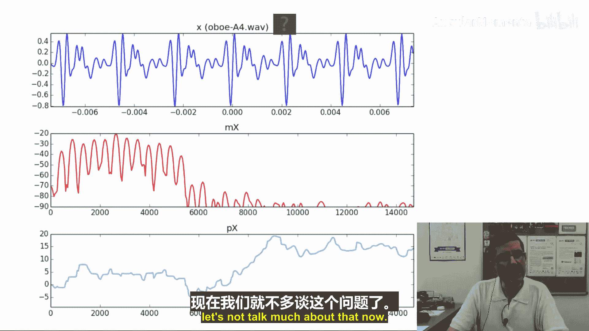

🎼A single note of a piano has a clear pitch， thus it should be able to detect it in the in its F0。

 let's listen to a phrase， a piano phrase。Clearly， we listen to the pitch of this sound。

 but if we look in the time domain， well it's not that trivial。

 it doesn't doesn't seem to be easy to identify the period of this sound。In the spectrum。

It's a little bit easier。 We see some of these peaks that clearly have a periodicity。

 so we can envision some algorithms that could take advantage of that。

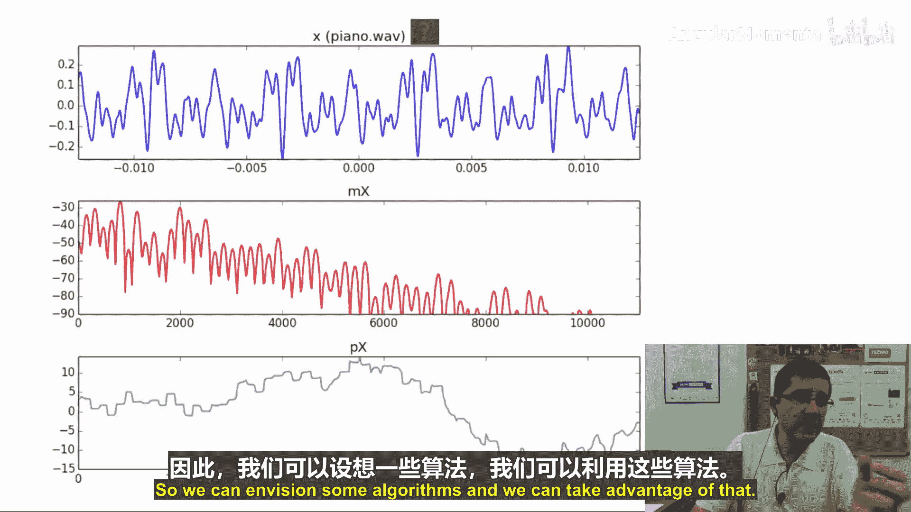

🎼And then if we deal with polyphonic signals， for example。

 this is a fragment of this kinetic pieceas， let's listen to that again。

There are several sound sources， but the voice is the most prominent one。

 and to detect the fundamental frequency of the voice in the time domain is basically close to impossible。

In the spectrum， well， it's not easy either， but we'll see that there are some algorithms that attempt to identify this prominent voice。

 this harmonic component in the frequency domain， and they do a pretty decent job。

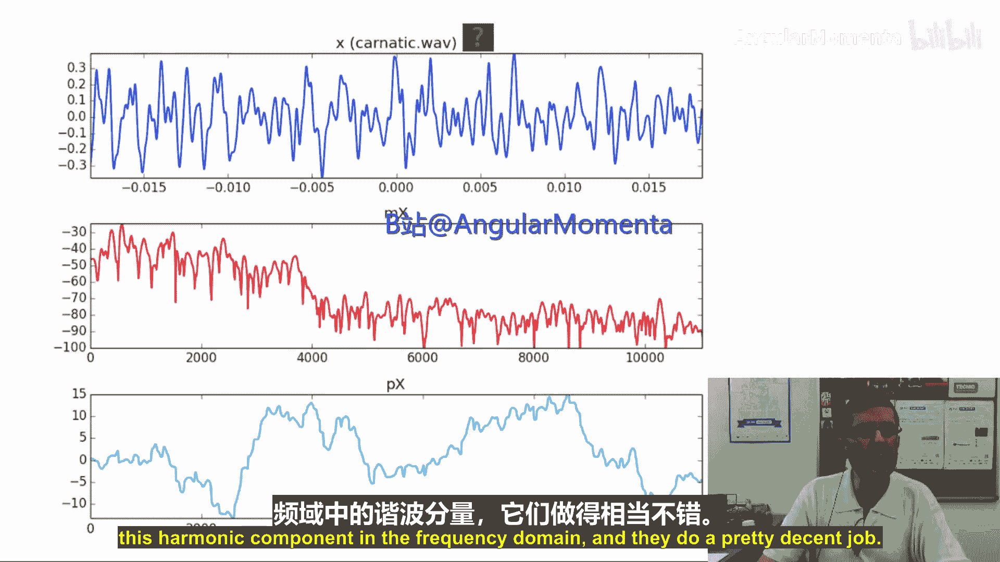

So to detect the fundamental frequency in the time domain。

 we basically have to identify the length of its repeating periodic cycle and the autocorrelation function is a mathematical tool for finding repeating patterns it is the cross correlation of a signal with itself and informally we could say that is the similarity between samples as a function of a time lag between them。

So in this equation we see a version of the autocorrelation function that has some tapering and what we do is we compute this function for every lag time so we try different lag times where it's an integer values。

 the sample values so we start with L equals zero and then we sum over all for a particular period of time a fragment of a sound multiply by the sound delay by that lag time。

 of course if we delay by zero is the same signal and delay we take different lagx is' going to be the multiplication will not will be different。

So we will get a function of L。 so therefore we will be measuring how correlated is a fragment of a sound with the samples delayed by a certain certain L so let's look at a particular example。

 So this is the over sound again and below is the the autocorrelation function in which we clearly see。

 of course， a0 lag 0 is 1 there is no is completely correlated and then as the lag increases and here we have expressed a lag time in seconds instead of samples to make it easier to correspond to the top signal。

 and clearly we see that a lag corresponding to1 period which is this 0。002， there is a local maxima。

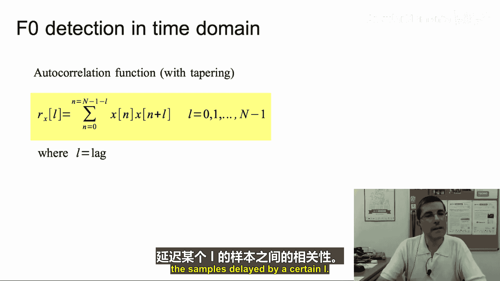

And clearly is the biggest local maxima， so that would be a good indication that this is the period or this is the inverse of that would be the fundamental frequency and then the lack of two periods is also a local maxa smaller and since there is a tapering also this keeps decaying with lag time。

But let's say that the out correlation function for such a clear periodic sound is a quite good measure of the period or therefore of the fundamental frequency。

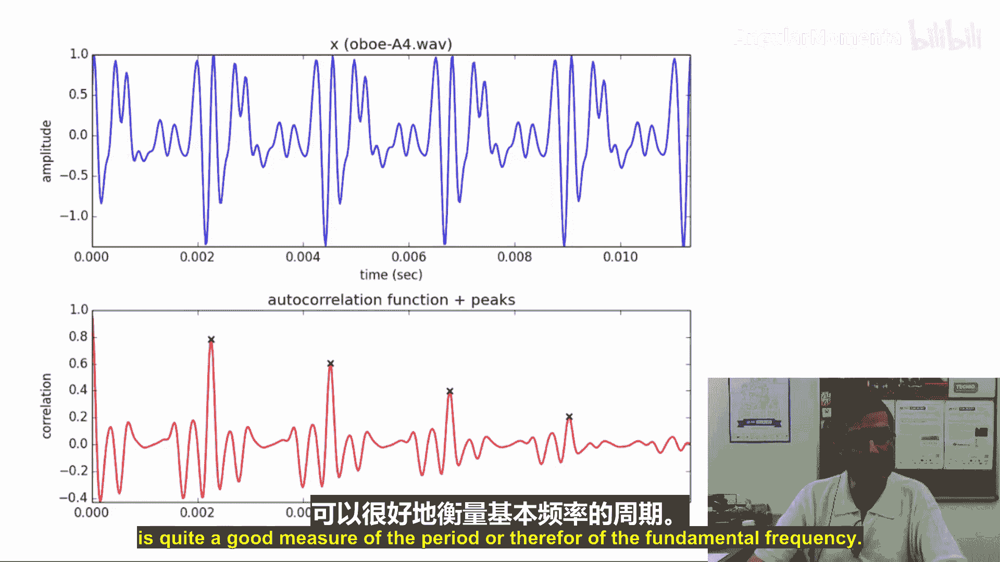

For the case of the piano sound the time domain waveform is not so well behaved。

 so for this fragment of a piano sound where we hear in fact the pitch quite clearly if we plot the autocorrelation function for the different lag times well it's not that clear there are several peaks。

 well the highest peak is in fact the fundamental frequency。

 but very difficult to have a threshold that would make it a clear decision on which is the best peak to identify the fundamental frequency。

A method similar to the autota correlation is the one proposed by Shiini and Kaawhara name yin。

 and it's based on the difference equation which is equation similar to the theta correlation。

 we just take the difference between samples with a given lack and then take the square and then sum and this function is0 when the lack is equal to the cycle length。

 so we have to find the minima of the function。And the Yin algorithm does some extra processing here to get a good measure of this period。

 and it does a pretty good job for monophononic signals。 So in fact。

 it has become a very common algorithm for speech or for measuring the fundamental frequency on monophonic musical instruments。

Let's look at how it does for a particular sound。 So in this this is the spectrogram of this vish sound that we have heard。

 and here we have plot the the function， the black line is the fundamental frequency that the y algorithm has detected。

 Of course it has detected it on the time domain， not on this spectrogram。

So let's listen to the fundamental frequency。So this is pretty good。

 iss basically it tracks the fundamental frequency very well。

 but this type of method does not work for many sounds。

 especially it does not work for polyphonic signals， so we have to go to the frequency domain。

So what is the fundamental frequency in a spectrum？

We have seen how to identify the sinusoids and the partials of a sound， for example， on the obsound。

 these crosses are the peaks and many of them correspond to partials or harmonics of this sound but which of these peaks or maybe some other part of the spectrum。

 which is the fundamental frequency， how can we identify the partials that are harmonic and then maybe from this information we can identify which of them or which other frequency is the fundamental frequency of this partials？

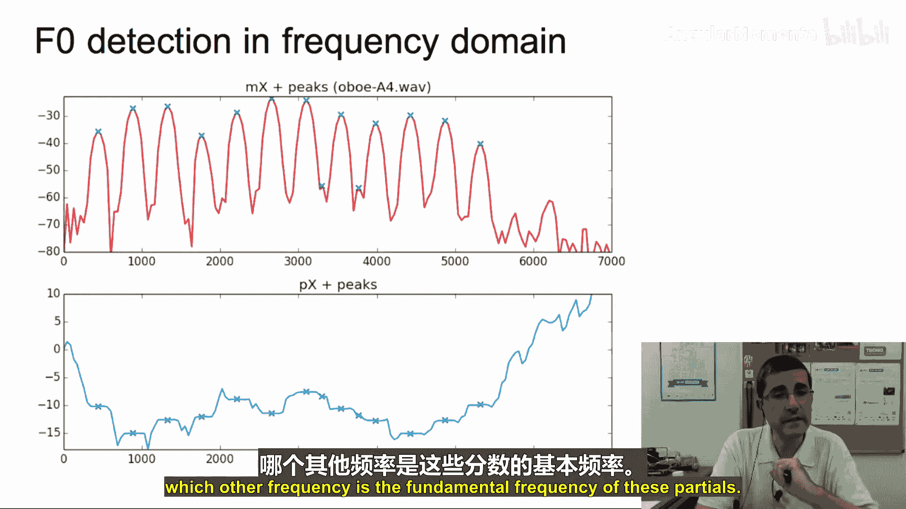

So the F0， the fundamental frequency in the spectrum of a sound。

 can be defined as the common divisor of the harmonic series that best explains the spectral peaks。

I think this is a very nice and compact definition that in fact we can develop algorithms for developing it。

So here we see a plot of that ob sound and the peaks and the vertical green lines。

Correspond to one harmonic series。 In fact， they correspond to the harmonic series that best explains these spectral peaks。

 So if we would just by the visual inspection， we see clearly that the green line。

 which are all multiples of the first green line。Really the closest possible to the harmonic series。

 even though some of them， they are definitely not right on top and there are some peaks that are not taken into account。

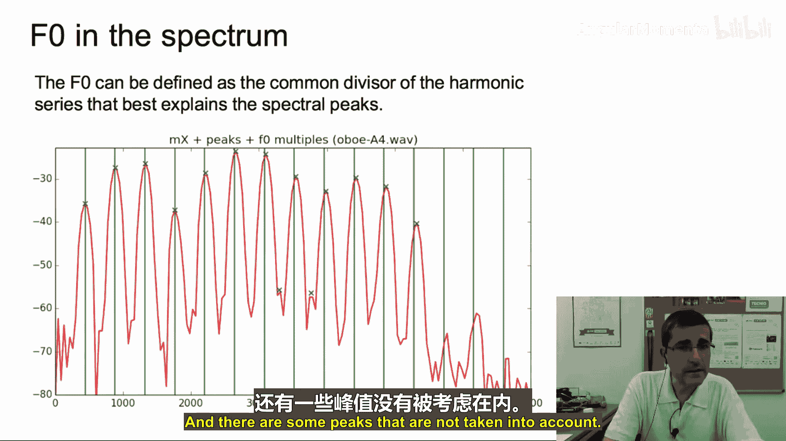

Da zero detection problem in the frequency domain can be formulated as a pattern matching problem in which we have to find the pattern of the harmonic series that best fits the spectrum。

And the two way mismatch algorithm proposed by Mahar and Bom does exactly that。

The concept of this algorithm is that it finds the difference between the measured peaks and the ideal harmonic series。

 the predicted Ps and vice versa。So if we start looking at the plot。

We see the measure peaks on the very far right， these are the pigs that we have obtained the frequency of the peaks and then we want to check a given predicted。

 a given harmonic series， a given f0 and its multiples how close is to these measure peaks so how well it explains those measure peaks so what we're going to do is measure the distance between this pair of values。

So we will be measuring the distance between the predicted to the measure and also from the measure to predicted。

 that's why the term2 wave is match because in fact， this distance will not be the same。

 So this first equation is the predicted to measure。

 So we take every predicted peak or every predicted value and we look at the closest measured peak and find the frequency distance and then we scale it according to the amplitude。

 we also have a value that sort of promotes the lowest frequencies compared with the higher frequency So we have some weighting coefficients here that allow us to tune these equation to the kinds of sounds we want to work with。

 We are not going to go into the detail， but feel free to look at the article or this equation and understand it better。

 and then we。

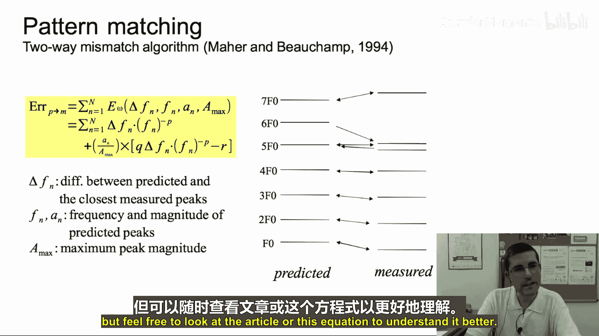

Do the other way around we measure the measure to predicted error。

 so we start by looking at all the measure peaks and look at the closest ideal peaks or the ideal harmonics and again we look at the distance and we apply some weighting factors and then we have a total error which is the sum of these two errors and again we have some weighting coefficients so that we can we can set it to work for our particular situation Bahar Musam propose some values for these coefficients and variables and these are the ones that we will be using。

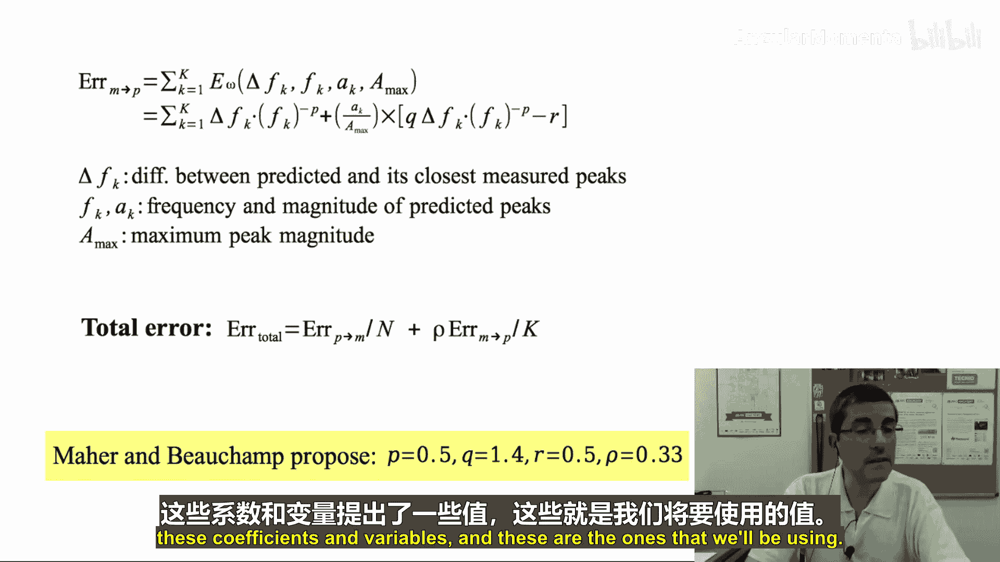

So let's put an example to explain this algorithmally better。 So for example， let's consider。

Se of peaks that we have measure in particular， let's consider that we have measure a peak at 200 hertz。

 300， 500， 600， 700 and 800 and let's check for different fundamental frequencies let's check for a harmonic series on top of 50 another on top of 100 another on top of 200。

And so in these metrics， we see the different errors predicted to measure and measure to predicted for these different candidate fundamental frequencies。

And clearly， the best result is for 100 Hz。100 Hz is the harmonic series that best explains the peaks there。

 even though the frequency 100 is， in fact， not there。

 And that's a very interesting consequence of this algorithm。

 The fundamental frequency doesn't have to be a peak， a measure peak。

For the algorithm to give a value at that particular point。

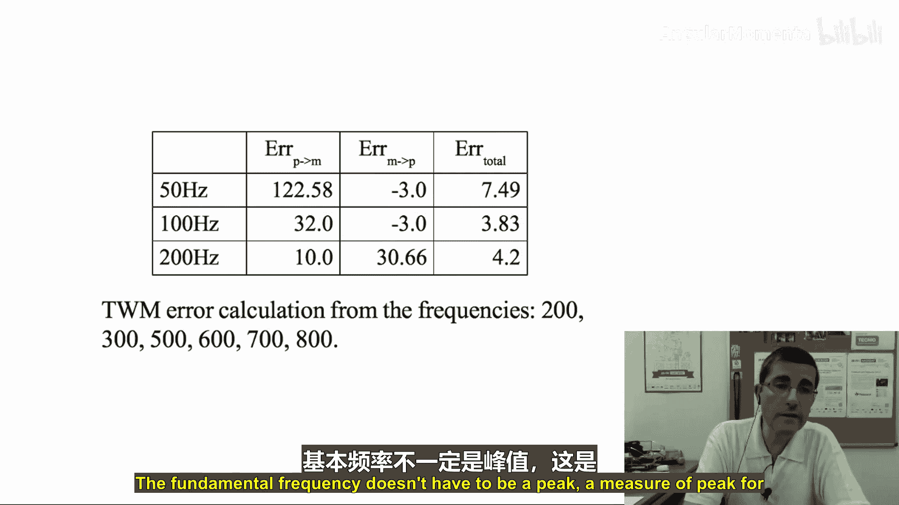

And let's put an example of these error functions for a particular sound on this sound that we already have been looking at the ob sound。

 so here we have on the bottom we have the three error functions。

 the blue is the predicted to measure the green is the measure to predicted and the black is the total one for possible fundamental frequencies ranging from zero to 1500 hertz so basically we have swept swept all these frequency range and have tried the algorithm for all possible frequencies at increments of1 hertz。

And clearly we see that there is one point that there is a minima。

 there is a local minima and of course it's at 440 hertz。

 which is the fundamental frequency of this obsound。

 this is an easy case and so here we see that there is not much doubt for the algorithm that the fundamental frequency is 440 hertz。

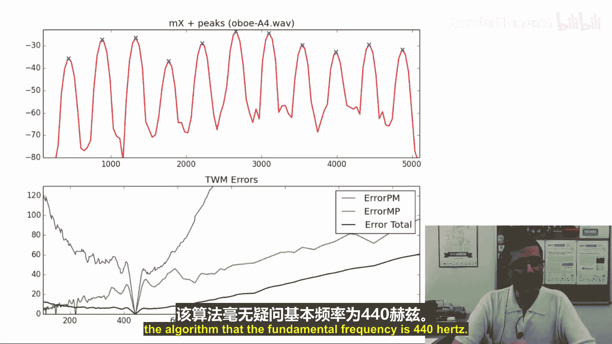

🎼But let's look at a sound that is more complicated。

 the piano sound that we mentioned before and this is the result of the best fundamental frequency identified by the two way mismatch of this phrase so the black line is the minima of that error function at a different node as they vary in time and let's listen to the first to the piano sound。

And then let's listen to this fundamental frequency as a sinusoid。Well， there is some glitches。

 especially in some areas where we see some gaps， but it does a pretty decent job in following this fundamental frequency。

In polyphonic signals， this is not so easy。 It's much harder。

🎼So polyphononic signal can have many sound sources， both harmonic and inharonic components。

 and the idea in F0 detection in polyphononic signals is to identify the fundamental frequencies of all the harmonic instruments that are playing together thus to find all the harmonic series that are present at every frame。

 so for example， in this plot we are showing the harmonic component that we the signal that we talked about before that we can listen to。

And we are plotting according to some algorithm， possible harmonic series present。

 so there is a harmonic summation formula that allows us to measure the strength of different harmonic series in a similar way to the two way mismatch and these are the best sort of the loudest harmonic series。

 let's say or at least the candidate harmonic series。

 So these are possible fundamental frequencies of those harmonic series。

 clearly I don't think this is completely right， but it's the first estimation of that。

Solomon and Goez they presented an algorithm。That on this type of harmonic summation contours。

Is able to identify which is the lead instrument or delete voice and therefore the prominent harmonic instrument in this case that is singing the voice and it does a pretty good job like in this sound example。

s I will play the prominent pitch it has found for this sound。So that's pretty good again。

 there might be some glitch， especially I see one glitch。

 but is able to identify the prominent pitch over this whole sound。

So the best references for the algorithms that I mention in this class are the original articles in which they were proposed。

 so I would encourage you to for the in algorithmgori。

 look at the article by Shivinni and Kaawhara for the two Way mismat read the article by Mahara Mosm。

 and for the Melody algorithm by Salomon and Gomez look at this Iriee transactions article which describes it quite in detail。

Again， you can find other informations and there is a lot of algorithms that have been proposed to do fundamental frequency and pitch detection。

 so I encourage you to study a little more into this and get a grasp of the techniques that are behind these ideas。

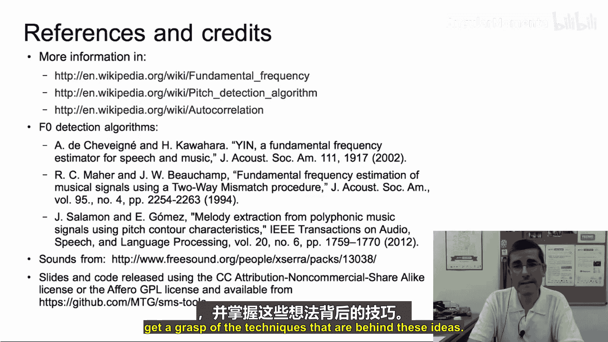

And in this lecture， so we have presented different approaches to the fundamental frequency detection。

 and this is a research problem that has not been completely solved yet。

 especially for complex signals。In order to not make things too complicated。

 we will focus on monophononic signals， but the concepts that we'll explain from now on should also be applicable to any type of signal by combining the harmonic model that we presented in the previous lecture with the F0 detection that we just presented。

 we can analyze and synthesize harmonic signals。But things are not finished yet。

 So see you in the next lecture where we will take this even further and try to see what happens when we have。

 of course， sounds that the harmononic model does not work so well。

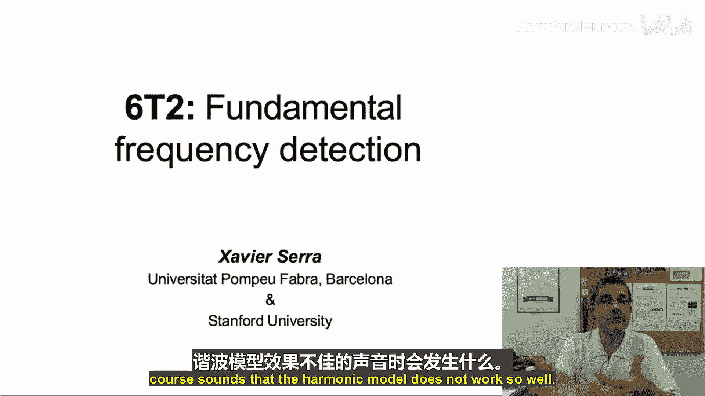

So I'll see you next lecture。