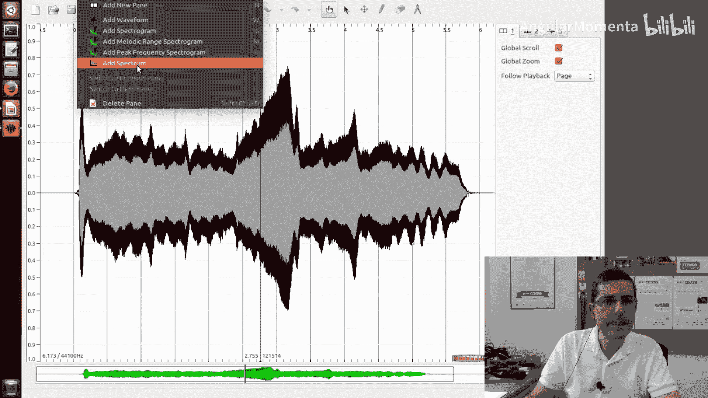
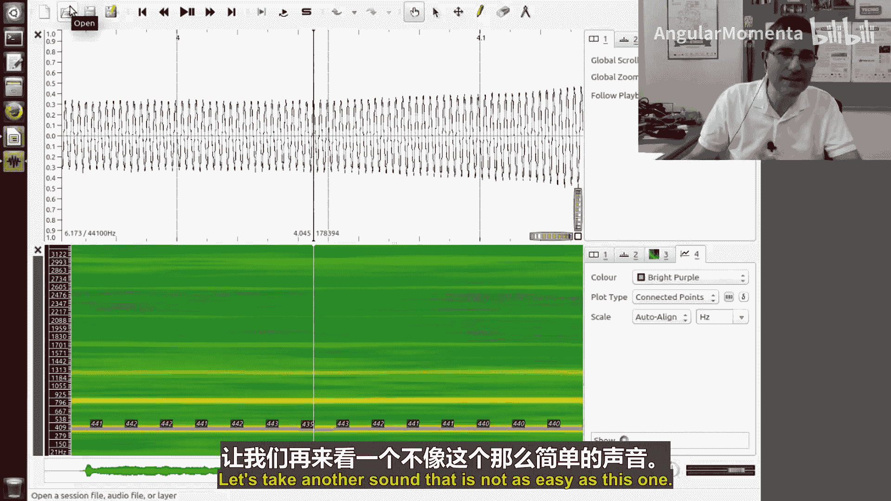
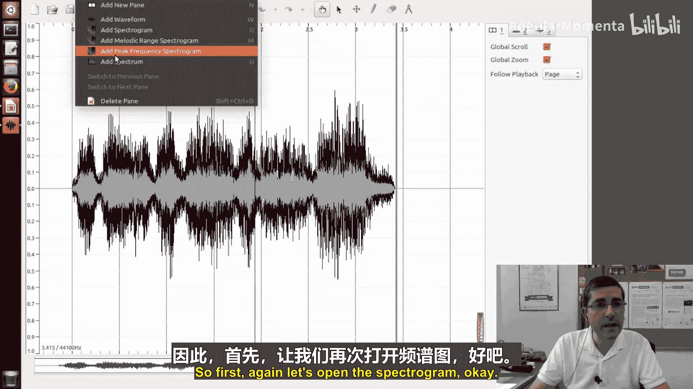
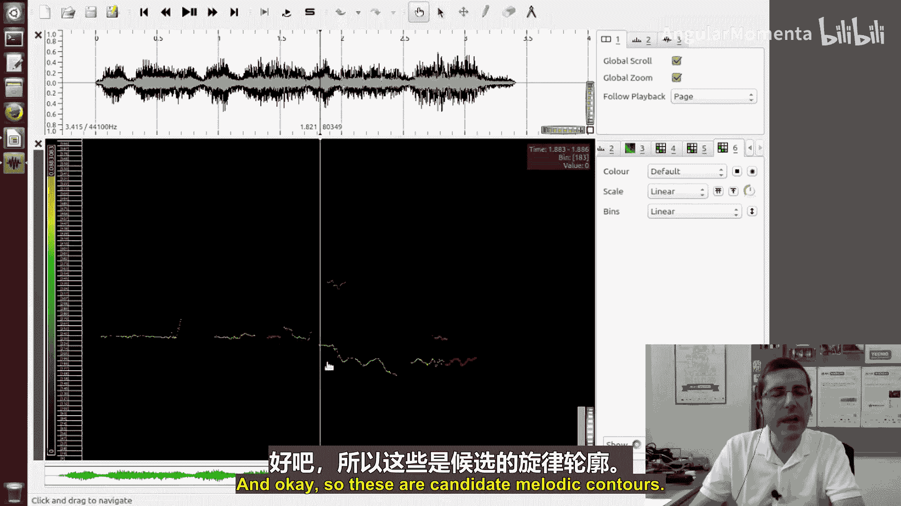
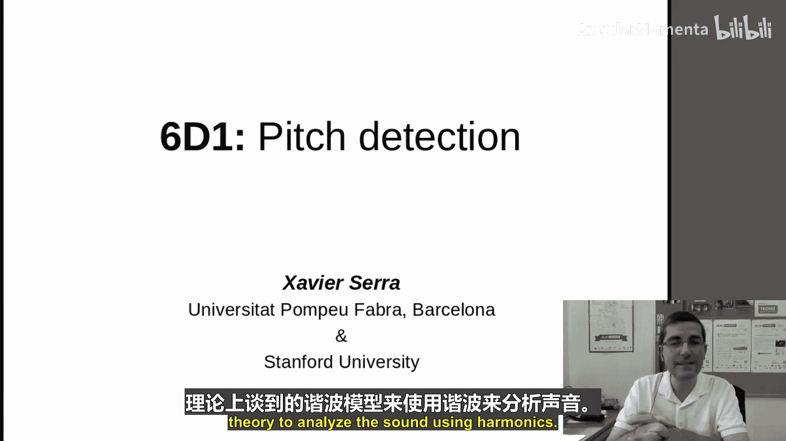

# 【巴塞罗那庞培法布拉大学】音乐应用中的音频信号处理-｜-Audio-Signal-Processing-for-Music-Applications-p41-06_02_01_音高检测--BV18Xr6BeEX5_p41-

Hello， welcome back to the course on Out single or processinging for music applications。

This week we're talking about harmonic sounds， sounds that have a very clear pitch of what we also call a fundamental frequency。

 and in this demonstration class I want to show some tools within soundnic visualizer。

 some plugins that allow us to analyze the pitch of several sounds。

So let's go to Sonic visualizer and let's open the file of a singing female from the SMS toolsol directory from which we use most of the sounds。

And so here it is， and we can listen to that。う。うう。So that's a quite clear voiced sound with a very clear tone。

 the tim quite homoogeneous throughout so we can hear quite well the pitch of it。 In fact。

 if we zoom in into the sound well be able to see the periodicity quite easily。

 so that means that a time domain approach could be able to identify this pitch。

So let's analyze the pitch of this sound using a time domain approach， but first。

 let's open the pane with the spectrogram。

Okay so this is the spectrogram of this sound。 and if we zoom in the lower part we see this horizontal lines。

 which is are the harmonics of the sound and the first one this more red one is clearly the fundamental。

 the first harmonic if we make the window size a little bit bigger like 2048 this is even more clear so let's zoom even more okay and now let's compute the pitch using a time domain approach and let's open plugin that is the audioio pitch detector which was developed by Poroier and the actual implementation was done by Chris Canan。

ind and we will be using the y algorithm。 This plugin has several algorithms and we talked about the y algorithm in the theory lecture that's a quite popular algorithm that basically similar to an autocorrelation function and see。

 let's see what it does so it has some parameters to control like the range that we will be accepting the lowest fundamental。

 the highest fundamental silent and threshold， the frame size within which we're going to compute these measure。

 and then the increment in time。So let's just take the default parameters and let's compute them。

Okay， so here we see this purple line on top of this first harmonic。

 So it very much tracked quite well。 the whole pitch contour， of course。

 except in the in the attack that we see where there is some silence and it found some pitches that may not be in the right place。

嗯。Okay， so now we can zoom into these and we will be able to see the actual numbers that it computed。

 so these numbers 372，371， our spaced 512 samples。 So every 512 samples we have one of these values and these tone if we recall it starts a little bit high。

 then it goes down up and then then finishing the same range。 So we will see this frequencies。

 So it starts around 49，414。 then it will go down to lower frequencies like 371 and then it will go up again to 443 to end the kind of a initial frequency range which was around4。

ThenAnd something hurts。Okay， so with that， we can really measure quite well these frequencies。

 Let's take another sound that is not as easy as these ones。 So， for example。

 let's take a a speech sound， a speech mail， which is a lower sound and may have some more problems than this one。

 So let's listen to that。 Do you hear me。 They don't lie at all。 Okay， and let's。

 let's do the same process。 Let's。

Let's first， a zoom。Into it， let's get the spectrogram of this sound。

Let's make it a little bigger and let's zoom into the lower part of it。Well。

 we will need to take a bigger window in order to visualize the horizontal lines better。

 So let's take 2048。 Okay， that's better。 But even in this case， we can even do more than that。

 this may better。 So here we see this harmonics and clearly there are several utterances。

 So we see them with silence in between and some consonants in in between two。

 So now let's use the same algorithm。Okay， the audio your pitch detector。

 and let's use the same y frequency estimator。 And let's just use the same parameters。Okay， and well。

 the color is not so easy to visualize。 So let's change the color。 Maybe let's。

 let's make it like black。So now we see the pitch track that it found。 and clearly， well。

 let's zoom in a little bit more。Okay。And now there is， it's pretty good。

 but there is some points that are are well are not correct， but again。

 they are not correct because they are trying to identify the fundamental frequency of some silence。

 So by controlling like the silent threshold and some other parameters。

 we might be able to get a better pitch struck。 maybe the one that is not so good is the this fragment here。

In which there is clearly some pitch， and it got a little bit confused。 It was jumping。

 And if we look， if we zoom even more， we will see the actual values。

So it was quite not very clear on the frequency that the fundamental frequency was okay。Anyway。

 so that's a pretty good tool to analyze the pitch of of monophononic sounds。

 So now let's open a polyphonic sound。Let's open that fragment of kinetic music that we have been hearing in some classes。

Okay， so this is。🎼This is it。 Let's listen to that。Okay， so that's a quite more complex sound。 We。

 we also listen clearly the voice， But there is this percussion instrument and some a little bit of the violin at the end and some drone。

 But definitely we need a frequency domain approach。 So first， again， let's open the the spectrogram。

and let's make it bigger so we can see better and let's zoom in into the lower parts。Okay。

 let's make the window bigger so that we can see some things maybe even bigger。Okay。

 now we start seeing some horizontal。Lines that might be the voice and might be the drone that there is underneath and the violin here and then。

Okay， but so now we let's use a frequency domain approach that will attempt to identify the the different pitch contours and identify the prominent pitch。

And that's I downloaded one plugin。That is meloia that was developed by Justin Salomon at the MG。

 the music technology Group， and it has two two parts。

 one it has all the intermediate steps that are used， and then it has the final result。

 so let's start with intermediate steps and first what it does。

 it looks at what is called the salience function。 So the salience function。

 well let's just use the default parameters， and let's just show it。

 so this is the salience function。 This is a computation that is done。

 Now the horizontal scale is in sense not is not in hertz。

 and basically it attempts to identify possible fundamental frequency。 So possible sinusoidal line。

 So it does sinusoidal analysis。 It finds all this sinusoidal。

And it tries to identify which of the sininooidal tracks might be fundamentals of harmonic series。

 And， and this is what it does。 And then the next step is to。Find the contours。

 possible contours that are the most prominent ones of these possible fundamental frequencies。

And these are the pitch contours。Okay now it's computing。

 so these are possible contours that it found that might be candidates to be the fundamental frequency of a given sound source。

 and then you can refine it a little bit more by identifying the ones that are really melodic contours。

Okay， hey。And。Okay， so these are candidate melodic contours。

And then the actual algorithm returns。Let's now call the actual algorithm， the meloia extraction。

Again， it has parameters of the range that it accepts。

 it has the size of the frame and the window increment here， it's 128。

 so it's very fine advancement and there is some other parameters that you might want to play around with like the voicing tolerance in terms of how how the voicing characteristics is how strong we rely on the prominent voice to be have a very clear pitch etc。

 So let's compute that。Okay， and let's change the color again to black。 Okay。

 and this is what it obtained， what it believes to be the prominent peak。We can zoom in into that。

 and again， we will see。The， the values。 And now they're very。They very space by 1，28 samples。

 So they we have to zoom in a lot to visualize the individual values。 But if we。

 let's zoom in maybe more。Vertically。And maybe not so much， horizontally。Okay。

🎼Now let's visualize it again。 Okay， so here we see clearly， there is some areas that， well。

 it did pretty good。 So， in fact， let's listen to this while we are watching the actual plot。Okay。

 so it it makes some sense， of course， a good way to check if this is a good candidate for the fundamental frequency of the voice would be to synthesize and listen the actual contour that we obtained。

 but some visualizer cannot do that， but anyway， we we showed that in the in the theory lecture and this contour was not that but it was pretty good。

Okay， so that's all I wanted to say， so basically we have tried to do pitch analysis on several sounds using sonic visualizer and several bump plugins more specifically we use two plugins。

 one that implements the yin algorithm。Aviio and one of the algorithms is the Yin and then a melodia。

 which is a plugin develop MDG by Justin Solomon that you can find more documentation in this directory so in this website so feel free to go there and get more information or to download the plugin and of course the sounds that we use come from freesome。

So that's all hopefully this gave you a practical view on the issue of pitch。

 sometimes easier and sometimes， of course， in complex sounds。

 this issue can be quite complicated and is's a necessary step to be able to handle harmonic sounds and to be able to analyze and understand and synthesize the sound。

 So that's what we're going to be doing in the next demonstration class we're going to be actually using the harmonic model that we talked about in theory to analyze the sound using harmonics。

 So thank you very much and I see you next class。

