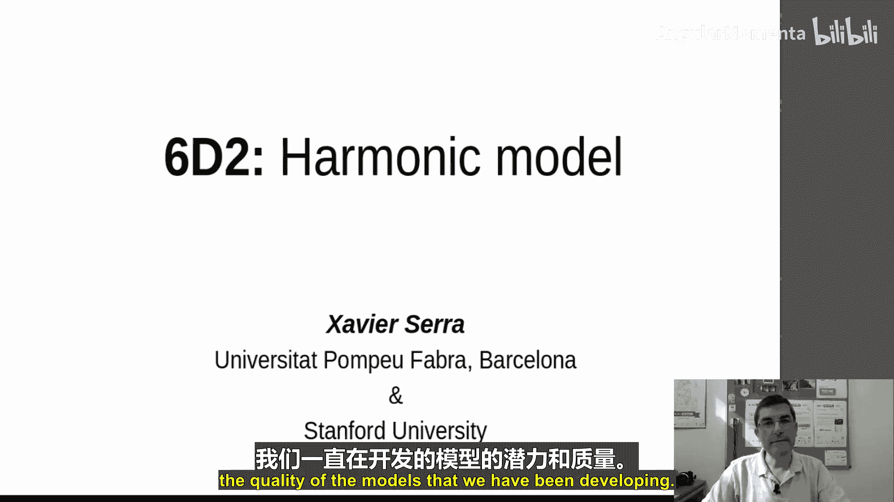
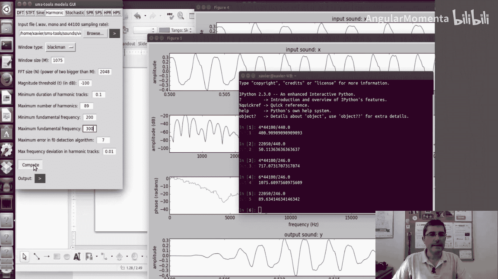
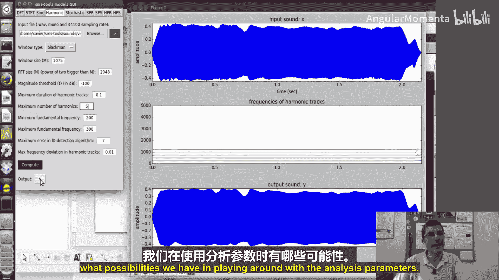
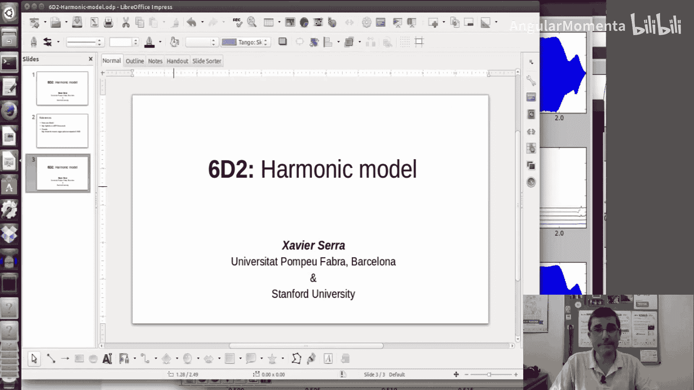

# 【巴塞罗那庞培法布拉大学】音乐应用中的音频信号处理-｜-Audio-Signal-Processing-for-Music-Applications-p42-06_02_02_谐波模型--BV18Xr6BeEX5_p42-

Hello everyone to the course on Auding or processinging for music applications。We are in week six。

 a week dedicated to the study of the harmonic model。And in this particular demo lecture。

 I want to demonstrate the use of that model using a particular implementation。

 the one that we have in the SMS tools package。And we will be analyzing simple harmonic sounds。

And then trying to understand the parameters to do a good analysis of those sounds and then synthesizing those sounds so that we can see the potential and the quality of the models that we have been developing。

So let's go directly to the interface that we have in the SMS tools package through which we can access all the models。

 which is this models GY interface。And well， here we have the harmonic model as one of the options。

 but let's start from the DFT and let's start by analyzing a simple sound。

 a sound of which we know the fundamental frequency and that is very clear。

 so this is a so tooth sound。Okay， so if we can listen to this sound。

So these are an electronically generated sound。And now what we want to do is to just first look at a single DFT so that then we can understand better the sound and decide what are the appropriate parameters for analyzing the harmonics of this sound。

So the first decision we have to make is what window do we use being simple sound， electronic sound。

 Sincerely， the type of window is not that critical。 So let's start with a simple window。

 for example， let's start with a humming window。But now we have to choose the window size and by default here it says 511。

 but how do we decide the best window size and we went over that in theory class So the window size which also we call with the variable M can be computed by multiplying the width of the main lo of the humming window。

 which is for multiply by the something grade of the sound。

 which is 44100 and divided by the fundamental frequency that we have and in this case is a Sos at 440 Herz。

 which is the a for node， So we divide by 440。And the result is basically 401 samples。

 This would be four periods of these particular sound。 So let's let's do that。

 Let's put 4 and1 samples as the window size。 And in terms of the FFT size Well。

 we want it to have bigger than the window size here。

 we can just do a big FFT size so that we have a lot of zero padding。 We have a smooth spectrum。

 So let's put， for example， to 0，48。And we have to choose where are we going to perform this analysis。

 This is a one second sound。 So here02， that sounds like a good point in which to choose these 401 samples。

 So let's compute。Okay。So this is the analysis results， the input sound， as we chose。

 is four periods of the Soth。Here is the spectrum of the Sous， the magnitude and phase。Okay。

 and here we see the faces of this particular fragment。

 So in fact if we would zoom in into the faces that we can just do by， for example。

 zooming in the very bottom of it so that we see better what's going on。

 we see that at every single peak every single harmonic that is a pretty flat kind of area that meaning that we have a very clear face in every harmonic。

Okay so these peaks correspond to the harmonics and we have harmonics going from 440 herz up to half of the sampling rate。

 So in fact， if we look at the the shape of the soooth is not a perfect soooth in the sense that doesn't have the smooth soooth。

 it has this kind of oscillation here， and this is because we have a finite number of of sinusoid It's not an infinite is not continuous waveform is's a discrete waveform and it has a limited number of sinusocytes and then if we do the inverse of that。

 we obtained the reconstructed waveform， but of course。

 is a reconstructed waveform with the window that we apply to it。 So we applied the humming windows。

 So this is a window。So tooth waveform。 anyway， so this works quite well。

 And we can just analyze these saw tooth with these parameters。 So now if we go， for example。

 to the sign model。And we choose the same sound， so we choose the So of。

Here we can put the same value so we can use the humming。 We can use the 401 size window。

 We put the Fft size to 48 here。 Now we have to start putting some other parameters in order to。

Decide what is going to be a peak or let's say， a partial of the sound。

 So the magnitude threshold we can put here。 we see the threshold。

 There is things going pretty much down。 So we can just put， for example，-100。

Then we can decide minimum duration of the sinusoids， but this being an electronic。

 a very stable sound， this really doesn't matter that much number of sinusoids to track well we can just put a big number。

 we can just put for example，100 that you define。And then we also can have a deviation that we allow from one frame to the next in terms of hertz with respect to what would be the frequency0 and then this is a little bit scale as it goes up。

 This being a very stable electronic sound is really not an issue the stability is going to be so high that this frequency deviation could be in fact very small and therefore the slope but this deviation so the change of this deviation as the frequency goes higher。

 also it can be very small， So that's not an issue。 so let's compute with this values。

Okay and this is the result， so here we have the original sound。

 the complete sound now we are analyzing all the sound。

And here is the harmonics or the basically the sinusoids that it found。 and the reconstruction。

 So here it's very much， in fact， the harmonics of the sound except at the very bottom。

 In fact if we look here at the very bottom， we see these lines that in fact。

 they are not part of the harmonic series。 and why is that is that it's， in fact， it's a sidelobes。

 If we go back to the the DFT here at the very low frequencies， we see some sidelos。

 and this is what is catching the sinusoid model at the very bottom。But let's do even， for example。

 exaggerate these effect of the side blockss。 So instead of using the， the the humming window。

 which has。Pretty low side los below around 40 Hz。 Let's use a hanging window in which the side lobes are higher。

30 something。 So， and let's increase the window size。 So， for example， let's put 600。

so that we have a bigger window size， more periods to be analyzed。

 and basically let's leave everything else the same。 and now we compute。Okay， and okay。

 interestingly enough， we see a very different。Set of sininooidal tracks。 We see many more。

 What are we seeing here， Well， we are seeing a lot of the side los of every single harmonic because the side los are quite high and therefore。

 with a threshold of-100 decibel and with a window size， which is large enough。

 So therefore there is space to to visualize the side los， this appear in the。

 in the in the analysis， even though if we plate。It sounds pretty good。

 it sounds as if we are only resynthesizing the harmonics and this is because of course they are part of the spectrum。

 so in terms of reconstruction， it's pretty good， even though from an analysis point of view is not so good because we are seeing basically the artifacts of the analysis。

Okay， now let's go to the harmonic model。And let's， in fact。

 start from kind of these wrong parameters。 So parameters that are not the best。

So in so we start from the hanging window and we do these 600 window size and we have this minus-100 threshold。

 and in the harmonic model， an additional set of parameters that we have to specify relate to the actual fundamental frequency and the number of harmonics to be detected。

 So in terms of number of harmonics， in fact， we can。

We can know because given that the fundamental frequency is 440， we can compute， in fact。

 the number of maximum number of harmonics that they will be in the spectrum。

 which will be half of the sampling rate 22050， divided by the fundamental frequency by 440。So 50 is。

 in fact， the maximum number of harmonics that will be present in this sound so we can specify 50 harmonics。

 and then we have to specify a possible range of the fundamental frequency。

 So to help the two way mismat algorithm that is being used here in in the detection of the fundamental frequency。

 So for example， I mean， we can be kind of flexible。

 so we can put between100 and let's say 600 we know that it's 440 so we could be more more restricted。

 but this would be just fine。 and let's just compute it like with these parameters。Okay， here。

 because we have the harmonic model， the result is quite different from the result that we obtained before。

In the sense that we now restricting， we are restricting the sinusoids to be harmonics of the fundamental that was found。

 And even though the window size was large。 The number of peaks identify where many more。

 and we also identify the sidelos。 These has now constrain the search for the harmonics。

 and therefore， we only see the harmonics。 Of course。

 now we can go back to the ideal type of analysis value。 So we let's go back to the hummming window。

 for example， and let's go back to 400 samples and let's leave the rest the same and we compute。

And now we， in fact， we will obtain the same thing。 It's it's the same thing。

 but now the window size is smaller， which is sufficient。 And if we play the original。

And if we played reconstructed。Is identical。 So we basically have capture all the relevant information of this sinoidal。

Components of the sound。Okay， now let's go to a more real sound， a more natural sound。

 So let's close all these display windows。And let's start again from the DFT。

 but let's look at a violin sound， So there is a violin sound here。In the sounds of the SMS tools。

 which is violin with frequency B3， and we can listen to that。So B3。

 the pitch that corresponds to the node B3， which is lower than the A4 that we had before。

 is 200 and around 46 hertz。so in order to find the best window size， we can compute for example。

 if we start from the humming window， we need to compute four times 44410 divided by the frequency。

 so 246。Okay， so this is a lower frequency。 Therefore， four period of the sound is each larger。

 It's 717 samples， So we can put here 717。Okay， and we can leave the same F50 size。 And in fact。

 well， we can this sound is a little bit longer。 So let's put 0。5 and as a place to be analyzed。

And here is the result。 This is not an is not an electronic sound。

 So the the number of of periods now that we have chosen still four。

 but is much more irregular than with the subtle。 So in fact。

 here it's even leave it hard to see the the period， In fact， the period is like two bumps。

 So these would be one period would go from here to here than another than another。 So it's again。

 four periods of the biolin sound。 The spectrum。Is a little more complex than the one again of the Soute。

 But we see clearly the harmonics。 So if we zoom a little bit better into the part that we see as being relevant。

 we see the first few peaks and these are clearly the harmonics of the sound。

 but we see a lot of kind of energy or spectral information that doesn't have this nice looking sort of peaks or shapes corresponding to the window。

 So in fact， instead of a humming window might be better to take a smoother window that kind of can discriminate better this kind of background residual or noise of this sound。

 So let's use the blackman window。 And having these is being a smoother。 we need more。Samples，So。

 in fact， we need six periods for these。 The main lo of the black man is 6 being wide。

 So we use the same equation to compute the window size but multiply by 6。

 So now we need at least 1075 samples。 So let's put here1075 samples。 and let's compute the same way。

And now we are seeing much better the harmonics of the sounds。

 in fact let's compared with the previous one and having zoom into the same area so if we zoom into that area that we had before which was around these I guess。

 now we are seeing better the harmonics and we see more harmonics of the sound going higher up because the side los of the black man is are much lower and therefore we have been able to reduce the artifacts of the analysis window and therefore having smoother representation and we can afford it because the violin sound is still quite stable。

This is a node quite stable， so by taking a bigger part of the sound。

 we still are capturing a stable part of the sound。Okay， so now let's go to the harmonic model。

And let's。Again， get this violin sound。And let's apply the same values。

 So let's apply the black man window。And the if we remember the the size that we put was 107075。

 So 1，75 and the FFT is 20，48， which is， it's okay。 It's a good0 pairing。 The threshold。

 the truth is that we don't need that match threshold down。

 we need more than in the in the soed because as we can see here。

 this higher harmonics are quite a bit down from the first harmonic。 So let's so-100 would be here。

 So let's just leave the minus-100。And then in terms of the duration of the track。

 so this is this idea that if a track doesn't last enough。

 we're going to reject it in terms of number of harmonics。

 also we can compute what would be the possible maximum number of harmonics present in the violin and we will just take the hub of the sampling rate 22050 and divide it by the fundamental frequency that B3 has。

 which is 246。So maximum， if there were harmonics all the way through half of the sampling rate。

 there would be 89 partials， 89 harmonics， so well let's put 89。

And then of the fundamental frequency we have to help the algorithm again。

 we know it's 246 so we can just put between 200 and 300 that should be enough and these other parameters again。

 this is a very simple sound。 It's not as simple as the side but still so I do not think these parameters will matter that much but so let's just compute it like this。

Okay， so this is the。Analysis of the violin。And it looks pretty good。We are seeing all the harmonics。

 as we go higher up， there is some harmonics that have some modulation。

 They are a little bit unstable。But let's listen again， the input and output。

So this is the input that we started from and this is。The output sounds pretty good。

 If you listen carefully， there may be some aspect。

 especially during the attack that is not quite there。 So kind of this is， let's say。

 a cleaner version of the original sound。 or let's say。

 a smoother version and maybe it' not as bright as the original sound。 but clearly， the， the。

 the core qualities of the sound are here。 And we have been able to capture them。😊。

With this analysis， we have been able to capture the essence of it。

 but we can start in fact playing around with it and doing things maybe that would not be the standard。

 So for example， if in terms of the number of harmonics。

 we specify that we only want to analyze the first five。And then， we compute。Well， the sound。

The shape of the output doesn't look that different。😊，But of course， in the analysis。

 we see that there is only five harmonics。 If we listen to the output。

 let's again listen first to the input。🎼And the output。Clearly。

 we hear a low pass version of the input。 We are only capturing the first few frequencies。

 the first five harmonics。 So we have lost all these high frequency components of the sum。Anyway。

 so that gives you an idea of what the harmonic model does and in fact。

 what possibilities we have in playing around with the analysis parameters。

That's all I wanted to say， so basically we went over。

The harmononic model from a practical point of view using the SMS tools package。

 and we use some sounds， the Sos and the violin which are in free sound in the pack that we use for this class and they're also in the SMS tools distribution tools。

And that's all So this was the second demo class for the harmonic model。

 We still have one more in in the next demo class， we will actually analyze more complex sounds So sounds that actually vary in time that they're not just single notes。

 but that are actually a melody so that we have to worry a little bit more about how to analyze the harmonics and how to set the parameters in order to capture the time varying aspect of a harmonic sound。

 So that was all Thank you very much for your attention。 and I hope to see you next class bye bye。

