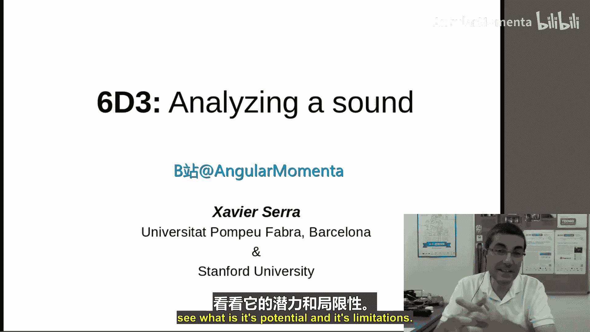
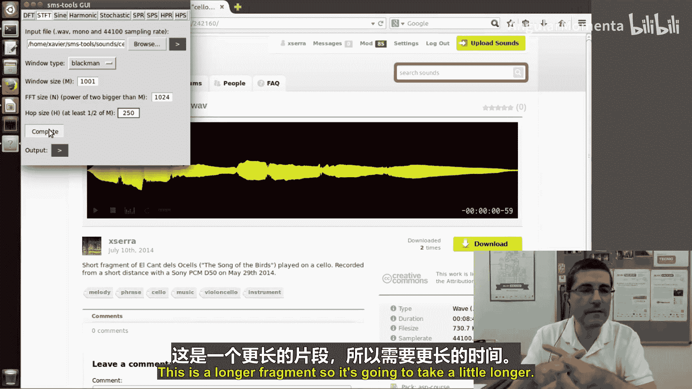
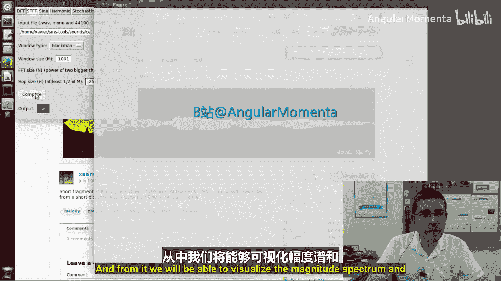
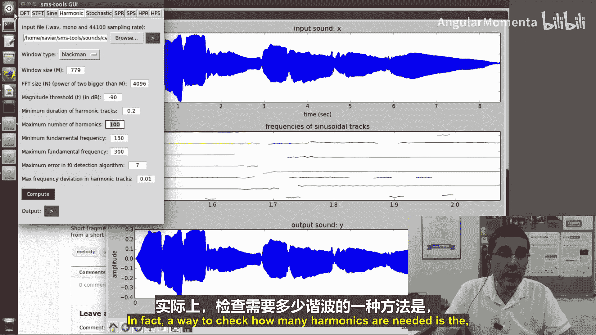
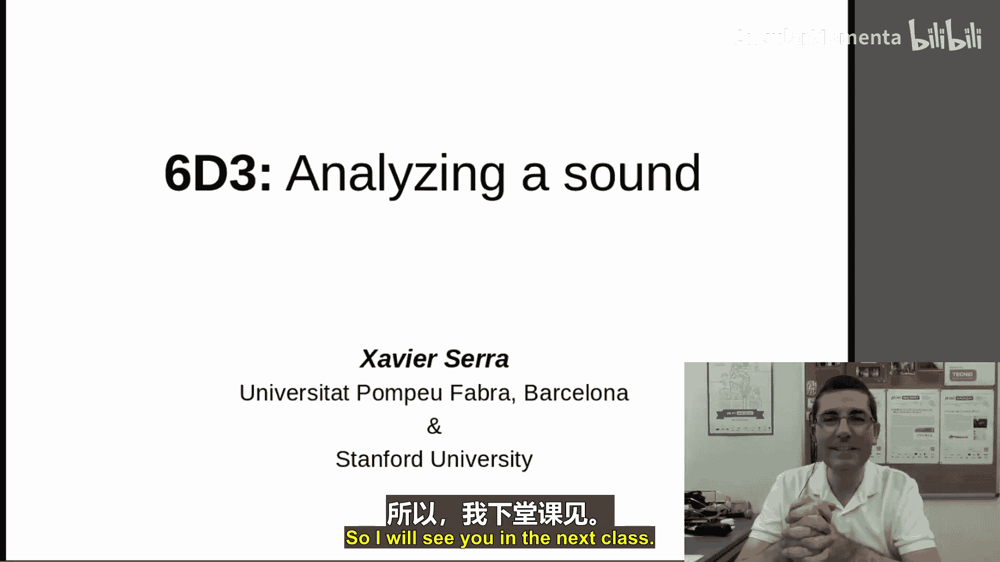

# 【巴塞罗那庞培法布拉大学】音乐应用中的音频信号处理-｜-Audio-Signal-Processing-for-Music-Applications-p43-06_02_03_分析声音--BV18Xr6BeEX5_p43-

Welcome back to the course for navigationing or processingcesing for music applications。

This week we're talking about the harmmanonic model and in these demonstration classes。

 we're trying to understand this model by actually using it by analyzing some sounds and synthesizing them in this lecture I want to go a little bit beyond what we did and and analyze a fragment of a sound and see if we can take it to the limit and see what is its potential and its limitations so in particular we will be analyzing little few notes of a cello that I played。

And the cello is of course it's a great instrument。

 it's a very traditional instrument that you can do a lot of things with it。

 so a good way to get a grasp of the types of sounds that the cello does is look at free sound and just search for beyond cello。

Okay。And that will give you a few samples of different types of cell sounds so in fact， for example。

 the first one is kind of an extended technique， so in fact let's listen to that。Okay。

 that's what is called a seagull effect。It's kind of an interesting sound。

 because you can also get some more traditional notes playing。What is called Tenutto。

Or also with a cello， you can play py Cat notes， and this is a py Cat notes。🎼。

But of course you can find many types of sounds and little fragments。

 the sound I will be using is a small short cellphrase from a very traditional cat and song the song of the birds and in fact it's the one that I use in the teaser of the course。

 in fact let's listen to that one。

Okay， so lets let's analyze this sound and let's open the SMS toolss GI and we'll first start from the short time for your transform。

 This is time varying sound so we need the short time for your transform to get a grasp of it。

So let's open the sound cell of phrase right here。Okay， and okay， we have to choose the parameters。

 And okay， let's instead of a humming window。 let's choose the blackman window。

 the blackman window the main lobe is wider than the the humming。 but the side lobes are lower。

 And that may be good for this sound。 So let's choose a blackman window。 And then okay， window size。

 we don't have much to to now to decide from。 but let's just， for example， let's use 1001 samples。

 So's just leave the FF size at1024。 and the FFT size the hop size has to be at least one fourth of the window size。

 So let's use 250。Okay and now we compute that， this is a longer fragment。

 so it's going to take a little bit longer and from it we will be able to visualize the magnet spectrum and the phase spectrum。

OkayNow what we are interested is in deciding what parameters are needed in order to be able to distinguish the harmonics of this phrase。

 so in fact， an important thing is to identify what is the lowest fundamental that is being played the lowest fundamental will be the one that will determine the minimum distance between two harmonics。

 so let's zoom into the very bottom of these spectrogram。Okay。Okay。

 so this is the first and a little bit of the second harmonic， so it's a very clear harmonic sound。

And we can see that it starts little low goes up， and then it goes down。 So clearly。

 the lowest frequencies are going to be the first and the last。

 But here we see that the resolution is not so good。 In fact， we see these boxes。

 kind of these quantization in the horizontal access。 the vertical access is pretty good。

 We have 25050 samples。 So there is quite a lot of frames。

 but there is not that many in terms of frequency samples in order to be able to visualize and then further onana the peak of these harmonic。

 So let's increase maybe the window size cannot be increased because then we would lose the time resolution。

 but let's increase the F50 size。 So we get a smoother spectrum more samples。For example。

 let's say496。 so quite a bit more。Of the FFT size。

 So this will give us quite a bit of zero padding and therefore will give us many more samples in the frequency vein。

 even though the actual data point will be the same。So well， again， this takes a little bit。

To compute。Okay， so this is the the spectrum。Clearly， there is a more fine resolution than before。

 Let Let's do the same thing。 Let's zoom into the very。Bottom of the spectrum。Okay。And。Okay。

 and yeah， now we definitely have many more frequency samples。And of course it looks similar。

 but we now would be able to see the center of the window much better。

 so if we look like in the last note， but with the center of these we looking at at the Y axis it's around 348 herz okay so that would be the lowest node and the highest note is around 456 herz。

So this is good information for deciding now the window size that we should use。So in fact， okay。

 let's do the sinusoidto model and let's look at this information so in order to decide what is the period length so we have to take 44100 and divide it by that frequency which was around 300。

 let's say and 40 hertz okay to make it a little bit lower。

Okay so this is 129 samples and then if we use， for example， the blackman window。

 well we will need six times that so if we take six times these。

Okay that would give us 778 samples okay so let's put in the window size 778 samples that should be enough to discriminate the harmonics and the FFT size I think it was good to have this big FFT size so 4096 was a good choice because I gave us a good resolution at least visually。

And now， of course， in the sinusoidto model， we can choose the threshold。

 the minimum duration of the sinusoids and how many sinusoids we want to track the maximum frequency deviation here。

 we should， I think have it a little bit bigger because there is quite a bit of variation。Okay。

 and now let's of course， choose the cell of sound， the cell of phrase。And we will compare it。Okay。

 so this is the sinusoidal analysis。And yeah， we see the the harmonics following kind of the melody。

We also see short sinusoids， in fact， if we zoom in。To one region of that， for example。

 let's show this region here。We see well， definitely the harmonics。

 but also we see some lines in between them and we see some trajectories stopping and continuing So anyway。

 So this is same sort model。 if we listen to the result。🎼Well， it's， it's pretty good。

 Maybe we are losing a little bit of the attacks of the notes， but it's pretty good。

 So let's go directly now to the harmonic model and let's okay， use the same the cello phrase。

And let's use the blackman window。 Let's use the same 700。 Oh we should have a not size window。

 So let's use 779。In terms of the FF size again， okay， I think it was a good choice for096。

 a lot of0 padding， the magnitude threshold minus-90。 that's okay。 The duration of the tracks Okay。

 so this will will require to be 0。1 seconds。 I think we can even make it bigger。 So let's say 0。

2 seconds。And the number maximum number of harmonics， there is clearly no need for 100， in fact。

 a way to check how many harmonics are needed is if we divide 44，100 by the frequency。

 the lowest frequency okay now we have to divide half of the sampling rate。

 so 22050 divided by the lowest frequency。

So 64， that would be the maximum number of harmonics that we would have if we really would have all the harmonics in the lowest node。

 So no need for 100。 let's say， let's let's put 60 would be plenty。

And here now is where we have to choose a range that includes all this melody。

 So we said that the the lowest frequency was around 340。 Let's make it safer。 So let's make 300。

And the highest was above 450 or something。 So let's make it quite a bit higher。

 just in case let's make it 500， okay。And this is an error thresholdhole that will be quite relevant now for identifying the fundamental frequency。

 But let's just leave it as it is now and see if we have to change it later。 Okay。

 so now we will compute it。So， again， this will take a little bit of time。Okay。

 so this is the harmonics is as obtained and that looks pretty good。

 it found quite a bit of harmonics， of course， in the transitions that where the problems or at least the little deviations occurs if we just zoom into just one transition let's say so this is where the harmonics。

 of course get lost and then they are picked up again， if we listen， well let's plotted again。

To the regional， and if we listen to the synthesize。ある？🎼Okay， that's pretty good。Now。

 if in terms of the this error threshold of the algorithm， if we make it more restrictive。

 so that means that unless it' below a certain error， it will not be accepted。

 we might see then that some of these areas it does not find the fundamental。 So instead of seven。

 let's put for example too Okay， and let's see what it finds。Okay。

 so now we see the result and we clearly see that in the transitions。There are gaps。

 And this is because in the transitions， the fundamental is not very clear。

 We are in a kind of attack， noisy attack。 So it has lost。A little bit of the transitions。 And。

 if we listen to that， in fact， we're gonna listen to these gaps。ある？Okay。

 so there are gaps in the transitions because that's where the areas that it didn't find the fundamental and therefore it didn't find any harmonics。

And that's basically all I wanted to say， so let's go back to the slides。And well。

 we have used the SMS toolss GUI in order to analyze this cello fragment。

 and we have used a short time for you transform， the sinusso model and now the harmonic model to see this phrase and to analyze the harmonics and we can see that by tweaking the parameters。

 we can get quite a bit of difference in the way that these harmonics are analyzed。So that's all。

 and this is all for the demo classes of this harmonic model week。

So hopefully this has given you a view of how the harmmonic model can actually be used in practice。

And still is not ideal and there is some parts of the sound。

 especially like in this sound that we just heard in the attacks that we lose a little bit of the sound that is present there so the next week we will extend the idea of the sinusoid ironharonic model to include that aspect to include but what we call the residual or the stochastic component hopefully that will allow us to generalize our models and to be able to handle many more types of sound so I will see you in next class Thank you very much。

