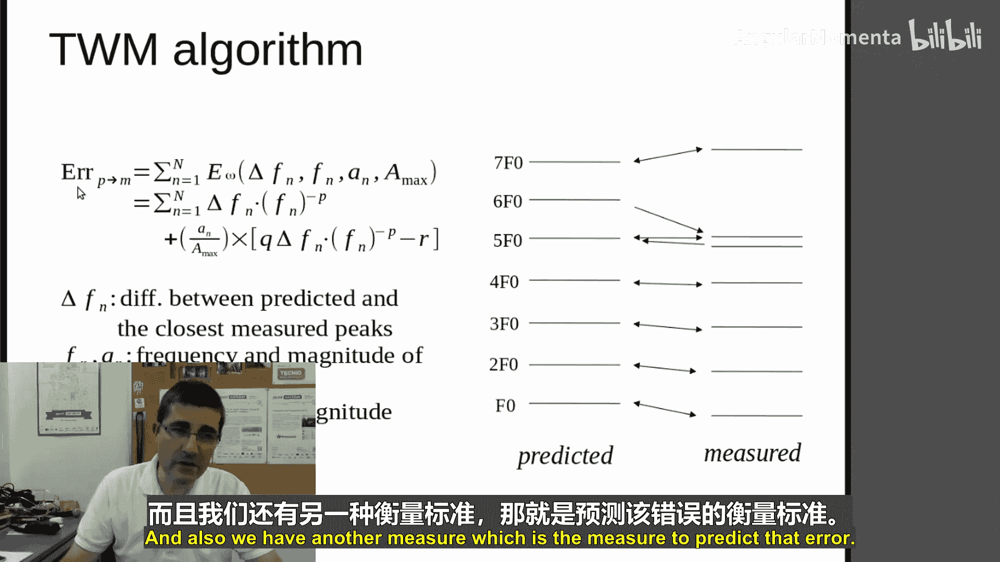
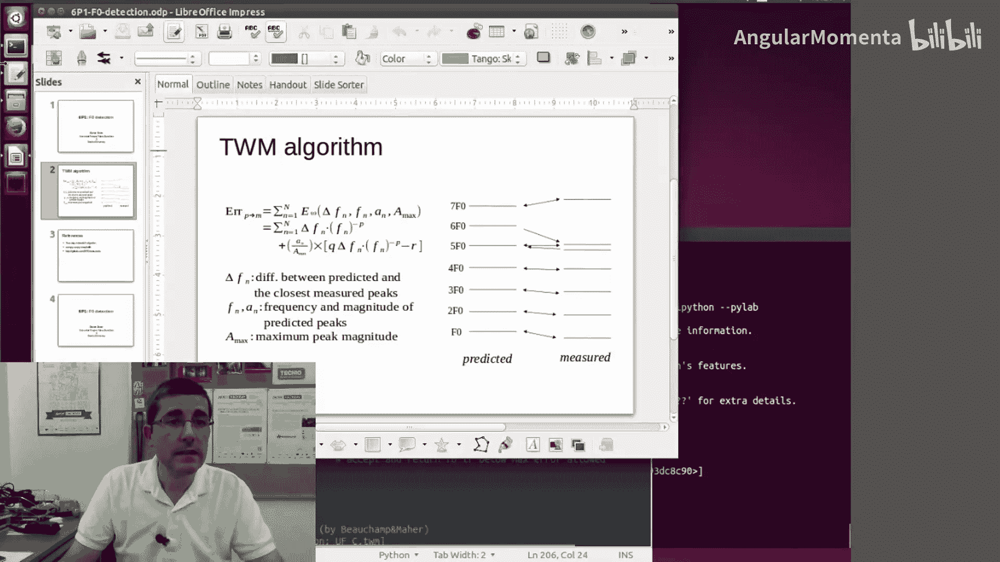
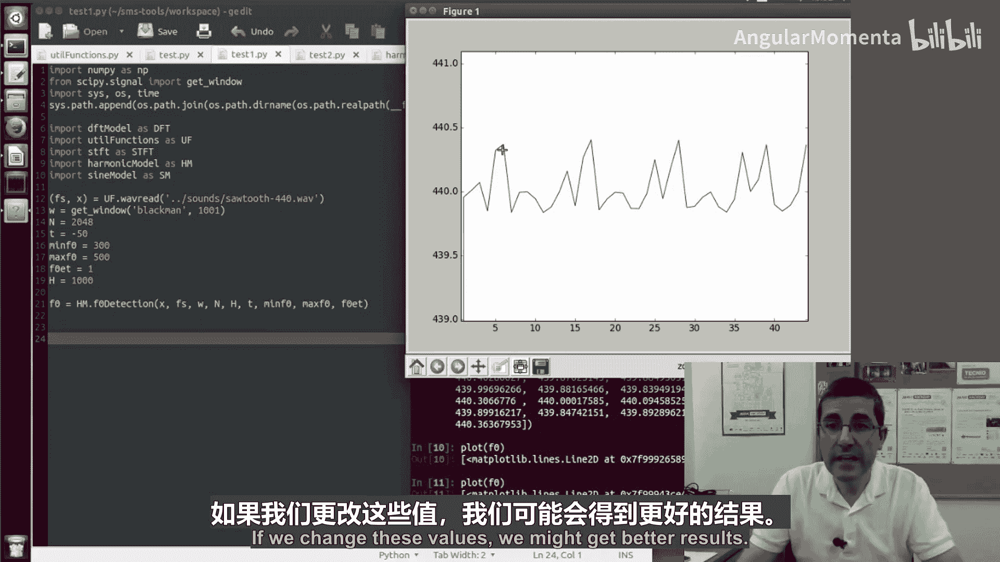
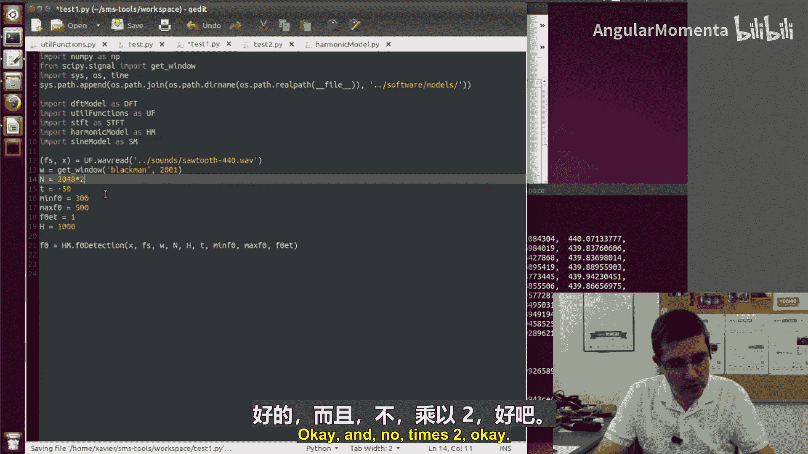
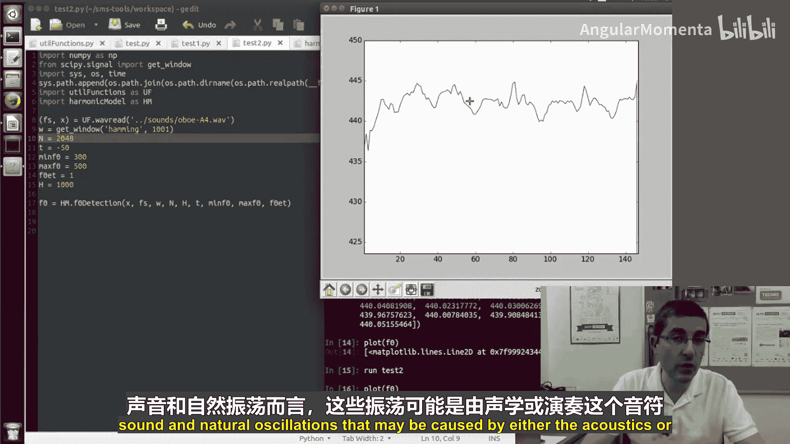
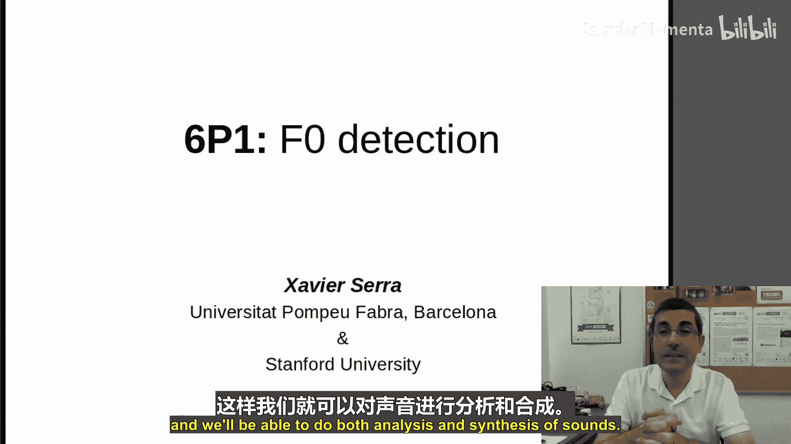

# 【巴塞罗那庞培法布拉大学】音乐应用中的音频信号处理-｜-Audio-Signal-Processing-for-Music-Applications-p44-06_03_01_基频检测--BV18Xr6BeEX5_p44-

Welcome to the course on additional processing for music applications。

This week we're talking about the harmonic model and in this programming lecture I want to talk about the implementation of it。

 in particular the first part of it， the part that requires detecting the fundamental frequency so that we can then identify the harmonics of given sound so we will be talking about one particular algorithm that two way mismatch algorithm that's an algorithm that we presented in the theory lecture and it's a frequency。

 the main algorithm that basically tries to identify a harmonic series。

 possible harmonic series that match the peaks of spectrum so in this plot we see like the measure peaks that we have identified and then we keep trying different predicted fundamental frequencies and the harmonics of it and we measure the error。

We measured the distance between these two list of valuess。And we do that by measuring two errors。

 the predicted to measures。 So the difference between the distance between the predicted and the measure values。

 And also， we have another measure， which is the measure to predicted error。

 But let's go directly to the actual code。

， in the SMS tools packet， in the utility functions file。

 there is the code for the2 weigh mismatch algorithm。

The core of it is a function called2A mismatch。In fact。

 there is a C version and a Python version now we will go through the Python version when we run it we normally use the C version because it's more efficient。

 so this algorithm what it does is it receives the peaks。

 the frequencies and magnitudes of the picks， it receives a list of candidates of frequencies of candidates of fundamental frequency and it basically identifies which is the candidate that has the smallest error。

So it does that by measuring the two errors the error predicted to measure。Which is this part。

And then the measure to predicted， which is this part。Within it。

 it keeps identifying all the distances between all the values of the harmonic series and the bigs and it has different ways of comparing those we' are not going to go into detail of that but of course feel free to go into it and then finally it just creates an error array。

 which is the list of errors of all the candidates。

So we have in the error we have all the errors for every single one of the candidates。

 and then what we do is we choose the minimum of those errors and the fundamental frequency is going to be that candidate that has the minimum error。

And then this function is wrapped by another one that is the one responsible for generating the candidates and calling the function。

So this F0 to wM receives again the peaks of the spectrum and then it receives the control parameters so like the maximum error allowed。

 this is the error that will be allowed for the fundamental frequency to be accepted as such and then the range of the fundamental frequency so from minimum a maximum of add0 and then there is one value which is kind of a memory tracking value that is basically the fundamental frequency of the previous frame and this will allow us to refine the fundamental frequency by restricting that the fundamental frequency it should be as smooth as possible but the algorithm here is very simple in fact it just takes the list of peaks that are within minimum a maximum value of the frequency。

C。And the rest it just makes a few more comparison about that there is a lot of room for improvement in this algorithm in the sense of generating more candidates so that we do a more exhaustive trial of different frequencies。

 but for efficiency reasons we made this simple implementation so that allows us to compute this quite efficiently。

Okay， so I wrote a little script that basically does an analysis of a single spectrum and then it computes the errors of all candidates。

So in here I have this little script that from a sound， the soed sound。

 it just computes one DFT and so here is it computes one DFT of that particular sound。

 it finds the peaks， it finds interpolates the peaks and then it generates possible candidates of the fundamental frequency in a similar way than what we just saw but even more simply in the sense that we are taking the candidates as all the peaks that lie within the ranges that we specified。

And then it called the two way mismatch algorithm， but I modified the function。

 so I have it here in a way that instead of returning just one value。

 the fundamental frequency that is the minimum error。

 it returns all the errors so it returns the array of all the errors for all the candidates so that we can look at them and see how they behave。

Okay， and then it prints here。 It just prints the spectrum and the pixel so we can understand a little bit what's going on。

 Okay， so let's run this。 So let's run test。Okay， and this is the spectrum。

 the magnet spectrum and the the peaks that we found So let's maybe zoom in a little bit so that we can see a little bit what is going on。

Okay， so these are clearly the harmonics of the sound。

 It has also found peaks like before the fundamental frequency and one after the fundamental frequency。

 but that's。That's。Well， basically it has identified just the harmonics。

So now let's let's plot or and let's print some of the intermediate values of all these so clearly the first thing is the candidates。

 So if we print the F0 C， this is the candidate and it's going to be the peaks that lie within the frequency range that we specified which was between 50 and 2000 Herz so the candidates are the first five peaks and if we print the frequencies。

 so by doing IP freak and。F 0 candidates。 those are the frequencies that lie within the frequency range and that we're going to test in the algorithm。

 So we're going to test 166 Herz，440，637， etc cetera， et cetera。

So now let's print the errors that it return。 So have 0 errors。

Whi is the output of this algorithm will have the errors for every one of these values。So for 166。

 we have an error of 4。8 for 440 has-0。13。 so clearly this is the smallest of all errors。

 and this is indeed the fundamental frequency， the candidate that is the best one for as a fundamental frequency So these error values are living misleading because they are not bounded within a particular range。

 it can be even be negative like in this case， but clearly the larger the error。

 the less the less chance is that it's going to be fundamental frequency。

 so we will be focusing on the lowest errors that we have。Okay。

 so this works quite well now can we can go into another。

A file that basically does this for the whole sound， so we will be iterating for the whole sound。

 We are just doing the exact same thing。 we are taking the satus sound and we are trying a different window we keep doing see if we can get a different type of result and we take the FFT。

 we define the minimum maximum and we call a function a0 detection which in fact is on the harmonic model。

File in the harmonic model file there is this function called F0 detection that does all what we talked about。

 Basically it accepting gifts from the input sound the sampling rate window F50 size and the values given by the user it iterates over the whole sound and it calls the DF。

 the peak detection peak interpolation， to way mismatch algorithm and then it decides which one would be the best fundamental frequency。

 There is a few sort of constraints to make sure that the fundamental stable in time related with this track that we talk about so but basically it returns just the fundamental frequency that it consider to be the best。

So let's now look at test1 and let's run it， so let's run。Test1。Okay， and now in fact。

 we can just show the F0。So this is the values that it has returned Well the hop size that I specify was quite large 1000 so it is not that many samples。

 so that's easier to look at and okay clearly that is not a perfect fundamental frequency identify it kind of varies like it goes from 439。

9 to 440 something in fact if we plot these。This array。

 we will see the variation that we will have here。Okay， well let's maybe get rid of these。

Let's get rid of these。 and now let's plot it again。Okay， now we can zoom in to the very top。Okay。

 so clearly it moves around。440 and these variations are caused by clearly by the errors of the peak detection algorithm and the interpolation。

 So that we are not really exactly at 440。 but of course。

 the errors is very small is less than 1 herz error。 So this is 440 and 440。5 and will below。

 So this is clearly a quite small deviation from the nominal value that is 440。

 If we change these values， we might get better results。 So for example。

 instead of having the the window being 1001， lets let's make it twice as much as much。

 and the F50 size let's make it twice as much。

Okay， and I know。Times 2 Okay， and now we will。 So let's see that before we were 439。95，440。

 something。 Let's see if it does any different， any difference by。

Looking now at。These values， okay？So this is what we got now and it's a little bit better so we can see the difference between these two values now the error is smaller than before。

In fact， if we plot now this。F 0。 Well， there is this exponential to the minus to the minus-2 So clearly this is a very small its a smaller error range than what we had before。

 So the lowest the lowest now is 439。9 and the highest value is 440。042。

 So that means that as the window gets larger and the Fft gets larger， the 0 padding increases。

 we will have better values。Okay， now let's look at the real sound and let's finish by running it on this o sound。

 And basically I do exactly the same thing so I can just run this test too。

This will compute the fundamental frequency of this oversound。 and now if I plot this F0。嗯。Okay。Now。

 we will have to。Zoom into the。呃。The meaningful range。Okay， and well。

 there is definitely also a variation， but here there is both the variation that may be caused by errors and the variation that is clearly natural to the plane of the obosso。

So for example， this sound is clearly higher than 440。

 so the ob sound was played a little bit higher in frequency than 440 so around in fact 442 and that is kind of a periodic oscillation that make sense to be present in the sound and of course might be some of these oscillations that may be caused by some error。

 but this is a very interesting way to try to understand what is going on and both in terms of the algorithm and in terms of the sound in terms of this ob sound and the natural oscillations that may be caused by either the acoustics or the performer that is playing this note。

Okay and that's all I wanted to say So basically we have talked about an implementation of the two way mismatch algorithm and I think that has given us a view on the issues of how to detect the fundamental frequency。

 Of course we have used Python and a number of these packages and the implementations that we have in the SMS tools package。

So that's all so this was the first programming class on this harmonic model week and then on the next lecture we will then add the whole model and include the fundamental frequency into a harmonic analysis and well be able to do both the analysis and synthesis of sounds。

 So thank you very much and I see you next lecture。

