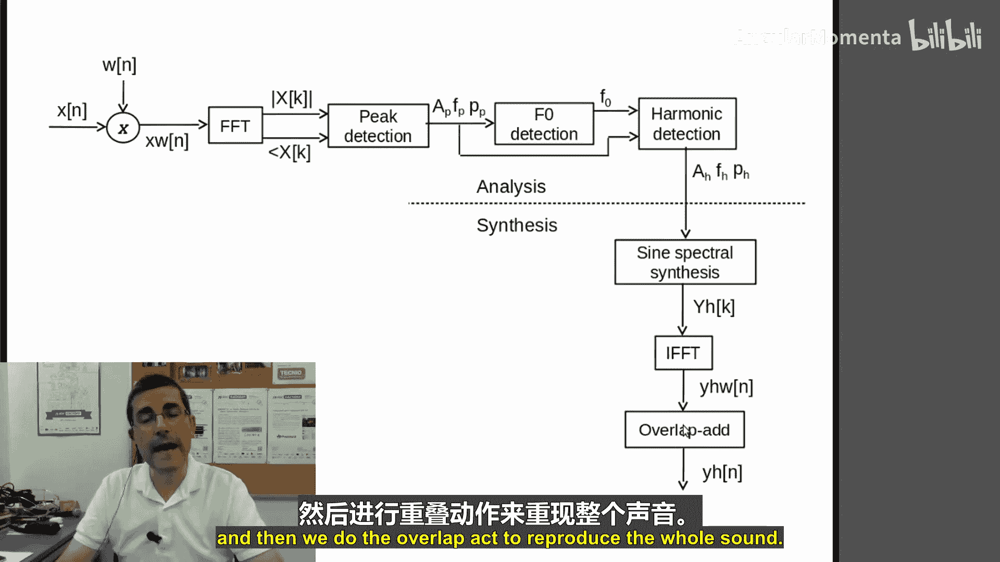
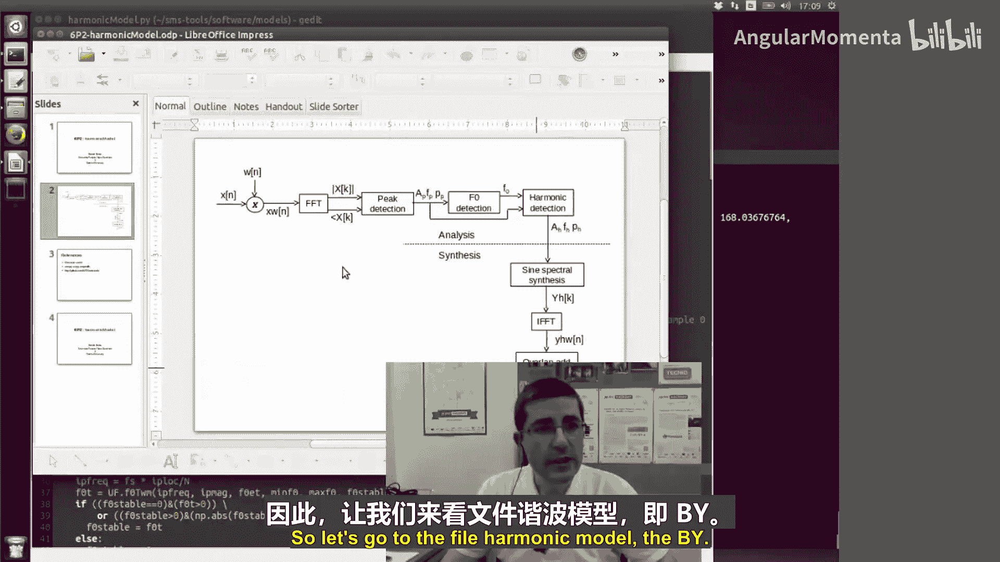
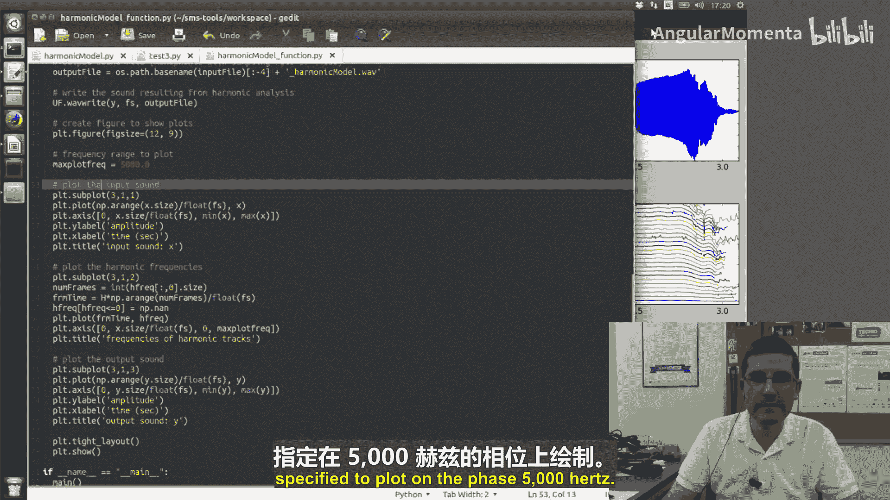
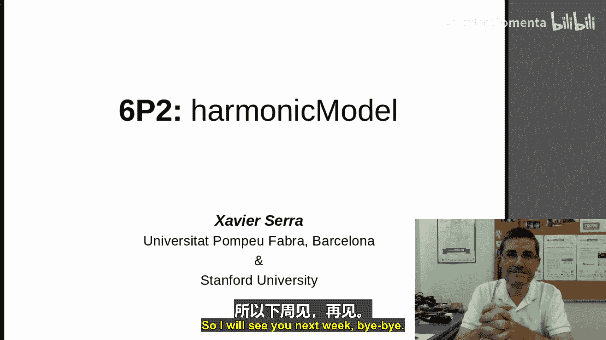

# 【巴塞罗那庞培法布拉大学】音乐应用中的音频信号处理-｜-Audio-Signal-Processing-for-Music-Applications-p45-06_03_02_谐波模型--BV18Xr6BeEX5_p45-

We'llcom back to the course on advertising processing for music applications。

In the previous programming class we talked about the pit detection。

 the fundamental frequency detection algorithm， so how to identify the fundamental frequency of harmonic sound Now we are ready to put together the whole harmonic model the analysis and synthesis so this is the block diagram of the system that we have and we're going explain so in which we start from the standard blocks that we already have seen in the sinnooid model so that it takes the input sound in windows then it performs the DftT and then it finds the peaks and these two blocks are the ones that are specific for the harmonic model so the first one is the f0 detection so from the peaks it identifies the best fundamental frequency。

And then it tries to find the harmonics based on that fundamental frequency。

 and this is what we'll be talking about today。And then this goes to the synthesis and the synthesis is exactly the same than in the sinusoidro model。

 so we generate the sinusoid in the spectral domain， we do the inverse FFT。

 and then we do the overlap a to reproduce the whole sound。

So， let's go to the。

The file harmonymod。py， this is the file that includes most of the functions of the harmony model。

 the actual implementation of the F0 detection is in the UT functions file。

 but here we have the wrapper to the fundamental frequency F0 detection that we already mentioned in the last lecture。

Then we have the harmonic detection that we'll be talking about shortly。

And then we have the complete harmonic model harmonic model that does both analysis and synthesis。

 but this is meant to be run in real time， so it doesn't allow for cleaning of the tracks so we will be talking about today on the analysis and synthesis separate because this allows us to do cleaning of tracks and so handle a little bit of memory of past few frames and this will result into better analysis and reyn。

 so let's talk about these function， harmonic model and all so it inputs all the parameters of analysis。

 the input array of samples， sampling rate the window5 size ho size the threshold T for the peaks the number of harmonics that are allowed so this is the maximum number then the range of frequencies。

For the fundamental frequency detection so this mean f0 and max f0 then there is this error threshold that is also part of the F0 detection algorithm so this minimum error that we'll be accepting and then for the sort of track continuation harmonic continuation we have these two parameters one is the harmonic deviation slope this is sort of a deviation slope from the previous series of harmonics and from the ideal harmonic series and this is a way to account for that higher harmonics should allow for bigger deviation than lower harmonics and then finally parameter to control the length of harmonic tracks so that we don't accept。

TheS tracks than the ones specified with this parameter。And the actual code is， again。

 very similar to the sinno sort model。We have a main loop that iterates over the whole sound。

And it keeps analyzing the spectrum， finding the peaks， interpolating those peaks。

 And then here is where the specific code of the harmonic model starts。

 So we call the fundamental frequency algorithm。 so this is the one from the utility functions that we talked about in the last lecture。

Then we have these few lines that make sure that this new fundamental frequency is not that different from the previous one so that it maintains certain continuity。

And then there is this function called harmonic detection。

 This is the one that identifies the harmonics of fundamental frequency。 And it's above this code。

 So let's go。To here， this is the harmonic detection function。

So this is the one that given the fundamental frequency F 0。And the peaks of the spectrum。

It identifies which of these peaks are close to multiples of this fundamental frequency。

We also as inputs， we accept some information from the previous frame so that we can identify if there is some time continuity and then this deviation that is the deviation we allowed from perfect harmononicity and from perfect continuity from the previous frame。

Okay， so the code is not that complicated。 The core is basically these three lines in which we defined the deviation from perfect harmonicity。

 So we find the ps compared or a particular peak compared with a particular perfect harmonic。

We also compared a peak with respect to the previous harmonic coming from the previous frame。

And then we define a thresholdre based on this harmonic deviation as lo。

 that's the one that will be accepted。So if the current peak is within that thresholdre。Therefore。

 within the kind of vertical deviation and horizontal deviation。

 so it had these frequency and time evolution tracking。

So we accept that peak as a harmonic and we keep adding to the harmonic that we create and that's all that's basically what the harmonic detection does。

 So if we go back to the harmonic model now。After this harmonic detection， that it。

 this is a sort of sum code to create the array of values that keeps adding up to the whole matrix of the output and finally if once the whole process is done so we have gone through the whole sound。

 we clean the tracks， so we delete the tracks that are smaller than given duration and again this is the same than we did in the sinusoidal analysis。

Okay， so I wrote a script that basically analyzes a sound with this harmonic model and L function。

So we took this vi sound and I specified all the parameters。

 So the number of parameters are starting to get quite a few。 So we have the window。

 we have the window size， the FF size， the threshold theres no need for this comma here。

 So minus-90 as the threshold， the minimum duration in time。

 the number of maximum number of harmonics， the minimum fundamental frequency and maximum fundamental frequency。

 the error threshold that we accept and then this deviation is slope that we just talked about then there is this two parameters that are normally fixed because they are more related to synthesis。

 which is the FFT of the synthesis buffer， and the hop size which given that the FF buffer requires for the synthesis it requires。

Hop size to the one fourth of that。 So we normally put H as being 128。

 so we normally don't allow any any changes from that。 So from the from the graphical interface。

 there is no control over these two parameters。Okay， and then we read the sound。

 we get the window and we call this harmonic model and nu function。And here I just plot this。

 the frequencies of these trajectories。 So let's run this。 So let's run test。3。

 now let's first save it。Okay， and now let's run it。Okay， and this is the trajectories we obtain。

They are okay， they are pretty good。 if we zoom in into a particular region。

 we might be able to see a little more。Okay。OkaySo of course， if we zoom in。

 we're starting to see the problems at the transitions between nodes。

 and especially we see a problem as the harmonics go higher and higher up。

And this is because this is， of course， linear scale and these deviations are kind of logarithmic。

 So as the frequency goes up， In fact， the changes get much larger because they are logarithmic changes。

 So in fact， this is the reason why we need this deviation slope that we specified here。

 So for example， if we reduce this deviation slope， let's make instead of 001， let's make 0001。

 and let's run it again。Okay， we will see that now there are much fewer tracks。

 especially in the higher frequencies。 it does restricted the deviation allowed in the higher frequencies。

 So it has the increase of deviation is much smaller。 So it has not allowed this larger deviation。

 So with that we have quite a bit of control of how this tracking process is implemented。Okay。

 so in the in the SMS tools package， there is this harmonic model function that performs both analysis and synthesis and is in fact。

 the file that is called from the from the interface。 So in in this file， we have one main function。

And it has all these parameters。That we already talked about。

 But apart from the analysis that we already perform， it does the synthesis。 Okay。

 and then it saves the file into synthesis file， and it plots。Analysis and synthesis of this。

 So let's run this harmonic model function。Okay。So this will take a little bit longer because it has to do the analysis and then the synthesis and then it just plots the first 5000 hertz are specified to plot only face 5000 hertz。

 So here we see all these trajectories that evolve in time and the synthesis at least the away from looks quite similar。

 So let's let's listen to the output sound。 So in now it created a file called big niche underscore harmonic model dowa。

 So I can play it So I put the exclamation mark play just say type big niche。

No no no no。Okay， so this is the synthesized version of the original file and it's quite good。

 I mean， we will see starting next week that in fact。

 there is some things that are left that are not included in thisynthesis。

 and this is basically the residual component that we are missing。But anyway。

 that's all for the Harmani model。 and we go back to the slides。

So we have basically seen the harmononic model from an implementation point of view by looking at the code。

And all this code is in Python。 where， in fact， the fundamental frequency detection。

 the one that we are using is a C version implementation。

 but we also have the Python version and all these is included in the SMS tools packet。

 So I would definitely encourage you to go through that and run it and and use it if view on。

 So that was all for。These programming classes on the harmononic model hopefully this has given you sort of a depth indth view of what it entails to implement this type of of models。

 and well we will continue。 So next week this will get a little bit more complicated because we will try to see what is missing out of this model。

 and we will try to model this missing part， which is going to be the concept of the residual or the stochastic components。

 So I will see you next week By bye Thank you。

