# 【巴塞罗那庞培法布拉大学】音乐应用中的音频信号处理-｜-Audio-Signal-Processing-for-Music-Applications-p46-07_01_01_随机模型--BV18Xr6BeEX5_p46-

Welcome again to a lecture of the course on address or processing for music applications。Until now。

 we have been analyzing sounds using sinusoidial representations， they work。

But there are many types of sounds that are best described by what we call stochastic models。

Signals like the sound of the ocean or the bold noise of a violin fit into this category of as stochastic signals。

We will talk about these today。

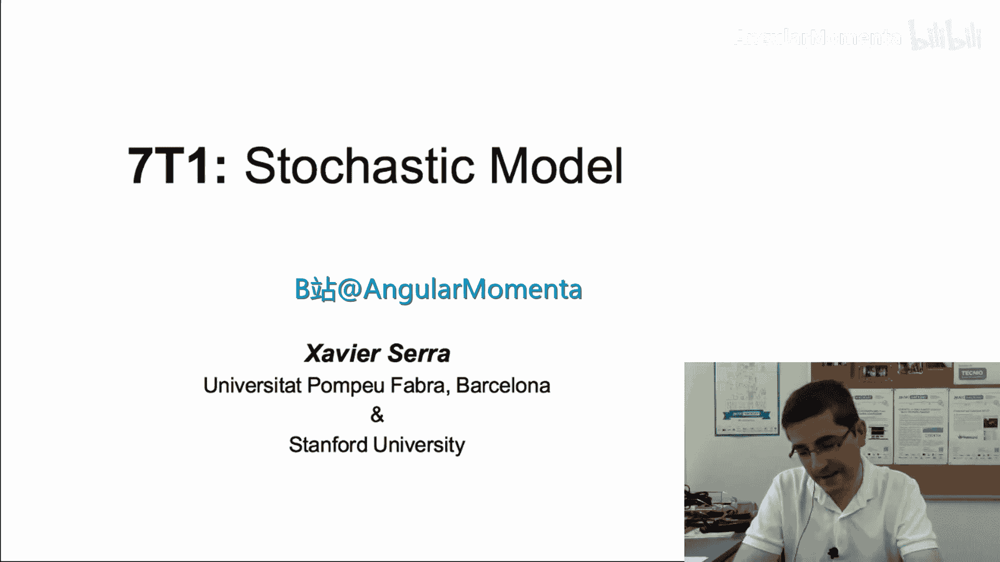

We will first introduce the concept of his stochastic signals。Then how to model them。

 what is a model of an stochastic signal？And then more specifically on how to deal with sounds using these models。

 so how to approximate with from an e stochastic perspective， a particular sound。

 and finally we will describe the concept of a system that can perform analysis and synthesis of sounds using these models。

The stochastic model is complementary to the models that we have covered until now， in fact。

 in the following lecture， we will combine the stochastic model with the sinusoidto based models and we will be able to take advantage of the best of both types of models。

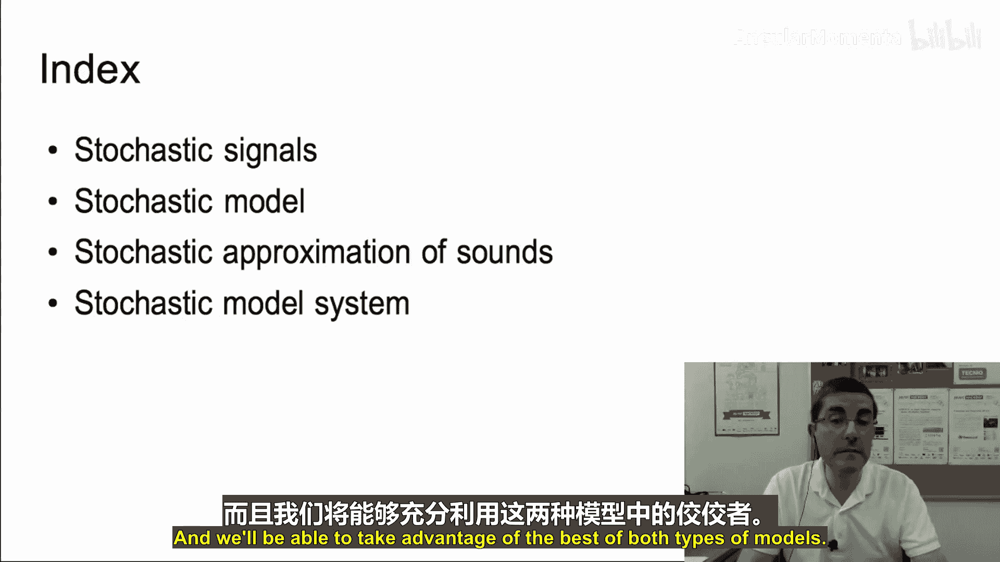

What is an is stochastic signal？While an stochastic signal cannot be described in a deterministic way。

 It can only be described probabilistically。And the feel of statistical signal processing deals with these type of signals。

 and is a quite advanced topic Here we give a very broad approach， which is sufficient for our needs。

So in a statistical signal processing， we talk about the loss of probability as a way to describe these stochastic signals。

 and we talk about the mean， the variance and the probability distribution of particular signals。

And there are some mathematical functions that are used to analyze these type of signals and capture some of its characteristics。

 for example， one is the autocorlation function， we have already seen this function before the autocorrelation function allows us to measure the periodicity of a signal or the degree of repeating patterns in a particular signal we use it for detecting the fundamental frequency。

So this is a function that can be used to measure how stochastic is a signal。

 if there are no repetitions， that means that it's going to be close to an as stochastic signal。

 So the lower the autocor function value is the closer is going to be the signal to an as stochastic signal。

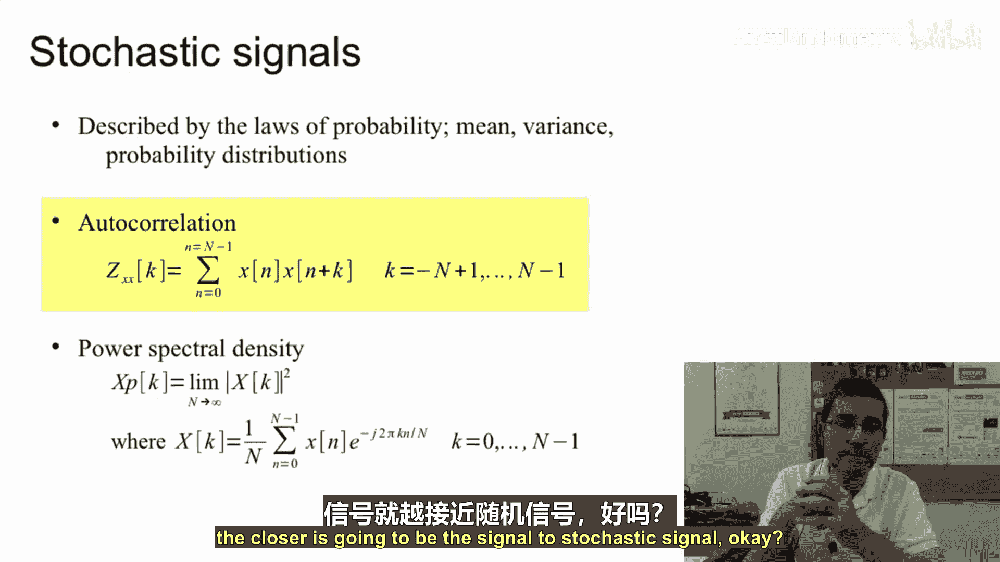

AndAnother mathematical function that we can use is what is called the power spectral density。

And also we have a similar version of that is basically the DftT。

 but with a major difference is basically the DftT to the limit。

 we take the square value of the absolute value of the DFT and we take n the size of the DFT to infinity and if it converges。

 if it converges to a function， that's our power spectral density。

And that happens in quite a few signals。

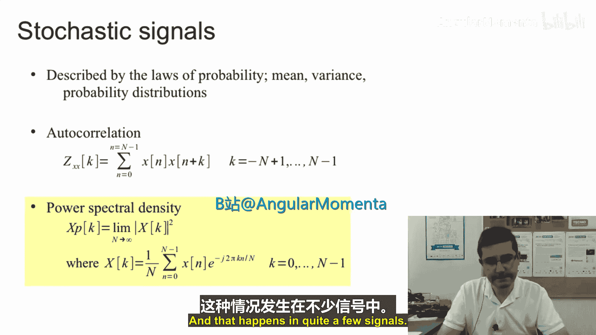

And there are many models that have been proposed to deal with these type of stochastic signals。

 willll use a very general model。Expressed by this equation， which， in fact。

 the convolution of two signals。So we will consider as an e stochastic model。

 the idea that a signal can be expressed as the convolution of white noise。

With the filter approximation of our signal。So by taking this convolution。

 we are assuming that the signal that we are dealing with is well expressed or well represented by its impulse response。

If we look at the same equation from a spectral point of view， we can understand a few more things。

So a convolution in the frequency domain is the product of the2 spectrum。

 so the product of the white noise， the spectral of the white noise with the spectrum of the impulse response of the filter。

 and if we express it in imp polar coordinates， then we can express it as the product of the two magnitude spectra。

And multiply by the exponential E to the J and the sum of the two phase spectra。Okay。

 so that's the product of these two spectra。And if we consider that this is a stochastic signal。

 we basically can say that the magnitude spectrum of white noise is a flat line。

 and we will see that later， so it's a constant， so therefore we can we can take it out of the equation。

 so we can reduce the concept of the impulse response of the filter of the input signal by the magnitude spectrum of the input signal。

 an approximated version of that which could be the frequency response of a filter。

 it could be some other type of function， but a function that approximates the magnitude spectrum of the input signal。

 and as the phase of the model， we use the phase of white noise。

Because the phase of an is stochastic signal is not so relevant， Therefore。

 we just can reduce the phase representation of our signal with random numbers。

 with the random numbers of the wide noise。Okay， so this is the good a good way to express this stochastic model。

 So we take an approximation of the magnetic spectrum of our signal and we take random phases for the modeling the phase spectrum。

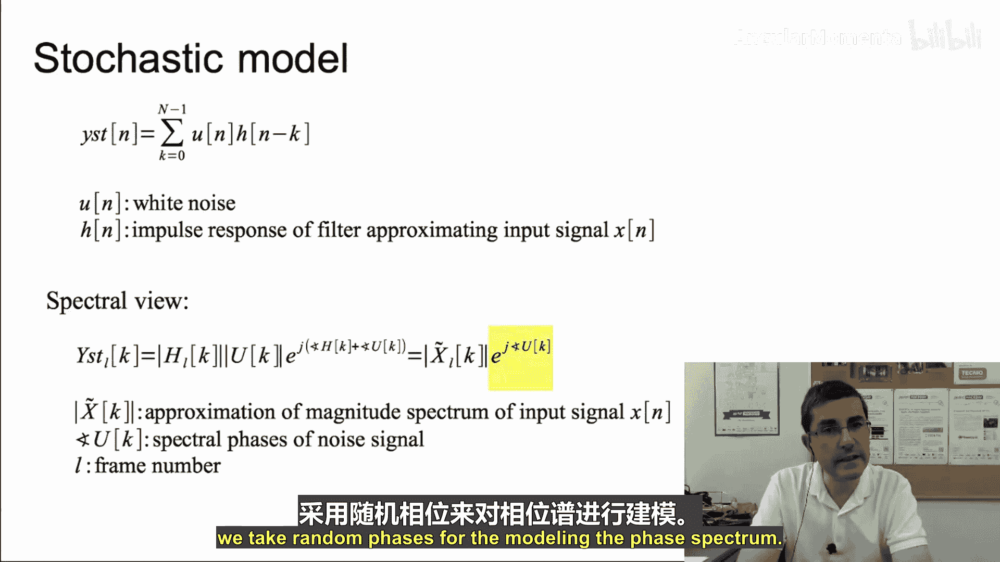

So this is an example， So if we start from a fragment of the sound， for example， of an ocean sound。

 and let's listen to that。Okay， so we just take just one frame of that and then we compute the magnitude and phase spectrum of this ocean sound。

 So the red plot is the magnitude spectrum of our input signal。And the faces。

 the CN function is the faces of the input signal。And then the， the black line。

 the black line on top of the of the magnet spectrum is the approximation of these。The spectrum。

We'll talk about different ways to approximate that。

 So it's basically a smooth approximation to the magnet spectrum and the black lines in the phase spectrum are basically random numbers and we claim that this random numbers are an approximation or a model are the random numbers that in fact are in the in the ocean phases。

 So we are basically saying that the phase spectrum of the ocean sound are just random numbers and can be approximated with any random number sequence。

And then if we take the inverse for the transform of these two black lines of the approximation of the magnitude and the random phases。

 we get this output signal and we are claiming that perceptually this signal is going to be similar to the first one。

 of course， by looking at it that might not seem to be the case because it's clearly a different shape。

 but given that were talking about stochastic signals， the details of the shape are not relevant。

 what is important is the statistical properties and so we will be able to to try to prove if this type of approximation works。

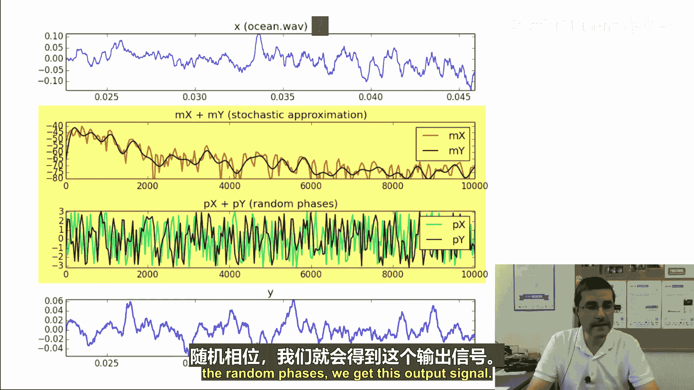

So the main analysis issue for this stochastic model is the approximation of the time bearing magnitude spectrum of the input signals so we will have to compute this approximation at every frame。

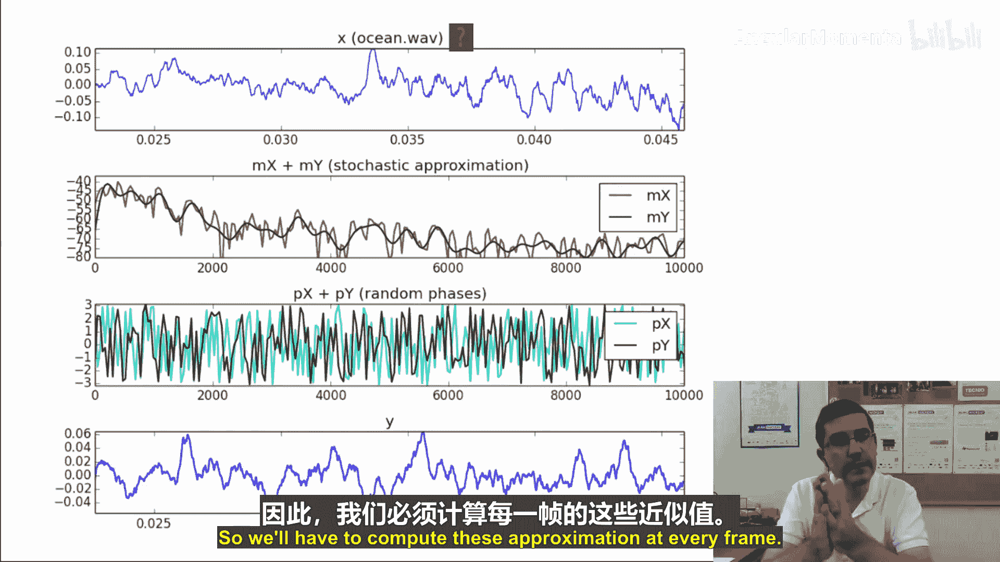

A common approach for obtaining a filter that approximates the spectral characteristics of a sound is to use a linear predictiveive coating。

With LPC with linear predictive coding， we can obtain a set of filter coefficients。

 a sub K and the frequency response of the resulting filter approximate the spectrum of the input sound。

So here we see a signal x， and the idea is that the approximation of this signal is defined according to this LPC model as the linear combination of past samples so it's as defined as the sum from k equal1 to capital k of a sub k multiply by x of n minus k which are the previous samples。

This is basically the expression of IR filter。An infinite impulse response filter that is a linear combination of previous samples。

 and then the the goal of LPC is to find these coefficients。

 to find a subK that best approximates X and generates a similar signal X X hat。

So we defined a mirror function。That is sum of the square root of the original signal with this approximated signal and with some originally from minus infinity infinity of course then we will narrow down to finite length signals。

 but with this error measure basically we can try to identify the a signal the a coefficients that minimizes this error signal we will not talk about how to actually implement that。

 but this is a very common common approach for obtaining these coefficients and therefore for doing what we call the LPC approximation so if we start from a sound。

 for example of voice sound like this sub sound and we can listen to。In fact。

 this is a type of sound that is commonly approximated with an LPC model and what it does is obtains this black line that we see in the bottom plot so in the bottom plot we see the magnitude spectrum of this fragment of this voice and the black line is the magnitude spectrum of the approximation of this LPC filter。

That approximates this signal and as we can see it kind of approximates what is a very common characteristics of the voice。

 which is these fors， so these are resonances， so an IR filter is a way to approximate the resonances of a signal quite well and so the LPC works quite well for this type of signals。

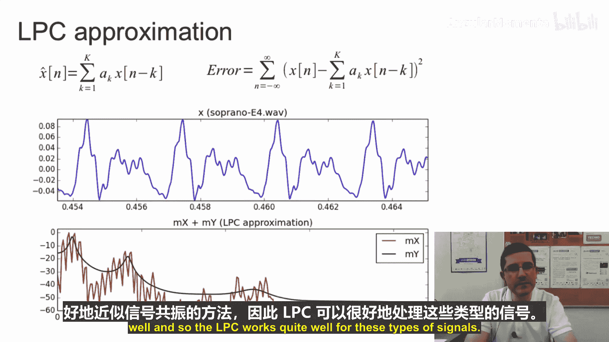

But the LPC does not work so well for many other types of signals。And here we present a more simple。

 simpler approximation that is just based on lopa filtering。

And we show it by implementing a lous filtering using the DFT。So we start from signal a of k。

And then we take the DFT of that。And we lopa filter。

 lopa filter means basically we cut the spectrum and we only accept the lower part of that spectrum。

 and then we can take the inverse DFT of that and we get another signal which this a tilde is an approximation smooth approximation of the original a subcase signal。

Then we might need to extend the signal in order to generate the same number of samples at the same sampling rate that the signal that we started with。

 so in order to do that we might have to take the DFT of that zero path to extend it to a longer FF size and then take the inverse dftT of that so then B of k is of the same length than a of k because the a tilde is just an approximation has less samples which is good because that means that we have an approximation with few number of samples。

 this coefficients， basically this a tilde is just the coefficients of the approximation。

And this is going to be the approach that we will use in our implementations。

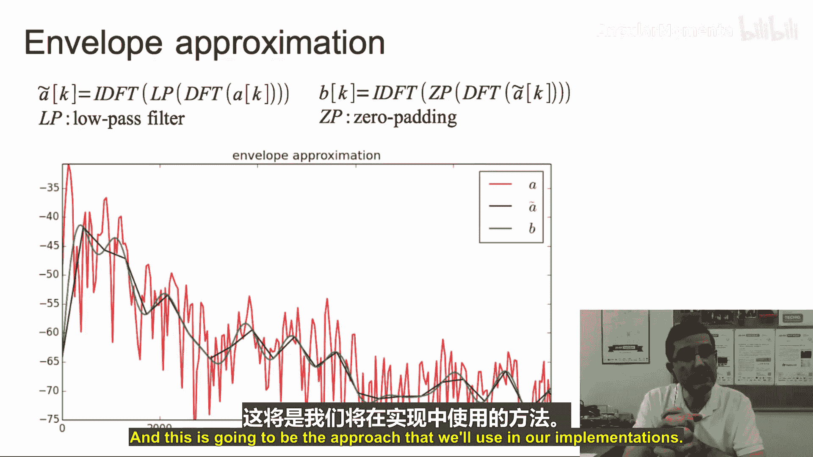

So now let's talk about the synthesises part of this stochastic model。

If we approximate a sound using LPC or with any other type of filter design approach。

 we can synthesize a signal from the obtained filter coefficients by filtering white noise。

So this equation that we already have seen before is the implementation of an IR filter in which we are filtering white noise。

 we are filtering the signal U with a series of coefficients a subK that are the coefficients of the filters and the implementation of these equation can be done in different ways。

 for example， these two block diagrams or two different structures that are used to implement these type of filtering one。

 the top is called the direct form structure and the bottom one is the lattice structure。

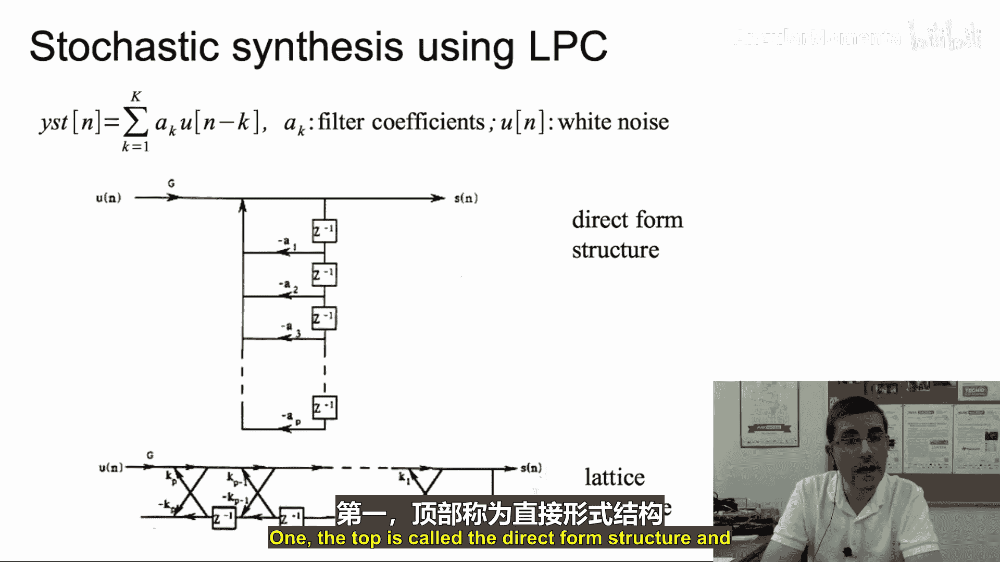

But if we obtain an approximation using the low pass filtering approach that we mentioned。

 we can synthesize the sound directly by computing the inverse DFT。

So in here we start from our approximation of the spectrum of the spectrum of the original signal。

 which is basically this smooth version of the signal is kind of like what we said the low pass filter approximation of the signal and then we can just take a random faces。

 the faces of the white noise and we take the inverse DFT and that's basically going to be a filtering operation of white noise。

 so we start we start from the smooth approximation of the signal。

 the random faces and then we take the inverse DFT and this will be the method that well use in our examples。

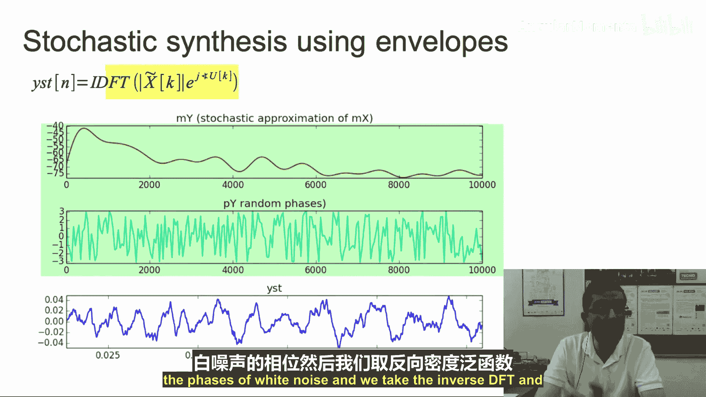

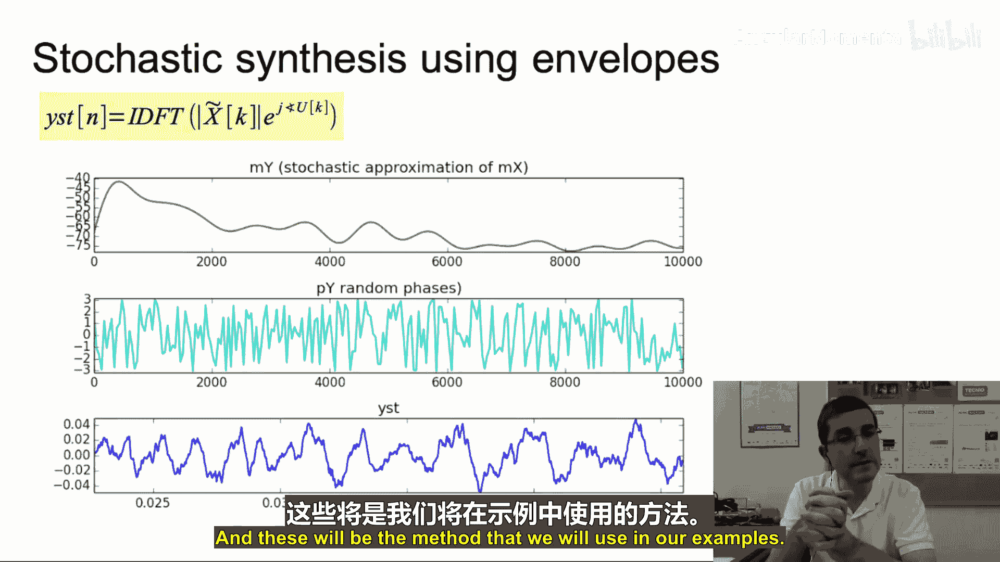

So now let's put it all together into an analysis synthesis system using this as stochastic model and so here we see the block diagram that we will be implementing in which we star from the signal x of n hopefully an stochastic signal we compute the FF0。

 we take the absolute value and then we do this is stochastic approximation which is again this idea of low pass filtering in。

 so approximating the magnet spectrum with a smooth curve。And then we can do the synthesis。

 the synthesis will be done by doing this inverse Fft of this stochastic approximation that might have to be zeropa and to interpolate it to be a longer size spectrum and then we generate random numbers for the phase spectrum and we can take the inverse FftT of that and that we return fragment of a sound and then we can just do an overlap at the similar in this exactly same way that we did for the sinnooid modeling here also we will have to take care about some smoothing window so that the overlap a works correctly but we this we can reconstruct the original signal so let's listen to some example okay so this is the ocean sound that we play before and then the first。

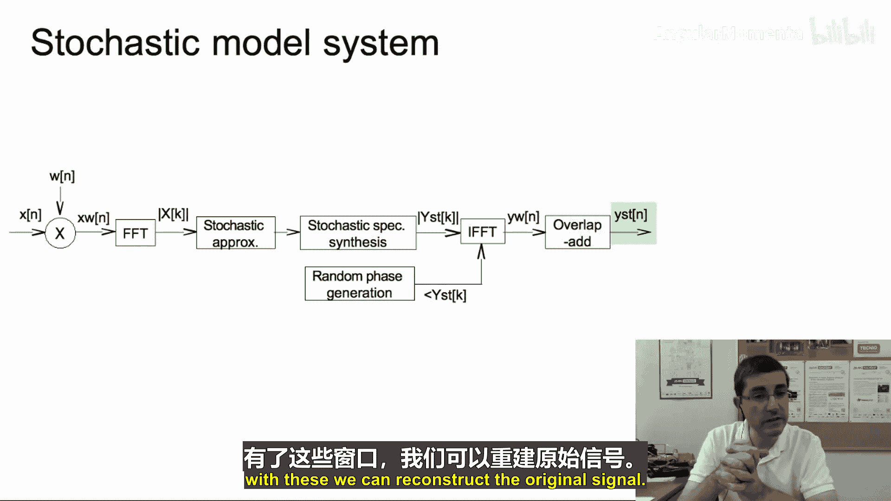

I the magnitude spectrum， the absolute value of the spectrum of the the spectrogram of this whole sound with a particular window and F50 size and a ho size and then the stochastic approximation is basically a visualization of this coefficients that are much fewer so in fact here we took kind of a compression of 0。

1 so every 10 samples of our magnitude spectrum we reduce it to1 so that's the idea of the approximation and then we can synthesize by combining these magnitude spectrum with random numbers so let's listen to the synthesized result。

If you do an AB comparison with the regional ocean， it sounds different。

 but it clearly sounds like an ocean sound， so for as stochastic signals maybe it's not so relevant to reproduce the exact characteristics of the sound but basically this kind of general characteristics of the sound and this is what this approach does。

So the feel of statistical signal processing is quite an advanced topic as I mentioned。

 and most of the reference impact are quite complicated quite advanced if you start by looking at these Wikipedia pages you can get links and descriptions to all these more complex view of stochastic processes and statistical signal processing so feel free to go there and check all these topics。

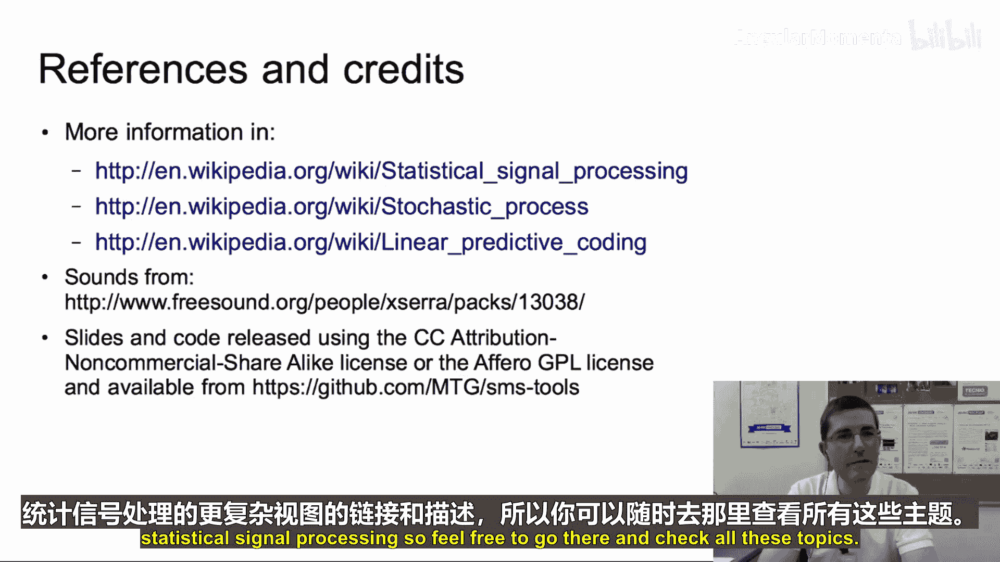

And that's all we talked in this lecture about stochastic models。

 the goal was to introduce a strategy with which to model some sounds or parts of sounds that cannot be well represented with sinusoids。

In the next lecture， we will see how we can combine these stochastic models with the other models we have been discussing the sinusotal based models。

 so I see you in the next lecture bye bye。

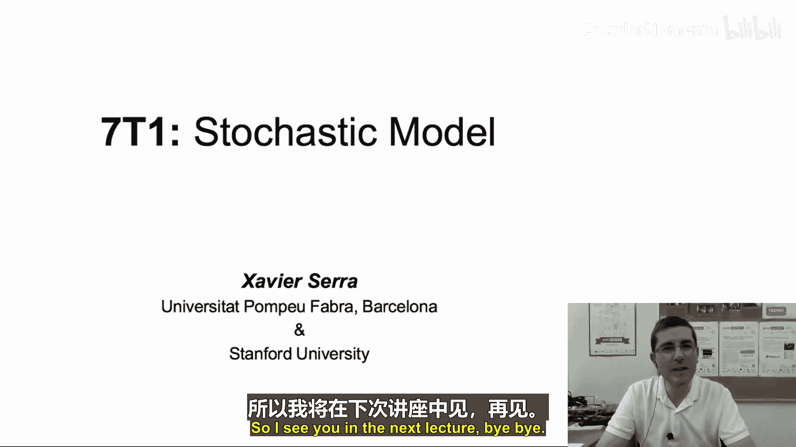