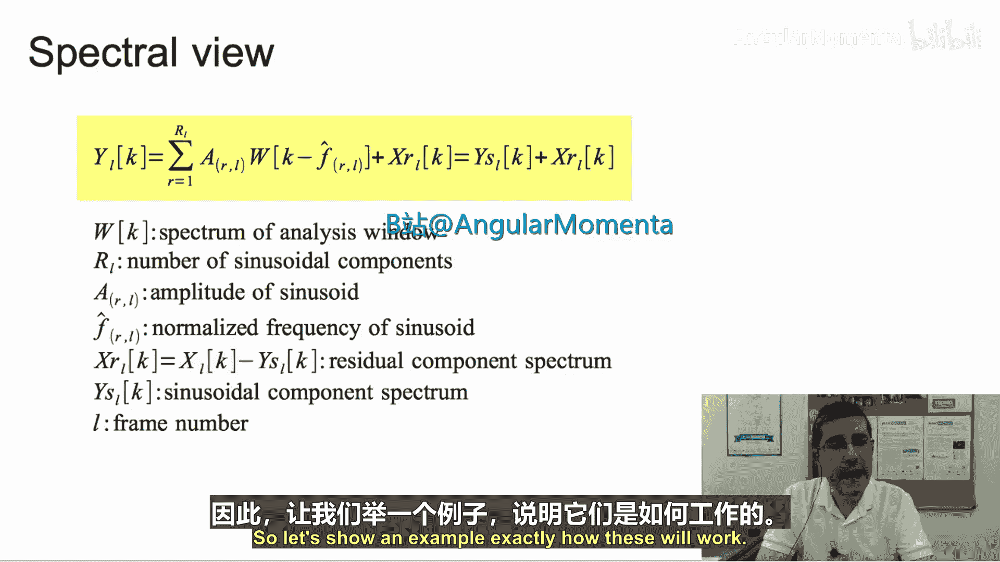
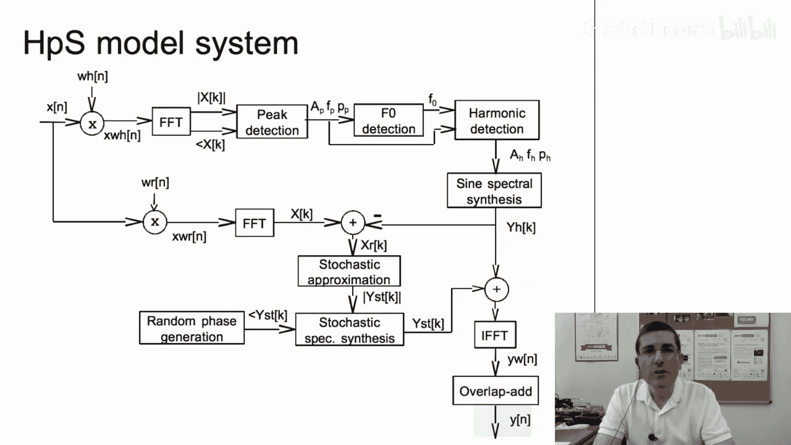
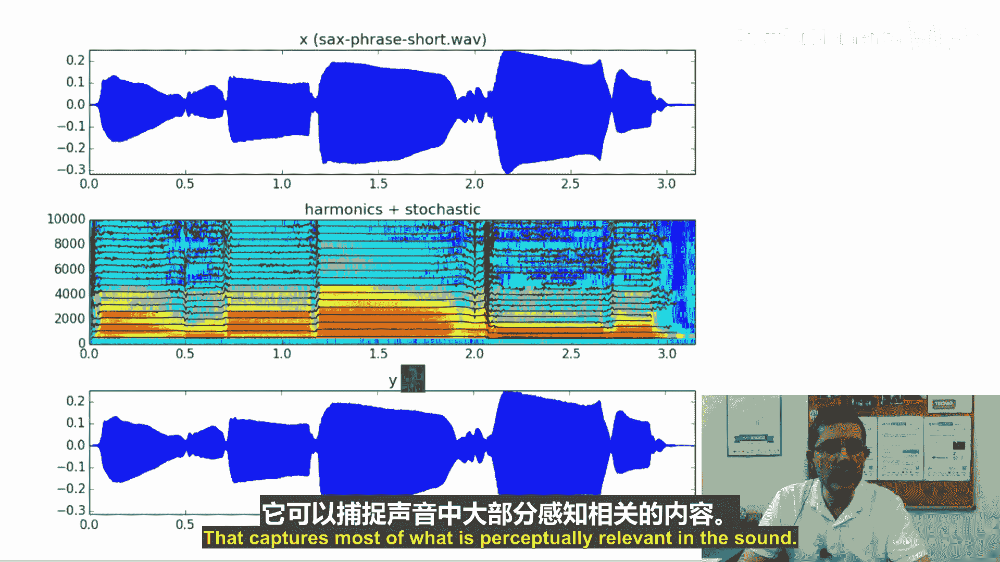
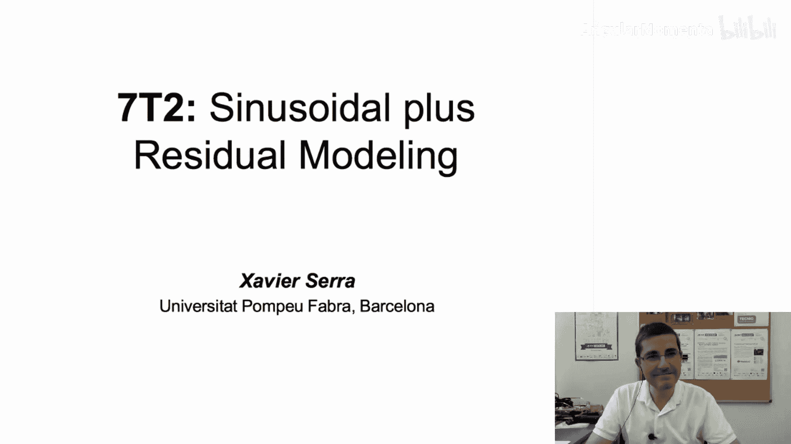

# 【巴塞罗那庞培法布拉大学】音乐应用中的音频信号处理-｜-Audio-Signal-Processing-for-Music-Applications-p47-07_01_02_正弦加残差建模--BV18Xr6BeEX5_p47-

Welcome again to the course on Nuing our processingcesing for music applications。

In the last lecture we talked about stochastic signals and how to model them with that we can now extend the sinusoidal and harmononic models that we talked about before into the concept of sinusoidal or harmononic plus residual or stochastic modeling。

We will decompose sounds into these two parts， the sinusoidal or harmonic one， and the residual。

 or ideally a stochastic component if this residual is a stochastic signal。

So in this lecture we will be combining all the models we have been talking about until now。

 we will put together the sinusoidal or harmonic modeling with the idea of a residual component for that we will need to talk about the subtraction of the sinusoid or the harmonics in order to obtain the residualible。

And we will talk about a system that puts this together into the harmonic plus rece system。

Then we will introduce the stochastic model and we'll put together the sinnooidial an or harmonic models with the stochastic ones for the residual。

 so in order to do that we will need to talk about how to model the residual as an stochastic component and finally we will make an example of this system that combines the harmonic plus the stochastic analysis into an analysis synthesis system。

The sinusoidal plus residual model is an extension of the sinusoidal model。

 we assume that a sinusoidal model is not able to represent the whole sound and that there is a residual component that is perceptually relevant。

 so it's a sound that needs to be kept。So here we see in this equation why the signal is modeled with this sum of sinusoids。

 time bearing sinusoid with amplitude and frequency。And we have XR， which is our residual。

So the whole sound is YS， our sinusoidal component and XR our residual signal。

An XR is simply computed by subtracting the sinusoids from the original signal。

 and this is what we will be talking about in this lecture。Okay。

 but it's much better least from our point of view to show this model from the spectral point of view。

Because that's where we're going to be developing all these models from。

So here we see the sum of the sinusoids as the sum of the transform of the windows shifted to a frequency and scale to the amplitudes of these sinusoids plus the spectrum of this residual component。

And the spectrum of this residual component， and now this is how we're going to do it is obtained by subtracting the spectrum of the sinusoids from the spectrum of the original signal。

So let's show an example exactly how this will work。

This is one frame of a sound， and here we can show the different steps involved in these harmonic plus residual analysis。

On the left top we see our frame window frame of a flute sound okay so its just a few periods of a flute sound and then below that we see the harmonic analysis that we do from the spectrum so we do the spectral analysis。

 the peaks and we select the peaks with these blue crosses that are really the harmonics of that particular sound。

And below it， we see the actual phase of the spectrum with the crosses and the phase of these harmonics。

Okay。Then what we do is we have to synthesize these harmonics。

And this is what we see on the right side with the light red and light C colors。

 so the light red is the synthesized harmonics of the sound of that particular frame。

 of course this is a different FFT size， the shapes of this lobes is different because the window is different this is a black manhar window using the synthesis。

 so this is the synthesized spectrum。And then we have to subtract this spectrum from the original spectrum。

 Strly speaking， we don't subtract it from the spectrum on the left。

 we subtract it from another generated spectrum that has the same parameters so that we can subtract the two of the same size and the same window size and then if we subtract these synthesized sinusoid or harmonics from the original when we get these dark red and dark C color and this is the residual spectrum in magnitude and phase representation。

And if we take the imverse of that， we see the residual residual signal in the tendmen and that's what we see on the top right plot in which we see the original flute sound。

 of course with the right windowing and the right size that we have in the synthesis and we see the residual signal。

 this dark blue one and again this is not just an error signal。

 this in fact is a relevant component is a relevant part of the sound that we want to recover。

So the whole system， if we put together all this analysis in a frame by frame type of thing and put it together into a whole analysis synthesis system。

 we get this block diagram， in which we start from the signal x of n， then we window it。

 we compute the FftT obtaining the magnitude unpha spectrum， we detect the peaks。Out of those peaks。

 we find the fundamental frequency。And once we have this fundamental frequency。

 we can identify the harmonics of that sound and we can synthesize those harmonics with the blank Harry window。

Okay， so we have another spectrum， Y H。That can be subtracted from the original signal。

 but in order to do that， we need to recompute another spectrum of the original signal with a window and a size that is comparable with the size that we use in the synthesis so we will choose a window size that normally will be 512 samples will use a black manhars window so that the shape of these x of K that we now compute can be easily subtracted from Yh so that it just a complex subtraction and we get x capital x R which is our residual spectrum。

And then this residual spectrum can be added to the harmonic spectrum。

 and then we can compute the inverse of5D and do the overlap at iterating over the whole sound。

We can see an example of the analysis of a particular sound using the harmonic plus reable model。

 So here we took the flu sound that we have heard before。

 and so on top we see the spectrogram of these flute sound and superposed we see the harmonic that have been obtained。

 So let's listen to these harmonic synthesis。and then these harmonics are subtracted from this background spectrogram and we obtain these lower sort of plots which are the spectrogram of the residual component。

 so let's just now listen to this residual that has been obtained。Okay。

 is soft that is clearly very relevant is basically the breathth noise of the instrument。

 which is an important part of the characteristics of this sound。

But this receiv component is a complete sound， therefore it difficult to process。We need to model it。

 so we need to be able to approximate it with a particular modeling approach and of course we will need to model it with this stochastic model。

So let's introduce the stochastic approximation of this residual component。

 and let's present this idea of the sinnooidial plus stochastic model。

So very similar to what we saw before so we have the signal to be the sum of sum of sinusoids plus the stochastic signal now this is stochastic signal or stochastic component is not just the subtraction of the sinusoids minus the original signal but is actually the result of a modeling approach so below here we see the equation of the modeling of this s stochastic component the stochastic component is the result of filtering wide noise with the impulse response of the approximation of this residual signal so we have the impulse response of every frame of this residual signal and we obtain this impulse response at the approximates a spectral shape of that so in fact it's much better to visual。

Allize this model in the frequency domain。And so here we see on the top the equation of the sum of the sinusoids。

 the sum of the analysis windows plus the spectrum of the stochastic component and now this stochastic component is this idea of filter wide noise。

 but in the frequency domain is the product of the approximation of the absolute value of the residual signal multiply by E to the J and the phase of the random the wide noise set of random numbers so the magnitude the spectrum is the approximation of the residual and the phase spectrum is the wide noise basically the phase spectrum of the white noise this is the concept of the stochastic approximation that we saw in the previous lecture so with this we can actually C。

How in a single spectrum， we actually perform this stochastic approximation。Of the residual。

 So we start from on the top with the magnetic spectrum of a signal， the harmonics。

 and then below the light red is the synthesized spectrum， the M Y H。

 and then this is subtracted from the original spectrum。 Again。

 is a spectrum that will have to be recomputed。And then we obtained the next curve， which is the MXR。

 which is the residual spectrum。And this residual spectraor can be approximated with a a smooth curve。

 which is the MSD， which is this sort of line approximation of this residual。

 and this is going to be our stochastic model。So we can put it together into an analysis synthesis system。

And it's very similar to what we saw before， so we start from the signal， we compute the FftT。

 we find the peaks， we find harmonics， we synthesize them in the frequency domain and we subtract them from another spectrum of the original signal we compute it to be able to subtract it and then what is new in in this model is the stochastic approximation of the residual so we take this residual spectrum。

 we run it through the stochastic approximation approximation module and then we can synthesize and we can synthesize the stochastic component by basically the idea is filtering white noise but in in the implementation is basically taking the phases of random numbers and applying。

The stochastic approximation magnitude spectrum。And this results into a spectrum。

That then can be sum to the spectrum of the harmonics and perform exactly the same thing that we have done before。

 so perform the inFT and the overlap that。So let's now see an example of a complete analysis synthesis of particular sound。

 so we are taking this saxophone sound， let's listen to that。

う。Okay， and then below it， we have the two representations that we have obtained the harmonics and the stochastic component。

 the spectrogram of the stochastic component， let's listen to the harmonics。う。Well。

 we may not appreciate what is missing， but when we listen to the stochastic approximation。

We have to make it a little bit louder in order to actually listen what is going on well with these two components we basically have analyzed and modeled the original signal and we can put them together and generate the synthesized sound。

う。That captures most of what is perceptually relevant in this sound。

So for these topics that I discuss in this lecture theres not that many references in terms of tutorials or sort of more introductory material。

 but there is quite a bit of articles that have been proposing different strategies to analyze sinusoids obtained residuals approximating the residualiv wallss etc。

 so in this link that I put here on the website of the MTG I have kept some articles well quite a bit of articles that have been published related to these issues so feel free to go there and you can sort of find those articles。

And that's all basically in this lecture， we have covered the most advanced models that we will be presenting in this course。

We basically combine all the previous models， developing a variety of analysis and synthesis techniques that can be applied to many sounds and for many applications。

In the next lecture， we'll focus on how these models can be used to transform sounds。

So I think we're going to start having fun and doing some interesting new sounds。

 so I hope to see you then， bye bye。

