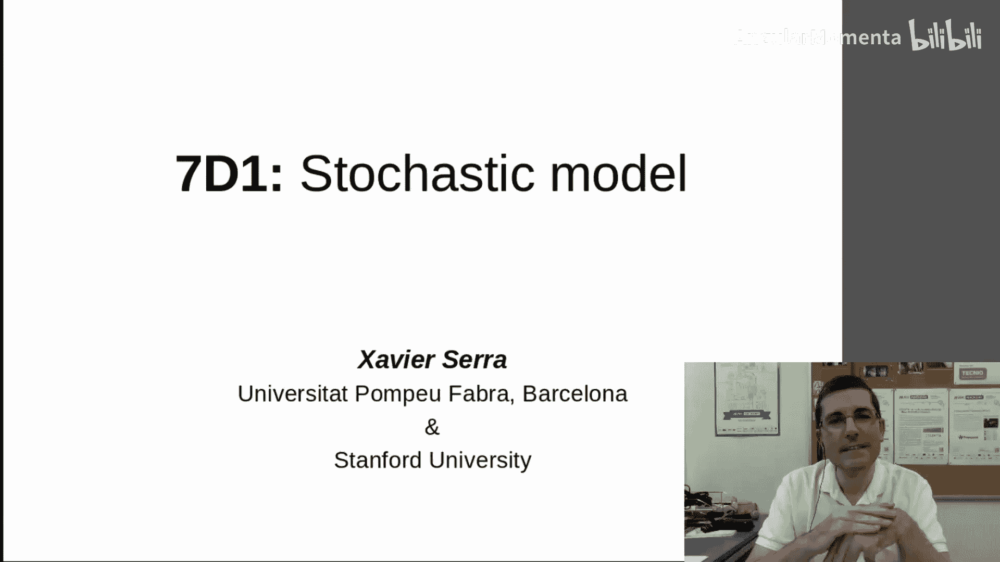
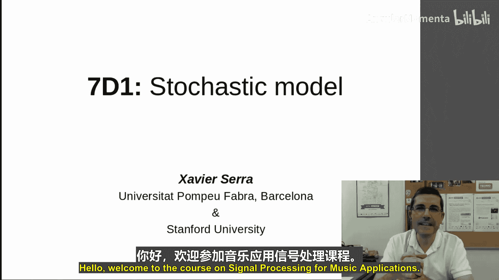
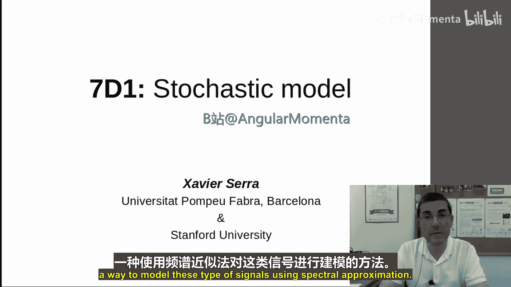
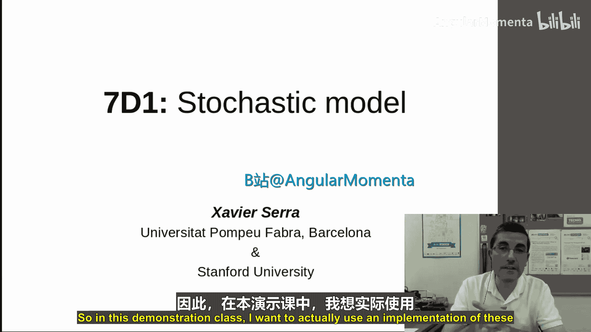
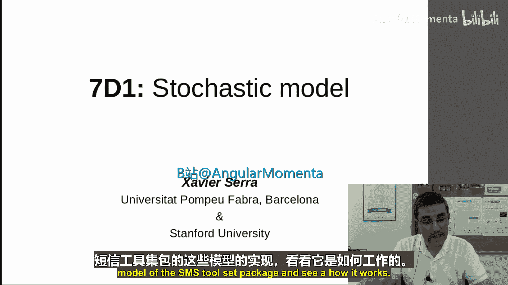
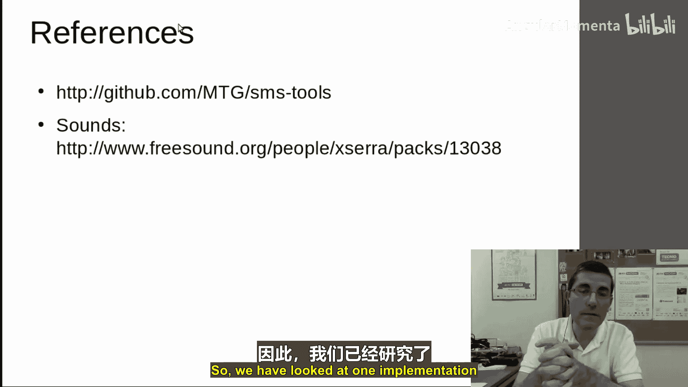
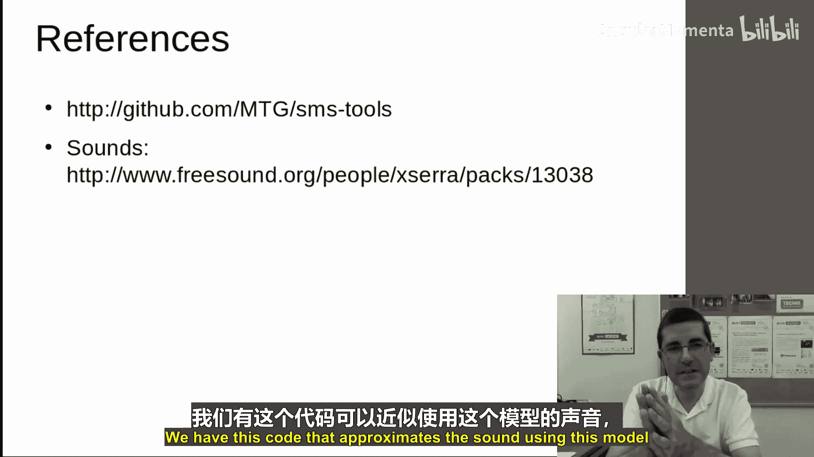
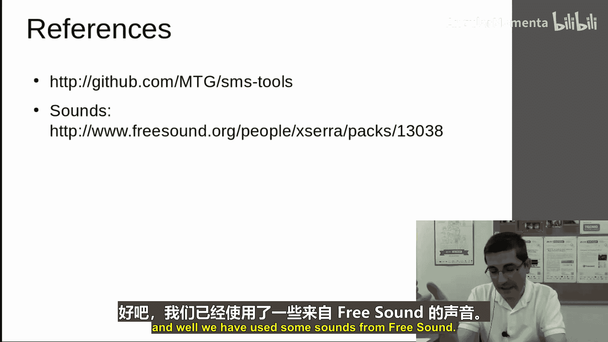
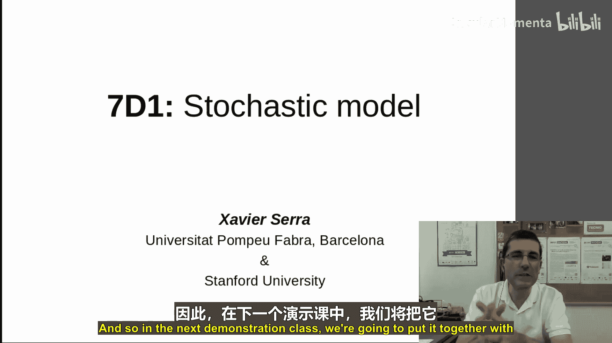
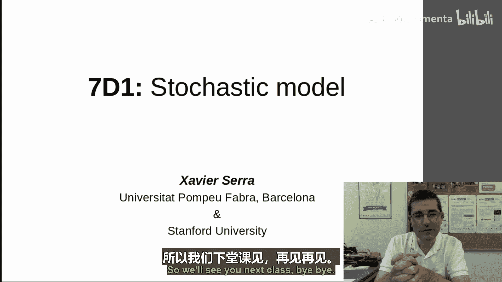

# 【巴塞罗那庞培法布拉大学】音乐应用中的音频信号处理-｜-Audio-Signal-Processing-for-Music-Applications-p48-07_02_01_随机模型--BV18Xr6BeEX5_p48-

Hello， welcome to the course on our using Pro for music applications。

This week， we introduce the concept of stochastic signals。

And a way to model these type of signals using spectral approximation。

So in this demonstration class， I want to actually use an implementation of this model of the SNS tools package and see how it works。

So let's open the interface of the S tools。And let's first use the short time period your transform to try to understand the sound。

 so let's open a sound， a good sound for stochastic analysis is the ocean sound is very noisy so that would be quite good for this type of approximation in terms of parameters that the fault are okay coming window window size 124 hop size 512 well let's first listen to the sound。

And now let's compute the SDFT。Okay， so here we see。

The spectrum of this ocean sound and clearly the kinds of things we expected in the sense that the magnet spectrum is very granular。

 I mean there is very little kind of repetitive structure。

 the only kind of a structure we can see is this overall shape in which we see basically the amplitude the swelling of the waves being shown here as this increase of this red area。

And also， we see that the higher frequencies are softer than the lower frequencies。

 So there is a much more emphasis on the low frequencies。And in the v spectrum。

 we basically see a random numbers， there is nothing particular here that we can see in terms of a given structure。

And if we zoom into the face spectrum， definitely it will。

Croborate this idea that these are basically random numbers。

 if we do it on on the magnitude spectrogram， maybe one of the areas that are more sort of stable。

 and yeah， it's very also very noisy。 Of course， in here。

 there is some more overall trends that we can see。

But now let's see what we can do with the snopho model that we have been been talking about and using。

 so let's take the sine model and let's get the ocean sound。

Okay in here we definitely will need a lot of sinusoids in terms of the window size。

 I don't think it matters too much， but maybe let's take a smaller window。

 let's say 1000 here the real since the faces do not matter that we can really just say 124 on F5 124 there is no need for doing anything different from that the hop size will be one fourthth of that so that would be fine magnitude threshold minus 80 well the duration of the sinusoids here clearly we need to account for tiny sinusoids that will come in and out and in terms of the number of sinusoids well we need a lot so let's put 200 hertz。

And this tracking， I don't think this matters much because they're going to be coming in and out all the time。

 So let's let's see what happens。Okay， so that's quite a lot of sine waves and a quite longer sound。

 so that may take a living longerger。Okay， so this is what we get。Again。

 maybe what we were expecting， the sine waves， these are the frequencies they are all over。

 we just see that they are scattered all over again in a very kind of granular random way。

 Let's listen to the sound that is synthesized from this sinnocer model。It doesn't sound too good。

 It has this kind of tonal quality and we hear like pitches that were not really in the in the the original sound。

 This is why the sinnosora model may not be that appropriate for this type of sound。

 We can push it more and make it sound closer to the ocean sound but clearly it's not an appropriate modeling approach for this sound。

 So now let's go to the stochastic model。And let's open the ocean sound。Okay。

 I mean here there is not that many parameters to choose， one is the hop size。

And the FF size will basically be twice as that so there is no need to control that and then there is an important parameter which is this smoothing approximation factor which is basically how much smoothing we going to perform for example we can start by 0。

1 that means that we're going to reduce the size of the F50 by 90% we're going to have the result is 10% of the overall so that means that we're going to have only one every 10 beams or frequency samples in the frequency domain and of course the phase spectrum will be random numbers so lets let's listen well let's compute that。

Okay that's quite fast and here of course what we are seeing and maybe we can compare it with the original STFT。

 we have a magnet spectrum which is much coarse so there is much fewer horizontal blind because we have the FftT size was down sampled was basically smooth out。

Okay， and but let's listen to the output sound。Well， it doesn't sound like the original。

 let's listen again， the original。But it definitely sounds like some water。

 So the quality is very much the same。 it sounds with a kind of high pass kind of thing。

 So let's get try to get a little better。 Let's have a hop size smaller than than this one。

 maybe 64 because these time changes are important And maybe let's not reduce this thatmat like 005。

 and let's see what happens。 Okay， now we have a more information。

 We have a finer grain both in the horizontal and vertical axis。 So let's hear what is the result。

Yeah， this sounds a little bit better， and we can play around with these parameters to get different types of approximations。

Now to finish these， let's try how this approximation works with a sound that is not really completely stochastic。

 so for example let's open the speech sound， let's open this speech mail sound。Okay。

 and let's not do so much maybe let's do 256 and let's do maybe 02 as an approximation。

 let's first listen to the sound。 Do you hear me， they don't lie at all Okay。

 so now we're going to attempt to approximate this， we're going to get rid of the phase spectrum。

 we're going to make it like random numbers， and we're going smooth out the magnitude of the spectrogram。

 So let's see how it sounds。Okay， so this is the approximation。 So this was the original sound。

 This is the stochastic approximation。 We see a very coarse type of approximation to the magnet spectrum。

 And this is the reynthesized sound。 Let's listen to that。Do you hear me， They don't lie at all。

 Okay， that's very interesting。 In fact， its it sounds like like a whisper type of sound。

 We have lost all the pitch information because a lot of this pitch information is in the face spectrum and we have basically got rid of that and since the magnet spectrum is quite smooth。

 Also we got rid of quite a bit of the possible pitch information that was present in the magnet spectrum。

Okay so that's all that's what I wanted to show so we have looked at one implementation of this stochastic approximation that we have talked about within the S tools。

 we have these code that approximates a sound using this model。

And well， we have used some sounds from3 sound。

So hopefully that has given you a flavor of what does it mean to approximate a sound with this stochastic modeling approach。

 and of course we're going to be using that for the residual of some signals and so in the next demonstration class。

 we're going to put it together with the other models that we have been talking about。

So we'll see you next class， bye bye。

