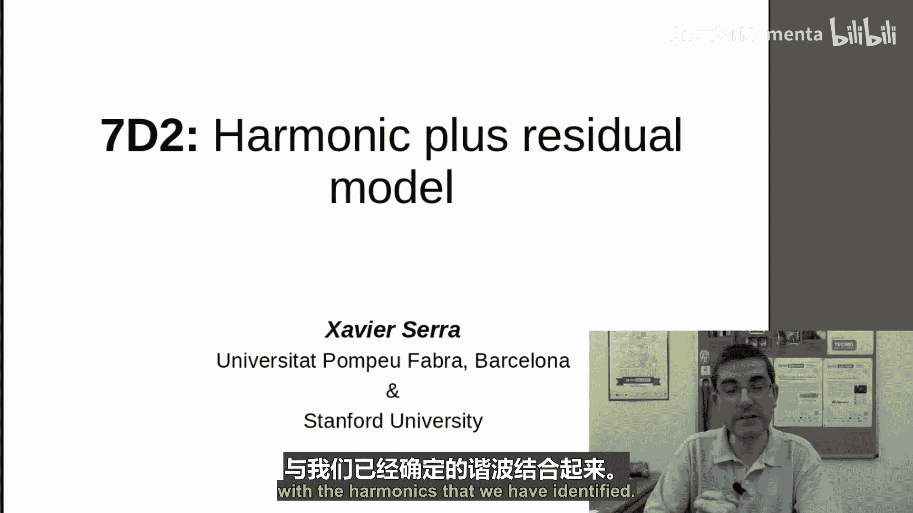
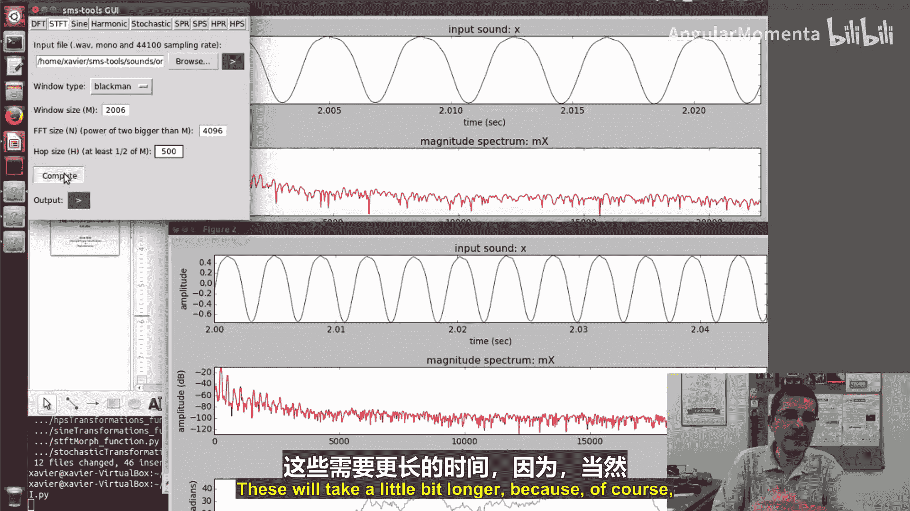
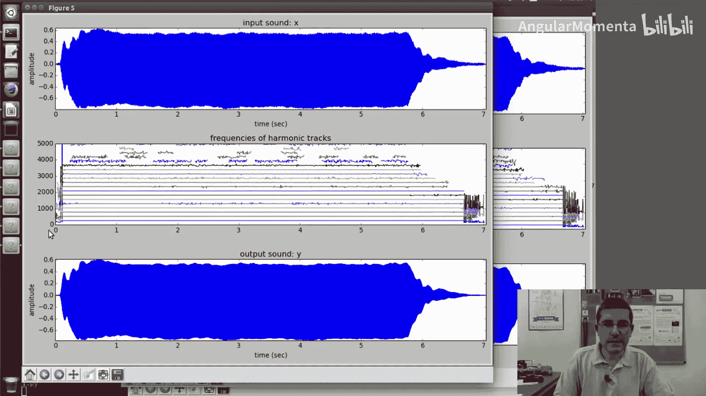
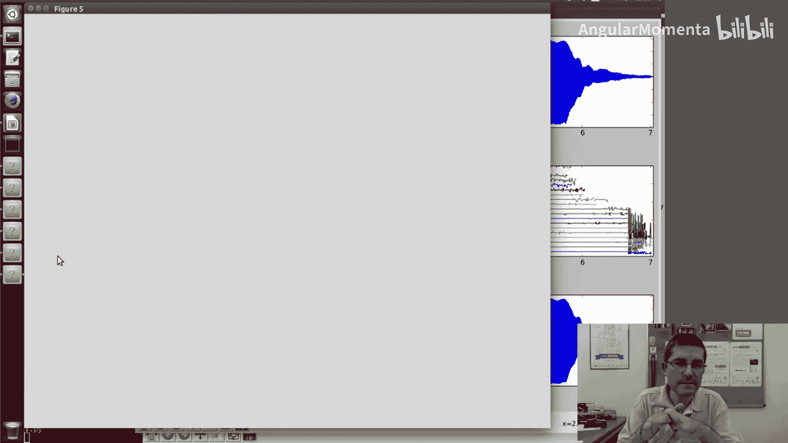
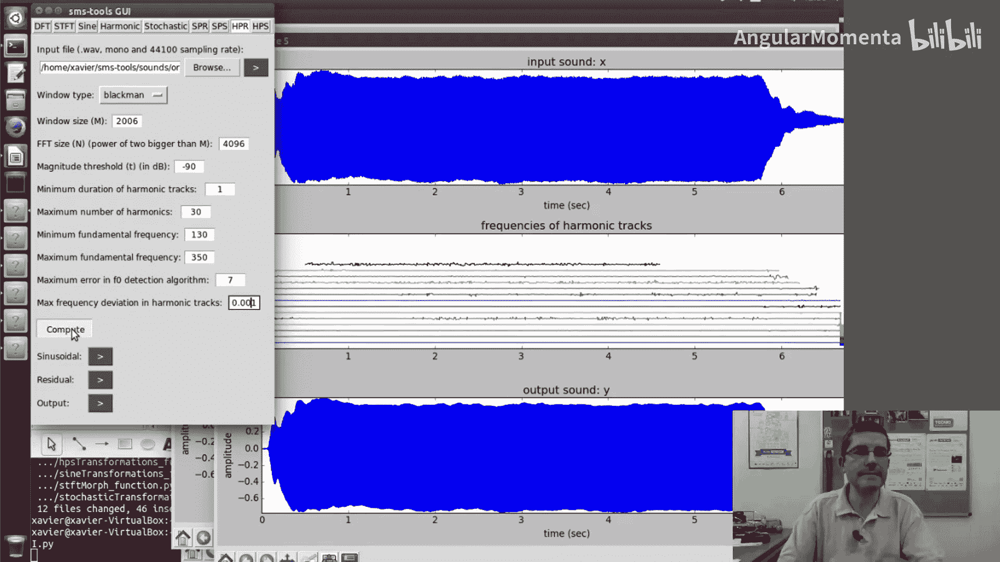

# 【巴塞罗那庞培法布拉大学】音乐应用中的音频信号处理-｜-Audio-Signal-Processing-for-Music-Applications-p49-07_02_02_谐波加残差模型--BV18Xr6BeEX5_p49-

Hello， welcome to the course on audio usinging or processing for music applications。

This week we're talking about quite a few spectral modeling approaches。

 we are combining the sinusoidal and harmonic analysis that we talked in the last few weeks with the idea of residual and stochastic approximation of this residual so in this demonstration class I want to talk about one particular model。

 the harmonic plus residual model， so the idea of analyzing the harmonics of a sound subtracting them from from the original signal and obtaining the residual which then can be combined。

 of course， with harmonics that we have identified。

So let's use the SMS tools that we have been talking about and developing in the course。

And let's start with the DFT and let's start with a sound with this organ sound that we have in the SMS tools directory。

 Let's listen to that and we listen with headphones。So that we can listen more carefully。🎼Okay。

 so this is a quite very stable tone and it's a very traditional standard sound of an organ。

So in order to analyze we want to be able to distinguish the harmonics of this sound。

 so this is a C3 which is around 264 herz so in order to find what is a good window size well let's use the blackman window is a very stable note so we can take advantage of a longer window and really try to isolate harmonics as much as possible so that's six bins for the blackman window and then something rate is 44100 and then we divide by frequency of this note 264 so that gives me 102 samples that makes sense to analyze okay so let's put 10003 to make it an odd window and okay let's use 2048。

F50 size。 So with quite a bit of0 padding， that's good。And so， let's compute it。Okay。

 so this is the samples that we are analyzing， we are analyzing six periods of the sound。

 it clearly looks very sinusoidal， and from the magnet spectrum we see that there is not that many clear harmonics。

 even though there is quite a bit of energy in the high frequency range。

But it doesn't have all these clear sinusoids， so this is an indication that it's a sound that has quite a bit of kind of a noise。

 like or kind of a stochastic component into that。Well， the phase looks as expected and of course。

 the reconstruction is quite good。 Okay， so this looks like a decent approach。

 of course we could maybe given that is stable， we could take a bigger window size。

 So let's try that。 Let's try like twice as much。 let's try 2000 and6 samples。

And then let's even do a bigger f 50。 Let's use 40，96。 Okay。

 so we are doing quite quite a bit of zero padding。 And while here the time was in two seconds。

 which is good。 the the sound is quite long。 So were kind of in the middle。 So let's do that。 okay。

 this looks twice as many samples like we are analyzing like 12 periods。 And yes。

 now we are seeing a little bit more things in the spectrum。

 if we compared the the previous one to the current one。

 we are seeing the the harmonics maybe more defined。

And we are seeing quite a bit of background thing， so maybe now we are seeing a little it higher harmonics than we were seeing before because with a higher window。

 we kind of reduce these background because is not a very coherent type of signal。

 so it emphasizes the coherent parts， the harmonics and reduces these kind of stochastic component。

Okay， so this seems to be a good choice。 So let's go to the SDFT and apply the same parameters。

 So let's apply the black man。 Well， let's first open the sound， the organ sound。

Let's use these 2006 samples that we took， okay， and let's use the。40，96 F50 size here。

 Now we have to choose a hop size。 Well， here， I don't think it matters that much。

 but let's just use maybe 500。So one fourth to， to be able to overlap with the black。 In fact。

 it should be even more。 but for efficiency purposes， let just slip it like that。Okay。

 let's compute this。This will take a little bit longer because of course it's longer sound and FFT is quite big。

Okay， so this is what we are getting。 Of course， the restynthesized。

 no need to listen to it because it's going to be quite quite identical。 And now， well。

 we see the horizontal lines maybe lets zoom into the lower areas。

And so that we can see a little better， the harmonics， the harmonics look clearly very well defined。

 but there is quite a few things in between。Okay that seems to be a good choice。

 Now let's do the harmonic analysis again， using the same parameters。 So we'll go to the organ。

 let's say the black men， let's use the 20006 and let's use 4096 as the FFT size。

 and now we have to choose the parameters to identify the peaks and the harmonics。

 the magnitude threshold， okay minus-90 that looks like a reasonable one the duration of the harmonics here since we are in a long stable node。

 we can even afford to put longer type of tracks， or at least let's say that they have to last for 0。

2 seconds， or it could be even more。 The number of harmonics。

 The truth is that there is not that many because they kind of disappear。

 So I would say that with 30 or 40 harmonics should be plenty。

And we know the fundamental frequency to 264。 So it the range has to be for for that。 So 130 and 300。

264 is within that。 So maybe we can even meet this。

Higher so that it makes sure that it fits correctly。 Okay， that sounds good。

 And this is the error for the fundamental frequency detection。 I mean。

 it should be a very clear fundamental。 They should not be a problem with that。 And this deviation。

 This is how we will allow the harmonics to deviate from perfect harmononicity。

 So let's leave it like this and see what happens。 Okay， let's compute it。Again。

 this will take a little bit longer。Okay， so we found。Quite a few harmonics。And of course。

 in the attack and the is very unstable， so maybe we should have rejected those。

But what is interesting is that some harmonics are quite stable， but some are very unstable。

 let's listen to the preynthesized sound。Okay it sounds good。

 let's compare with the original well if you pay attention clearly the original has this more air in the background that is not in the synthesize because it's only the mainly the harmonics but the truth is that also some of these high harmonics are very unstable so maybe it's not right to consider them as harmonics because they are basically maybe tracking some noise part so one way to get rid of that is to reduce this deviation and restricted even more for example let's put 0001。

嗯。And then let's see what happens。Okay， now it got rid of some of these partials。

 But maybe an even better way to do that is to make sure that they are long enough。

 So instead of having  point2， let's make sure that， okay。

 that the harmonics should be at least one second to be considered。

Okay， now we got rid of quite a lot of these higher andstable， either harmonics or components。

 Let's listen to the synthesized sound。🎼Yeah， that sounds quite clean and definitely of course not as rich as the original sound Okay now we can go with this same parameters to the harmonic plus residual so to subtract this harmonics from the original signal。

 so let's use the same sound。Let's use this2006 Windows size。4096， the threshold was- 90。

 The minimum duration of a track。 we think we put 04 or。We put， know， we put one second。Okay。

 so one second。A number of harmonics now definitely we can put less。 We can even put just 30。

 And here we have to make sure is within that。 So let's say1 hundred and30 to。To 350。

 so that it's within that for sure you will find it no problem。And error。

 I don't think this matters too much。 But here we put 0，0。 I think that's 2 zeros。 Okay， well。

 well leave it like that。Okay， let's now compute these。

Okay， this is what we got and lets let's see。 So here we see the harmonics it found。

 the black lines and the background spectrogram is the residualo。

And we can listen to the different components so we can listen well。

 just the sinusoid its the harmonics。 we already heard that。 Let's listen to the residual。🎼Yeah。

 that's a very clear and nice sound that is what it was missing from this harmonic sound so clearly if we put these two sounds together。

 they will sound like the original。🎼compared with the original yeah， that's an identity basically。

 so this was a good sound to explore the potential of the harmonic plus residual of course if we take time varying sounds that may be a little more tricky and we will have to tune the parameters a little bit more。

But with that， I think you get an idea of what the harmonic plus residual model and the tool within the SMS tools that implement this model。

 what it can do， so I encourage you to play around， of course choose other sounds。

 maybe more complex sounds and sounds that change in time。

So we have talked about the harmonic plus residual model and this is one instance of the models that we are talking about this week on the next demonstration lecture。

 I want to talk about the harmonic plus is stochastic model so that we can model this residual that we just heard as an e stochastic signal and see what it can do so I will see you next lecture thank you。

