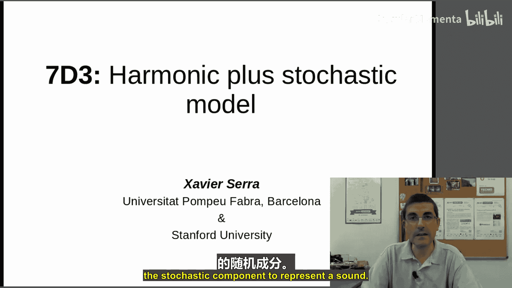
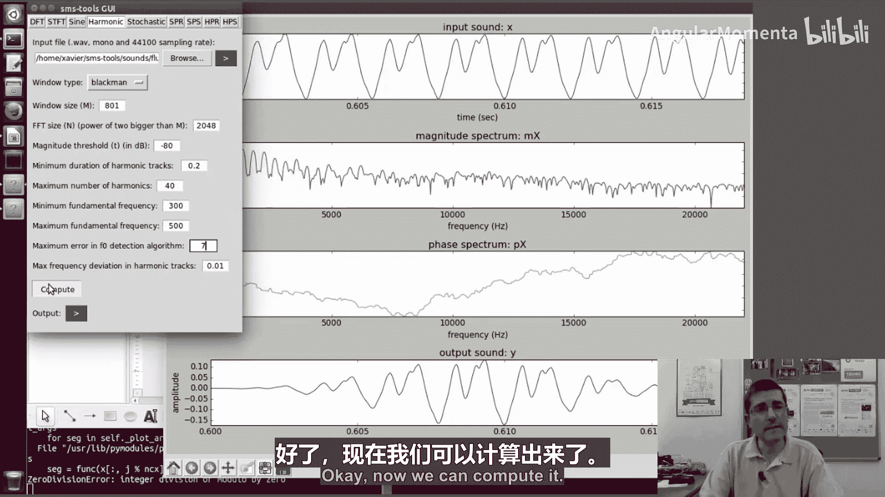
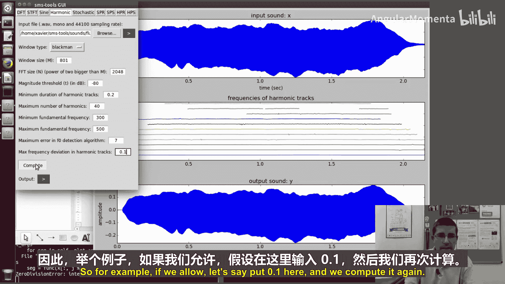
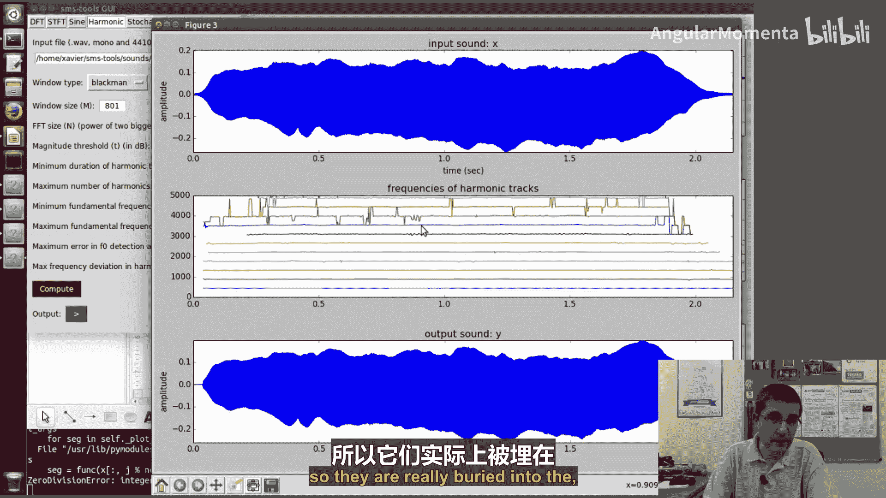
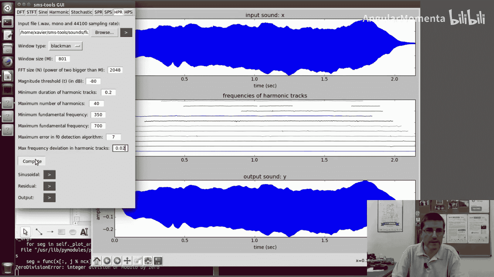
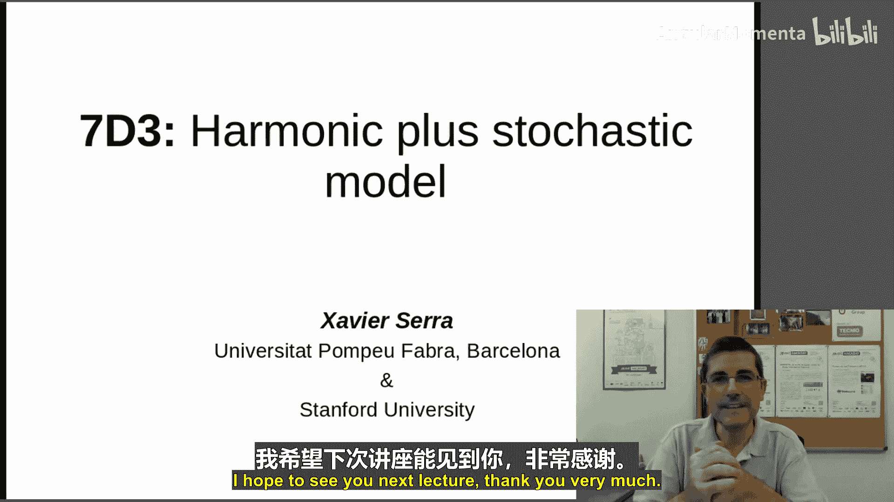

# 【巴塞罗那庞培法布拉大学】音乐应用中的音频信号处理-｜-Audio-Signal-Processing-for-Music-Applications-p50-07_02_03_谐波加随机模型--BV18Xr6BeEX5_p50-

Welcome back to the course on nowing or processing for music applications。

In the previous demonstration class we talked about the harmonic class residual model。

 we actually analyzed a sound with the model with the SMS tools。

 and we were able to identify the harmonics， subtract them from the original sound and obtain a residual。

 which then we combined with the harmonics to obtain the original signal。In this demonstration class。

 we want to go a little bit beyond that by approximating the residual with the stochastic model。

 and in the case that the residual is close to an stochastic signal。

 then this will be a good representation， the harmonic plus the stochastic component to represent a sound。

So let's start and let's open the GI of SMS tools and we will start with the sound of the flute cell。

Okay， so let's listen to this fluid sound。嗯。Okay， so it's a very stable note。

 quite clearly the the pitch， in fact is an A4。And it clearly has some breathing quality that will be relevant for this idea of the stochastic component。

In order to decide what window size， well again let's use the blackman windows into a stable sound。

 blackman will be a good choice for being able to get low the side lobes and getting a good kind of signal to noiseeration in terms of the window so in order to compute what is the best window size so we'll have to just to 6 which is the number of beams of the blackman window times the sampling rate 44 100 divide by a fundamental frequency of this sound and this is a na4 so it's 440 hertz。

Okay， so 601 would be a good window to use， given that we really want to get a good resolution of the harmonics and try to minimize the rest of the components and it's quite stable。

 we can afford to take a longer window maybe so let's take 801 samples。The FFT size， again。

 lets we can take a bigger FFT so that we get a smoother spectrum， so 2048。Okay。

 and well let's analyze just in the middle of the sound， this is a quite long sound。

 so let's a like that。Okay， so this is the samples of the input signal。In this spectrum。

 we see quite well the low frequency harmonics。And similar to the organ sound that we analyzed before。

 in the high frequency areas， there is quite a bit of kind of unstable or kind of very stochastic type of components that are not so clearly defined as partials。

 so they may be there might be some harmonics or partials but theyre kind of mask and are difficult to identify here。

Anyway， so okay， so now let's just go directly to the harmonic model and let's apply the same parameters。

 so 801， 2048， now we have to choose the parameters for for the big detection and harmonic detection。

I don't think we need to go very much down in the spectrum for the harmonics because as we saw。

 there is not that many。In terms of the duration of the harmonics。

 I think it's good to make sure that there long is a stable node， so we might want to put like 0。

2 in terms of the minimum duration in terms of number of harmonics there are clearly not that many so I'm sure with 40 should be plenty and we have to set the minimum and maximum fundamentals so that 440 feet here。

 so I'm sure if we put 300 and 500 should be plenty and the error for the peak detection well let's take the default7 and the deviation let's start with these values see what happens。

And of course， we need to get flus down。Okay， now we can compute it。

Okay， so clearly we got quite a few harmonics and some here that appear and disappear。

 of course we have to realize that here we are just plotting the first 5。

000 hertz if we want to see more and what's going on in the higher frequencies we should display little differently。

Okay， so let's just listen to the result。Okay， that's pretty good。

 that's a quite accurate rendition of that， of course is different from the original one。

 in fact if we hear back the original。Yeah the regional has a more brighter type of quality and this is because it has all these other components。

 Of course， we can play around with these parameters， for example。

 to allow for more harmonics to appear。 So for example。

 if we allow let's say put01 here and we compute it again。

Yeah now we are allowing these high harmonics which are very unstable to appear sort of more。

 but of course all these gems are not really that good。

 so that means that these harmonics are not really stable。

 so they are really buried into kind of the noise or these breath that we also hear。

Okay now we can go ahead and use the harmonic plus residual model so we can listen to the residual and let's again use the same parameters。

 the fluid sound let's put 800， let's put 2048 and in terms of the threshold minus- 80 the minimum duration。

 let's just put 0。2 number of harmonics， yeah we don't need that many and well this will be okay 35700 and these I think7 was all right and yeah let's make it not as open in terms of the deviation as as before。

 let's just put maybe 002 see what happens。

Okay， so here we see。The original and harmonics， and maybe we see a few more than before。

And synthesize， so let's listen to the residual。Okay， that's a pretty nice residualberry。

We hear the attack and the attack， in fact， there is this red thing here that during the attack。

 it's cleared louder his breath and then it just。ItSort of gets attenuated and we hear a very clear breath noise throughout。

Okay， so now so this is very much an stochastic signal。 Let's say it's very noisy。

 So that means that we can apply the stochastic analysis to that。

 So now let's use the harmonic plus s stochastic model and let's。Get the same type of parameters。

 Of course， we can play around these parameters to， to get better values， but I。

The ones we chose the looked okay， so let's again， let's put 02 here。

 let's get the number of harmonics。 Yeah， I think 40 harmonics。 and this was al right。

 this was 7 and this was 0。02。 Okay now the parameter that is specific for the stochastic analysis is the stochastic approximation factor。

 And here by default is 0。1。 So it means that it reduces the whole spectrum by 90%。

 So it's only it it will quantize kind of the resolution to 110th of what it originally was。

 So let's let's just try this。Okay so clearly now we see well we see it differently because in this one we are showing the range from0 to 14000 hertz so in fact we're seeing quite a bit more so we see more of the stochastic component but as we see the harmonics are very much on the lower side above 5000 hertz that is that much there is some of these but maybe these even these lines should not be considered harmonics and maybe they should be discarded。

 but let's listen to the stochastic component。Okay。

 of course we have lost like a little bit of the of the details that the residual had。

 but it definitely keeps this breathy noise。 Of course， is's not that loud。

 So when if we put it together with the original signal with the harmonics。Okay。

 so it sounds good but clearly the harmonics are taking over and they're kind of masking quite a bit this stochastic component。

 we have to listen to it quite carefully if we want to be able to distinguish the stochastic component of these type of sounds。

And that's basically all I wanted to say。Let's go back。

So we have talked about the harmonic plus a stochastic model and we have used the SMS tools。

 the interface that has allowed us to play around with this model。And of course。

 the sound that this fruit sound is in free sound。So hopefully that has given you a view of the potential of the harmonic plus stochastic model。

 it's a little bit different from the harmonic plus residual。

 but the main difference is that now with the stochastic representation of the residual we will be able to do quite a bit of things next week in fact we're going to be doing transformations to the sounds and the stochastic representation will allow us to do that whether in residual would not be able to give us that flexibility So anyway so that's all for these demonstration class and I hope to see you next lecture Thank you very much。

