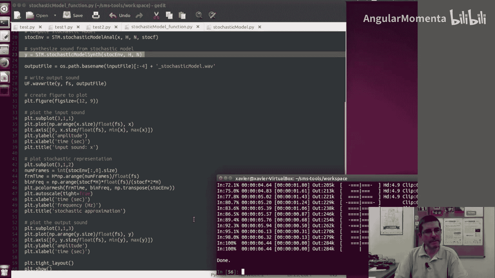
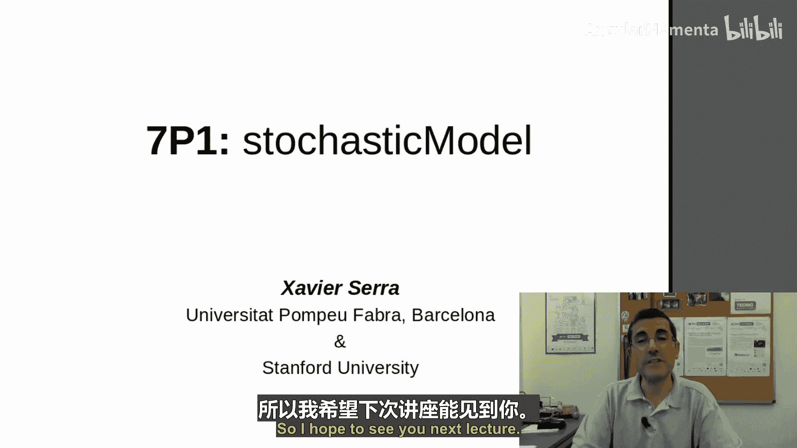

# 【巴塞罗那庞培法布拉大学】音乐应用中的音频信号处理-｜-Audio-Signal-Processing-for-Music-Applications-p51-07_03_01_随机模型--BV18Xr6BeEX5_p51-

Hello， welcome to the course on audioing or processing for music applications。This week。

 we are presenting diverse spectral modeling strategies to model sounds。

And one of the underlying concepts that we are introducing is the idea that there are many sounds that are not quite well modeled with sinusoids or with a harmonic analysis approach。

That there are signals that are very noisy， that are what we call stochastic that require a different modeling approach。

That is this modeling approach is based more on statistical signal processing or describing the sound from a probabilistic point of view。

So in this programming class， I want to go over that from a programming perspective。

 so present the models that we have been implementing in the SMSS tools and that implement this idea of stochastic modeling。

So we'll basically be talking about this block diagram。

In which we start from a signal and then after windowing it and computing the FFT。

 we just keep the magnet spectrum in stochastic signals。

 the phase spectrum is not relevant and so the approximation is based on the magnet spectrum that then it's approximated with a smooth curve。

And this smooth curve is what we call the stochastic model。And from that。

 we can reconstruct or we can regenerate a signal by sort of reconstructing a magnitude spectrum。

And then generating faces randomly。So that we can create another complex spectrum that captures some of the essence of the original sound。

 and then by overlap adding， we can generate a signal that hopefully if the original signal had this stochastic properties will be quite similar to the original sound。

So let's go to a text editor and here I wrote a very short script that implements this idea of approximating fragments of a sound with this stochastic model。

So we start by importing a few packages that we need。

And then the core of the code is basically reading a sound file。

 This is the ocean sound file that we already have been using。

 so it's clearly an stochastic type of signal。AndThen in order to analyze the spectrum of it。

 we have to define the FFT size and window size in this type of sounds and this type of situation there is no need to0 pad that is no need to have a odd sizeize window so we have M the window size and n the FFT size of the same size which is 256。

 then the key parameter is what we call a stochastic factor。

 which is basically the smoothing factor of the down sampling factor， so 0。

2 in this case that we define it means that we are basically reducing the information by a factor of 0。

2 andm getting only kind of the surface information。

Then we get the window in this case we get a humming window but it can be any any type of window it doesn't have to be very complex。

 in fact， I would say that maybe it's easier to just use the hunting because it's even simpler and it works。

Okay，Then we need to select the portion of the sound we're going to analyze。 So in this case。

 well we shows a section in the sample 10000 and then plus the window size and we multiplied by the window。

Then we compute the spectrum。Then we convert it to Db。And we do the approximation。

 the stochastic approximation on the D B spectrum。And we do it by using this Python function called resample resample is a function that basically uses an F50 approach。

 so it uses a spectral analysis approach to downs samplele a signal or to resample a signal。

 both we can downsample or up samplele a signal so we give a function。In this case。

 Mx and we just make sure that there is nothing below-200 decibels it wouldn't make any sense。

 and we specify the length， the new length that we want to create so the original length was of size n over 2 because we are only using half of the spectrum okay so from n over two samples。

 we are going to generate n over2 multiply by this stochastic factor approximation。

 So basically if this is 0。2 were going to have one fifth of the samples that we started with。Okay。

 let's run this little script。So you run。Thatest。And we can plot the signal that we start with。

 the window fragment that we start with。So this is the fragment of the ocean sound already windowowed by a hanging window。

And then we are computing the spectrum of that。 So the spectrum is this Mx array。Okay。

 so this is the magnet spectrum of that。 And now we can plot on top of that the。

The smooth approximation or the the down sample approximation of that。 So which is Mx M。

 But in order to make sure that it， it's shown on top of this array， which is a longer size。

 we have to plot it differently。 So we have to say NP range of。M， X， M。Well， the size of that。

And then， if we divide。By a stock factor。This should stretch these points to the size that we had of the Mx。

Okay， so yes。 So here we show in in green。The approximation， the smooth approximation。

 of course it has less sample so MxM has the size of it is 25 samples。

 so from the 128 samples that the positive side of this magnet spectrum has we have reduced it to 25。

Of course， if we change the stochastic factor， we will do we will have more or less samples to be approximated。

 but clearly this green line is an approximation to the blue light。Okay。

 so this is what the kind of a stochastic approximation that we're going to be using D and now let's go to this other script and what we will be doing is to actually synthesizing a sound from this。

So we have the the same first part up until here。 Okay， so we generate the envelope。

 and now what we're going to do is to re again the the approximated spectrum。

 but to the size of n over 2 so that we get all the samples of the complete FFT。

Then we will generate random numbers for the phase。And then to create the whole complex spectrum。

 we will have to deal with the symmetry so that we will recreate the magnet phase for the negative frequencies and。

 of course， converted to complex numbers。 So the positive spectrum。

 the positive complex spectrum would be 10 to the power of the magnitude multiply by the。

Exponential of the face。Well， this is， of course， the conversion from DV to linear scale。

And then for the negative part， we do the same thing。

 but we reverse the order and the faces that neated at that。

 And then we just take the inversese Fft of the complex spectrum。 So let's run these。

This is test one。Okay。And in here we have the magnitude spectrum that we started， the MX。Okay。

 so this is the original spectrum。 And now we can plot on top of that the approximated N。

 but up sample to have the same size。 in fact， M Y。Has the same size than this。

 So now this green line。Started from the samples that we showed before。

 so it was more a jagged line and it had fewer points。

 and now it has converted into a smooth version that has the same size than the original spectrum。

 and of course the phase spectrum if we plot the Py， this is the phase spectrum that we generated。

 which is just random numbers from0 to pi so2 to pi。 and by taking the inverse FftT。

 we can just obtained the output signal。 So this is the。

Synthesize signal from that approximate approximate spectrum。 Of course。

 this is different from the X W that we have started from。

So now the green is the original signal we started from clearly very different。

 but that's not the point here because being a stochastic signals。

 the shape in the time domain is not that relevant。

 What is important is this general distribution in the magnitude spectrum。Okay， so now。

Let's look how the actual analysis and synthesis work for longer sounds。

So in here we have the stochasticmod。pyy file in which we have different functions that implement the analysis of a complete stochastic signal and the synthesis from analyze stochastic representation and basically it does they do what I have done for a single frame。

 in which the stochastic model and L， it starts from the signal， the ho size。

 the FFT size and the stochastic factor， and it iterates over the whole sound and it does what which is it performs FFT。

 it finds the DV mag spectrum， then it uses the resample function to downsample it to fewer samples depending on the stochastic factor and it keeps app these to a sequence of envelope。

Because we are going to have a time bearing envelope for the stochastic representation and of course。

 the synthesis does again， what I showed before， it has to ups sampleampble the magnet spectrum to the complete size。

 it has to generate the random faces and then it has to convert to the complex spectrum and do the overlap at to recover the whole signal。

So let's call these for a particular sound。 So in here I wrote a little script that takes that ocean sound and it calls the stochastic model and also it analyzes the whole sound。

Okay， and it uses a ho size of 128。 the the the FFT size， it's used to be twice as that。

 So instead of specifying an FF size， that the fault is normally to just take twice the hop size。

 And then there is the stochastic factor， which is12。 So now if we run。This test 2。Okay。

 now we have created stock。And that if we look at the shape of that。

 that's a matrix that has 2217 frames， and each frame has 25 points。

 which are the points of the approximation。And this， we can we can look up individual frames。

 but basically what we normally do is we plot it with P color。Meish。Okay， the P color mesh。

 and we specify is stock。M will display this array like in a color， like like 3D type of plot。

 Of course， this is shown in the the kind of the wrong direction we are accustomed to see time in the horizontal axis。

 So what we normally do is show it with NP P and。Transpose。Okay， so this will。Reverse。The plot。

 and it will show the X axis in the as as astein and vertical axis as frequency。 Okay。

 so this is the， the， the plot of the spectral representation of these。

Have these coefficients of this stochastic representation。

Okay and let's now go to this function that basically does this stochastic analysis and synthesis for a complete sound and at the same time it plots it nicely。

 This is the code that is used from the interface and it plots nice spectrogram of the stochastic representation。

 So in here we have this main function that has some parameters by default and it reads a sound。

 it performs the analysis which is did and then it does the synthesis from the whole analysis and then it outputs a sound file and then it plots。

The different components， the input sound， stochastic representation and output sound。

 So let's run these。 We run the stochastic model function of P Y。Okay， and these plots input sound。

 the stochastic approximation and the output sound。

 and of course we can now it has save a file called ocean stochastic model dowa。

 and I can just play by taping play and ocean。Okay。Okay。

 so this has played the complete sound and as we showed before， well， it's quite similar。

 even though it's not identical， it definitely sounds like an ocean sound and even though it doesn' it has lost some of the low frequencies。

 so we might have to change a little bit the stochastic approximation in order to recover the complete sound a little bit better。

But anyway， okay， so that's what's what I wanted to present。

So we talked about this stochastic model implementation that we have in the SMS tools package。

And of course， we use quite a bit of the Python functions flows from numpy。

 sipi and also the plotting of Mac。So we have seen how to implement the stochastic model that we talk about in class in the theory class。

 and this will be one important component to then now in the next classes to incorporate it into the harmonic or sinusoidto plus stochastic representation so therefore we will be using these model to analyze the residuals that we obtain by subtracting the sinusoids or the harmonic so I hope to see you next lecture bye bye。

