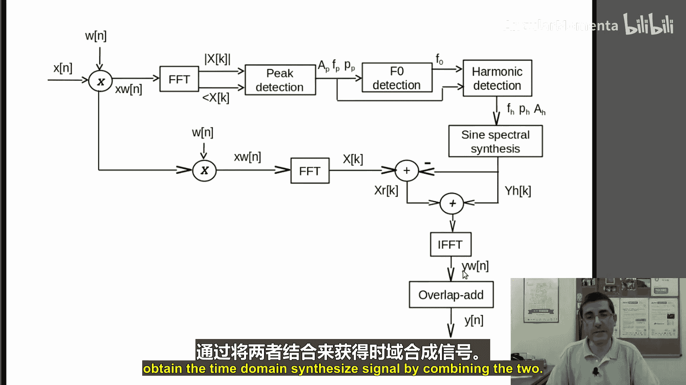
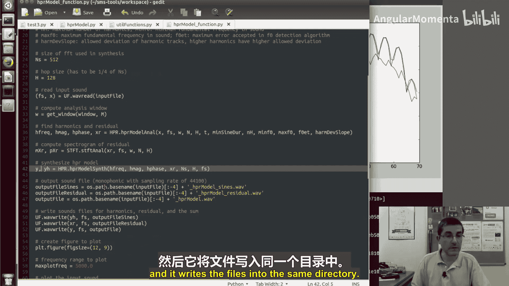

# 【巴塞罗那庞培法布拉大学】音乐应用中的音频信号处理-｜-Audio-Signal-Processing-for-Music-Applications-p52-07_03_02_HPR模型--BV18Xr6BeEX5_p52-

Welcome to the course on audioing processing for music applications。This week。

 we're talking about how to model sounds by combining the sinusoidal or harmonic approach that we talked in the previous weeks with the idea of a residual or a stochastic component。

And the core aspect of that is how to subtract the sinusoids of a sound from the actual sound。

 and this is what we going we're going to be talking about in this programming lecture。

 from a programming perspective。 so we're going to be implementing the subtraction of sinusoids from signal。

And we're going to do it through the HR model， the implementation of the model that we have within the SMS tools package。

 So basically， we're going to be talking about this blocked diagram。

In which from the input sound and all the analyses that we have already been talking about。

 the computing of the spectrum detection of the peaks in the case of the harmonic models。

 detection of the fundamental frequency and identification of the harmonics。

 then we are synthesizing the harmonics in the spectral domain。

 so we are synthesizing the lobes of the harmonics。

 and now in in this week what we are focusing on is on these subtraction。

So were focusing on how these sinusoids can be subtracted from the original signal and what we do is we compute again the spectrum of the input signal with the same parameters。

 so therefore with the same window that is implicit or in fact is quite explicit in the spectral domain of this sinusoid。

So that then we can subtract them。And then this residual spectrum can be sum to the harmonic spectrum and obtain the time domain synthesized signal by combining the two。

So let's look at some code that I wrote to show this in a concise way。

 So I I wrote some code just does it for one single frame。So first。

 we import all the packages that we need for this analysis。 Okay。

 we already have seen all of these packages。 and then we read a sound file。

 So we're going to start from the O sound， the a 4。

And we need to specify some parameters in particular， we're going to be analyzing only one frame。

 so we we choose the the location， the pointer where we're going to be reading the sound from。

 so the place 40000 sample。And then well we need a Windows size M， we take 801 samples。

 we need an FFT size bigger than thats so we take 2048。

 then we need a threshold for identifying the peaks since we're going to be doing harmonic analysis we need a minimum and maximum frequencies to look for the fundamental frequency。

 then we need an error threshold to have the lower bound for the algorithm that we are using for f0 detection that we wave mismatch or function。

 then we will decide how many harmonics， the maximum number of harmonics that we are going to be identifying and this is the deviation slope that we choose so that the higher harmonics have a higher degree of deviation than the lower ones so these are the parameters。

And now we start by computing things。 So first， we compute the analysis window and we take the blackman window。

Then since we're going to be doing this subtraction， the phase information is fundamental。

 we need to do zero phase window， This is where is fundamental。

 the idea of centering everything around zero so that the time domain basically waveforms they align perfectly so that the phases match and therefore the subtraction is possible and here the odd sizeized window is again fundamental so that's why we need to compute the center of the window in this way。

Okay， then we choose the fragment of the sound。And here we the pointer。

 so we choose the center of the window。 the pointer is the center of the window。

 and we take half of the samples from the left of this pointer and half of the samples on the right of this pointer。

So this is going to be our sound that we analyze and then we have seen all these before we compute the Dft of this fragment of the sound。

 we find the peaks， we interpolate the peaks with parabolic interpolation in here we convert locations to hertz and now we detect the fundamental frequency okay so we call the two way mismatched algorithm and it returns the best candidate for fundamental frequency。

And we identify all the harmonics by calling the harmonic detection function that looks for the peaks that are closest to the multiples of the fundamental frequency。

 Okay， and now we can synthesize these harmonics that we have identified。

And we synthesize it with another FFT and and window that we did the original analysis。

 So now we take an FFT of 512。And half of that is 256。

And we're going to be synthesizing the spectral signs the main lobes of the blackman window。Okay。

And this is the Y H is the complete spectrum of the this harmonic component。

And now this is what we are basically focusing on this week。

 we have to subtract this harmonics from the original signal。But to do that。

 we need to recompute the spectrum of the original signal so that we use the blackmarhar window that is in this spectrum。

Okay， so we have to compute。A window， a black Harris window of the size of the same size that we are now using for the synthesis。

512。And then we're going to choose again from the original signal。Of the fragment of the sound。

 But only the 512 samples around the pointer。 So here we we choose another。Original signal with this。

 these 512 samples and multiplied by the black Harry window normal so that then it becomes easier to compute。

To do this subtraction。Okay， and so this is our new input signal。

 and then we have to00 phase window it， so we have to put it around zero and we do that by defining the FFT A we're going to use and center everything around0。

 and then we can compute the spectrum of that。And the the subtraction of the sinusoids then becomes easy。

 Its just a complex subtraction。 We subtract the harmonics。

 the harmonica spectrum from this new spectrum that we just compute。So okay。

 so let's run this and let's step through the different variables that we have been generating。

 So this is the file called test 3。Okay， so this has computed it。

 And now let's keep looking at the different variables。 So， for example， let's plot the x1 sound。

 Okay， this is the fragment of the sound we are analyzing。

Then we can plot the resulting spectrum that we computed from that so we can plot Mx。Okay。

So this is in Dv， the magnet spectrum of that。Then it has computed out of that peak so we can even just print the locations of the p So E P log is the peaks or the ps that it has found within the array of the FFT。

 it's better to show it in in her。 So if we print IP frequency is the frequency of the ps it has found。

Then this has gone to the F0 detection， so it has identified a fundamental frequency and the fundamental frequency has been chosen to be 443 Hertz which makes sense we are analyzing a noble sound an A4。

And then out of this fundamental frequency， it has chosen the， the peaks that are harmonics of this。

 So H frequency。Is the set of harmonics that it has identified。In this particular location。

 so it has identified all these harmies， the other peaks have not been considered harmonics。

 Of course we have chosen a threshold and a given set of parameters that has limited the number of harmonics to these 6000。

 So it becomes easier so we just have analyzed up these these harmonic。Okay。

 then we generate these harmonics as a spectrum。And so it has generated Y H。

 So if we plot the absolute value of Y H。We're going to see the the magnitude of the complete spectrum。

 but let's plot it just in in Db。 So we will just plot in 20 times block 10。off。

The absolute value of Y H。 And let's just take only， let's say the first 70 sample。

 So from the beginning to the sample 70。 So we focus on the first harmonics。

 which are the ones that basically we have generated。Okay。

 so these are the harmonics that we basically， we have synthesized。 This is the synthesize spectrum。

 On top of that， we can plot。The， the signal that from the original sound that we have recomputed。

 So x2， the x2 spectrum。Okay， so if we plot on top of that， the absolute value of x2。

In here we now see the green line which is basically the original spectrum。

 and as you can see is very much similar， so that means that we very much have synthesized the original spectrum and then we can apply the subtracted spectrum so the subtracted is the Xr spectrum。

And this is this red line。So the red line is the subtraction of the two。

 and it clearly shows the residual world that it has。

This works and basically we do that at every frame。And then， of course。

 we can do the inverse to generate all these signals back。Now。

 let me show you the actual code that is in the SMS tools package that performs this harmonic plus residual wall modeling。

So there is this file called HPR model。pyy within the models directory。

 and in it there is the analysis and synthesis of HPR modeling。

 there is one function that does the analysis， another one that performs the synthesis。

 and then there is another one that does both analysis and synthesis at one frame at a time。In fact。

 we recommend very much to do the analysis and synthesis separate so that we can take advantage of cleaning the trajectories and having some memory in the tracking so that the harmonics are better。

And in the analysis part of the function。It basically calls two functions one that we already have seen。

 it does the harmonic analysis in the same way that we saw it when we talk about the harmonic model and then the new thing that it does is the subtraction so there is this function sign subtraction that has this input the harmonics identified by the harmonic model has this input also the input sound again and it subtracts the harmonics from this input sound。

 so this function is in the ut functions directory。

In the file and in here you find the s subtraction function and it basically does what I have explained just a while ago。

 it goes through the sound and then at every frame， it does the subtraction of the sinusoid。

 so the sinusoids have already been been identified so here it iterates over all the analyze frame and then it reads again a fragment of the input sound。

 it recomputes the input sound with this window with the black Man Harrys window and then it synthesizes the harmonics。

 with this blackman main lobe and then is able to subtract the。The harmonics from the input sound。

 and that's all。 And then it synthesizes the residual signal。Back and that the windowing effect。

 So we can do the overlap at correctly。And that's all that's what the sininooidal subtraction does。

 and it returns， of course， the residualiv signal。And the output of the analysis is the harmonic frequencies。

 magnitudes and phases and this residualce signal。And then the synthesis。

 it basically receives back the harmonic magnitude and phases that we analyze and the residual signal and simply puts it together。

 so it calls the sinusoidal model synthesis that we already have seen and it simply adds these sinusoids with the residual。

And that's all。 Then we have this other function。HPR model function dot py。

 which is the file that puts it all together and is in fact。

 the file that is called from the interface that we have been using and it simply there is one function main and that does the analysis and synthesis of a sound and it plots the intermediate values。

 So it calls the HR model and L。and then well it computes the spectrogram of the residual so that we can show it as an spectrogram。

 and then it performs the synthesis and it generates the overall output sound。

 the sum of the residual plus the harmonics and just the harmonics。

And it writes the files into the same directory。

Okay， so now we can execute this file， we can run this HR model function file and it will analyze fragment of a saxophone sound。

 which is the default sound with the HR model so we will get here we see the harmonics of the sound and the background is the spectrogram of the residual so we have computed the spectrogram of the residual and here are the two together and of course we can listen to them we can just in this directory it has save the residual signs and the sum of the two so we can just play the。

for example， first the residual。Okay， and then we can play， for example， the signs。うん。

And we can play the sum of the two。うんう。Okay， and that's。

 that's all basically we have gone through the the harmonics plus residual model。

And we have used quite a bit of code from the SMS tools and from Python to be able to subtract the harmonics from the residual。

And hopefully that has given you a programming perspective to this idea of harmonic plant residual subtraction。

 and it's not a very sophisticated thing from a signal processing point of view。

 but from a programming point of view is quite delicate。

 we have to be very careful in how to put the signals and how to analyze them in order that they align perfectly and in order that the complex subtraction in the spectral domain is done correctly and we obtain a real residual。

And that's also in next class we're going to take the next step which will be to from a programming perspective look at the stochastic component。

 so how we can then convert this residual that which is compute it into an as stochastic component and then have the harmonics plus stochastic model。

 so see you next lecturee bye。

