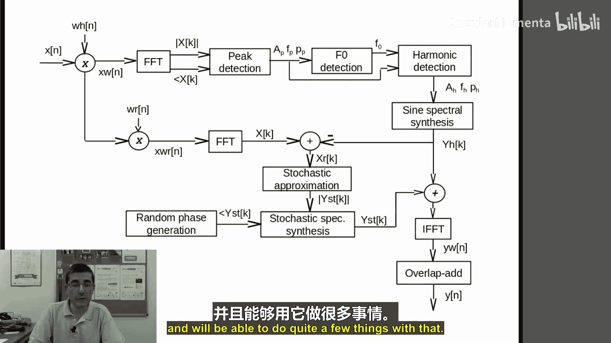
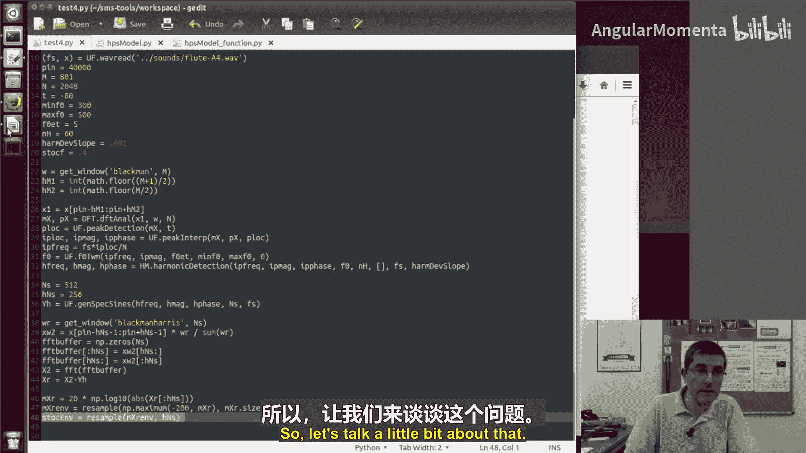
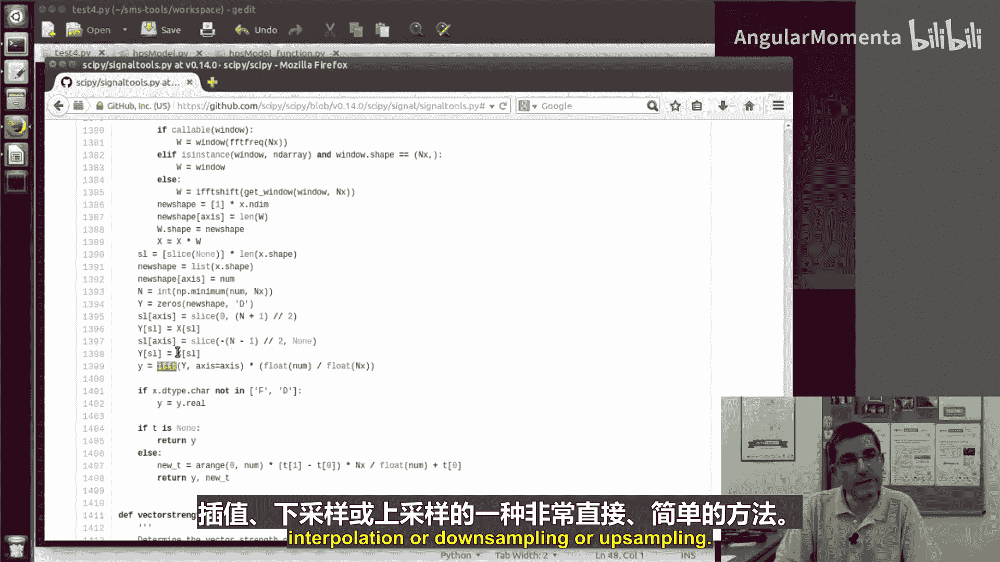
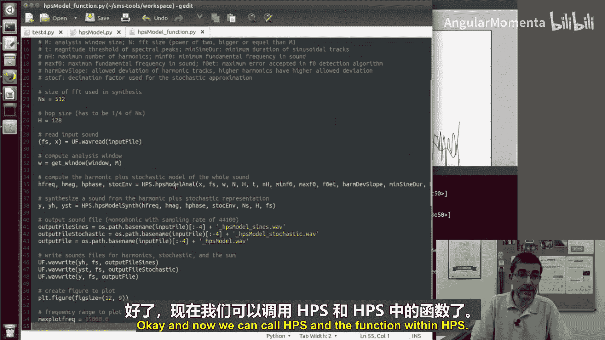
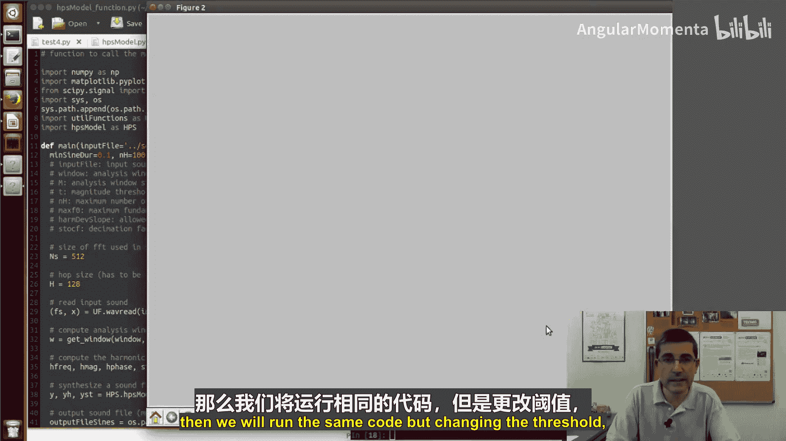
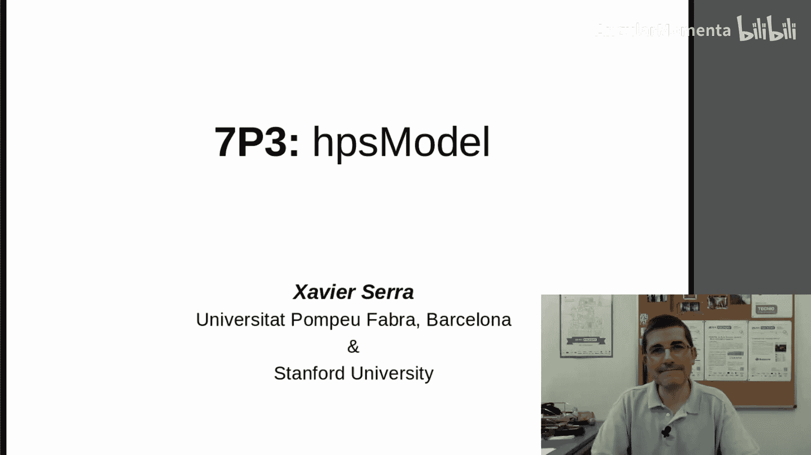

# 【巴塞罗那庞培法布拉大学】音乐应用中的音频信号处理-｜-Audio-Signal-Processing-for-Music-Applications-p53-07_03_03_HPS模型--BV18Xr6BeEX5_p53-

Hello， welcome back to the course on another single processing for music applications。

In the previous programming lecture we talked about the HPR model， the harmonic plus residual model。

 that was the idea of modeling a sound with a harmonic and a residual component and we talked about the implementation in the SMS toolsol package。

Now we want to go step further and talk about the H model， the harmonics plus stochastic model。

 So now we are modeling the residual that we obtain with the stochastic modeling approach。

 so we obtain a harmonic and an e stochastic representation of a particular sound。So the diagram。

 the block diagram is very similar， the whole thing for the analysis is the same until we obtain the residual spectrum of x Xr of k and then instead of just going and summing it with the harmonic component。

 what we are doing is approximating it with an is stochastic approximation so by smoothing the magnet spectrum。

And then the synthesis is done by generating random numbers for the phase and combining it with sort of an interpolated version of this approximation so that we generate a complete spectrum and these stochastic spectrum can then be added back to the harmonic component。

The great advantage of this stochastic approximation is that now we are more flexible。

 we can do many more things on this representation apart from being much more compact this is stochastic approximation reduces the amount of information that is required to reconstruct the signal so apart from being a compact representation is more flexible and we'll be able to do quite a few things with that。

So let's start from the same code that we looked at in the last lecture which was this code in which well now I changed the sound。

 now I use a flute sound but basically it performs the harmonic analysis by taking FFT and the detecting the F0 so it performs the harmonic analysis steps and then it synthesizes those harmonics and it subtracts them from the original signal。

 it recomputes the spectrum of the original signal with the same window size and type then the one that is in in generated sinusoidal spectrum so we need to multiply by a blackmanhar's window and we need to choose the window size that was the same then was used for the。

Sinoceral synthesis。And we can then subtract the harmonics。

From the original signal and obtain the residual。 and now in this lecture。

 basically we focus on the stochastic approximation of this residual。

 and these are these three lines doing that。So the first is we are converting it to a Db scale。

 so we are converting half of the magnitude spectrum to a DV scale and we obtain a new magnitude spectrum。

And then we call this function called resample with this magnitude spectrum and of course。

 with values that are above a certain threshold。And we are converting it to a shorter array and the size of this new array is the size that we started from multiply by stock F and stock F is our stochastic factor approximation。

 basically is our smoothing approximation or down sampling factor。So basically。

 it means that the output array will be 40% of the original spectrum。

And then we are up sampling again to the size that we started with in order that then we can do the reynthesis so in fact。

 resample can be used both for downs and for app sampling and it uses the DFT approach So lets let's talk a little bit about that so we can go to the documentation on the resample function within spi so this is the documentation。

 so it takes an array， it takes the size of the output array。

 so either less or more so you can downsle or app sample and well there is some optional arguments also that allow us to give a particular window or to give a more multimensional array and process only part of that。

And since Python， of course is all open source， we can also see the source code of this function。

And as I said， well， a example is uses an Fourier based approach to do down sampling and app sampling and what it does。

 it performs first the FFT of the input signal。Then it will basically cut the spectrum or append sample。

 depending if it's up sample or down samplingling or upsling。

And then once we have recomputed a longer or a shorter spectrum by cutting or appending zeros。

 we perform the inverse F50。That's a quite straightforward。

 simple way of performing interpolation or downs or app sampling。

OkaySo we go back here。 So these returning the for the first resample， we will return less samples。

 And then afterwards， we will convert it to this up sample version that will be a smooth version of the spectrum we started with。

 Let's， let's run this。 So we can see how that works。 So let's run。De 4。Okay。

 and now we can plot the original spectrum。 So M X R is already the D B version of the spectrum and half of it。

Okay， so this is our residual spectrum。 And then if we plot on top of that。The， the stock M。

 that's of the same size， but a smooth version， because it the result of having first down sample and then。

App sample with interpolation。Okay， so as you see it we are very much in fact。

 if we zoom in into any of these regions。We see that the green line is the the smooth version。

 but is of course is is smoother than the original one， but it follows quite quite well。

 the original signal。 So let's change the stochastic factor of 0。4。 And let's put maybe 01。 Okay。

 so then that will be a stronger smoothing factor。And if we save these and then we compute it。Okay。

 now we plot again the。The original residual spectrum。 And now let's plot the smooth envelope。Okay。

 and this clearly shows the smooth envelope on top of that and its much smoother than before。Okay。

 so that's basically what the stochastic approximation does。

 And if we now go into the H model code of the of the SMS tools。

 well we'll see the analysis function， the synthesis function。

 and also one function that does analysis and synthesis at the frame level。And the analysis。

 for example， is basically the same than for the HPR model， we only add one input parameter。

 which is this stock F， the factor， the movinging factor and then in the analysis we first perform the harmonic analysis then we subtract the sinusoids from the original signal to obtain the residualce。

 and then we run the stochastic model and L， the one that we already discuss when we talked about the stochastic model。

 so we just the stochastic model receives the signal， the residual signal， and it has the ho size。

 the same ho size that we are using and now the window size that we use for the stochastic approximation is just twice the hop size so in fact the stochastic approximation does not require a big windows in fact it's all the other。

Other way around the smaller， the better so we can capture time information。

 the stochastic components， the residual components， the time information， the attacks of the node。

 etc cea， are most critical so the smaller the window the better So in fact if H many times is by default like 128 samples here we are using windows of 256 samples so we will be computing an f50 of 260 56 samples and approximating that。

Okay，And， of course， then we return the harmonics。 And instead of returning the residual。

 we return these envelopes， this sequence of envelopes that we are computing。

 and in the synthesis part。Well， it's a similar situation。 we synthesize the sinusoids。

And then synthesize the stochastic component using the stochastic model synth that also we talked about。

 So from these envelopes， we can synthesize the stochastic component。

And the function that puts it all together， there is this HP model function that includes analysis and synthesis using the harmonic plus stochastic models so it has some parameters。

 default parameters， and then it performs analysis and it performs the synthesis and in the process it plots certain intermediate values。

Okay， so let's go to the terminal。 And now， instead of running the， the code or running the。

 the the code by calling the the file， we can also run the function directly。

 And that allows us to be able to change the parameters。 So if we import this function。

 the H P model。Function。Okay， now we have imported。 we haven't executed。 Now。 well。

 we better to just import it with a given name， for example， H。Okay。

 and now we can call H P and the function within H。 So within this file， there is this function main。

 so we can just call main。

And here now we will be able to change the values of this parameter。

 So let's just get the values by default。Okay， so this computes this analysis and synthesis of this。

Sound of this s phrase with the default parameters。And now。

If we can we can play around so of course we could use the interface that we have been showing in the demo classes。

 but here it may be sort of more more intuitive in terms of understanding what is going on and being able to go deep into the code to just replace parameters here。

 So for example， now if I want to change the threshold and make it a smaller threshold instead of minus-100。

 let's put minus 40， then we will。Run the same code but changing the threshold and of course。

 changing the threshold has meant that it found only few harmonics。 in fact。

 it considered everything is stochastic and in here the the stochastic representation is the one that is more prominent。

Okay。嗯。And you can change any parameter。 you can change the sound， for example， Okay。

 let's we can change the sound file or we can change the the minimum duration of the of the harmonics。

 etctera， etc cetera。 So no need to to explain that any。

 basically we can just execute it any way we want。Okay， and that's all I wanted to say。

 So this is basically。An extension of the harmonic plus residual model。

 and we have seen how it works。So basically this is the most complex model that we're going to see in this course and all the others can be understood as kind of related with this one。

 So if you understand this model， I think it's a good way to understand a lot of the things we have been talking about。

So that's all for today， so I hope to see you next lecture。 Thank you。

