# 【巴塞罗那庞培法布拉大学】音乐应用中的音频信号处理-｜-Audio-Signal-Processing-for-Music-Applications-p54-08_01_01_声音变换1--BV18Xr6BeEX5_p54-

We'll come back to the course on addressing or processing for music applications。Until now。

 we have been presenting different techniques for analyzing and synthesizing sounds。

It's time to put that in practice and to make use of it in actual music applications。

 so this week we'll be talking about sound transformations about how to transform the representations we have been talking about and then reynthesize a sound that is a modified version of the input sound。

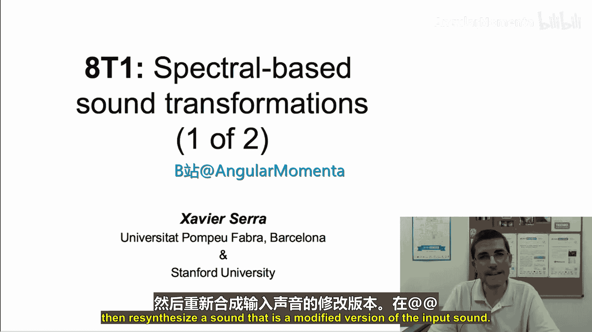

Well be talking in this first theory lecture about the short time for your transform and about two types of manipulations or transformations。

 filtering and morphing。And also， we will be talking about the sinusoid model and how we can use it for frequency scaling and time scaling a particular sound。

Let's start with the short time for your transform。

 this is the block diagram that we saw in which frame by frame we are selecting a fragment of a sound when doing it。

 computing the spectrum obtaining a magnitude and phase and now what we are introducing is a transformation block after this spectral analysis。

From this transformation， we obtain a new magnitude and phase spectrum that can be inverted。

And we can obtain a new sound that is a modified version of the input sound。

Let's first talk about filtering。We talked about filtering in this course before and the idea is that filtering can be implemented in the time domain using convolution or in the frequency domain using multiplication。

 so this is what we are using here， the short timeframeier transform for applying the filtering in the spectrum by multiplying the magnitude and phase spectrum of the input sound with the magnitude and phase spectrum of the filter。

Strictly speaking， what we are doing is if we have the magnitude and phase separate。

 we're going to be summing the phase spectra and multiplying the magnitude spectra。

So the filter is expressed by its frequency response that has a magnitude and a phase and the phases are added and the magnitudes are multiplied。

Okay， and the equation below shows this idea。 So the the complex spectrum of the output。

Is equal to the product of the two a man spectrum of the minus spectrum of the filter with one frame of the manual spectrum of the input sound。

 and the faces are sum， but again is the whole phase spectrum of the filter with one frame of the input sound。

And then we can perform the inverse of F D and obtain an output sound。 So let's see that in practice。

 So here we have on top left a fragment of an orchestral sound， very short fragment。

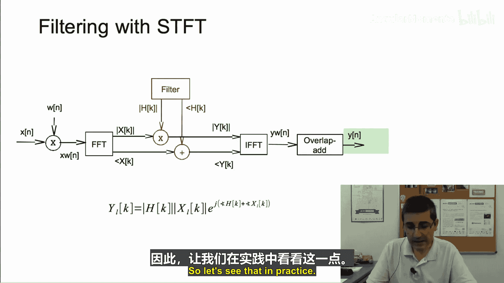

Of which we compute the magnitude and phase spectrum。

 So below that we have the red line is the magnitude spectrum and below is the phase spectrum。

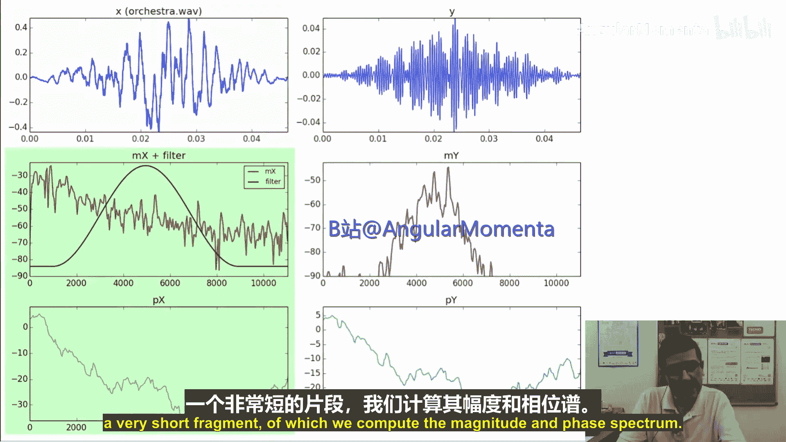

And then we have the magnitude spectrum of a filter。A filter can be zero phase。

 So it's normally the important aspect of the filter is the magnitude of it。 and in many situations。

 we basically can discard the phase because it has no effect。

 So in here we are what we're going to do is multiplying the magnet spectrum of the filter with the magnet spectrum of the input sound。

 However， since we are in a log scale in Db， we at the two together。

 So we'll be adding these two shapes that we see here。

 and the shape on the right is the added result of these two shapes。

 So it's a modified version of the input spectrum。And the faces basically are untouched。

 and then we obtain the output sound y by performing the inverse of50 of that。

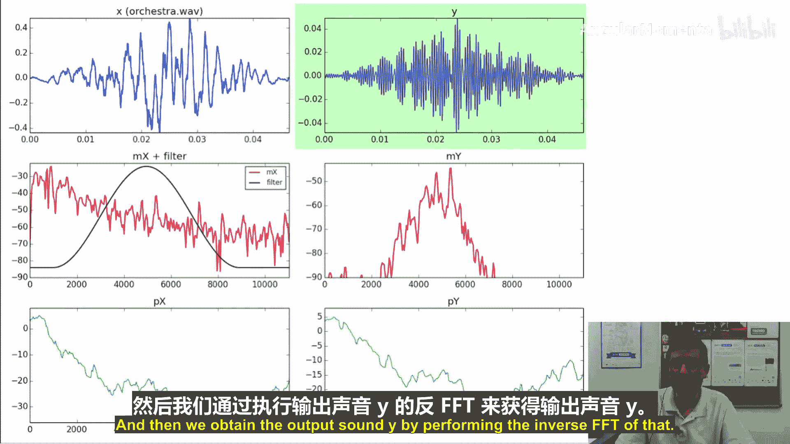

Let's actually see these for a complete sound。So on top。

 we see the spectrogram of the complete orchestra sound we have heard before。

 but let's listen to it again。🎼，🎼，Yeah。And now in the middle。

 we have the shape of the filter that we are applying the magnitude of it。

And then what we are doing is multiplying this shape。

 but every single one of the frames of the input sound in the magnet spectrum。

 And we obtain the spectrogram below。 So let's listen this resulting sound。

Clearlyly much softer because we have attenuated most of the frequencies。 We have only let pass。

 So this is a band pass filter。 The frequencies around 1000 and something hurt。

 and the rest are very much attenuated and these ones， we have even boosted them a little bit。

 but of course， energy wise， we have reduced the energy quite a bit。

Let's now use the short time for your transform for another type of transformation。

 what we call morphing。In morphing we start from a sound x1 in which what we are doing is basically the short time for your transform analysis reynthesis。

 and at every frame we are multiplying its magnitude spectrum by a magnitude spectrum of another sound that is also changing in time。

So what we are doing is with taking another sound X2。

 we are doing a similar short time for a transform process and at every frame。

 So basically it's a parallel process， we are only using its magnitude spectrum and then what we're doing is movinging it because we the idea is that we are applying the general shape of x2 into x1。

And if we see the equation below， basically what we are doing is similar to the concept of filtering。

 but now the x2 is time varying， so it has an L is as a frame and were multiplying this two magnitude spectrum of x2 and x1 at frame L and then the phase spectrum is only the one of x1。

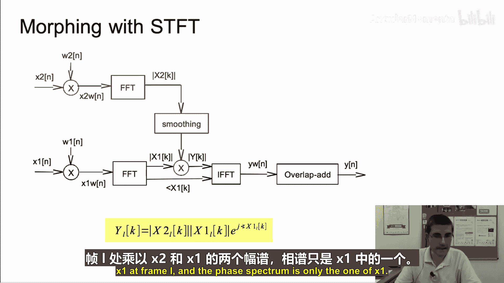

So let's see that in practice。This again is the same sound that we played before the orchestral sound and below it is again the magnitude unpha spectrum。

 but now what we are doing is this this black line is a smooth magnitude spectrum of another sound。

 but this one will keep changing the same way that keep changing the orchestral sound and we will be adding this two spectra again because it's in a logarithing scale and we will be creating a new set of a spectra from which we do the inverse F5。

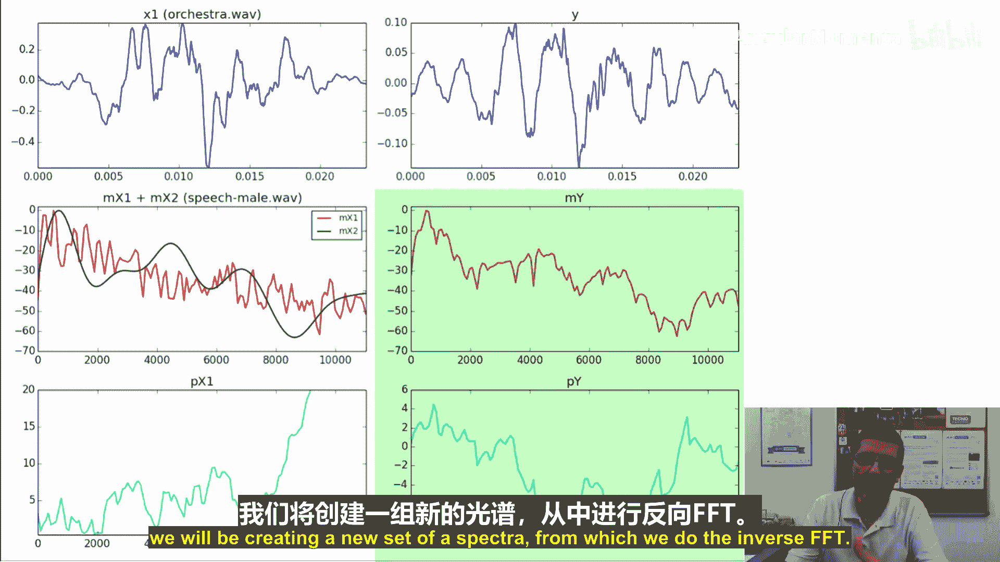

Let's do this for the time varying sound。

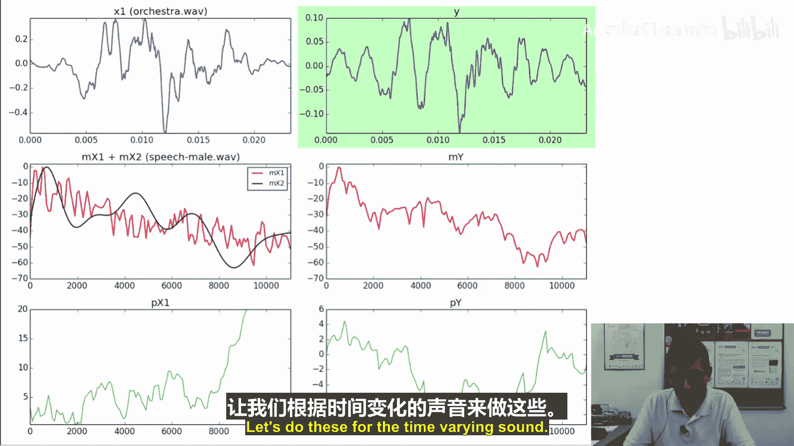

So on top， we have the orchestra。 We already have heard about it。

 and let's now listen to the other sound， the x2 sound， which is this speech male sound。

 Do you hear me they don't lie at all。 And the spectrogram we see in the middle is the smooth version of this x2 sound。

 So it does not have the detail of x2。 It just has the general shape。

 And these are the two spectrograms that we are summing frame by frame to obtain the lower spectrogram M Y in which we are definitely seeing that is not X。

 and there is not it's not x2。 It's a modified version of the two。

 Let's listen to this modified version。やめ？🎼They tell。今日？Okay。

 so it clearly has aspects of the orchestra and basically we can understand the speech because the general shape of the minus spectrogram is the one of the speech。

Maybe one way of understanding this sound is as if the orchestra was playing through the vocal track of this male and therefore reproducing the phonetic kind of textures of the speech sound。

Okay now let's go to the sinusoidal model that we already have seen。

 so we have again the analysis of the sinusoidal model with the pig detection and sinusoidal tracking and now what we're going to be doing is modifying the resulting sinusoidal values but there is a small change here we are not going to take the phase values。

 the phase values are very sensitive and if we want to make any transformations。

 it's very difficult to take care of them。 So what we are doing is regenerating the phase values from the frequency values。

 so we'll be modifying amplitude and frequencies and then we will be generating the phase values after the transformations and this is the input for the synthesis and is the same synthesis that we have been doing until now。

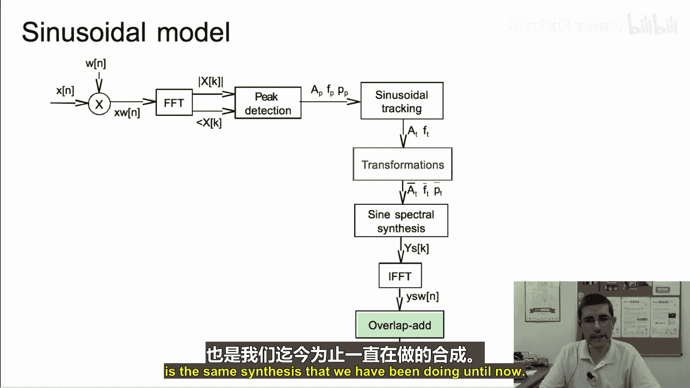

These are the particular operations we are doing on the output of the sinnocerial analysis。

So that the new frequencies and new amplitudes are the result of applying some scaling factor S F to the input frequency。

And also the reading of the input frequencies are controlled by some scaling time factor。

 which allows us to move inside the kind of input array input signal so that we can slow down or speed up the reading of the sound。

And we do that for both amplitude and frequency。 The amplitude since is done in the D scale。

 with sum the scaling amplitude factor with the amplitude of the input signal。

And the faces are regenerated， they are not from the original sound。

 and they are generated by starting from the previous phase and therefore we need an initial phase at the beginning which can be zero or can be random value and then at every frame we add the frequency。

 the new frequency that we are generated so that the faces automatically unwrap and generated from the frequency values。

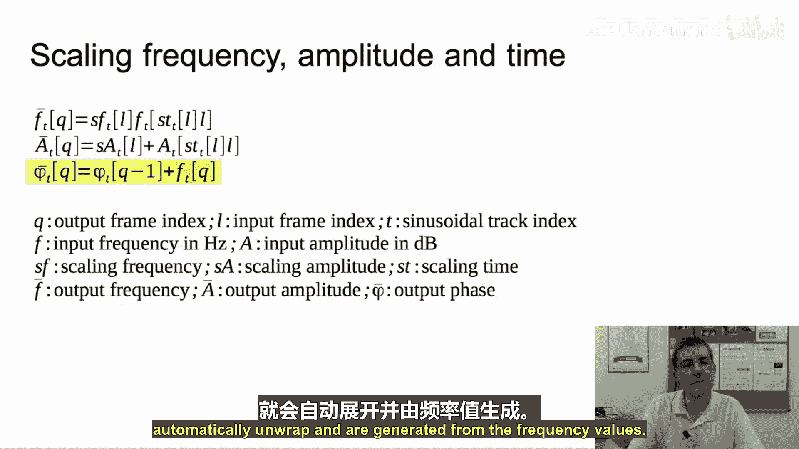

So this would be， for example， a scaling envelope。 So the scaling factor applied to a particular sound。

And therefore， it would be an envelope in which will will read from the input time。

 So the horizontal axis is the input time， and it will assign an output time to every input time。

So changing the reading position of the input time and modifying it its length。

So let's see a particular example of this time scaling effect。In which we start from Madrana sound。

And we are analyzing that with the sinusoidal model。 So on the spectrogram top。

 what we are seeing is the original signal。And the synthesize， well。

 the trajectories of the sinusoids。And let's listen to this sound first。

Okay and then below it is the transform spectrogram， both the transform sinusoids。

 So these are the modified sinusoids in which we have spaced them differently。

 So we have been reading them at a different speed And if you look at the horizontal axis。

 the time axis is very different。 So the original sound was two seconds long。

 And now this output sound is basically three seconds long。 So it has stretched by a factor of 1。5。

 So what we are seeing here is the output sound， but of course， with a new time information。

 So in terms of frames， there are many more frames because the length of the frame will remain the same。

 So let's listen to the reynthesized modified sound。Okay so we have changed the duration。

 not in a constant scale。 In fact， we basically made all the onsets at the same sort of distance。

 so we we basically wrap the time information in a way to generate the times in a different position and making the sound a little bit longer。

 Of course， the number of possibilities here is enormous and we can just play around with this mapping in any way we want。

And in terms of the other transformation， the frequency scaling applied to the sinusoids。 Well。

 we also need a scaling envelope in which it's time varying。

And so here we have the horizontal axis time and the vertical axis is the scaling factor。

 So that means basically that at beginning of time we are multiplying all the frequencies of the sinusoids by 0。

8 and by the end of the sound were multiplying all the frequencies by 1。

2 so the frequency will start lower and end up higher。

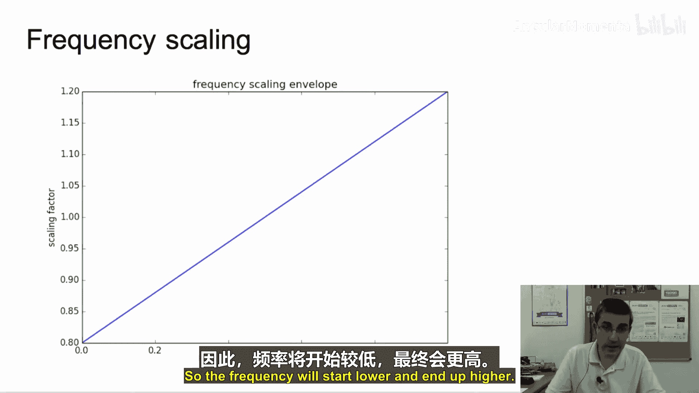

So let's see that in a particular sound。 So this is the orchestral sound that we have already heard and we see here the sinusoidal analysis of it。

 the spectrogram where we see the original spectrogram and the sinusoidal tracks and then below it is the transform sinusoids from that curve that we just show So here we see that at the very beginning。

 the sinusoids are more compact， so they're lower frequencies and at the end theyre higher because we have multiplied them by 1。

2 so let's listen to these modified orchestral sound。Okay， of course。

 it doesn't sound natural because this is not something that you normally would do and there is some distortion。

 but it can be refined and obtained some good results by applying this type of techniques。

There is not much information about the details of how to apply these type of transformations on sounds。

But if you look in Wikipedia， you can have some pointers and some initial references for sound effects。

 equalization and how to apply time scaling and pitch modifications to sounds。

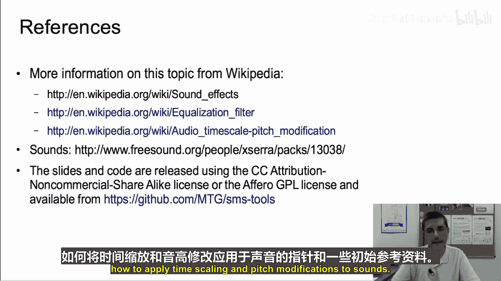

That's all I wanted to say in this first theory lecture。

 so we have gone over some particular transformations using the short time forier transform and the sinuscerro model and then in the next theory lecture we will continue with the other models we have presented and using them in some other type of transformations。

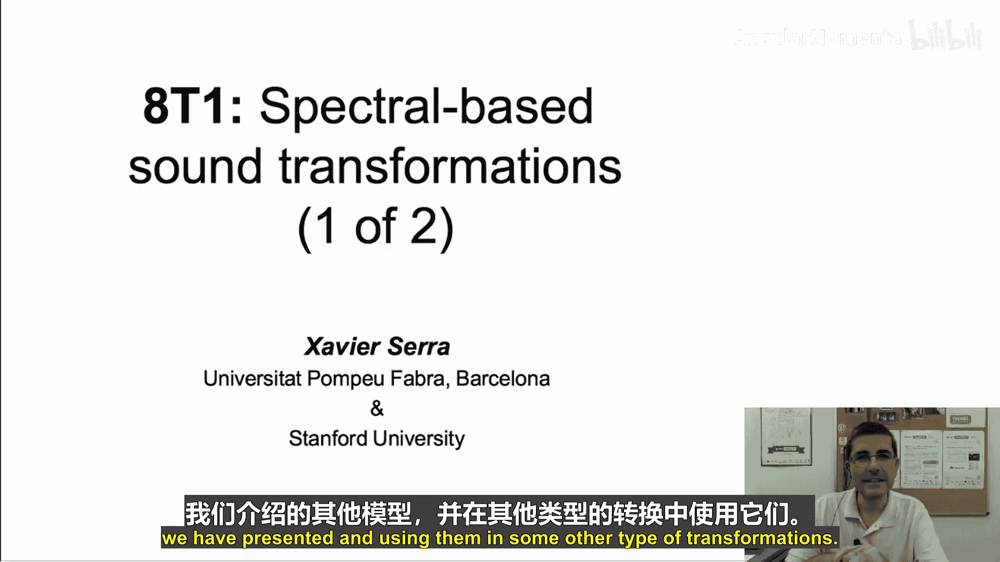

So I hope to see you next lecture， bye bye。