# 【巴塞罗那庞培法布拉大学】音乐应用中的音频信号处理-｜-Audio-Signal-Processing-for-Music-Applications-p55-08_01_02_声音转换-2--BV18Xr6BeEX5_p55-

Welcome back to the course on our processing for music applications。In the previous theory lecture。

 we started talking about sound transformations， in particular about how to use the short time Four transform and the sinusorro model to manipulate sounds。

In this second theory lecture， I want to continue that。

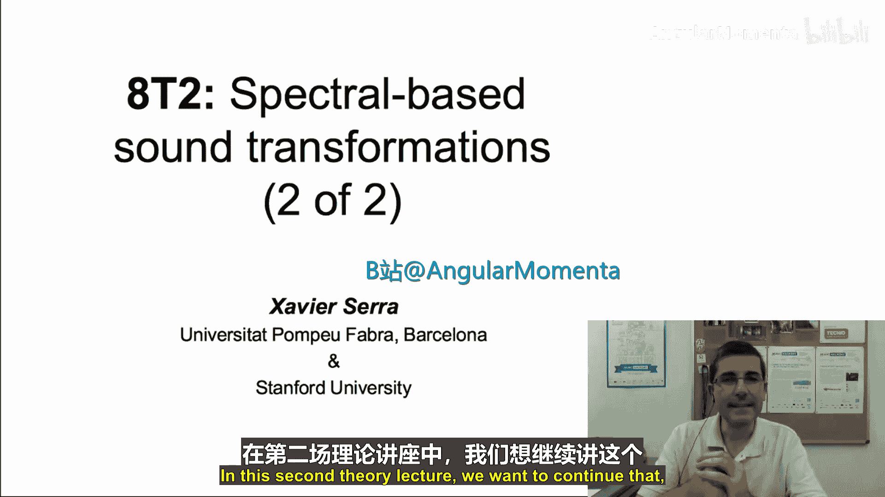

And talk about the harmonic plus residual model and how it can be used for transforming the frequencies of the harmonics。

 and then the harmonic plus is stochastic model and how can it be used for time stretching and morphing operations。

This morphing， by the way， is quite different from the one that was possible with the short time period transform and of course these are just some example operations。

 example transformations， but the number of possible usages of these models is much larger。

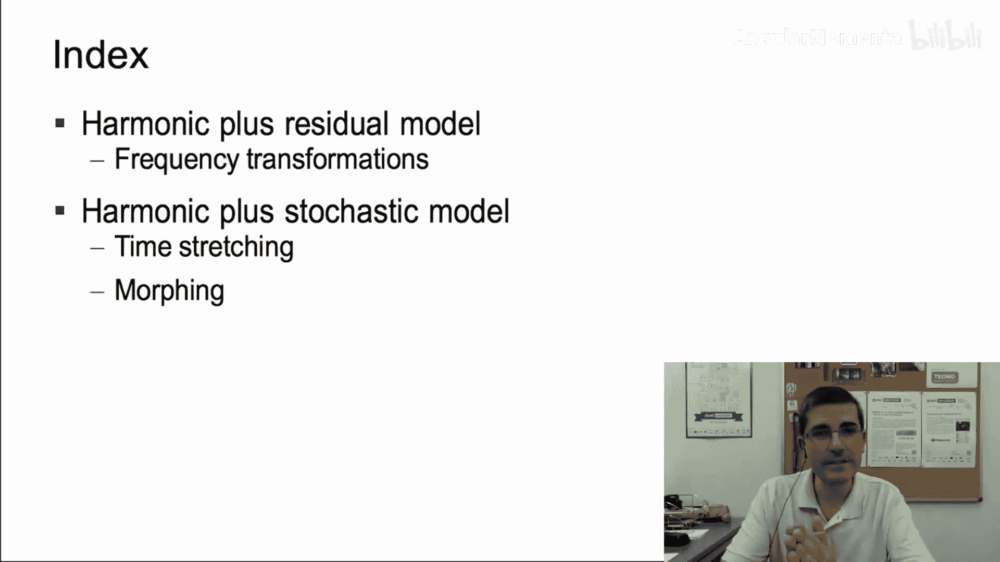

Let's start with the harmonic plus residual model。This is the block diagram that we have seen before in which from the input sound。

 we analyze the spectrum， find the peaks， then find the fundamental frequency。

 find the harmonics and we subtract those harmonics from the original signal。

 we need to compute the spectrum of the original signal again in order to develop a spectrum from which we can subtract this harmonics in a proper way。

Okay， and then where we do the transformations is in the frequencies and amplitudes of the harmonics。

 we don't apply any transformations to the residual well。

In order to apply transformations to the residual， it makes sense to have a model for it。

 and that's what we're going to be introducing in the next model， the harmonic plus stochastic model。

And here the transformations on the harmonics again， like in the sinusso model。

 it's applied only on the frequency and amplitudes， the phase are forgotten， we don't use them。

 we will be resynthesizing them again after transformation。

And the main issue of that is because the faces are very sensitive to transformations and it's very difficult to handle them。

 so it's better to just regenerate them after transformations and it doesn't sound that bad。Anyway。

 so after the transformations we can sum these new harmonics to the residual signal and these residual signal since it does not include any deterministic。

 any harmonic information， it will merge quite nicely and then we will create a sound it has the same residualiv than the original and the harmonics will be modified。

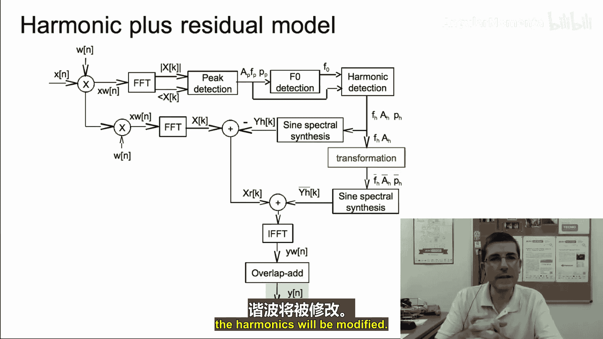

In terms of types of transformation that can be done to these harmonics。

 to the frequency of these harmonics， there are many。And here I， I explain three common ones。

The most traditional one is to just transpose all the frequencies by a given factor。

 so we multiply all the harmonics by a scaling frequency factor so that would correspond to a transposition。

 so if you multiply by 2， it would correspond to converting the sound to an octave higher。

 if we multiply by 0。5 would be an octave lower。Then we can， instead of multiplying。

 we can just shift all the frequencies。 For example， we can sum a factor to all the frequencies。

 So we'll be shifting all the harmonics by an additive component。And finally。

 the last one I want to mention is what is called frequency stretching。

In which we are applying a frequency change that is dependent on the harmonic so here what we are doing is basically dividing every harmonic by its harmonic number。

 so we basically get a frequency around the fundamental and then we multiply by the harmonic number to the power of a scaling factor。

Therefore， the higher harmonics will be modified very differently from the lower harmonics。

 it's very much the harmonic dependent and that can create some nice effects that we will see。

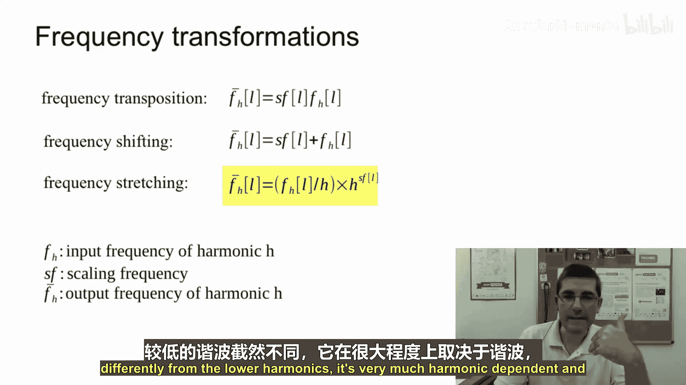

So this is a plot of these three transformations that exemplify these operations quite nicely。

 so on the top left we have the original harmonics all located at at the harmonic number location。

 one，2，3，4 and5， then if we transpo by two on the right it just simply multiplying every by two so harmonic one will be in position2 harmonic2 imposition4 etc。

 we are maintaining a harmonic spectrum which is transposing by a factor of two。If we shift instead。

 by a given value in this case， since we are having the frequencies normalized to integer values here by 0。

5 will be basically shifting by half of the frequency of the first fundamental of the first harmonic。

And in here we see that we are shifting everything by a constant value。

 So from now after this transformation， we do not have any more a harmonic series because the first harmonic is not just the fundamental frequency anymore so we have now a series of values that are equally spaced。

 but there are multiples of another frequency。 So the sound may be quite a bit different and quite interesting in some cases。

 and finally the frequency stretching operation。It's a quite different operation now it changes the distance between the harmonics and it likes it's like an aordion so if it's here 1。

3 means that well the first value of the fundamental will not be touched the first one will be stretch by a factor of 1。

3 and then these are going to be powers of these so as we go higher up it's going to go sort of the distance will increase kind of exponentially and these creates again quite very interesting effects。

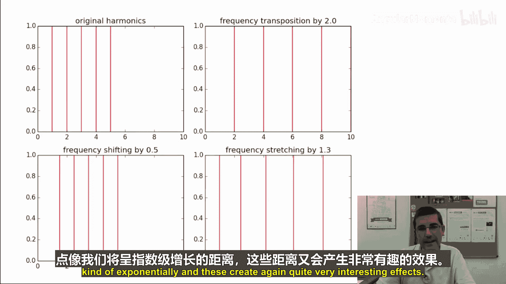

So let's listen to sound in which we have applied some stretch and transpose kind of transformation。

So let's listen， so it it's a flute sound that we can listen to。Okay， it's an A4。 And below that。

 we see the harmonics that have been identified on top of the residual spectrum of the original of signal。

 And then what we are doing is leaving the residual asities。

 So the background spectrogram is exactly the same。T the top one。

 And we are just modifying the harmonics。So if you look here。

 the harmonics have been heavily modified and if you see there have been a stretch and at the same time transpose a little bit。

 so let's listen to the modified sound。 of course， quite different and if you pay attention。

 the residual is there and since the residual is basically this breath noise is it merges also quite well with this transpose harmonics。

Okay， let's go to the other model， the harmonic plus stochastic model。

 and it's very similar to the previous one and now the transformation is applied both in the modeling of the residual signal and of course in the harmonic components。

So we have an e stochastic approximation。And therefore。

 we can transform that quite easily because it's a model that has simplified the residual world quite a bit and is quite flexible in terms of manipulations。

And then of course， after transformation， we obtain the stochastic component and we obtain the frequency amplitudes of the ands of the harmonic sinusoids。

 and we can synthesize the two and suming together。

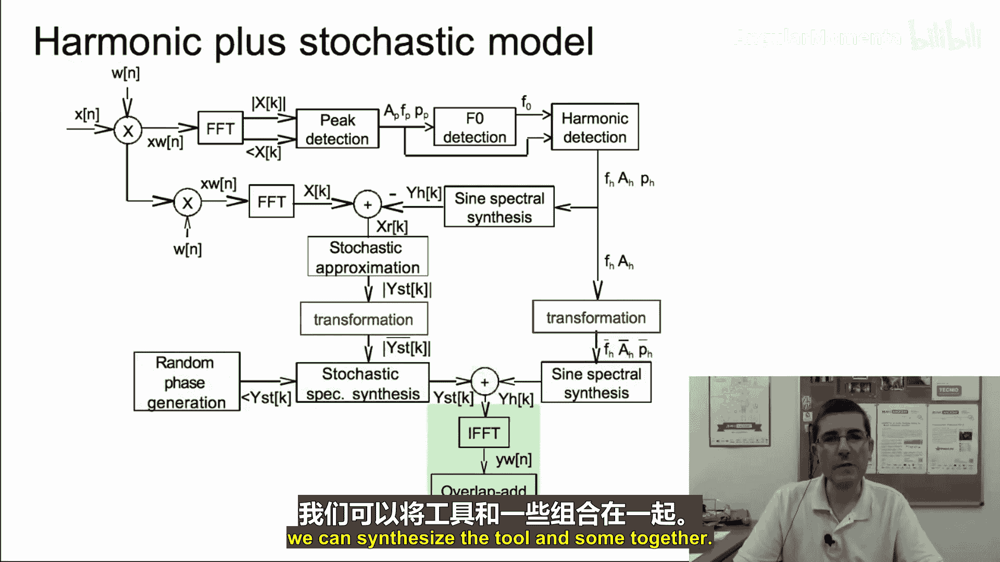

So in terms of what is actually done is very similar to what we presented for the sinino sort model。

 Now， what we are introducing is the transformations on the stochastic component in a similar way。

 So the frequencies of the harmonics can be a scale by a factor and the time。

Of the reading of these frequency values also can be changed in order to obtain this time scaling operation。

 So we have this scaling function。The amplitude is the same way and the stochastic component is handled in the same way and of course the phases are generated and they are generated by starting from an initial phase and then adding the frequency of every harmonic that we are want to generate to that phase so we can generate the instantaneous phase that way。

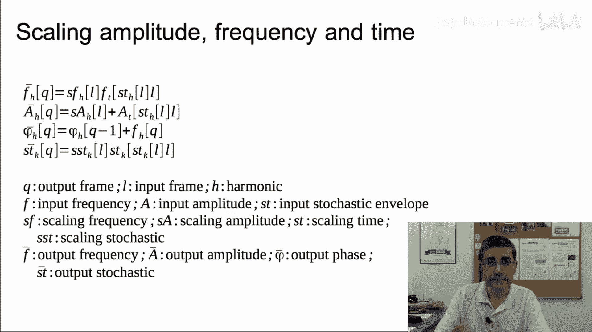

Okay， lets let's show an example of that this is the s phrase that we are also also we have heard before。

 let's listen to that again。う。Okay， and then we have the analysis of it where we have analyzed the harmonics and the stochastic component。

And then we can change that in this particular case， we have done time scaling。

 so we have changed the timing and now with the residual proximity with stochastic。

 it's very easy to do time scaling of the stochastic and the harmonics and that's it。

 We have just focus on the time scaling transformation in this particular example。

 let's listen to that very simple time scaling operation。ううん。ううん。

So basically the only thing we have done is we have compressed the first part of the signal by quite a bit。

 In fact， it's like half of the duration and the second half has been extended by twice as much。

 So in fact， the overall duration of the sound remains the same and of course。

 as you can imagine this is very flexible and we can do a lot of envelopes that we can play around with。

Okay， now let's talk about the morphing using this harmonic plus as stochastic model。Okay。

 here we have simplified the block diagram， we have two sounds， x1 and x2。

 now they are basically at the same level and basically what we're going to do is interpolate the two representations。

So from x1， we obtain the frequencies and amplitudes of the harmonics and the stochastic approximation of the residual。

And of sound 2， we do the same thing and then what we are doing is interpolating these two set of functions。

 we are interpolating the frequencies， the magnitudes of the harmonics。

 and we are tailolulating the stochastic envelopes of the residual and then of course we can synthesize back the output sound by generating the stochastic component and the sinusoidal component。

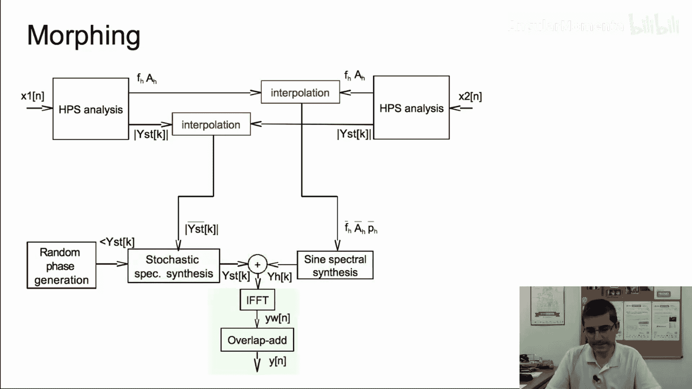

Let's look at the particular frame of a sound in which we have applied like a 50% interpolation。

So on top left is the x1， one particular frame， the harmonics visualize as the location is the frequency and the height is the amplitude and then the blue one is sound 1。

 x2 the red one is sound2。And then we can interpolate these two， basically harmonic by harmonic。

 we can interpolate。 And as you see the x2， the it's a different frequency。

 It's a sound that has a higher pitch。 So the interpolated resolve。

Has a pitch which is in between the two and has a shape again that is in between the two。 Okay。

 so it's basically a 50% interpolation between the two set of values。

 and the stochastic component below does the same idea。 So on x1。

 this shape is the approximation of the residual。 So it's very few。

 the crosses is where we actually have values has an envelope。

 and then x2 is another envelope for x2。And the output is the interpolated envelope。

So it's a shape that is in between these two shapes。

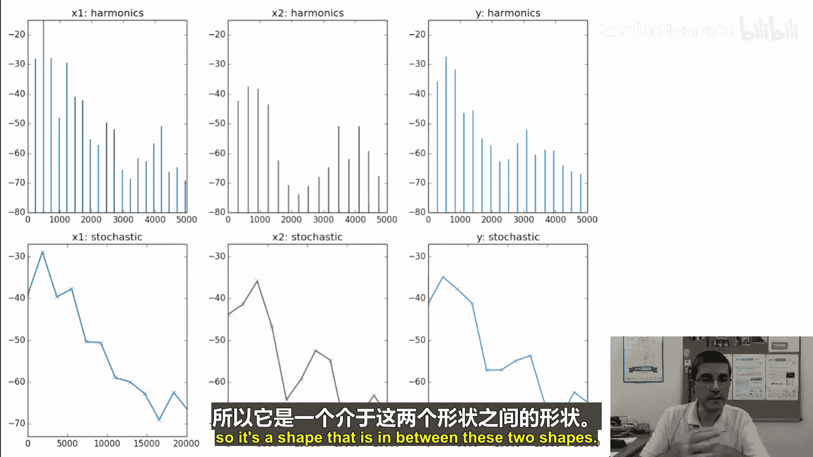

Okay， let's use that in a particular example in which we start from a violin sound。

 and we're going to interpolate it progressively towards a sopranno sound。

So here we see on the top the violin sound that we can listen to。

and it's analyzed so we see the harmonics well we see I think here is the first like 40 harmonics and then the stochastic component of that and then we see below the analysis of the sopraranno sound let's listen to this okay where we see again the harmonics it's a higher pitch and the stochastic component in the background。

And now we can choose the interpolation values to go from one set of values to the other。

 So it will progressively go from one sound to the other。 Let's listen to the result。

Of course since one the sopranno sound is higher than the violin， we hear this gllyande。

 but at the same time we hear the evolution of the timber and every single parameter is slowly changing from one to another again the possible type of functions to control these interpolations is enormous so we can play around quite a bit with these ideas。

And that's all so again， Wikipedia there is not much and there is not much that we can refer to in terms of trying to understand some of these transformation aspects and in fact a lot of these things is just by trying so I would encourage you to try these things and develop your own intuition of what it works and what it doesn't。

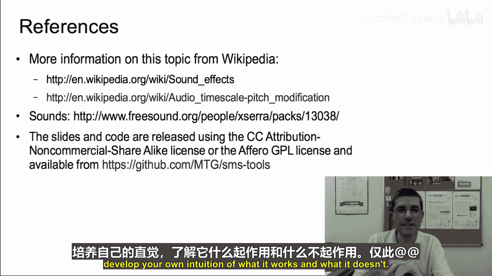

And that's all so this has been the second theory lecture on sound transformations。

 of course in this week， what is important is the programming and the demonstration classes even more than the theory lectures because after all it' a very applied topic and it has to be grasped from an application and from an intuition and musical perspective。

So thank you very much for your attention and I see you in the next lecture， bye bye。

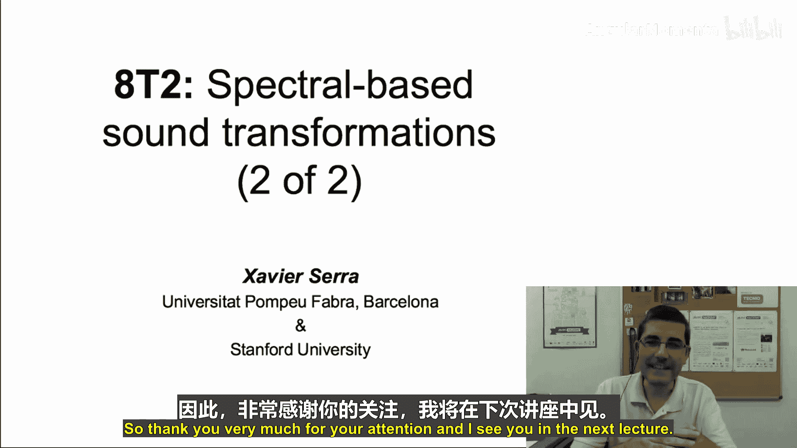