# 【巴塞罗那庞培法布拉大学】音乐应用中的音频信号处理-｜-Audio-Signal-Processing-for-Music-Applications-p56-08_02_01_基于STFT的形态变换--BV18Xr6BeEX5_p56-

Hello， welcome back to the course in other processing for music applications。

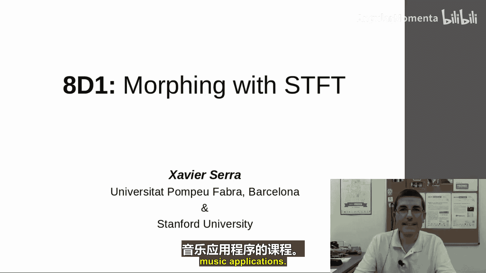

This week we're talking about sound transformations in the theory lectures。

 we went over some of the models that we have been talking about this course in the context of how they can be used to manipulate sound。

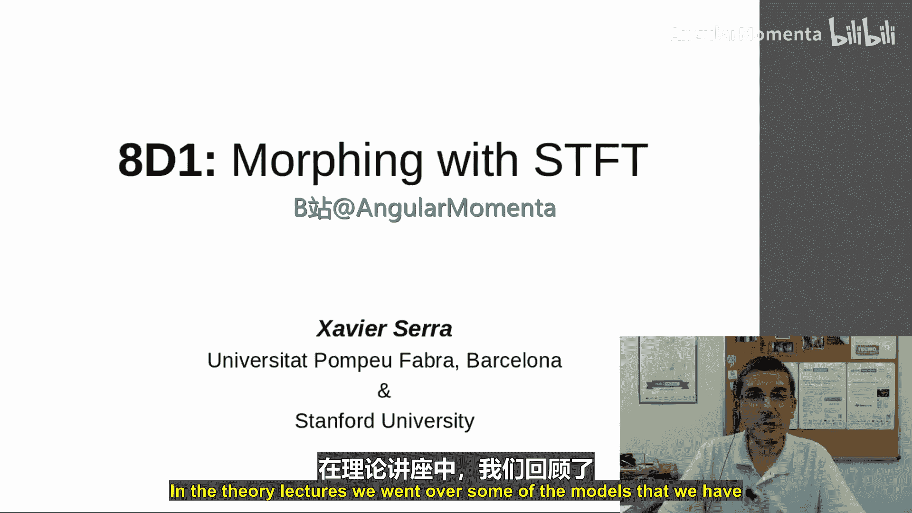

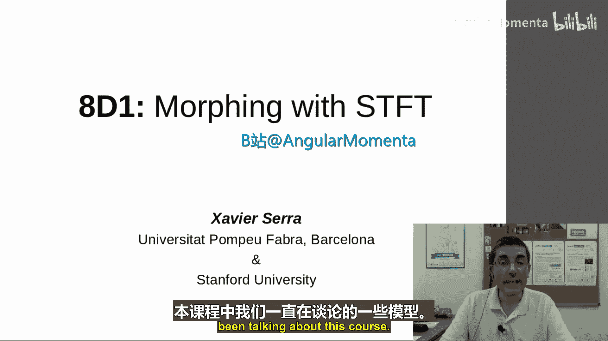

So now in these demonstration classes， I want to use some tools， mainly the SMS tools。

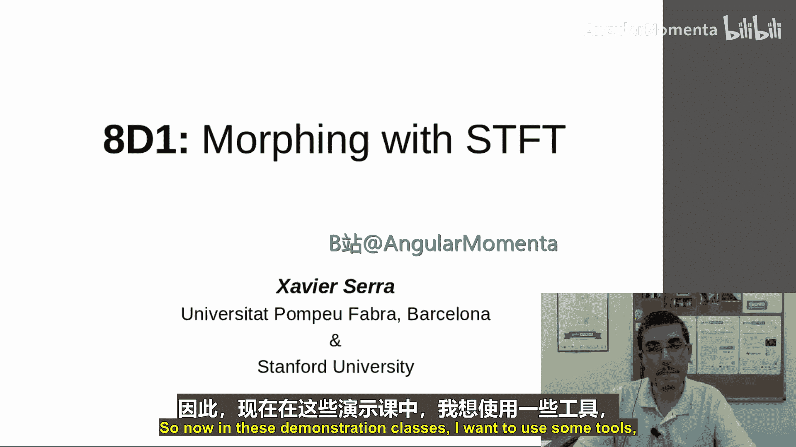

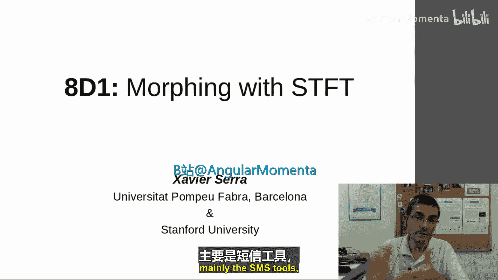

To try to understand these transformations from a practical point of view。

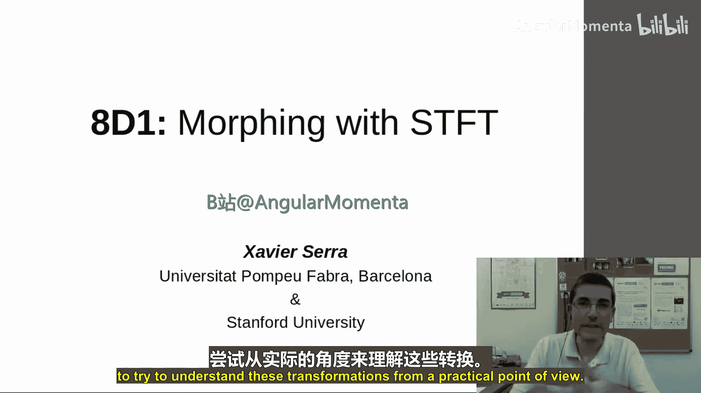

In this class， I want to go over the idea of morphing using the short time for a transform。

 so we'll be morphing two sounds， we'll be morphing the sound of the ocean sound we have been listening quite a bit and the sound of male speech that we also have been listening to and using the STFT to combine them in some way。

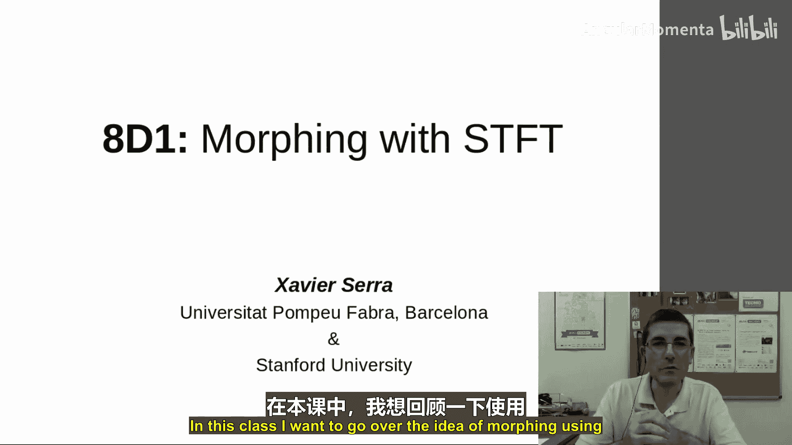

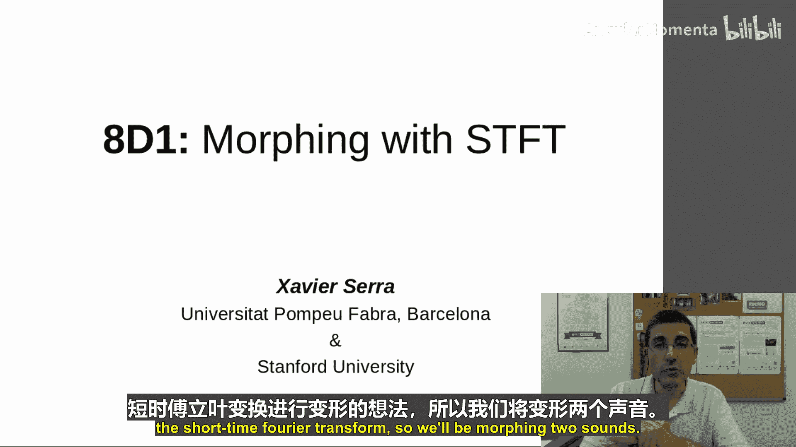

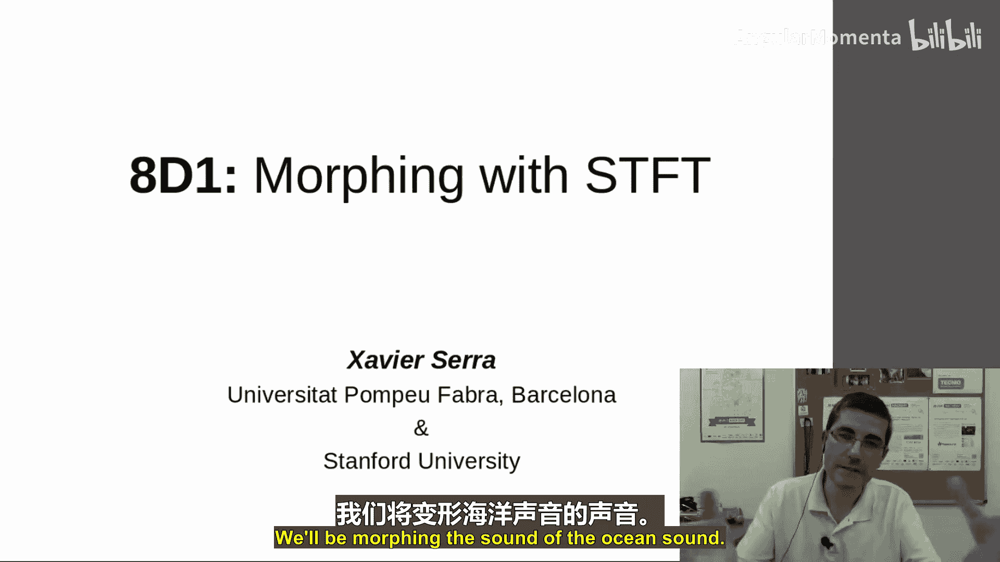

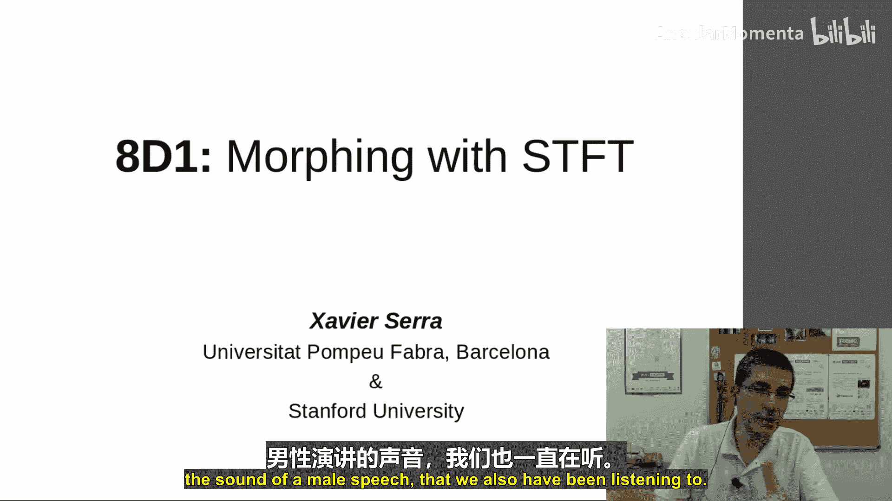

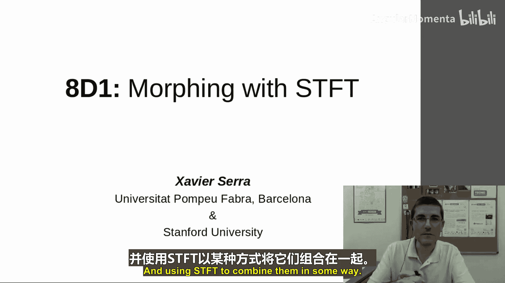

Okay， so let's start first trying to understand these sounds， we will use the SMMS tools GY。

 the analysis models one， and we will start with the short term for a transform and we'll first analyze the ocean sound okay。

This is going to be the sound we're going to be taking as x1 as a sort of the basic sound on top of which we will be putting kind of the speed sound。

So this is the basic sound and is a sound that mainly we use all the phase spectrum for and well be combining the manual spectrum together with this speech。

 So the detail is not so important here。 We are worrying about the general spectral characteristics。

 So the window does not have to be that big。 So for example，112。 It's okay。

 there is no need to really zero padding。And there is no need for zero phase windowing。

 So odd size window is no problem。 And a honey window is， it's good。

 honey window will be able to overlap nicely to 50%。 So it's nice。 It's a simple window。

 And the hop size。 This is important to be quite small hop size so that we preserve the time information of this ocean sound。

 So let's use maybe 128。so now we we compute well we're not going to see much because basically we're just going to see the spectrum of this very noisy type of signal。

 but clearly we see this wave type of shape and of course these random type faces and of course the reconstruction will be the same anyway so lets we will start with this type of parameters and now we will also analyze the speed sound。

So we'll take the speech mail sound。And were going to we don't have to use the same parameters。

 the ho size will be the same because we will have to be morphing frame by frame。

The window size can be larger， but again， since were only going to take the overall shape。

 there is no need for a frequency resolution to define the the harmonics of the sound or have the detailed frequency resolution that we would need if we wanted to detect the harmonics。

 So maybe let's just use these。Okay， so clearly in the magnitude spectrogram we see very nicely the time information。

 we see very nicely the shape of the spectrum so here basically is the foants of the sound and the different bowels that we here so there we see these kind of red shapes and of course we don't see the individual harmonies。

 but it's not a problem we don't want to detect them for these particular type of transformation Okay so let's start with these two sounds and these parameters and now we will go to the。

The transformations interface。 So we go to the SMS S tool software transformation interface directory。

 And in here is where all the code for， for the transformations is。 I mean， the the control code。

 And there is a main。File that is an interface， which is called Transs GI。So we can execute that。

And that will open the interface for the transformations we have implemented so far。Okay。

 so here we have these different transformations and well focus on this SDFT morph one。

And by default， in fact， we have the the sounds that we were talking about。 okay。

 the ocean sound and the speech mail sound。 So let's set the parameters as we talked in the previous analysis。

 So let's use the honey window。 Let's use 512 as window size。

 let's use the same50 size and let's use the hub size of 1，28。And now for this picture again。

 let's use hunting window。And let's use the same parameters。Okay。

Now we have to choose the parameters for the actual morphing， and there is basically two parameters。

One is the smooth factor of the second sound。Okay， so we're going to be applying。

The speed sound on top of the ocean sound， but before applying it。

 we're going to smooth it so that it just captures the general characteristics。

These values go from0 to 1。 So where0 has to be bigger than0。 and one is no moving。

 So that means that we just capture the 512 samples。 Well。

 half of that because we are only going do the positive spectrum。 So 256， but we can reduce that。

 So by default here， it says 0。5。 So let's leave it with 0。5。 And then we have a balance factor。

 which is a factor that will say how much of each spectrum we're going to take。 if we take0。

 it means it's going to be close to the ocean sound。 In fact， if we 0， it' just the ocean sound。

 And if it's one is going to be basically the full magnitude spectrum。

 the smooth magnitude spectrum of the speech。 let's just take quite a bit of the speech。s。

 for example，0。8。 and let's apply it。Okay， so here is the result。We see the input sound X。

 the ocean sound， then the magnet spectrum of the ocean sound。 And this is the morph spectrum。

 So this is already the， the combination of the magnet spectrum of the ocean with the smooth spectrum of the speech。

  clearly， we see quite a bit of the speech shape。 But we also see the granularity of some of the ocean sound。

 And this is the synthesize。 Let's hear the synthesized sound。Doear hear me。They don't lie at all。

So we definitely understand and hear very clearly the pitch sound。

 We don't hear the pitch of it because the pitch we don't we have not track it and the face， in fact。

 where a lot of the pitch formation is in the phase spectrum is the one of the ocean sound。

 So we hear like a whispering type of sound and a kind of little bit of the ocean。

 in order to hear more of the ocean， we can just reduce the balance。 So for example。

 let's put point2。These will take。Let's see。20% of the speed sound and 80% of the ocean sound。

Definitely now from the spectrogram， we can see that it's much closer to the oceans。 and， in fact。

 it's very close to the ocean sound。 But if we listen to it。Yeah。Yeah。Interestingly enough。

 since we already have heard the speech sound hearing this sound we hear and understand the speech sound。

 even though if I bet that if we would have heard these for the first time we would not have understood these speech utterance at all anyway。

 so feel free to play around with these things and with the parameters and I think quite a lot of different nuances can be obtained。

 of course we could extend these application to have more sophisticated controls over these kind of interpolation or morphing parameters but anyway with these I believe it's a good interface to get an understanding of the potential of these type of tools and of techniques。

Okay so that's all I wanted to say， so basically we have used the SMS tools first the analysis to understand the spectrum of these two signals that we wanted to morph and then we introduced the transformations interface that we have within the SMS tools and we have used the SMS more SDF morph interface to more of these two sounds that are from free sound。

 these ocean sound and this speech sound。

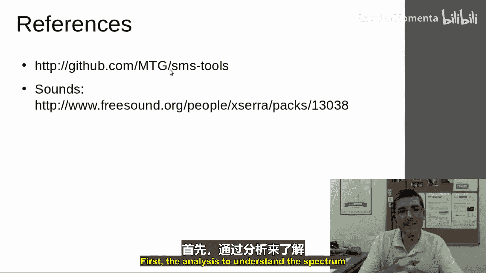

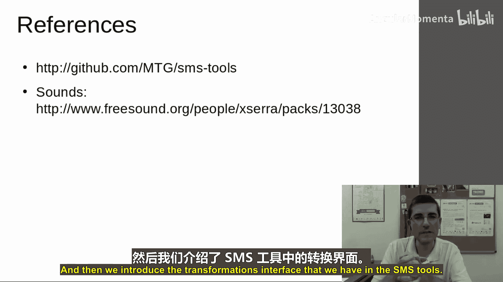

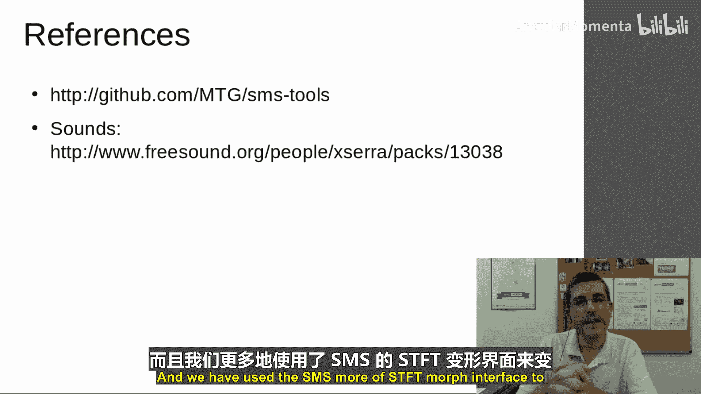

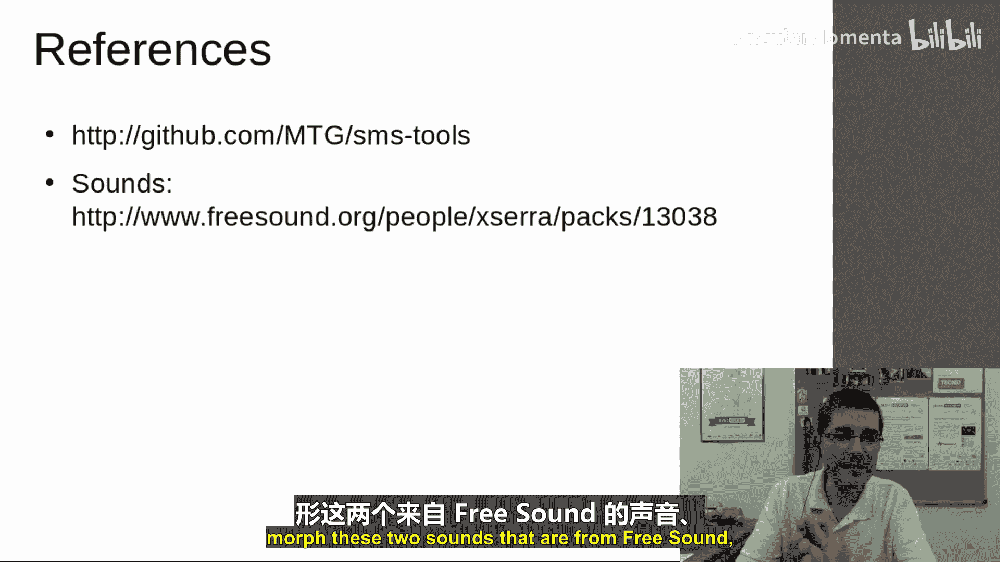

So that's all that was the first demonstration class we have seen the potential of the STFT for morphine now in the next classes we will go to the sinnooidro model and to the harmonic plus residual and stochastic to experiment with other types of transformations。

 so I hope to see you next class。

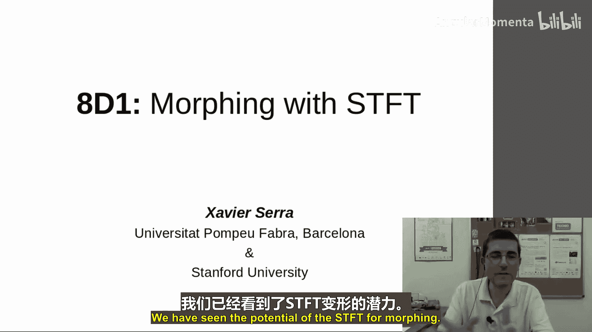

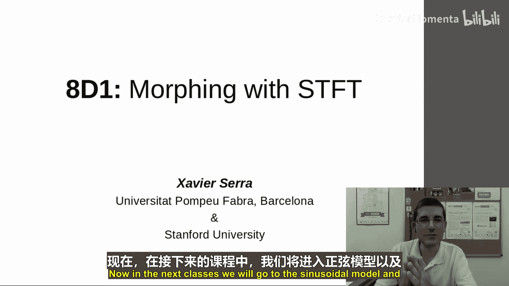

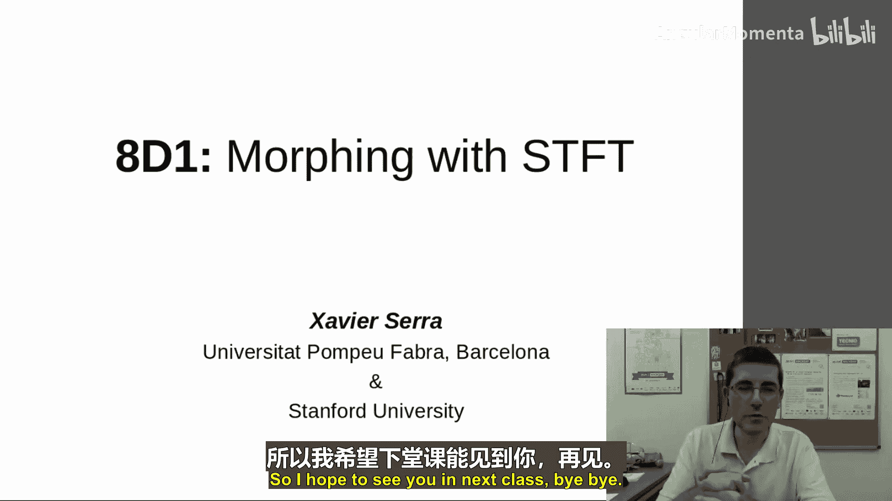