# 【巴塞罗那庞培法布拉大学】音乐应用中的音频信号处理-｜-Audio-Signal-Processing-for-Music-Applications-p57-08_02_02_时间缩放--BV18Xr6BeEX5_p57-

Hello， welcome back to the course on Another signal processing for music applications。

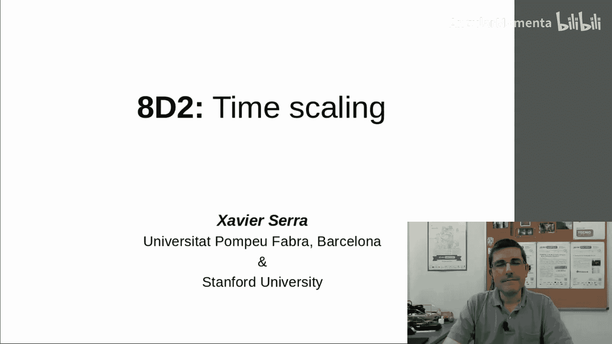

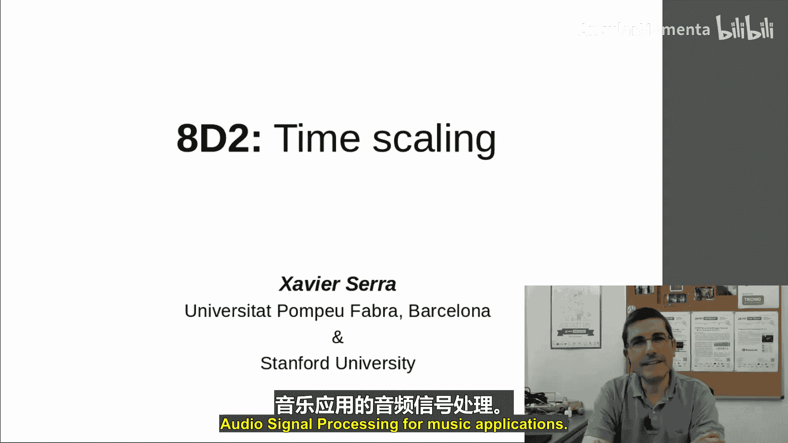

This week we're talking about sound transformations。And for example。

 in the previous demonstration class， we talked about morphing。And in particular。

 about how to use the short time for your transform to morph the qualities of two difference a。

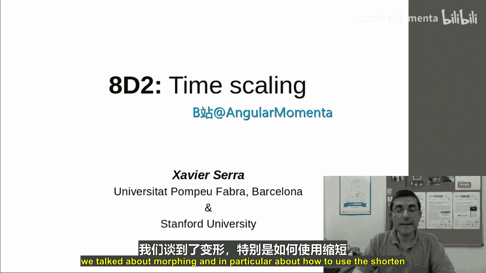

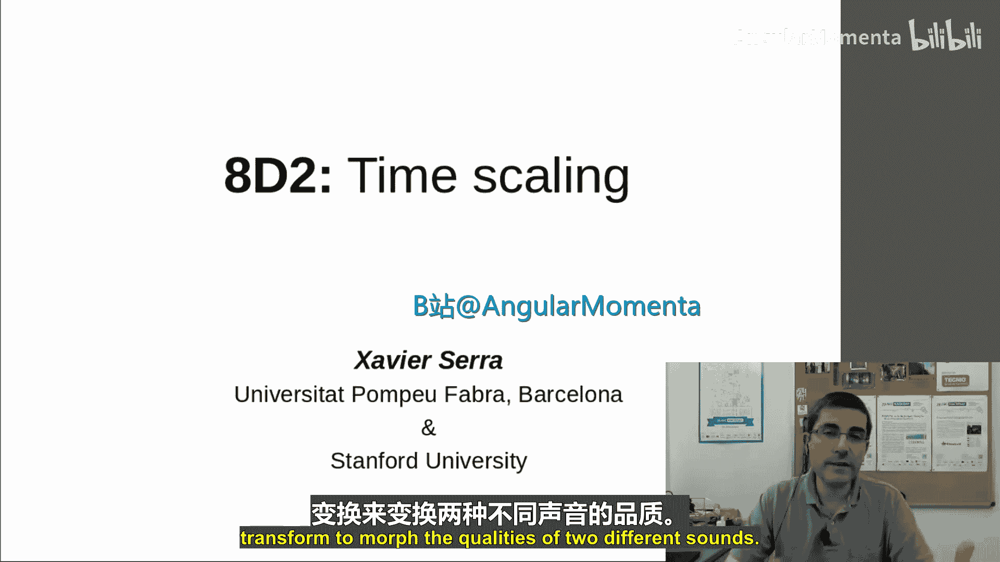

Now in this second class， I want to talk about time scaling， therefore。

 about how to change the duration of a sound。

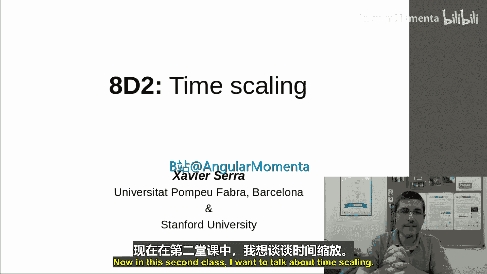

And basically then modified the length of a particular sound fragment。

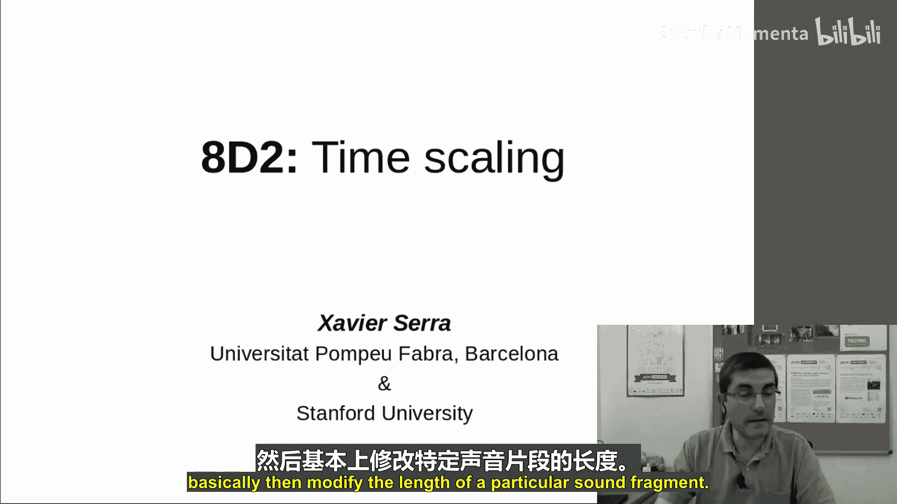

So let's start by using the possibilities of audacity for this type of transformation。

Let's start from this sound， this is the orchestral sound that we have in SMSS toolsol's directory。

Now in the effects menu of audacity， there is quite a few of transformation possibilities and even there is the possibilities for extending these transformations by external plugins and you can find many available online but let's focus on very few of these transformations that relate with changing the duration of a sound。

 and the simplest one is for example， this one it says change speed。

This is a very simple algorithm that the only thing it does is change the reproduction speed。

 basically。 So it change how the samples are read and therefore reproduce。

And of course the effect of this is that it modifies not just the time。

 but it modifies the frequencies of the sound。 So let's listen to that same orchestral sound that change by for example。

 well， if we put it at zero there would not be any change and for example， let's change it by 30%。

 So this will speed up the reproduction of the sound by 30%。

Clearly we see that the sound is now shorter and now we can play it。Okay。

 so this is the standard effect of reading in a disk or un changing the speed of reproduction of an analog disk or of a tape that can be done in digital media。

But clearly this is it's okay， but is's not that interesting in the sense that we are manipulating not just the duration。

 but the whole quality of the sound So more interestingly when we talk about time scaling what we normally are referring is to be able to change the duration of the sound without changing the quality of the sound without changing the frequencies that are present in the sound and within the audacity。

 there is a few algorithms that do that the most sophisticated one that I know of is this one that says sliding timescale and pitch shift。

And this algorithm performs both tempo change or time change and pitch change。

 and it uses a sinnoau model。In fact， it uses a of sort model very similar to the one that we have been presenting in class。

And you can of course， look at the code of this algorithm on on the audacity website。

 you have access to the source code of that。 the measure difference。

 which is an important one is that this sinusoid model is based on a suban type of processing So it does a sinusoid modeling by splitting the whole sound in octaves and modeling every octave with a different analysis synthesis approach So the quality is a little bit better than what we can do in the algorithm that we have been developing in class。

 So let's listen to that。And it easily can be controlled in time。 So here， for example。

 the control of this algorithm can be done in a way that we have an initial tempo change as a percentage and a final tempo change。

 So for example， what we can do is start slower。 So let's say， okay， let's start。

 let's let's say 20% or 22% slower。 and let's finish by speeding up。 So let's for example。

 end up with 30% speed increase but remember these we are not changing the reading of the samples。

 the time domain samples， this is done using the sinusoidal model。

 So therefore resynthesizing the sinusoids， but at different speeds while maintaining the pitch of the sinusoids。

So， let's。Analyze this。This quite fast， in fact， is a very efficient algorithm implementing in C。

 So now we are done and we have changed the duration。 Well， it's a time varying duration。

 So let's listen to that。Okay， so we have a time duration。 and clearly。

 the pitch or the frequencies have not changed。 The sound has changed in duration has sped up。

 The temp has increased， but not the frequency。 And that's a pretty good algorithm。

 There is some more sophisticated ones。 But this is a pretty decent one that can perform good time scaling algorithms。

 So now let's go to the our own implementation。 So let's go to the Gy of transformation that we have。

 And let's go to the sine model。And let's go to the for example， a sound， let's use the piano sound。

Okay。Of course now this algorithm we have to decide the parameters。

 So in the audacity implementation， everything kind of it's a black box。 and it that's pretty good。

 it chooses the best parameters for this type of transformation here。

 we have to choose the parameters So we first have to choose the analysis parameters of the sinusoidro model。

 It's a piano sound。s well it's a harmonic sound。 but in the sinusoidro model， this is not an issue。

s we have to make sure that we distinguish the the peaks of the spectrum enough so that we can build sinusoid out of that。

 So let's start maybe with the humming window 800。 maybe let's increase this a little bit。

 let's put 1000 samples of the window size the threshold minus-90， maybe let's do even more-100。

The minimum sinusoidial duration， Well， let's leave it like that。

 maximum number of signsine we can put as many， for example。

200 so we we really do a lot of sinusoids and well let's leave maybe thisly higher their offset。

 so we allow frequencies to change a little more and let's first do the analysis with synthesis。

Of the piano。Okay， here is the the analysis， the sinusoidal analysis that I have performed and the rethesis。

 Let's listen to the reths。Well， let's first listen to the original sound。🎼Yeah。

And then the reynthesized one。🎼。Okay， it does a pretty good job。 So that's a good starting point。

 Now we can apply the transformations。 And in these interface。

 we can do scaling and the frequencies and of the time。 So let's not do any frequency scaling。

 So for not doing any frequency scaling， let's say that at time 0。

 we just put the value of one and at time 1， we put the value of one。

 So there is no frequency change。 And in the time we have we can put the time scaling operations。

 So for example， we can say at time0， just start at0。 And for example， at the n。

 we can just normalize to say one。 let's slow down by a factor of2， for example。

 So this was slow down quite a bit more than we would written before。

 So this will stretch the sound to twice as long。 So let's see what it does。Okay。

 so this is the stretch sound。 So this is much longer。 The original sound was around 4 seconds。

 Now it's 8 seconds。 And here we see the sinusoids that， of course。

 since they have been a stretch we see a little bit more of a mess here because we see twice as long and therefore more compact type of representation。

 let's listen to this stretch sound。🎼응。🎼I。Okay， that's pretty good。 And， of course。

 we can do with these interface， we can make changes that vary not just from beginning to end。 But。

 for example， we can say， okay， at the beginning， let's start at 0。 let's put that in the middle。

 let's speed up by by 50% so it's gonna be at 0。25。 And at the end， let's， for example。

 leave it Well， we can just leave it so that it's leave it longer。 So it's 1。3。Okay。

 so now we can apply the transformation。🎼Okay， so this has done a time varying time stretching and the beginning has sped up and the ending has slowed down。

 so let's listen to that。Yeah。Okay， so that's a pretty good。

 And that's a quite interesting transformation。 And there is quite a lot of opportunities to do interesting things here。

 Again， this is different from the algorithm that audacity includes。

 But the basic concept sininooid model is the same。

 The only thing is there it does it a little bit more complicated。 And， of course。

 the implementation is in C and is little bit more efficient。😊，So that's all I wanted to say。

We have talked about time scaling and used two algorithms。

 both the audacity and the one available in the SMS tools。

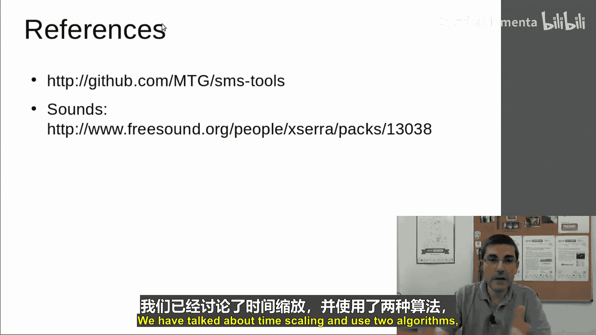

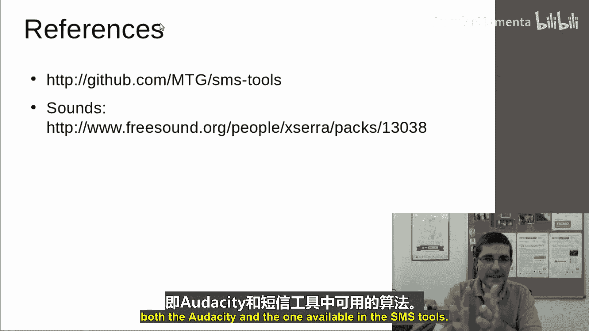

So hopefully that has given you a view of the potential of the sininooidial model for time scaling operations。

 and that's a very interesting transformation that is very much used for many types of applications。

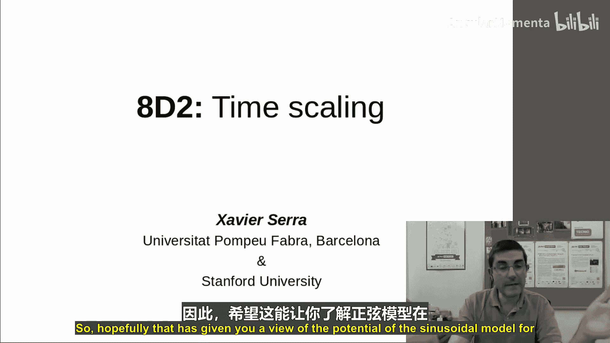

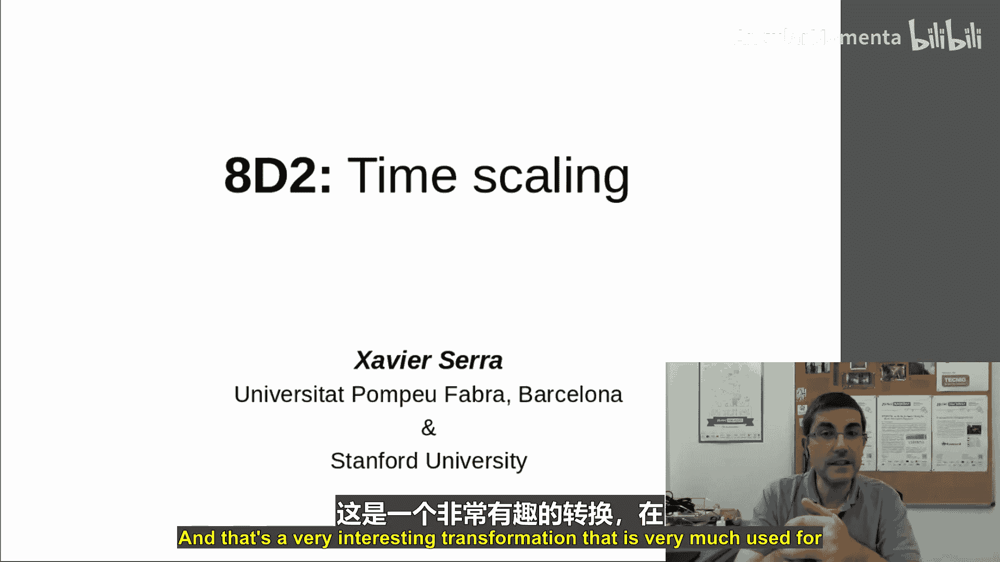

So next class， we're going to be talking about changing the pitch of the sound。

 so that's a very compliment operation to changing the time， so I hope to see you next class。

 bye bye。

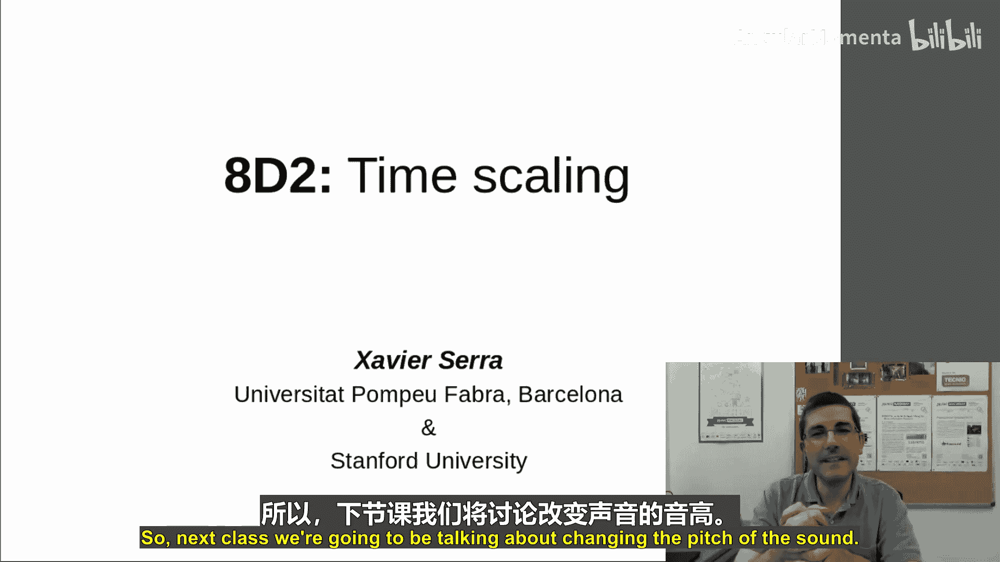

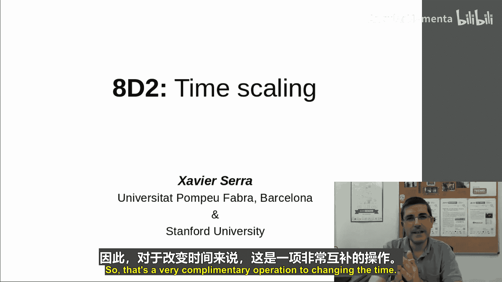