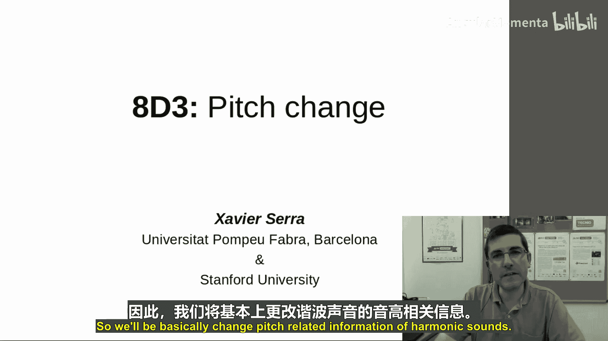
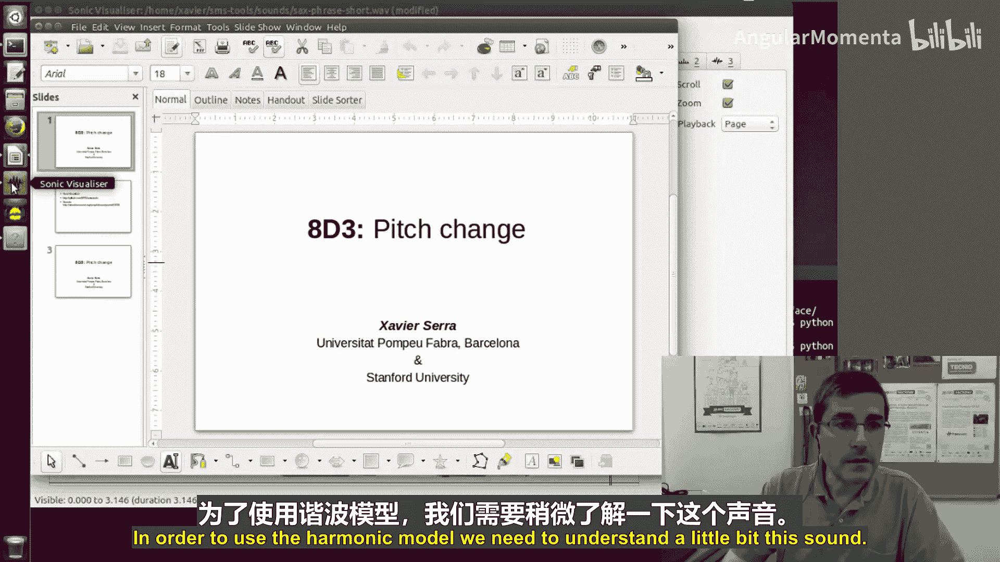
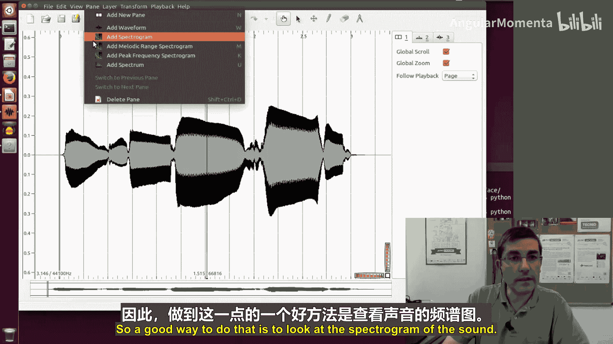
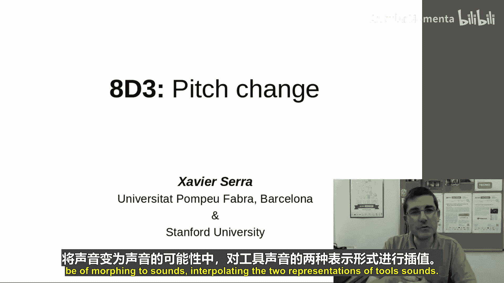

# 【巴塞罗那庞培法布拉大学】音乐应用中的音频信号处理-｜-Audio-Signal-Processing-for-Music-Applications-p58-08_02_03_音高变化--BV18Xr6BeEX5_p58-

Welcome again to the course on other single processing for music applications。This week。

 we're talking about applications。 We're talking about how to use the models we have been studying throughout the course。

For the application of sound transformation。So we aim at manipulating sounds and changing different aspects of it。

In the first demonstration class， we exemplified the idea of morphing using the short time Fourier transform in the last class we talked about time scaling。

 how to change the duration of the sound using the sinuscer model。And in this class。

 I want to talk about pitch changes， how to change the frequencies of a sound。

 and we will use the harmonic plus stochastic model。

 so we'll be basically changing pitch related information of harmonic sounds。

In order to use the harmononic model。

We need to understand a little bit the sound。 So， for example， if we start with this saxophone sound。

 let's listen to this。うん。In order to define especially the window size。

 we need to know the ranges of fundamental frequencies that are present here。

So a good way to do that is to look at the spectrogram of the sound。

And basically， zoom in to the。First harmonic so that we see basically the fundamental frequency。

 which is the first line of this harmonic series and kind of see which is the lowest and highest values in here。

So it's better to use a bigger window size。 So we see a more refined line。 And with this， okay。

 we have a pretty good view of this line。And clearly the lowest sound would be this note here more or less。

 So that's around， if we see or let's say around 450 hertz， and then the highest is this note here。

 which is around 6 something hertz。Okay， so this is good information for now defining the parameters of the harmonic harmonic plustochastic model。

 So let's go to the the SMS S toolss models G Y。 and let's go directly to the harmonic plus stochastic model。

And we will open this same file， which is this sex phrase， the short version of it。Okay。

 now we have to choose the parameters。 So the window black man is a good choice because it has a good low level sidelos。

Now， in order to decide the window size， well， it's good to basically go to a terminal。

And from high Python， we can just quickly do calculations。 So， for example， we can just say， okay。

 the black one window has 6 beans in the main lobe。 We multiply by 44100。

 And we said that the lowest frequency was around 400 and something hertz。

 So let's in order to be saved。 let's say， okay，400 Hz。So，400。

And this is the a window size that is appropriate for a frequency of 400， the lowest。

 which is the the meaningful one， because it's the the longest window that we will need。 Okay。

 so we will put as window size， let's say，661 an odd size。F50 size， let's make a big one。

 So we have zero padding。 Let's 2，0，48。The threshold it really doesn't need to be that low。

 but let's leave it， so we have a lot of harmonics there， the minimum duration of sensor tracts 0。

1 that's fine maximum number of harmonic， the maximum number of harmonics that there will be will be 44100 divided by 400。

OkayThat would be if it had all the harmonics。 it's 110， but of course， this is the lowest frequency。

 and this is really if we would have harmonics all the way through。 So 100 would be fine。

Then we need to define the range of the fundamental frequency。 So we can put the one we said。

 It was around 400， and the other was around  six and something。 So to be save， let's say， 650。

This is a narrower threshold to identify the fundamental frequency。

 Maybe it's L more flexible at put 7。And this deviation， that's fine like this。

 And the satochastic approximation for the residual， we don't need to be too， too smooth。

 We don't need to do data compression。 So if let's say if we have 04， that should be okay， Okay。

 let's computer now。Okay， so this is the result。 We have the original signal。

 the analyze the harmonics plus the stochastic and the synthesize。

 Let's listen to the different components of it， the sinuscer component。うん。

It clearly capture most of the sound。 then let's listen to this stochastic。Well， it's very soft。

 but is' there， so it's a relevant component and of course the sum of the two。うん。Okay。

 so this is a good starting point to now run the transformation。So let's go to， let's quit this。

Let's try to remember these parameters。 And now we will go to the other directory where we have the transformations。

Interface， and let's type Python and the transformation G I。Okay。

 so this is the GY for the transformations。 And let's go directly to the H model with the transformations。

 And well， it's already by default。 the s phrases here。

 So let's use the parameters that we use if I remember was 661。 We did FF of 2048。

 the threshold was minus- 100 minimum signine duration was that number of harmonics 100。

 these minimum was frequency。We at 400， and maximum was 650。 F 0 detection。

 the F0 error threshold was 7。 and the stochastic factor， we put 04。Okay， now we can analyze。

And this will definitely do the same thing that we did before， so we can check that analysis。

 correct。Okay， that's exactly the same sound that we heard before。

 so now we can start playing around with the transformations。

And we have two possibilities for changing the frequencies and one for changing the time。

 So for the time， we are not interested in changing the time。 So let's say the time as 0，0，1，1。

 So I means that is not changing anything。Okay， now in frequency scaling。

 we have two frequency transformations。Given that we are in a harmonic sound。

 we know where the harmonics are and that's a great advantage compared with the sinusoidal model。

 So in fact， these type of changes could be done with the sinusoidal model， but of course。

 then we are restricted to some transformations and for example。

 the frequency stretching is not possible with the sinusoidal model because we don't know which sinusoid corresponds to which harmonic。

 Okay let's just first maybe let's just use the scaling first。 So let's have here again without any。

Transformation so if we put 01，11， that means that there is a frequency stretching of one means no stretching at the beginning and at then。

 and then okay， in the frequency scaling。 Well let's start with by downloading or sort of decreasing the pitch of this sound。

 for example， 08。 and so it's at time 0， we will have 0。8 and at time 1， we will have also 08。

And a very important parameter is this tim preservation。 This stam preservation， what it does。

 it tries to preserve the shape of the spectrum of the harmonics。 If we put one。

 it preserves the harm the harmonic shape。 So it should sound more natural than if we put 0 in which 0。

 we just transpose everything。 And so the magnitudes will be affected。 So let's apply like this。Okay。

 so we have clearly transpoposedse the harmonics down。 So now they are closer together。

So let's listen to the result。う。So it sounds quite natural， even though we have transpoposedse。

 mainly because of this stam preservation， we have maintained quite a bit these。

 this quality of the saxophone。 And then just to finish， let's make some。Frequency stretching。

 so frequency stretching is is a kind of a to convert the sound into an inharmonic type of spectrum in which we are adding an exponential factor to the harmonic value。

 Let's say So if we have at times 01 let's say， let's start with one。 And then at the end。

 let's stretch everything to， let's say one point。 let's say one。 Okay。

 so we will have a stretching factor then and not at the beginning。 So progressively。

 the stretching will increase。 Let's see what that does。

 so we see clearly here that the fundamental has remained the same。And the harmonics。

 well we still have maintained the scaling factor， so we are scaling everything down to 0。8。

 but the harmonics keep getting apart from each other more and more as the time goes on and clearly at the end that are not equally space。

 so that's an inharmonic spectrum， let's listen to that。🎼うん。Okay。

 so clearly the low frequency is the same， but as time progresses。

 the sound sounds more inharmonic kind of more metallic because the harmonics have been stretched。

Of course we can do a lot of things， so feel free to play around with these parameters and of course。

 with time scaling， time scaling is also very powerful once we have been able to analyze a sound with the harmonic plus stochastic model。

That's all I wanted to say， so basically we have talked about the idea of changing the pitch or the frequencies of a sound。

 first we use Sonic visualizer to understand the sound and then we use the SMS toolss GY with the harmonic plus stochastic model change the pitch or the frequencies of a sound。

so we have been talking about pitch change， of course。

 pitch change can be done with the sinusoid model can be done with the harmonic plus stochastic or the sinusoidal plus stochastic or with quite a few of the models we have been talking about and in audacity also there is some implementations for that So anyway so we just presented a little bit of that an example using the harmonic plus stochastic and the potential for these type of transformations so I hope you got an idea of that and now we'll have still another demonstration class and willll be talking about the harmonic plus a stochastic model but in another type of possibility of transforming sounds which will be of morph than two sounds interpoolating the two representations of two sounds so I hope to see you all next classe bye。

