# 【巴塞罗那庞培法布拉大学】音乐应用中的音频信号处理-｜-Audio-Signal-Processing-for-Music-Applications-p59-08_02_04_采用HPS的变形技术--BV18Xr6BeEX5_p59-

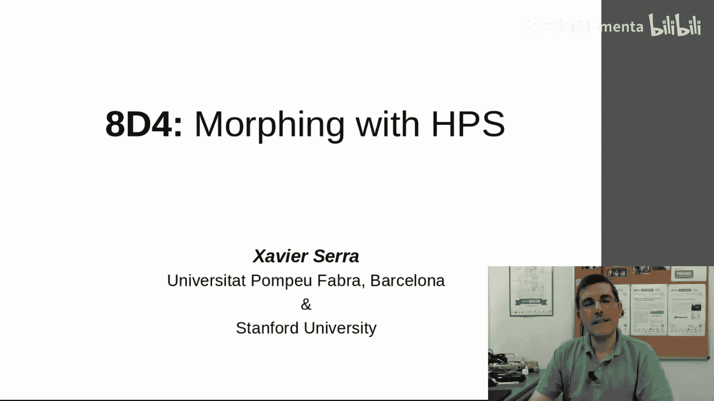

Hello， welcome back to the course for another single processing for music applications。

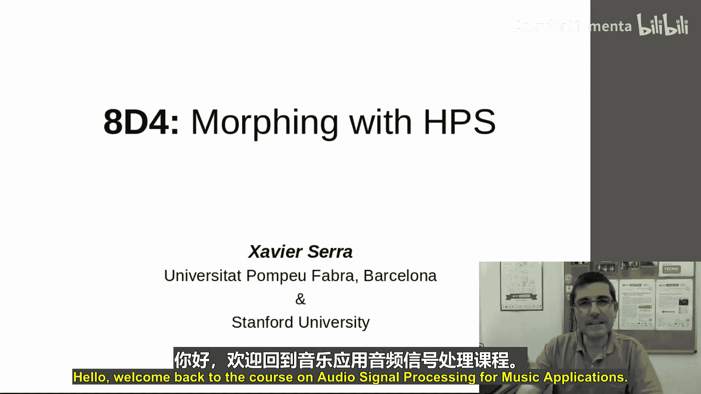

This week that were talking about sound transformations in the demonstration lectures。

 we have been exemplifying the different models that we have been talking about during the course and sound transformations that can be done using those models。

For example， on the first class we talked about the short time for a transform as it can be used for morphing on the second one we talked about timely scaling using the sinusoid model and then on the last one we talked about how to do pitch changes using the harmonic plus stochastic model。

Now I want to go back to the idea of morphing， but using a different model。In this case。

 we're going to use the harmonic plus a stochastic model。

 and we will be showing that with this model， the type of morphing that we can do is very different from the type of morphing that were able to do with SDFT。

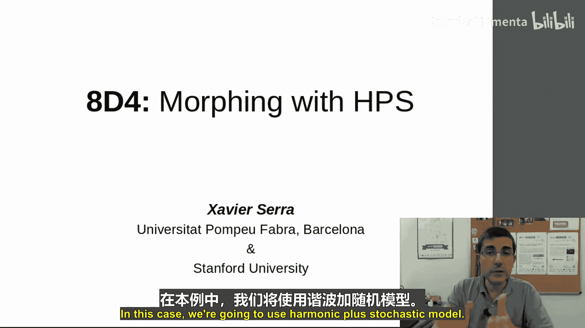

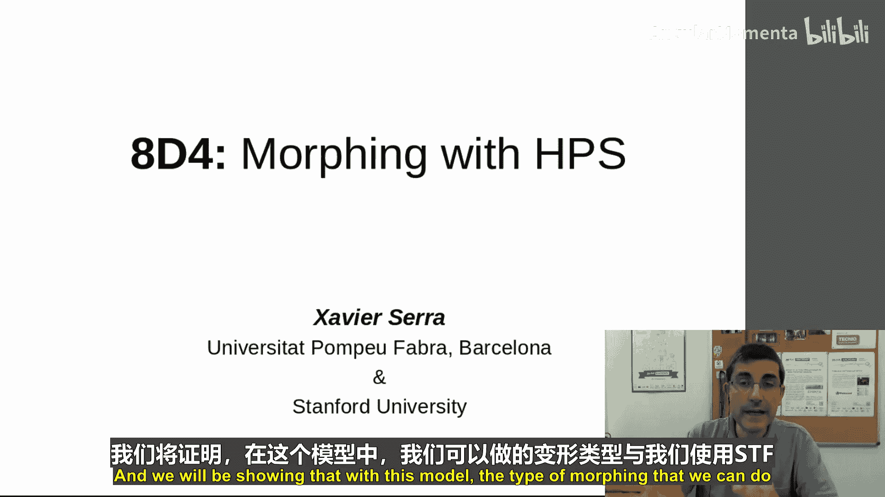

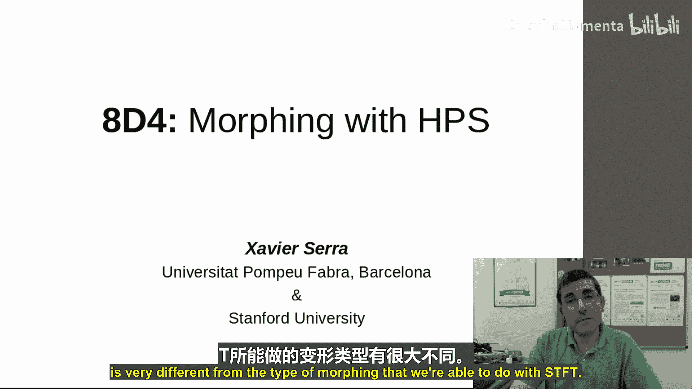

So in order to do the morphing， we first have to have a good analysis of each of the sounds that we're going to morph。

 So let's start with the GI， the SMS tools model GI and let's go to the harmonic plus stochastic and so let's start with one of the sounds we're going to morph we're going to morph the violin sound with soprano sound。

 So let's start with the violin sound okay。this is the sound。

So we have to choose quite a few parameters。 The vman window is a good choice for this stable node。

 and the side lobes are quite low。 So that's good。 We have to choose the window size。

 And that's always requires some computing。 So B3 is around 246 Hz。

 So in order to decide the window size， we just take the number of bins of the window。

 which is 6 times the sampling rate。44100 divided by the frequency of this node。Okay， so。

So we need around 1075 samples， so let's put it here。1，75。The window， the FFT size has to be larger。

 so let's make it quite large。So we get a lot of zero padding 4096， for example。

minus the threshold minus100 is fine minimum duration of the sinusoids。

 Yeah it's a single node we want to do interpolation with another sound。

 so the longer the better so 0。5 would be good。In terms of the maximum number of harmonics， again。

 we want quite a few as many as as we can。 So 100 it's also okay。

 now in terms of the range of the fundamental frequency， we said that it was 246 fundamental。

 So definitely this has to be below that， if we do from 200 to 300， that should be okay。

And the F0 detection error， well，7 should be fine。The deviation。Yeah， 01， it should be。

 it's quite a bit。 And it's fine。 And the stochastic approximation。 Yeah。

 let's not do too much of an approximation。 So we get the the good quality of the residual So let's 08。

 maximum would be 1， which be the the whole magnitude spectrum 。8。 It's okay。 Let's compute it。 Now。

 let's listen to the sinusoid。Okay， this is fine， the sarcastic。Okay， that's it's quite noisy。

 but it's soft。 And it's it's okay。 I think we can， we can manage that。 Okay， when here we can see。

 we can see this representation， we could try other parameters， but let's leave it like that。

 And now let's analyze the other sound。 Let's analyze the sopraranno sound。Okay。And this is an E 4。

 So now again， let's listen to that。 And let's keep the blackman。

 The window doesn't have to be that large。 So let's choose the window size。 It's 6 times 44，100 and。

And E 4 is around 330 Herz kind of。 So it's 330 dot0。 Okay。

 so doesn't need to be that large a window。 So let's leave it as 801。And FF size， well。

 let's leave it it big。 So that's good。 threshold minus thresholdes 100。Duration 。5 is fine。

 Let's keep the number of harmonies as to be the same number of harmonies because we're going to be interpolating the two of them。

 So 100 is fine。 And now since the frequency was 330， let's now the the voice has a birados。

 it will change quite a bit。 So let's be safe and let's put from 250， for example， to 400。Okay。

 and now we can just leave the same parameters， the same error threshold for the 0 detection。

 the same deviation and the stochastic factor 0。8。 So let's compute that。Okay， that's。

It's a little bit more difficult to analyze this sound because because of the form。

 there is some areas of the voice that there is not much。And but let's listen to the result。

 The signus such look good。啊。The stochastic sounds okay， good。 And， of course， the sum is fine。 Okay。

 now we are ready to go and to do the actual morph between these two representations。

 So let's close these and let's go to the transformation。Diy。And let's type it then。Transformations。

 G， Y。This is the interface for the transformations。

So now we can go directly to the HPS morph option。And in fact。

 the sounds that we're going to morph are already the default one， so well use those。

And now let's change the parameters to the ones we decided to use。

So we decided to use of the size of the window for violin。1075 and FftT size， big 1，4096。

The threshold minus 100， the minimum duration of a trajectory we decided 0。5。

 and given that these frequencies around 246， we decided to use。From 200 to 300。And now。

 the error threshold。We set 7。 and here maybe we can be a little bit more open and just say 0。05。

And for sound2， the soprano， were going to use the same window， blackman。

 were going to use a smaller window because it's a higher pitch so it's 801 iss fine and we decided to use the same F50 size。

And similar values for the rest。So for the minimum， this is a higher frequency， so its we need to。

 it's 300 something， so we need yeah， 250 to there is no need 500，400 that should be enough。

And the 7 and these。Okay， so we can now analyze O。I wanted to change the number of harmonics。

 It has to be the same number of harmonics and we said to have 100 harmonics and the stochastic factor。

 we wanted to have a good stochastic component。 So we said 0。8。 Okay， let's try again。Okay。

 so these are the two sounds clearly on the on the violin， it found more harmonic than on the voice。

So that means that we are only going to be able to interpolate the harmonics of of the voice。

 So now what the transformation will do， we will be interpolating these two sets of values。

And we have three ways to interpolate the set of values。

 We can interpolate the frequencies of the harmonics。

 We can interpolate the magnitudes of the harmonics， or we can interpolate the stochastic component。

 So let's， for example， let's just have the frequencies of sound0 of the first sound。

 So let's put it at time 0 will have the sound， the first sum which will refer as0 and at n we also have the first sum。

 So basically the frequencies are of the violin。And the magnitudes， let's say， are of the voice。

 So we'll put that at time 0 will have one， which are the magnitudes of the voice。 And at one。

 well also have that。And for the satorcchastic， well， we can just put 50 and 50。

 so we can just put a time 0。05 that means in between and at times 1， we will put 05。Okay。

Let's see what happens。Okay， so this is a result。 and the。

 the frequencies clearly look the spacing of the violin。But the let's see the magnitudes。

 We don't see them here because we don't see the magnitudes of the lines。 But let's listen to that。

Yeah， so clearly， it sounds。What it is， it sounds a little bit the mags of the voice。

 but at the pitch of the violin。 Now let's go from one to another。

 So if we go from all the values of the violin to all the values of the voice。

 we can just do it by putting 001，1 and again here 0011 and here 0，01。1。Okay， and let's apply it。

Okay， and here clearly we see that it's going from one sound。 and here from the frequencies。

 we see that there is this kind of gllyandy， which is because the pitch of the voice is higher and the pitch of the violin。

 So let's listen that。Okay， so clearly we see this evolution and of course in this we have an envelope that we can specify any interpolation and in any time varying fashion so we can have quite sophisticated interpolation envelopes。

 clearly this is very different from the short time for a transform that we did。 So if we So okay。

 let's finish this and basically we have。Talked about a transformation。

 the morphing using the harmonic plus stochastic model that's within the SMS tools and clearly is a different type of morphing。

 It has different possibilities than the SDFT。 We can now interpolate basically every set of parameters and obtain any sound in between。

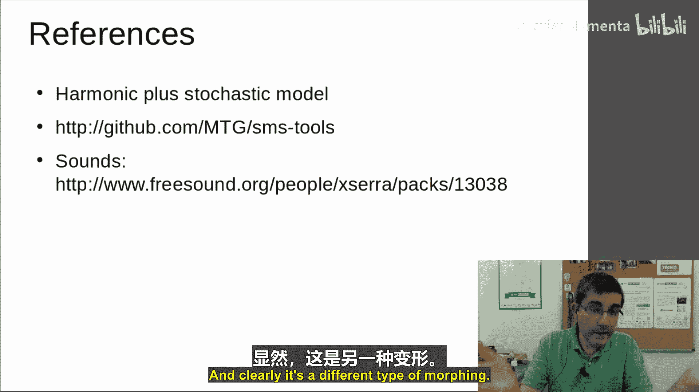

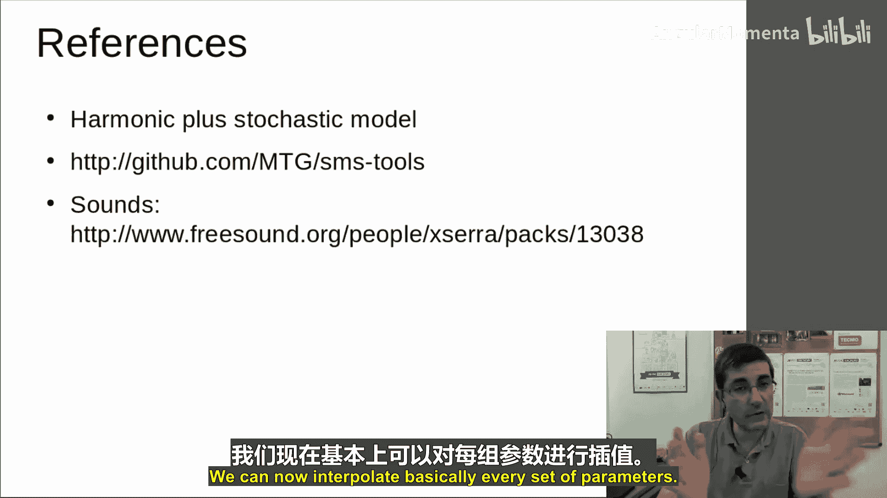

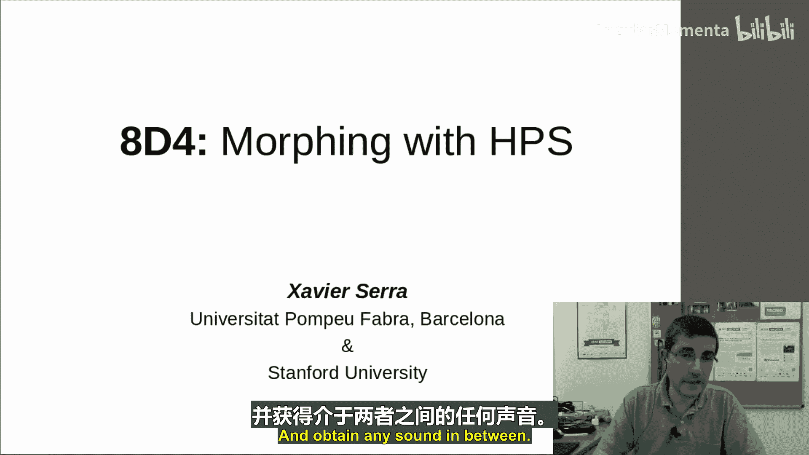

So even though we are using the same term morphing。

 the model has a big impact on the possibilities that the technique offers and what we can do with this idea of interpolating between two sounds。

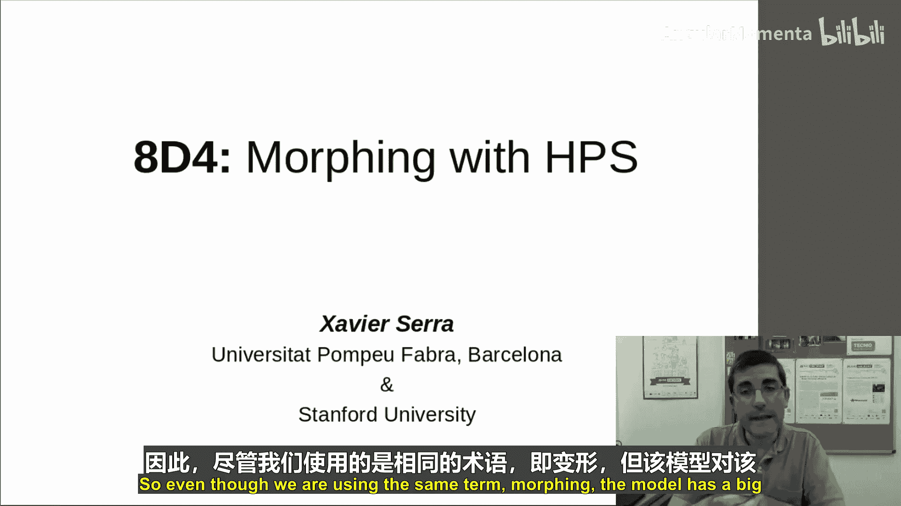

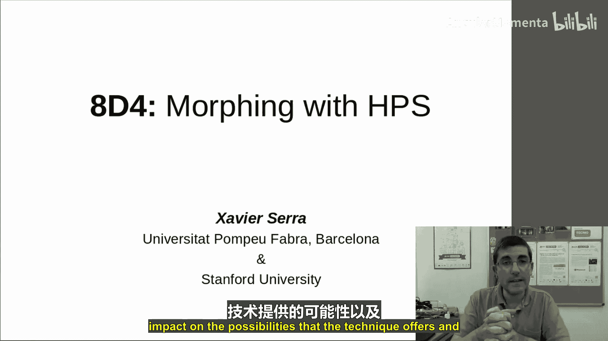

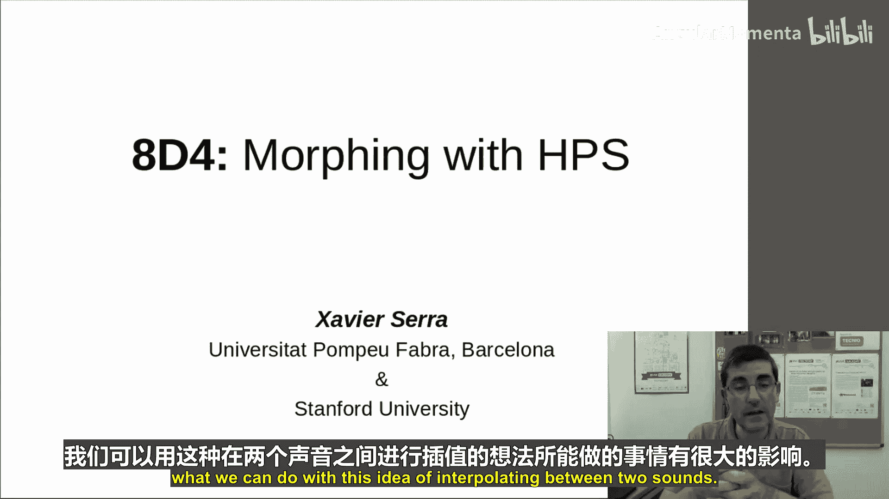

So that was all so hopefully between these demonstrations you have gotten an idea of the different possibilities that these different models offer for transformations and of course there is many more possibilities and some models we have not used them and they also offer different transformation possibilities so feel free to do it by yourself so thank you very much for your attention and I will see you in the next lecture bye bye。

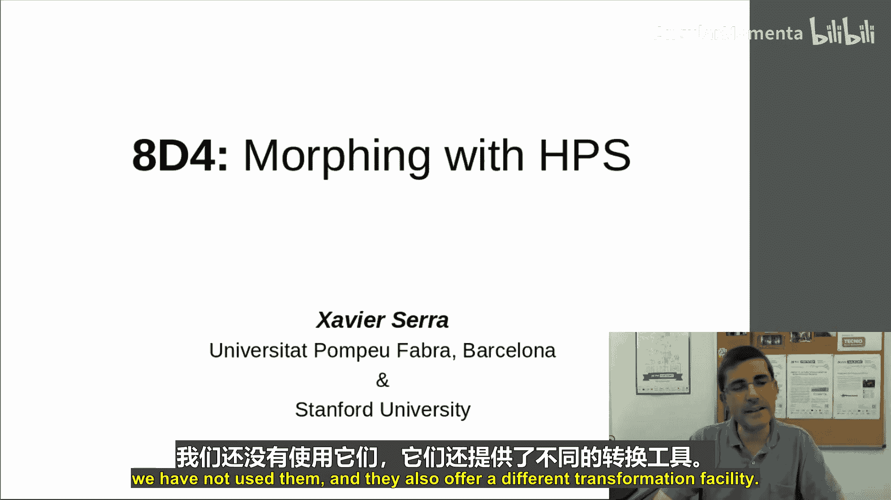

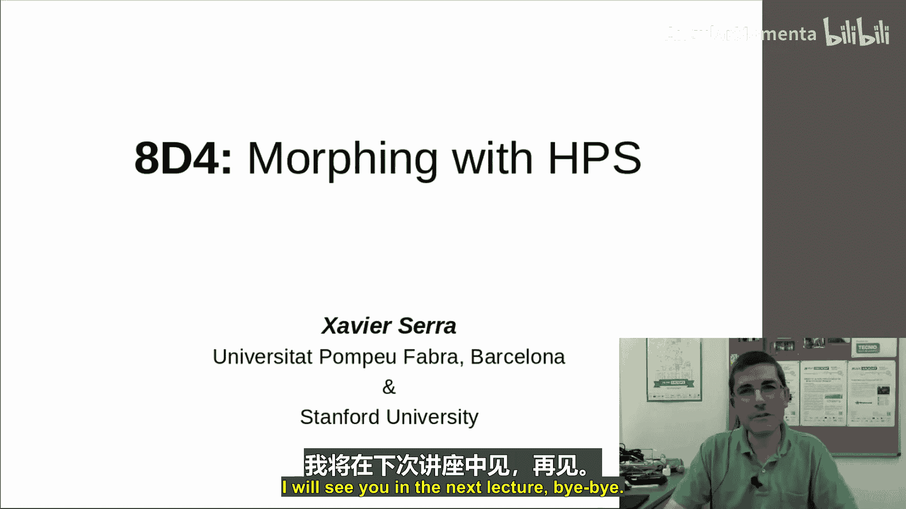