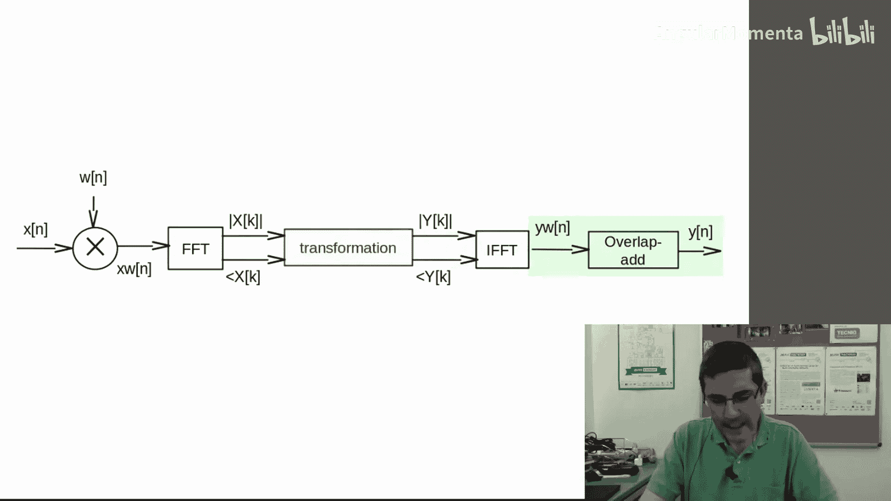
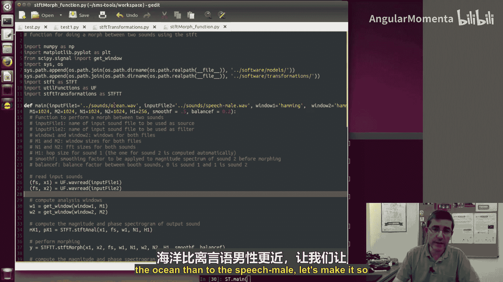
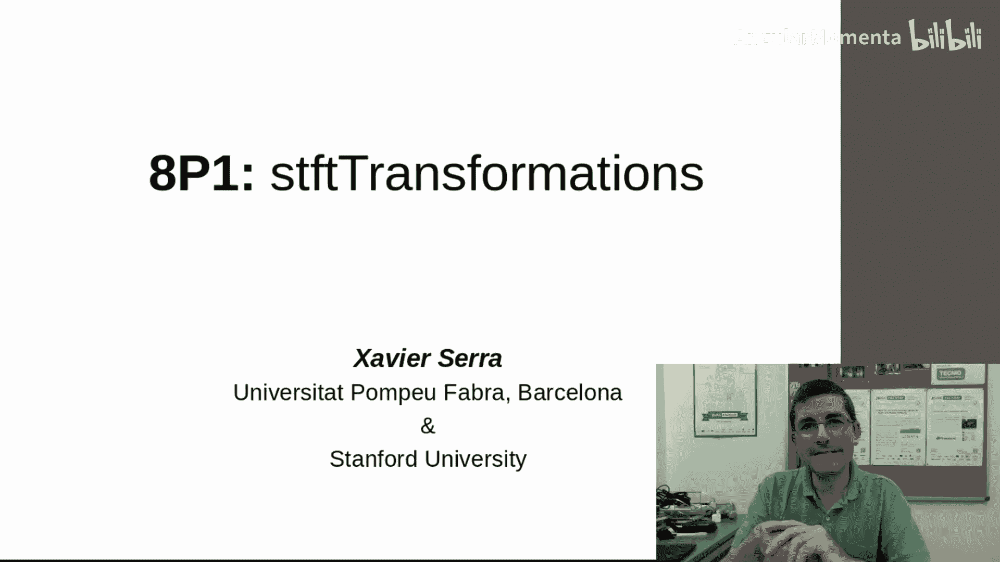

# 【巴塞罗那庞培法布拉大学】音乐应用中的音频信号处理-｜-Audio-Signal-Processing-for-Music-Applications-p60-08_03_01_短时傅里叶变换转换--BV18Xr6BeEX5_p60-

Welcome back to the courseary single processinging for music applications。

This is the transformations week， the week that we talk about the potential of the spectral modeling approaches we have been discussing in the past few weeks for the application of manipulating sounds of transforming different aspects of sounds and in these programming lectures I want to go over some of the code of the SMS tools package that implement these transformations。

 so in this lecture I want to explain the SDFT transformations so the file that implements some very basic transformations using the SDFT。

So we'll be basically implementing this block diagram in which after the analysis of a sound in a particular frame where we have the magnitude and the phase of sound。

 we can apply some transformations to these spectral data。

Before we actually do the imverse Four your transform and resynthesize basically a new sound。

So let's go to a script that I wrote that makes a very simple operation on one single DFT of a sound on one frame。

 so we'll be doing some filtering to one particular frame。Okay。

 so well be using this sound over sound。And so after importing all the models and packages that we need。

 we read the sound file， the O sound file into the array X。

Then we well we get a window hanging window with a given size。

 here we have the same size for the window and the one that well be using for the FFT N。

and then we just take one fragment of the obsound， 512 samples， the size that we have defined。Okay。

 and then we also define a filter and the concept of defining a filter in the frequency domain is basically defining a shape in D scale because we're going to be applying in in the D scale that will be added to the spectrum of the original signal。

 So it has to be a smooth shape we don't want to have very jack strong discontinuities that will create distortion。

 So in fact， what we are defining here is a filter that is in fact the shape of a humming window。

 So we're going to be designing a humming window。As filter in the frequency response。

And in order to apply it in DB we multiplied by60 so that we have a shape， in fact。

 this is an inbit humming window， so this will be used to do basically a band stop filter so we're going to attenuate certain frequencies using this shape。

 we're going to see that by plotting these curves， then we take the magnitude and phase spectrum of the signal that we chose。

And in order to apply the filter， we basically decide where we're going to apply the filter。

 the filter is 30 samples long， so we're going to affect 30 samples of the spectrum and we decide that it's going to be the center is going to be the sample 40。

And then now we copy the input spectrum to this M and we're going to manipulate。

 or we're going to change the 15 samples around this 40th sample。

So the filter will be applied to the 30 samples that are around the this 40th position。

 and then we do the inverse DftT Okay， so let's run this code first。

We are in this directory in the workspace so we can just run test。Okay。

 so we have executed this script now we can keep plotting the different things。

 so we first can plot the waveform that we are going to be computing the DftT off。

 So this is the windowed fragment。We can plot the filter， So we plot。The filter。

This is the shape that we're going to be applying applying， so in fact。

 it already attenuates because it's a humming window so there is a step here。

 so it doesn't start at zero and since we have subtracted 60 to it it goes down to 60 and then goes up again so this is going to be the shape that 30 samples that are going to be applied into a magnet spectrum。

Then the magnitude spectrum that we're going to be using is these。Okay， this is the oval spectrum。Of。

Well， 256 samples， the magnet spectrum deposit positive values。And now the modified version， well。

 let's say maybe we can even plot here on top of these the modified one so we can plot the MY spectrum here。

Okay， so this green spectrum is the modified version in which everything is the same。

 except this middle part。 This is the part where we applied the window and it clearly was affected very little at at the boundaries and very much at the center。

 So we applied a smooth shape and therefore we did a band stock filter。

 We kind of reduced attenuated the frequencies that are around this area。And of course。

 then we obtained at the output sound， which is the y signal。This is the modified input signal。

 So in fact， if we plot on top of this the original signal。Okay。

 the green one is the original signal and of course。

 the blue one has been attenuated and is the shape is quite different because we have attenuated certain frequencies much more than others。

 Okay， so this is a filtering operation that can be easily done。

And then in the SDFT transformations file that within the transformations directory。

 we can find this code， the SDFT filtering as it's implemented to be applied for a whole sound。

 So in fact， it's the same idea。 This is the definition of the function。

In which the input is the input sound， sampling grade， the window of FT size and ho size。

 and then we pass it this filter， which is an array that is going to be applied to the magnet spectrum。

 and then basically the core is this while loop that does exactly what we have been showing for one particular frame。

 it performs the DFT， it applies the filter， and then it applies the inverse DFT。Okay。

 now let's talk about another operation that I believe is's a little more interesting。😊。

Which is the morphing that we talked about。 So in this script， we're going to be morphing two sounds。

The sound of a rain。With the soprano sound， but again， one frame。I order to do this morph thing。

What we're going to do is apply the magnitude spectrum of one into the other or basically interpolating the two magnitude spectra。

How do we do that， Well we do exactly the same things that we did for one single sound。

 define the window， we choose these two fragments， they have to be in this case the same size because we're going to be applying the same operation on both sounds we're going to be interpoolating the two manual spectra so we have to start from the same window size。

 or at least then they have to be of the same size， then we take the two spectra。

 of the two sounds of sum 1 and sum2。And the core part of the morphing is in this next section。

So what we're going to do is have one smooth version of one sound so that we only apply the general shape of one sound into the other。

And so that's going to be the the second sound is going to be the one to be smooth by one given factor。

2。 So we use the reseling， the kind of the down samplingling aspect to obtain a smoother version of the x2 spectrum。

And then we up sample it again with interpolation to get the complete spectrum with a smoother representation。

 Of course， we can just have no smoothing by putting a value of one。

And then we're going to basically combine the two， a linear combination of the two。

 we are in a D scale so we can just add them， otherwise we would multiply them in which there is this balance factor that defines how much of each is in the mix basically。

In this 0。7， it means is 0。7 is applied to the second sound and the rest of 0。

3 is applied to the first sum。And then， of course， we take the inverse DFT from the resulting magnitude spectrum with the phase of the first signal。

 Okay， so the phase will be of the first signal。 and the magnitude spectrum is a combination of the two。

Okay let's run this again， let's run test1。Okay， and now let's keep showing the different sort of variables that we have。

 Let's start with the minus spectrum。 So let's plot the minus spectrum of sound 1 M X 1。Okay。

And we'll had it open， so we have to close it here and let's open it again。Okay。

 so this is the magnet spectrum of the rain sound。 So it's quite noisy。 It's， of course。

 it the case in the high frequencies。 So the low frequencies are stronger。

 but the case as the frequencies go up。 and we can plot on top of that， the second spectrum。

 which is this soprano voice。Which is clearly different。

 Sopranovo has these very clear shapes which relate to the forants。

 We are not so interested in this type of morphing to get a good resolution on the harmonics。

 We are interested in the general shape。Okay， and now we can plot on top of this。

 the smooth version of the second。 So we applied a smooth factor of  point2。

 So M X2 smooth2 is the interpolated。So version of that。 So if we put Mx2 the smooth。呃。2。

That's going to be。The smooth version of this speech of this voice sound。

so now this is the red line is the one that will be interpolated with the blue line。

And now with the balance 0。7， the resulting spectrum is M that also can be plot on top of these。So。

 M。Okay， will be now is this。Blue line。And is clearly an interpolation between the two。

 So since is 0。7 is closer to the red line to than to the blue line。If we had instead of 07， we had。

 let's say，02。O。1。 let's and let's save that。 and let's run。The test1 again。 And now。

 if we plot on the same plot， the M Y。Okay， now is this purple curve。

 and it clearly is much closer to the rain sun because we have specified 0。1。Okay。

 so hopefully that gives you an idea of this idea of interpolating between two magnitude spectrum。

And， of course， then when we plot Y the output， this will be the。Resulting。

Fragment of the sound that captures this interpolation or dysmorphing aspect。

And if we go to the SDFT transformations， and there is another function that performs that for a whole sound。

 the SDFT morph。Okay， so F TST morph。Receives2 sounds， x1 and x2。

And here we have the procedure of controlling windowing differently。

And then there is this smooth and the balance。 and it does exactly what I showed in in the case of two individual frames。

Okay， and now we can show the file that basically is the one that is called from the interface。

 the transformation interface that has one function main。

 and that it receives two sound and plots the spectrum and it plots the resulting morphing。

So it has some default parameters and it does all the things that we have been doing so basically for the whole sound。

 so it reads the sounds， it gets the windows， and then it performs STFT analysis for the whole sound。

 and then it does the morphing。Between the two sounds， in this case。

 the STFT is done so that we can visualize the spectrum of the signal。

and then we use the morphing and we do again the analysis of the output sound so we can visualize the spectrum of the input and the output sound in the plots。

 and then it writes the resulting sound files。Okay， so we can import this。This file。

 So the S T FT morph function。We can import it as a name with for example， S。

And now we can call this main。And of course， we can change the parameters or the default parameters。

Where ocean sound with a speech mail。With this particular windows。 So for example。

 let's change the balance。 So now it was 0。2。 So it was closer to the ocean than to the speech mail。

 Let's make it so that the balance。

Of F is very much close to the speech。It's stupid right。蚊s， oh come on。Balance。Okay， F。And let's put。

 for example， 0。9。Okay， and let's run this。Okay， so now we have the input sound。

The spectrogram of the input sound。And this is the spectrum of the output sum。Okay。

And then the actual output sound。 So clearly here， the output sound has captured quite a bit of the shape of the speech。

 So if we can play， it has save a file into this directory so we can just type play and ocean SF more。

They don't lie at all。 Okay， so clearly has taken the duration of the。

 of the ocean sound because that's the the basic sound from which we are taking the analysis from。

 And then the magnet spectra has been modified by this smooth spectra of the speech male sound。Okay。

 and that's all I wanted to say。So we have seen how within the SMS tools。

 there is all this code for being able to do morphing between two sounds using the short time for a transform。

 and the code is quite simple， In fact is the maybe the simplest type of transformation that we can do with these spectral tools and it can be quite useful and interesting for quite a few types of applications。

So that was all this is the first programming lecture。

 so in the next one we will talk about the sinusotto model。

 how to implement transformations in the sinusotial model using these same SMS tools and the particular code that implements them。

 so I see you next class bye bye。

