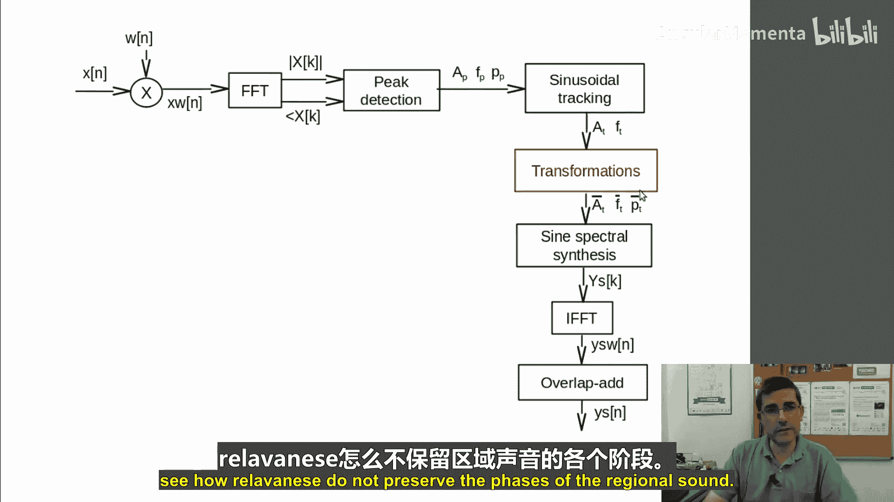
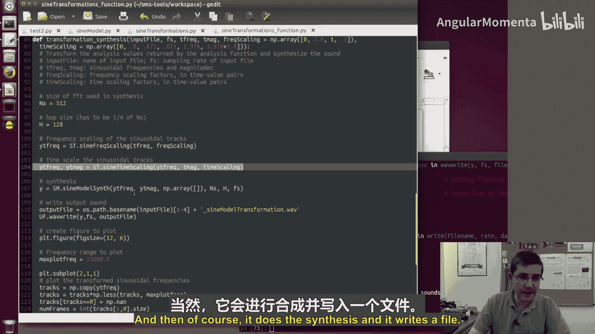
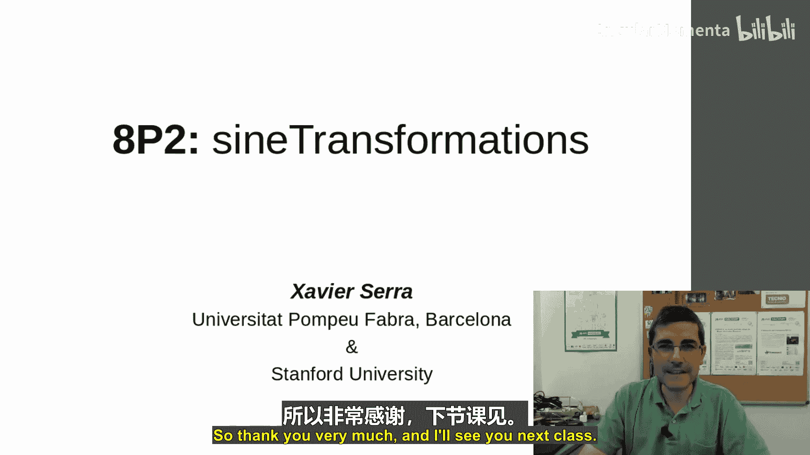

# 【巴塞罗那庞培法布拉大学】音乐应用中的音频信号处理-｜-Audio-Signal-Processing-for-Music-Applications-p61-08_03_02_正弦变换--BV18Xr6BeEX5_p61-

Hello， welcome back to the course on other single processing for music applications。

In these transformations week， we are talking about how the spectral modeling strategies that we have been presenting throughout the course can be used for transforming sounds。

And in these programming lectures， we are actually trying to understand those transformations from a programming perspective by actually looking at the code of the SMS tools and trying to understand and use these transformation possibilities。

So we are actually going through this block diagram。

 this is the block diagram of the analysis synthesis of the sininoceral model。

And what we are doing now is from the output of the sinnooid model by just taking the amplitude and frequencies of the sinusoid。

 we are applying some transformations to them and then resynthesizing the sound。

And if you notice here， the face information of the analysis is not being used。

Most of the transformations require to regenerate the faces because we are changing time or we are changing the frequency and therefore it affects the face。

 so the original faces are not used anymore and we are regenerating the faces and first I want to look at this issue and see how relevant is to not preserve the faces of the original sound。

So I wrote this little script。In which I analyze a sound， a piano sound using the sinus sort model。

And I do analysis and synthesis。So first， I have all the packages that need to be imported。

Then I have all these parameters for the analysis that are needed。The window， window size， FftT size。

 et cetera， et cetera。And then， well， I read the file。

 I get a window that I need a humming window in this case。

 and I call the analysis function of the sinusoidto model file okay。And it returns frequencies。

 magnitudes and phases。Now I want to call the synthesis of that， in fact let's use everything。

 so let's use the frequencies， the magnitudes and the faces of the analysis and let's generate a sound。

 so let's save this and let's run this file。Okay， so now it has executed everything and let's plot first the input sound x。

And we can plot on top of it， the output sound， y。Veryre very close。 And in fact。

 if you listen to them， also， clearly， they should be quite close。 So if we just type。

The input sound from that。Let's move this here from the piano。Okay， and let's listen to that。

🎼And now we can play the reynthesized sound So the test2 do W that I created。 Okay。

 they are quite similar。 The attacks are a little bit not ideal。

 but now let's zoom into one fragment of this。Okay， for example， this region here。

And let's take a tiny version of it， a tiny section， so clearly they are very similar。

 they are not identical， well the blue is original and the green is the synthes size。

 the synthesize has lost some aspect of it， but they look very close。

 they are a little bit different in the high frequencies in the contours。Okay。

 now let's do the synthesis， but instead of using the original phases， let's pass an array。

 an empty array。 and this is the condition that then the synthesis will recreate these phases and we're going to see that next。

 but let's first let's let's just run this。 let's run it again。Okay， let's run this file。

And now we can do the same thing。 We can just first plot the input sound。Then， we can plot。

The output sound。🎼Already we can see that they're different and of course we can play， we can。

 for example， play the the sound that was generated basically looks identical then it sounds identical then the synthesized sound with faces。

 but if we look at the faces， if we look at the shape of the waveform。

 which are going to be the face information。呃。We zoom in into a tiny portion of it。

I maybe leaving more。Clearly， the shapes of the waveforms are very different。

 The input and output shapes are very different。 That means that the phase is quite different。

 They all preserve a phase continuity， but the phase is different。Okay。

 so basically in the synthesize now we have generated the phases， let's go to the sine model file。

In where the synthesisthe is performed， so in the sinusoidal model synthesis here， in this function。

 that where it passes， it accepts the frequency mag basiss and it calls the synthesis。

And then in the main loop， we can see that there is some lines to take care of these phase issues。

Basically， if the input parameter， if the T phase parameter。Exist。

 I means there is a array that is bigger than0， it will use as the synthesis phase this phase。

 Otherwise it generates the phase using this line what does this does starts from an initialized phase that is initialize before here it's initialized as random phases the first time through and every time after that。

 it increments the previous phase by， let's say the frequency， the new frequency。

So it takes the frequency that has to be synthesized and using the ho size。

 it computes basically the phase that the new frame should have， so it does face continuity。

 but without measuring or using the analysis phases and this is what results into this shade that we saw here。

Okay， now out of these the sinusoidal transformation。

 so this is the vi what implements the different transformations on the sinusoidal representation and basically there are two types。

 the time is scaling ones and the frequency scaling ones。The time is scaling， it's very simple。

 it accepts frequencies and magnitude。 so again， no phase is here。

And what it does is basically it creates frames in between。 So the core part of this function。

 which is this it basically it keeps creating a new matrix a new array of frequencies and magnitudes and it adds interpolated frames in between。

 It actually does not interpolates， it just simply repeats or jumps actual frames so that's the way that we can create a much longer set of frames。

 So the frame rate is calculate the same and it keeps adding order leading frames in order to make it longer or shorter the sound。

 and for the frequency scaling， it's simpler。 It basically just takes the frequencies。Okay。

 they are every at every frame。And the frequency scaling can vary in time。

 the same thing that the time is scaling was varying in time。

 and now it will multiply every single frequency value of all the sinus such of a particular frame by this scaling factor at that particular frame。

That's basically all it does。Then we have a design transformations function that actually calls the analysis and transformation and synthesis and displays the results。

 and this is the file that is used from the graphical interface。

 So in here we have a function that performs the analysis and has some default parameters and it does just the standard analysis that we have seen。

 but it plots intermediate data， and then there is this file transformation and synthesis that accepts the analysis parameters that we have obtained without the faces。

 and then it performs these transformations that we just mentioned the frequency scaling from a given array of scaling factors。

 and then it has the time scaling that performs the time scaling operations。

 and then of course it does the synthesis and it writes the file。 So let's call this。

Okay you say plots。To a。Figures， it plots the figure of the analysis in which we see the intermediate data。

And the reynthesized。 and it plots the modified version in which the sinusoids have been scale。

Both in frequency。 So we see here some clear transformations。

And in time in which the duration has changed。And that that's all。

 So basically this was an explanation of the code of the within SS tools that performs sinusoidal transformations。

These sinusoidal transformations can be quite powerful because we have quite a bit of flexibility and we can do some interesting tinyness stretching and frequency shifting or transposition operations that sound very nice。

So next lecture we will continue in presenting the facilities of another transformation and another model in this case is going to be the harmonic plus stochastic model and we'll be talking about the morphing that we already have seen in the demonstrations that we actually going to try to understand the code of it。

 so thank you very much and I see you next class。

